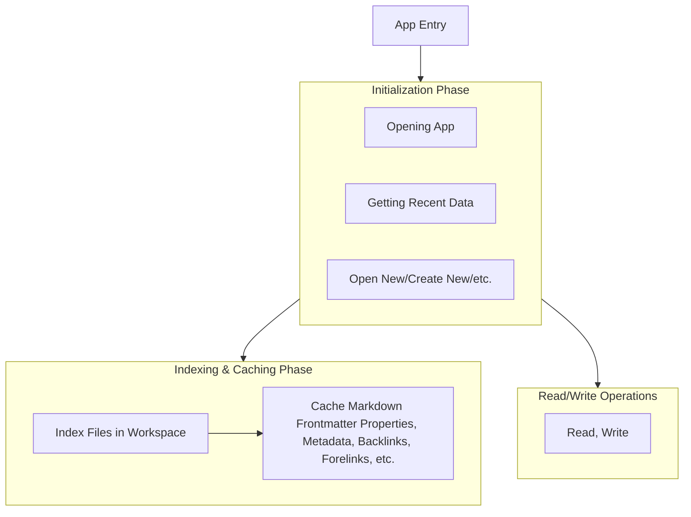
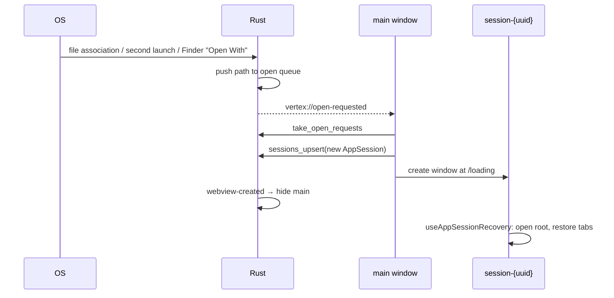
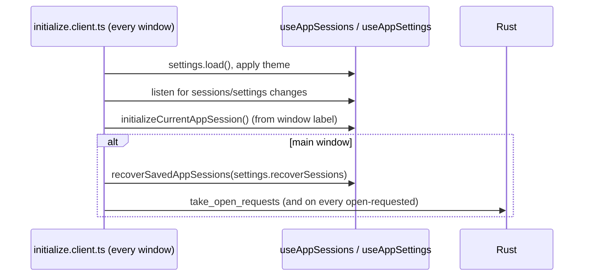

# Concepts and Structures

## Two Modes, One App

The Editor has two main modes: Workspace Mode, and Singlespace Mode.

A Workspace is a folder that contains groups of markdown files and other types of files, which the editor will index everything in the folder and use that indexed information to enhance markdown editing features, i.e. internal links, embeds and etc.
Singlespace is when the Vertex editor is editing a single file without the context of all the files in a folder. Like Notepad, but Rich text editing with Markdown.

When the user opens a folder using Vertex, it automatically opens that folder in Workspace Mode.
When the user opens a file using Vertex, it automatically opens that folder in the Singlespace Mode.

Context is the core difference between a Workspace and a Singlespace/Single-File.

## Operating Flow

---

## Sessions: Two Layers, Two Concepts

Vertex has **two distinct types of sessions** that work together to provide seamless multi-window functionality with persistent state across app restarts.

### ActiveSession (Runtime Layer)

**Purpose**: Represents a workspace or singlespace that's currently active during runtime.

**Characteristics**:
- Lives only in memory (not persisted to disk)
- Created when a user opens a folder (workspace) or file (singlespace)
- Managed by `useActiveSessions()` composable
- Used for current editing context and file indexing

**Structure**:
[Type definition file](shared/types/active/sessions.d.ts)

**Lifecycle**: Created → Used during editing → Destroyed when window closes

### AppSession (Persistence Layer)

**Purpose**: Represents a window's state for recovery across app restarts.

**Characteristics**:
- Persisted to disk (`sessions.json`) by Rust; webviews never write the file
- Contains recovery information (opened tabs, focused tab, expanded folders)
- Mirrored per window by `useAppSessions()`, kept fresh by the `vertex://sessions-changed` event
- Updated continuously by `useAppSessionPersistence()` while the window is open

**Structure**:
[Type definition file](shared/types/app/sessions.d.ts)

**Lifecycle**: Created → Updated on every tab/folder change → Loaded on restart → Recovered (per the *Reopen windows on launch* setting)

### Why Two Session Types?

This separation follows the **Single Responsibility Principle**:

- **ActiveSession** handles runtime editing context
- **AppSession** handles persistence and recovery

This design prevents confusion between "what's currently happening" (ActiveSession) and "what needs to be saved/recovered" (AppSession).

---

## State Ownership

Anything shared between windows lives in Rust (`src-tauri/src/state.rs`), which is the **only writer** of
`sessions.json` and `settings.json`. Windows call commands and listen for change events; they never read or
write those files themselves. This removes the cross-window lost-update races the old design had.

| Rust command | Purpose |
|---|---|
| `sessions_list` / `sessions_upsert` / `sessions_remove` | AppSession CRUD; every write is persisted (atomic temp-file + rename) and broadcast as `vertex://sessions-changed` |
| `settings_get` / `settings_set` | App settings; every write is broadcast as `vertex://settings-changed` |
| `take_open_requests` | Drains the queue of paths the OS asked us to open |
| `quit_app` | Asks every session window to flush (`vertex://flush-requested` → `vertex://flush-done`), then exits |

The frontend wrapper is `app/utils/stateClient.ts`. It has no Vue lifecycle, so it is safe from plugins and callbacks.

---

## Window Model

| Window | Label | Notes |
|---|---|---|
| Main | `main` | Anchor. Never destroyed at runtime. Hidden while any session window exists, shown when the last one closes — enforced by Rust (`sync_main_visibility`) on real window create/destroy events. Recovers saved sessions and serves the OS open queue. |
| Session | `session-{uuid}` | One per workspace/singlespace. `uuid` is the AppSession uuid. Starts at `/loading` and initializes itself. |
| Settings | `settings` | Singleton utility window. Not persisted. |

Labels, routes and `useState` keys come from `shared/constants/app.ts`; never hand-build them.

### Opening something

Menu/button opens (`useAppSessionActions`) skip the queue and start at `sessions_upsert`. Opening a path that
already has a window focuses that window instead.

### Closing and quitting

- **Close window**: a single `onCloseRequested` handler (`useAppSessionPersistence.registerCloseHandlers`) awaits the
  last pending session write, then lets Tauri destroy the window. Because state was persisted continuously,
  teardown (`clearTabs`, `clearIndex`) can never overwrite it. Rust shows `main` if this was the last session window.
- **Quit (Cmd+Q)**: `quit_app` sends `flush-requested`, waits for every session window's `flush-done`
  (3 s guard against a hung webview), then exits. No fixed sleeps.

### Startup recovery

The main window reopens saved sessions according to **Settings → General → Reopen windows on launch**:
`none`, `workspaces`, `singlespaces` or `both`. Older settings files with `openLastOpenedWindows: true` migrate to
`workspaces`, which was the previous behaviour.

---

## Composables

| Composable | Responsibility |
|---|---|
| `useAppSessions` | Per-window mirror of AppSessions; CRUD via `stateClient`; current window's session; startup recovery |
| `useAppSettings` | Per-window mirror of settings; `set` (memory) / `save` (persist + broadcast) |
| `useAppSessionActions` | User-facing "open folder/file" actions; one AppSession + window per path |
| `useAppSessionNavigator` | Turns a path into an ActiveSession in the current window and routes to it |
| `useAppSessionRecovery` | Restores a session window's tabs/folders from its AppSession |
| `useAppSessionPersistence` | Writes the window's tabs/focus/folders back to its AppSession on change; owns the close path |
| `useAppFileStartHandler` | Main window: drains the OS open queue |
| `useAppWebviewWindows` | Find/create webview windows; no session logic |

Dependency direction is one-way: actions → navigator/sessions; recovery → navigator; persistence → sessions.
Nothing in `app/composables/app` is imported by `shared/`.

### Initialization

`app.vue` builds the native menu on mount, on focus and on route change. Session windows continue in `/loading`
→ `useAppSessionRecovery` → the workspace/singlespace layout, which builds the index, restores tabs and then starts
`useAppSessionPersistence`.
