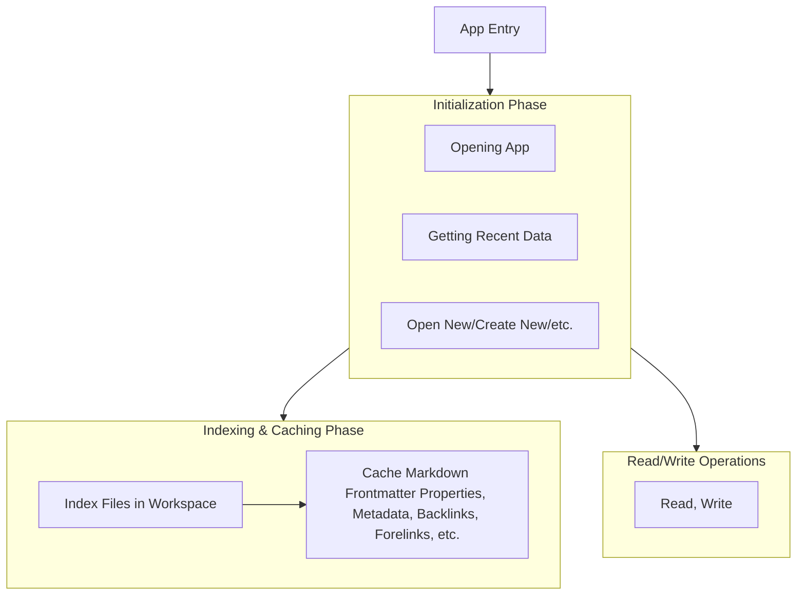
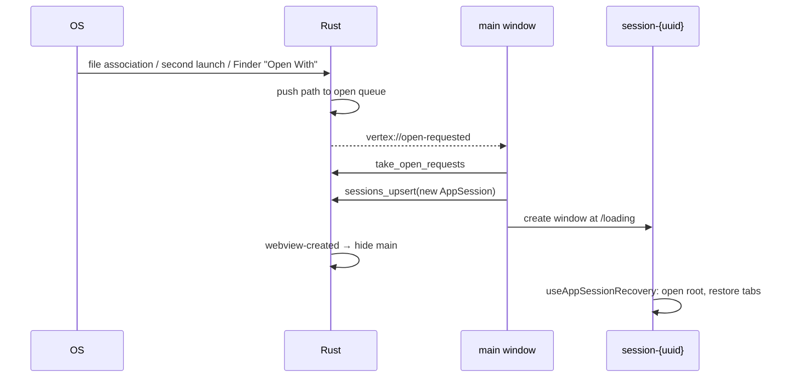
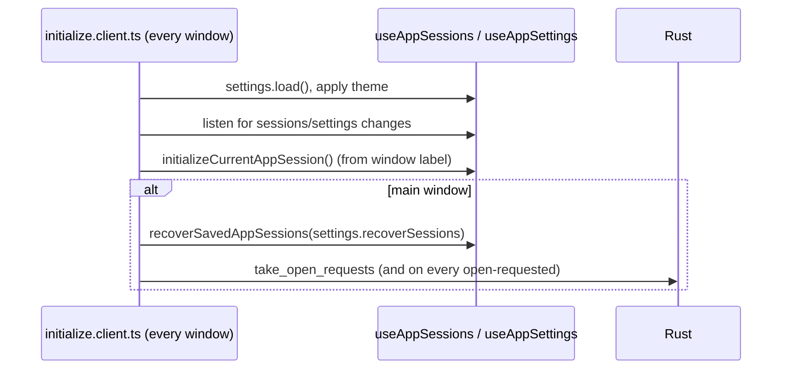

# Concepts and Structures

## Two Modes, One App

The Editor has two main modes: Workspace Mode, and Singlespace Mode.

A Workspace is a folder that contains groups of markdown files and other types of files, which the editor will index everything in the folder and use that indexed information to enhance markdown editing features, i.e. internal links, embeds and etc.
Singlespace is when the Vertex editor is editing a single file without the context of all the files in a folder. Like Notepad, but Rich text editing with Markdown.

When the user opens a folder using Vertex, it automatically opens that folder in Workspace Mode.
When the user opens a file using Vertex, it automatically opens that folder in the Singlespace Mode.

Context is the core difference between a Workspace and a Singlespace/Single-File.

## Operating Flow



---

## Sessions: Two Layers, Two Concepts

Vertex has **two distinct types of sessions** that work together to provide seamless multi-window functionality with persistent state across app restarts.

### ActiveSession (Runtime Layer)

**Purpose**: Represents a workspace or singlespace that's currently active during runtime.

**Characteristics**:
- Lives only in memory (not persisted to disk)
- Created when a user opens a folder (workspace) or file (singlespace)
- Managed by `useActiveSessions()` composable
- Used for current editing context and file indexing

**Structure**:
[Type definition file](shared/types/active/sessions.d.ts)

**Lifecycle**: Created → Used during editing → Destroyed when window closes

### AppSession (Persistence Layer)

**Purpose**: A workspace or single file Vertex has opened: the recents list, and what its window restores.

**Characteristics**:
- Persisted to disk (`sessions.json`) by Rust; webviews never write the file
- Contains recovery information (opened tabs, focused tab, expanded folders), as paths relative to the root (the index's `relativePath`), so a moved folder keeps its tabs; old absolute paths are read too (`defaultAppSessionContext`)
- `open` (its window is open now) and `lastOpened` (when its window last opened or closed; recents are newest first) are Rust's, from window events; a webview's copy is ignored on upsert. `pinned` keeps it first and past the cap
- Mirrored per window by `useAppSessions()` (normalized by `defaultAppSession`), kept fresh by the `vertex://sessions-changed` event
- Updated continuously by `useAppSessionPersistence()` while the window is open

**Structure**:
[Type definition file](shared/types/app/sessions.d.ts)

**Lifecycle**: Created on first open → Updated on every tab/folder change → `open` cleared when you close its window, left set when Vertex quits → at the next launch Rust turns `open` into `reopen` → Recovered (per the *Reopen windows on launch* setting) → dropped when you remove it, or past the cap (50 workspaces, 20 files, unpinned, oldest first)

**Recents** (`useRecents`, shared by the start page and the workspace switcher): workspaces and files, pinned first; a gone folder or file is checked whenever the list changes and shown dimmed ("Not found"). Opening one whose path is gone says so with Remove from recents (`useAppSessionActions.openFromPath`). The start page lists both with pin and remove on hover; the switcher (`WorkspaceSwitcher.vue`, title bar: the left sidebar's header, or the tabs header when it's collapsed or in a singlespace window, where it's an icon) has New Workspace…, Open…, the open workspaces (this one ticked) and the recent ones (remove on hover). Badges are the first letters of the folder name's first and last words on a colour hashed from the path (`workspaceBadge`). New Workspace… (start page, switcher, File menu) asks where and what to name the folder, creates it and opens it.

### Why Two Session Types?

This separation follows the **Single Responsibility Principle**:

- **ActiveSession** handles runtime editing context
- **AppSession** handles persistence and recovery

This design prevents confusion between "what's currently happening" (ActiveSession) and "what needs to be saved/recovered" (AppSession).

---

## State Ownership

Anything shared between windows lives in Rust (`src-tauri/src/state.rs`), which is the **only writer** of
`sessions.json` and `settings.json`. Windows call commands and listen for change events; they never read or
write those files themselves. This removes the cross-window lost-update races the old design had.

| Rust command | Purpose |
|---|---|
| `sessions_list` / `sessions_upsert` / `sessions_remove` | AppSession CRUD; every write is persisted (atomic temp-file + rename) and broadcast as `vertex://sessions-changed`. On first read, `sanitize_sessions` drops invalid and duplicate entries, migrates old ones (`lastUpdated` → `lastOpened`, `trustedDeviceIds` dropped; no `open` means closed), turns `open` into `reopen` and caps the list |
| `settings_get` / `settings_set` | App settings; every write is broadcast as `vertex://settings-changed` |
| `take_open_requests` | Drains the queue of paths the OS asked us to open |
| `quit_app` | Marks the app quitting (windows destroyed from then on keep their session `open`), asks every session window to flush (`vertex://flush-requested` → `vertex://flush-done`), then exits |

The frontend wrapper is `app/utils/stateClient.ts`. It has no Vue lifecycle, so it is safe from plugins and callbacks.

### Workspace index

`useActiveWorkspaceIndex` keeps one reactive entry per file (`fileIndex`, by path) and a non-reactive `LinkGraph`. What reads the index re-renders whenever what it read changes, and an autosave runs `updateIndex` about once a second while typing. So writes that change nothing are skipped: `applyProperties` and `syncLinks` compare first. `fileTree` copies only what the tree shows (`UITreeNode`: uuid, name, relative path, folder, `icon`). A note's save then re-renders neither the Files tree nor the backlink lists. Link targets resolve through the graph (`resolveLink`, used by chat links), not by scanning every file.

The Files view (`FileTreeComponent`) is a virtual `UTree`: only the rows on screen exist, so a folder of thousands of notes opens and scrolls like a small one. Its rows are flat. Each file row's indent and the dotted nesting guides come from the row's level. There is one right-click menu for the whole tree: the clicked row's `data-id` picks its items, and outside any row it shows the panel's New items.

Names don't truncate. Rows wider than the panel scroll sideways, with a thin horizontal scrollbar only (`scrollbar-x`). The virtual list positions rows absolutely, so `fitRows` measures the rows on screen and sets `--row-w` on the tree's DOM; every row is that wide, so highlights span the scroll width. The extension tag or fold arrow is sticky at the panel's right edge. A row whose name runs under it gets `data-clip` and `--clip`, which mask the name so it fades out before the tag; the row's highlight stays whole. Only a row's icon and name (`data-grab`) start a drag; the rest of the row doesn't.

Rows select like a file manager's. The selection is the tree's own (uuids plus an anchor). Reka's tree only receives it to mark rows (`data-selected`, styled `bg-elevated`); its own select is prevented.
- A plain click selects one row and opens a file or toggles a folder. Cmd (macOS) or Ctrl toggles a row; Shift selects the range from the anchor over the rows as shown; Cmd/Ctrl+Shift adds the range. A click with a modifier never opens or toggles.
- Collapsing a folder deselects what's inside it, and removed files drop out, so actions never reach rows you can't see. A click below the rows clears the selection.
- Drag select: pressing on a row's blank part (not its icon and name) or below the rows and dragging draws a box. The rows it touches are selected, or added with Cmd/Ctrl; near the top or bottom edge the tree scrolls. Rows are found by index × row height over the rows as shown, so rows scrolled out of the virtual list count too. The box is drawn on the DOM (teleported to `body`), and the click that ends it is swallowed. For this the tree has no `data-tauri-drag-region`.
- Right-click outside the selection selects that row. Inside a selection of several, the menu acts on all of them: Open in New Tabs, Copy full or relative paths, Reveal in File Explorer, and Delete.
- Keys, with the tree focused: Esc clears the selection; Cmd/Ctrl+A selects every shown row; Delete (or Cmd+Backspace on macOS) deletes the selection, as `fileConfig.deletedFiles` says (below); Cmd/Ctrl+Z and Cmd/Ctrl+Shift+Z (Ctrl+Y on Windows too) undo and redo Files' operations.

Deleting (`deleteFiles`, `useActiveWorkspaceTools`) follows `fileConfig.deletedFiles`, workspace-overridable (Settings → View → Files):
- **`'trash'`** (the default): the system Trash or Recycle Bin, through Rust `trash_item` (`src-tauri/src/trash.rs`). On macOS it uses `NSFileManager trashItemAtURL:resultingItemURL:` (`objc2-foundation`), which says where the item went; elsewhere it uses the `trash` crate. `trash_restore` puts an item back: on macOS by moving it from where it went, elsewhere by finding it in the Trash's listing by original path and deletion time. It fails with `taken` or `missing`.
- **`'workspaceTrash'`:** a move into `<root>/.trash/`, under a free name (`freeName`). Like every dot-folder, it's hidden from Files and the index.
- **`'permanent'`:** `DeleteFilesModal` asks first, then the items are removed for good, with no undo.
- Either trash asks nothing, and the toast ("Moved N item(s) to the Trash.") has an **Undo** button. An item a clash's Replace displaces goes the same way.

Files' history (`useFilesHistory`, per session, in memory, 50 steps; a new step clears the redo side):
- **What records a step:** `moveFiles`, `renameFile`, `deleteFiles` and `importItems`, so drops, pastes, Duplicate and the chat's and editor's imports too. Each records a `Change`:
  - the items moved (uuid, from, to);
  - the notes whose links were rewritten, with their text before and after;
  - the folders a merge emptied and removed;
  - what it trashed, with what restoring needs, including every indexed item it took along, so a restore indexes them again under their old uuids (`addFileToIndex(path, root, uuid)`);
  - what it created, with its size and modified time once written.
- **Undo** reverses the change, last part first. Created items go to a trash (never deleted for good), the notes get their old text, the merged folders come back, the items move back, and trashed items are restored. Each part acts only where things are as the change left them: an item still at its new path, a note still reading the rewritten text, a created item unchanged. **Redo** does it again with the same care. Whatever is skipped is named in one toast.
- **Where to undo:** the keys above, the toast's Undo (that step, only while it's the latest), and Undo/Redo items naming the step in the tree's empty-space menu. A move now also has a toast: "Moved N item(s)."
- **The editor is unaffected:** its Cmd/Ctrl+Z is its own, since the tree only sees keys while it has focus.

Rows drag like a file manager's:
- What moves: dragging a selected row moves the selection (what's inside a selected folder goes with it); an unselected row is selected alone first. The drag image is a card with the row's icon and name, with two stacked cards and an "N item(s)" badge for more than one.
- Where a drop lands: onto a folder, into it; onto a file, into its folder; onto empty space, the top level. Items already there stay; a folder never goes into itself or its subfolders. The target folder and its shown rows get one `border-primary` outline (the top level, a ring around the tree), and the target opens before the move so the moved rows stay selected.
- While dragging: a closed folder held for 600 ms opens, and the edges scroll.
- Moves go through `moveFiles` (`useActiveWorkspaceTools`). It plans first (`planInto`, which imports share), then asks, then moves:
  - **Plan:** a folder onto a same-named folder merges, so its contents move in and the emptied folder is removed.
  - **Ask:** every other name clash, ignoring case, goes through `FileConflictModal`: Replace, Keep both ("Note 2.md", `freeName`) or Skip, optionally for the remaining clashes. Cancel moves nothing.
  - **Move:** then `relocateFiles`, which renaming uses too, moves each item on disk and in the index (uuids stay, so tabs and open folders follow). It then updates the links whose text changes, to the items or to any note inside a moved folder, with one dialog for the whole move.
- Whether links are updated comes from `fileConfig.updateLinks`, overridable per workspace (Settings → View → Files): ask (the default), update, or keep. The dialog's "Remember my decision for this workspace" writes it.
- **In Vertex, the drag is native** (`tauri-plugin-drag`, `dragOut` in `outsideItems.ts`), so Finder or Explorer copy the rows as files. `dragstart` is cancelled and the plugin starts the OS drag. Its image is the same card, drawn onto a canvas from the laid-out ghost (`ghostPng`), since the plugin takes a PNG rather than an element.
  - **Back over Vertex,** the drag arrives as plain OS files. The rows it started stay known (`draggedRows`) until the plugin reports the end, plus half a second, since the page may see the drop after that report. The tree moves them, the chat attaches them and a note links them, as with the HTML5 drag.
  - **Copy only:** the drag offers only a copy, so the outside never moves files out of the workspace. Inside the tree, the move therefore shows the copy cursor; asking for a move would get the drop refused.
  - **In a browser** (no Tauri), the tree keeps the HTML5 drag with `FILES_DRAG`.
  - The plugin's command is allowed in every window by `capabilities/drag.json`.

Files from the OS (Finder or Explorer) drop onto the tree like rows, with the same targets and outline. `dragDropEnabled` stays false, so they arrive as HTML5 `Files`. `outsideItems` (`app/utils/outsideItems.ts`) reads them while the event lasts: folders whole, skipping `.DS_Store`/`Thumbs.db`/`desktop.ini`. `importItems` then decides what each one is:
- **Already the workspace's:** an item with the same path when the webview gives one, or else the only one with the same name, size and modified time, moves instead (as on the same disk). Option/Alt copies it anyway.
- **Everything else** is copied in through the same planner and clash dialog, written with plugin-fs and indexed parent-first. What arrives is selected, with one "Added N item(s)." toast.

An OS file dropped anywhere else is refused by a window guard in `app.vue`; before, the webview could navigate to the file. Files dropped or pasted into a note go through `useEditorFileDrops` (below), so CodeMirror never puts a file's bytes in as text.

Files into a note (`useEditorFileDrops`, in `useActiveEditorExtensions`): rows dragged from Files become links at the drop point (with a drop cursor). Files dropped from Finder or Explorer, or pasted, are copied into `fileConfig.attachmentsFolder` without asking and then linked; ones the workspace already has are linked as they are. A paste takes the system clipboard's files first, else image data, saved as `Pasted image YYYYMMDDHHmmss.png`. Several go in one per line. A note is linked by its name without `.md` when that finds it, else by its path. Anything else is linked by its path with the extension (`![[…]]` for an image), because the editor finds embeds by full path or by a name without extension. `linkKeys` also indexes a name with its extension (`cat.png`), so Obsidian's `![[cat.png]]` counts as a link and is renamed with the file.

Copy and paste in Files go through the system clipboard's file list (Rust `clipboard_files_get`/`clipboard_files_set`, `arboard`), so there's one clipboard shared with Finder and Explorer:
- **Copy** (Cmd/Ctrl+C, or the menu) puts the selected rows there as files.
- **Paste** (Cmd/Ctrl+V, or the menu) copies whatever files it holds into the selected folder, a selected file's folder, or the top level. It uses `outsideItemsAt(paths)` and `importItems` with `copy`/`inPlace`: by path with `copyFile`, never through the webview.
- **Naming:** in the items' own folder the copies are named like Keep both without asking ("Note 2.md"), as Duplicate does; elsewhere clashes ask.
- **Keys:** the tree takes Cmd/Ctrl+C/V as a keydown or as the `copy`/`paste` event the macOS Edit menu may send, whichever comes first.

### AI requests

Every AI call goes through Rust (`src-tauri/src/ai.rs`) so provider API keys never reach the webview:

| Rust command | Purpose |
|---|---|
| `ai_key_set` / `ai_key_has` | Provider API keys in the OS keychain (`ai-provider:<id>`). There is no getter. No keychain → error, never a plaintext fallback |
| `ai_request` / `ai_request_cancel` | One HTTP request for a provider: the URL must share the provider's `baseURL` origin, Rust adds `Authorization`, and the body streams back over a `Channel` |
| `ai_model_catalog` | The models.dev catalog, cached for a day, for model badges |

- `app/utils/aiFetch.ts` wraps `ai_request` as a `fetch`, which ai-sdk (`@ai-sdk/openai-compatible`) and the editor's `aiAssistant({ endpoint: { fetch } })` use unchanged.
- Model parameters: `AiModelProfile.params` (`AiModelParams`: temperature, top P/K, min P, frequency/presence/repetition penalties, max output tokens, seed, stop, `extra`; ranges in `AI_NUMBER_PARAMS`, `shared/utils/aiParams.ts`; `sanitizeModelParams` clamps and drops). `createAiFetch(providerId, params)` adds them as snake_case fields (then `extra` as it is) to POST `…/chat/completions` bodies, only where the request doesn't set the field itself (`withModelParams`; Test's `max_tokens: 5` wins). Chat replies (`ChatSendSetup.params`, the replying profile's), the editor assistant (its profile's; part of `useAiEditorExtension`'s key) and the profile's Test send them; chat titles don't. Edited in the profile's Parameters (`SettingsAiModelParams`): a switch per parameter (off = not sent), a slider saved when let go plus a number input, stop sequences as tags, the extra fields as JSON (saved on blur when it's an object).
- Changing a provider's `baseURL` or removing it deletes its key in `settings_set`, so a saved key can't be pointed at another host.
- `settings.aiConfig`: provider profiles → model profiles (provider + model + system prompt) → features (`shared/constants/ai.ts`), each falling back to the default model profile. Workspace-overridable: `aiConfig.enabled` and `aiConfig.features` (trusted folders only: a shared vault can pick among your own profiles or turn a feature off, never add a provider, model or prompt, nor turn AI back on), `aiConfig.chatStorage`, `aiConfig.chatMode`, `aiConfig.chatTitles`, `aiConfig.editorAssistant` and `aiConfig.commitMessages` (any folder).
- Switches (Settings → Assistive AI → Features): `enabled` turns off every feature; each feature has a switch beside its profile select (off stores `''`; on again removes the entry, or in a workspace whose global choice is off, overrides it with the default profile). `aiFeatureOn` (`useAiConfig.ts`) is the switch state, `resolveAiFeature` adds the model and returns `null` when off. `editorAssistant = {toolbar, slash, shortcut}` goes to `aiAssistant()` (`useAiEditorExtension`; shortcut off passes `shortcut: false`); `chatTitles` gates `autoTitle`. With Chat off (or AI off), the Chats and Chat views are unavailable (`CHAT_VIEWS` in `usePanels`), Ask in chat leaves the editor menu and File → New Chat is disabled; chats stay on disk and open chat tabs stay. The Providers and Model profiles pages show a banner while AI is off (`SettingsAiOffBanner`).
- Settings pages (`pages/settings/ai/`): Providers and Model profiles are searchable lists (`SettingsAiList`: a search field, checkboxes with "select all shown", Remove selected after a confirmation; `selectable` keeps the default profile out) whose rows open a page per item (`providers/[id].vue`, `models/[id].vue`). The search is the list's `?q=`, which a page's Back link returns with. A profile's page has General (name, provider, model), Behaviour (tools, system prompt) and Parameters, with Test, Set as default and Remove in its header; a provider's has its connection (name, base URL, key) and its enabled models (the same list, to search and remove several). Profile rows show provider · model and badges (default, tools off, custom parameters), the default first; Duplicate copies a profile. `useAiConfig` removes several at once (`removeProviders`, `removeModelProfiles`; the default profile never). Profile pickers (Features, the chat prompt) search names, providers and model ids; Features and the chat's context window link to a profile's page (`createOrFocusSettingsWindow(scope, path)`: an open Settings window gets `vertex://settings-route` and navigates). The nav keeps Providers or Model profiles highlighted on their items' pages.

### Chats

Chats belong to a workspace (singlespace has none) and are stored by Rust (`src-tauri/src/chats.rs`); the webview only
calls `app/utils/chatClient.ts`.

| `aiConfig.chatStorage` | Where | Format |
|---|---|---|
| `app` (default) | `<app_data>/chats/<workspaceId>/` | Plain JSON; never in the workspace, never synced |
| `workspace` | `<root>/.vertex/chats/` | age-encrypted; needs the workspace's chat password |

- The workspace id is in `<root>/.vertex/workspace.json` (`{"id": …}`, other keys kept), so app-data chats follow the folder through moves and renames. A *copy* of the folder keeps the id, so both copies share their app-data chats.
- Encryption: `key.age` is a per-workspace X25519 identity encrypted with the password (age scrypt, about 1 s per unlock); each `<id>.chat` and `folders.chat` is encrypted to it. The unlocked identity stays in Rust memory; "Remember on this device" also puts it in the keychain (`chat-key:<workspaceId>`). There's no password recovery. Change password (`chat_vault_change`, Chats view's empty-space menu while unlocked) re-encrypts only `key.age`: the identity, the chats and a remembered key stay as they are.
- Folders are virtual: each chat stores its `folder` inside its (encrypted) content and `folders.chat` keeps empty ones, so folder names never show on disk. Files are flat `<id>.chat`; the index skips the dot-folder.
- Changes from elsewhere (sync from another device): the workspace watcher turns any event under `.vertex/chats/` into a `chats` index event; the left sidebar batches them (500 ms) into `useChats.syncExternal`, which re-reads the list and reloads each loaded chat whose file is newer than its own copy (its own saves come back with the same `updated`), unless it's replying. App-data chats only change through Vertex, so they aren't watched.
- Switching `chatStorage` leaves existing chats where they are; each location lists its own.
- The chat file is `{version, id, title, folder, created, updated, profileId?, messages, forks?, mode?, scope?}`; Rust reads only the summary fields and the messages' text parts (search), and keeps every other field as it is (`ChatFile.rest`).
- Mode and scope (the prompt's toolbar; icons only in the side panel): a chat is in Read (changes nothing), Suggest (proposals decided in the editor) or Write (staged changes reviewed after the reply). A stored `ask` (Read's old name) loads as Read (`toChatMode` in `shared/utils/defaults/apps.ts`, for the setting and a chat's `mode`). New chats take `aiConfig.chatMode` (default Suggest; Settings → Assistive AI → Features → Chat mode); a chat without one follows it. In Suggest and Write, the scope says which notes may change: Named notes (default: the open note, every note and folder attached in the conversation, and the notes the chat created), a folder (at any depth), or the whole workspace (`inScope`, `scopeText` in `chatTools.ts`). It limits changes only: the model reads any note. The system prompt (`toolsPrompt`, with or without tools) names the current mode and says what all three allow, and words the scope; a change outside it fails with that wording, so the model can ask to widen it.
- Mode switches: a user message records the mode it was sent in (`metadata.mode`), and the model's copy of the first one after a switch starts "(The user switched this chat to … mode.)" (`markModeSwitches`, applied by the transport), as a history of one mode's tool calls otherwise outweighs the system prompt.
- Write mode: `createNote`, `writeNote` and `editNote` (with `execute`) stage instead of writing (`useChats.stage`, into `LiveChat.staging` while the reply runs; `readNote` sees staged text). A new note's path is checked by `newNotePath` (`app/utils/chatChanges.ts`: workspace-relative, no dot folders, `.md` added); outside a folder scope, new notes are allowed anywhere and count as named. When the reply ends (stopped or failed too), its changes go on it as `metadata.changes` (`ChatChange`: path, `before` (`null` = new), `after`, state), one per note, and `ChatChanges.vue` shows them under the reply: per note +/− lines (`lineDiff` counts, as the diff tab's), and Apply/Discard for the ticked pending ones.
  - A note's path opens its change in a diff tab (`useChats.openChange`): `kind: 'diff'` with its own id (`chatChangeTabId` / `chatChangeOf`: base64url JSON of chat id, message id, path, prefixed `chat-change-`, which `diffSpecOf` doesn't read), shown by `ChatChangeView` through `TextDiff`, with the chat beside it (`showBeside`, shared with `editorFor`: a chat in a tab moves to the side panel). The versions are the change's own `before`/`after`, never git: it works with or without a repository. The view reads the change from the live chat (loading it), so its state badge, the conflict notice and Apply/Discard follow it; a chat that can't load (a locked vault) or no longer has the change (deleted, rewound) says so. Like git's diff tabs, it isn't restored after a relaunch.
  - Apply (`applyChanges`): only while the note still reads as `before` (else `conflict`, left alone). A note with a mounted editor gets the change dispatched into it (`textChange`: one span, `input.ai`), so ⌘Z undoes it and autosave writes it; otherwise, and for new notes and their missing folders, through `useWorkspaceVault` (the workflows' Vault: self-write marks, index, tab reload).
  - Each send's system prompt says what became of earlier staged changes (`changesSummary`: latest per note).
  - Rewind to a reply undoes the changes applied from the replies it drops, newest first, each only while the note still reads as `after` (a new note moves to `.vertex/trash/chat-<id>/<time>/`); the confirm lists them and a toast says what was undone or left alone. Notes don't follow branch switches.
- Message actions (`ChatView`'s `actions` slot, none while replying): Copy on both sides; Edit on the user's (inline; Enter sends, Esc cancels); Retry on replies, its chevron retrying once with another model profile (`LiveChat.retryProfileId`), and Rewind to here (not on the last reply; native confirm), which drops everything after it; Info on both, opening the context view at that message. Edit, Retry, Rewind and branch switches first withdraw the chat suggestions still waiting in the session's editors (`withdrawSuggestions`).
- Context view (`ChatContextModal.vue`; a chat's ⋯ menu → Context…, or a message's Info): the messages as of opening, with totals (messages, model calls, tokens, time) and per message its parts and raw JSON; a reply's model calls each show the model and profile, start, duration, finish reason, tokens (in, out, reasoning, cached), the notes sent with the characters sent of each, the tools sent loaded and those deferred to tool search, and the instructions without the notes' text; then its tool calls by step. The transport records each call in the reply's `metadata.requests` (`ChatRequestInfo`) on `start`, completes it on `finish`, and carries a continued reply's earlier calls over (metadata arrays replace on merge). Tokens need `includeUsage` (`stream_options.include_usage`); replies from before this have no `requests` and say so.
- Branches (`app/utils/chatForks.ts`): Edit and Retry keep what they replace in `forks`, keyed by the message before the fork point (`''` = the start); each entry lists the alternative rests, `null` marking the one in `messages`. A `‹ n/m ›` switcher shows on the message where a fork starts; switching swaps the rests and saves. Rewind keeps only the forks still reachable (`pruneForks`). Only the shown branch is searched. Replies record `modelId` and `profileId`, and a tool round goes on with the reply's own profile, so a retry with another model keeps it through its tool calls.
- Frontend: `useChats(session)` (`app/composables/ai/useChats.ts`) holds the index, the vault state and one live `@ai-sdk/vue` `Chat` per chat, shared by its tab and the right panel. `app/utils/chatTransport.ts` runs `streamText` in the webview through `createAiFetch`; each send's instructions are the profile prompt plus the active note (live buffer) and every note attached in the conversation (capped at ~60k characters). The chat saves after each sent message and finished reply; a failed save shows in the chat with Retry.
- Notes and folders are attached from the prompt's Attach picker or by typing `@` (at the start or after whitespace; the query may contain spaces, the list shows while something matches; ↑/↓, Enter/Tab, Esc). In the prompt both share one list, a folder's path ending in `/`; a sent message stores them apart (`metadata.notes`, `metadata.folders`). A referenced folder sends no note text: the system prompt lists its notes' paths (200 per folder) and the model reads what it needs. Replies render with `@comark/nuxt`'s `<Markdown>` on Nuxt UI's prose components, with Comark's `math` (KaTeX) and `rangi` (highlighting; dark colors via `--shiki-dark` in `main.css`) plugins and two of ours in `app/utils/comarkPlugins.ts`: `[[wikilinks]]` and Obsidian callouts (`> [!type] Title`, every Obsidian type and alias, as ProseCallout; the title line keeps its formatting; `-`/`+` make the title a native `<details>` toggle, closed/open; it replaces Comark's GitHub-only `alert` plugin by name). `ChatMarkdown.vue` overrides `a` (wikilinks open the note; other links open the browser) and `pre` (` ```mermaid ` through Pele, the rest through `ProsePre`), and maps `icon` (a folding callout's) to UIcon.
- A reply has no frontmatter: `frontmatterAsCode` (same file) replaces Comark's default `frontmatter` plugin by name and shows a leading `---` block (a quoted note's properties) as a ```yaml block. The default parsed it as YAML, hiding it and throwing `YAMLException` on a half-streamed key.
- A chat tab uses the file viewers' `LayoutWrapper` header: centred breadcrumbs (its folders, then the title, renamed in place), the chat's menu (`useChatActions`, shared with the Chats view) on the left and "move to side panel" on the right. The side panel keeps a compact header.
- The prompt floats over the messages (`absolute` at the bottom; the scroll area is padded by its measured height, which `UChatMessages` counts when it sizes the last message), so they scroll on under its backdrop blur; the `@` list is blurred glass too.
- Rendering: `ChatView` (header, prompt, alerts) renders `ChatThread` (messages, their actions, the edit box) as its own component, because `ChatView`'s body is a reusable template that re-renders whole on every keystroke. Each message's content is `ChatMessageBody`, so a streamed chunk redraws only the last message. While streaming, `ChatMarkdown` parses at most every 100 ms. A closed tool card has no body (`unmount-on-hide`).
- Long chats: `ChatThread` mounts the latest 50 messages, with **Show earlier** above them (50 more, keeping the first shown message where it was). Only the view is windowed: the chat state, the model's request, branches, undo and the context window use every message. The window is a start index. Replies extend it, a message being edited, retried or branched at stays in view, and a rewind clamps it. Each view (tab, side panel) has its own window, reset when the chat opens again.
- Attachments: notes, folders and images, as workspace-relative refs in the message's `metadata.notes`/`folders`. The stored chat never holds file contents.
  - **Adding them:** with `@`, or by dropping or pasting (`useChatAttach`).
    - Rows dragged from Files carry `application/x-vertex-files` and attach as they are.
    - OS files the workspace already has attach as they are. Others are copied into `fileConfig.attachmentsFolder` (default `Attachments`, created on first use) after `ImportToChatModal` asks, unless `fileConfig.importToChat` is `'always'`; the dialog's Remember sets that for the workspace.
    - A paste takes the system clipboard's files first, then image data, saved as `Pasted image YYYYMMDDHHmmss.png`.
    - Anything else, an image over 5 MB, or an image for a model whose `inputModalities` lack `image` is refused with a toast.
  - **At send:** notes go into the system prompt as text (`notesFor`). Images are read as data URLs (`imagesFor`) and added to the request's copy of the message that attached them, as `file` parts (`withImages`). A model known not to take images fails the send with a message naming it.
  - **In the thread:** images show as thumbnails.
- Chats view rows: each "…" menu is a `ChatRowMenu` that builds its items when opened. The open chat's row (`data-current`) and a drag's target folder are marked on the DOM, not in the list's items, so a tab switch or a drag doesn't redraw thousands of rows.
- Search (Chats view): titles are filtered in the palette; message text is searched by Rust (`chat_search`: case-insensitive, text parts only, newest first, 50 results, a snippet around the first match), so decrypted chats never cross to the webview in bulk.
- A chat tab is an `ActiveTab` with `kind: 'chat'` and the chat id as its id; `AppSessionContext.openedChatIds` restores them, and `lastFocusedChatId` (instead of `lastFocusedAbsoluteFilePath`) refocuses one.
- Folders: Move to… (folder and chat menus) never offers a folder itself or its subfolders; moving onto an existing name merges. Which folders are open is kept per session (`StateKey.chatsExpanded`), read back from each folder's accordion trigger after a click (mouse, Enter or Space).
- Drag and drop (Chats view): a chat or folder onto a folder, onto a chat (its folder) or onto empty space (top level), with the same rules as Move to…. Rows carry `data-drag` (`chat:<id>` / `folder:<path>`) and a mutation observer makes them draggable, because Nuxt UI passes only `data-`/`aria-` attributes on to a row.
- Titles: a new chat is titled by its first message; after the first reply, the chat's own model writes a 3–6 word title (`generateChatTitle`, cleaned by `cleanTitle`), unless the title was changed meanwhile. A failure keeps the first message's.
- New chat: File → New Chat (⌘⇧L, workspace windows) opens one in a tab.
- Ask in chat: the markdown editor's right-click menu (`RichText.vue`; Cut, Copy, Paste, Select all, then Ask in chat in workspaces) replaces the webview's own, so spelling suggestions and Look Up aren't there. Paste goes through a synthetic `paste` event so CodeMirror's and the editor's paste handling apply; a table's own menu takes its right-clicks first. Ask in chat quotes the selection into the side-panel chat's prompt (a new chat when none is shown) and attaches the note, through `useChats.pendingPrompt`; it runs once the menu has closed, so focus ends in the prompt.
- Tools (`app/utils/chatTools.ts`, sent unless the model profile's Tools switch is off, `AiModelProfile.tools: false`):
  - One list in every mode: a tool made for one mode starts its description with it ("Suggest mode: …"), and called in another it answers with `modeError` (the mode it needs, this mode's equivalent: `proposeEdit`/`proposeInsert` ↔ `editNote`, `writeNote` → `proposeEdit`; in Read, ask the user to switch) instead of running: `execute` tools through `gated`, the editor tools in `onToolCall`.
  - Note tools, run in the webview: `searchNotes` (Rust `notes_search` in `src-tauri/src/notes.rs`: paths and text, case-insensitive, dot-names skipped, 20 hits with a snippet), `readNote` (a path or a note's name, even partial when only one note matches, or no path for the open note; the mounted editor's buffer, else the file; `startLine`/`endLine`, 1-based and inclusive; `readLines` ends a read at the last whole line under 20k characters and returns `endLine`, `totalLines` and `truncated` so the model reads on; it never shows the note), `openInEditorTab` (shows a note in its tab with the chat beside it, `editorFor`; reads nothing), `findFiles` (every file and folder in the index but dot-named ones, by part of the path, folder and kind, 200 at most; it replaced `listNotes`, whose rows in older chats keep their name). Older chats' `readDocument` rows keep their name; the tool is gone (`readNote` without a path replaced it).
  - `fetchUrl` (`url`, `offset`; any mode): the AI SDK's web fetch (`experimental_createWebFetchTool` from `@ai-sdk/tool-web-fetch`; `webFetch` in `app/utils/webPage.ts`, one for the app so its cache of converted pages, 16 for 5 min, outlives a send and `offset` paging doesn't refetch). It asks for `text/markdown` first, turns HTML into Markdown with defuddle over linkedom (both imported on the first HTML page, about 1.1 MB unzipped), passes text types (JSON, XML, plain text) as they are, and refuses the rest (a PDF: `unsupported_content_type`); 20k characters per call, 2 MB per response, 30 s, 5 redirects, each followed by the tool; failures are results (`{type: 'error', errorCode, message}`) and the row shows them as failed. Its transport is `rustFetch`: Rust `web_fetch` (`src-tauri/src/web.rs`) does one GET with the tool's `Accept`, no cookies, keys or proxy, 15 s, never following a redirect, and returns the status, headers and up to 2 MB + 1 byte of body (so the tool's size check fires) framed as raw bytes (`frame` / `unframe`: the head's JSON length, the head, the body); a resolver that drops non-public addresses (loopback, private, link-local, CGNAT, …) and a check of IP-literal URLs refuse this machine and the local network at every hop, which `rustFetch` reports as a `DownloadError` (the tool: "resolves to a private or reserved address"); other Rust errors go to the console, as the tool tells the model only "The request failed". In the webview, linkedom's `defaultView` is a Proxy over the real window, so defuddle called the webview's `getComputedStyle` on linkedom elements and fell back to the whole page; `webPage.ts` patches `getComputedStyle` to answer a call it rejects (`TypeError`) with no style. `needsApproval` unless the chat allows the URL's `hostname` (`ChatFile.allowedHosts`, kept by Rust's `rest`) or the user wrote the URL in one of their messages (`urlInUserMessages`: user text only, fragment and trailing punctuation aside; the AI SDK's `requireUrlInUserMessage` idea, but other URLs ask instead of failing): the row shows the URL with Fetch, "Always for <host>" (`useChats.allowHost`, then approves) and Don't fetch; typing in the prompt declines.
  - Editor tools: the editor package's `readSelection` (any mode; the open note: the shown one, or from a chat tab the note shown last, `lastShownNoteOf`, while its tab is open; the system prompt names it; run on that editor without showing anything), and our `proposeEdit`/`proposeInsert` (Suggest), the package's with an optional `path` (path or name, `findNote`) for a note that isn't open; it must be in the scope (`editTargetFor`). They have no `execute`: `useChats`' `onToolCall` runs them; a proposal first shows the note with the chat beside it (`editorFor`: a chat tab moves to the side panel, the note's tab opens, and it waits for the editor to mount; `editorViewOf` is a shallow-reactive registry fed by the outline plugin in `useActiveEditorExtensions`), then runs `runEditorTool`. An insert without `after` into a note that wasn't open goes at its end. A proposal shows in the editor's preview and answers once accepted or rejected, and `sendAutomaticallyWhen` continues the reply. The preview is the editor assistant's: with only Chat on, `useAiEditorExtension` installs it on Chat's model with its own toolbar, slash items and shortcut off.
  - Closing a chat's tab (`closeChatTab`, `editorFor`) moves the route off it first: a route left on a closed tab falls back to SessionTab, which sends the window to the empty page.
  - `askUser` (any mode, no `execute`): 1–4 questions, each open or with options (one, or several with `multiple`). The system prompt tells the model to ask with it rather than in its reply, so the answer continues the same reply instead of costing a new one. `ChatQuestions.vue` shows it in the reply (options, a line for the user's own answer, Answer/Skip) and answers through `addToolOutput` (`{answers}` or `{skipped: true}`); answered, it shows the answers. While it waits, the prompt says so and sending answers it (`{reply}`, with what the message attached) instead of starting a new message (`useChats.send`, `waitingCall`).
  - `runWorkflow` (`path` or name, `note`, `dryRun`): a dry run in any mode (the runner's `dryRun`: `wouldChange`); a real run only in Write, with `needsApproval`, so the row shows Run / Don't run (`addToolApprovalResponse`; typing in the prompt declines it with the text as the reason) and `sendAutomaticallyWhen` also continues on an approval response. Then the session's `useWorkflowRunner` (one per session, made in `runWithContext`, so it and `useWorkflowManifest` use `$i18n` rather than `useI18n`) asks for trust when the file isn't trusted, runs it on `note` (else the open note) and reports in its toast with Undo; the model gets the status, steps, fault and the changes (`opText`, 50 at most). Runs aren't staged, limited by the scope or undone by Rewind. The transport sends the model plain copies of the messages: an approved call's input is `structuredClone`d, which Vue's proxies refuse.
  - `bash` (`command`; any mode): a shell in the webview, `just-bash` (an interpreter in TypeScript with grep, sed, awk, jq, find, sort, diff, xargs and more; the browser build, imported on the first command, about 1.3 MB) over an `InMemoryFs` (`app/utils/chatBash.ts`). The workspace's text files (`noteFiles`, dot paths left out) sit at `/workspace`, the working directory, each read through the chat's `read` on first use (Write mode: staged text first); no network (none configured, so no `curl`), no Python or JS (not in the browser build). Our own few lines in the AI SDK's bash tool shape (`runCommand`: `{stdout, stderr, exitCode}`, each cut at 30 000 characters, stopped after 10 s or with the reply), as `@ai-sdk/tool-bash` and its sandbox import Node modules. One sandbox per reply (`LiveChat.sandbox`, dropped with `staging` when a new reply starts, so notes changed in between read fresh); files stay between that reply's commands, and a note staged by another tool is written into it too.
    - Writes: the sandbox's file system records the paths a command writes (writeFile, appendFile, cp and mv targets). In Write mode, after each command, `sandboxWrites` gives the ones under `/workspace` still there and different from `read`'s text, and `runBash` stages each (`stage`: scope, `newNotePath`); a new file only as a `.md` note. The result lists `staged` and `notStaged` (with the reason). Deletions aren't staged, and a move stages only its new file. In Read and Suggest, writes stay in the sandbox; the description says both.
    - Built-in tools first: its description and the system prompt send the model to the note tools, with the shell for counting across notes, regex searches, many-file changes and jq/awk; the prompt names it only as a search ("run a bash command"), since a small model given its name called it without searching. `rankTools` lists it after every other match.
  - Tool search: every tool but `findTools` (the AI SDK's `toolSearch`, with `rankTools`: words in the name count double, plurals match singulars, this mode's tools before other modes', `bash` last; all tools when none match, so a model searching with the user's topic still finds them) and `askUser` is `deferLoading`. The system prompt explains tool search before the mode: placed after it, a small model called made-up tools. Discovery lasts one generation, so tools the conversation already used or found (`usedToolNames`) are sent loaded. At most 8 steps per reply.
  - Tool calls render as `UChatTool` rows (name, its query/path/command or the outcome: accepted, rejected, failed, declined, asks to run, the raw result when opened; `bash` opens as a terminal: `$ command`, output, exit code, then what it staged). A provider error saying the model can't take tools (`toolsUnsupported`) clears the error and asks (native dialog) to turn Tools off for that profile and retry.

### Git

Git runs in Rust (`src-tauri/src/git.rs`), which spawns the installed `git`, so the user's config, credential helpers, SSH agent, hooks and LFS apply as in their terminal; the webview calls `app/utils/gitClient.ts` (types in `shared/types/app/git.d.ts`). Plan and phases: `Git Integration Plan.md` (#42).

- Finding git (`find_git`, cached until it goes missing): `gitConfig.path` alone when set (global settings only, so a workspace can't choose the program), else on macOS `/opt/homebrew/bin/git` and `/usr/local/bin/git` (an app opened from Finder gets launchd's `PATH`), then `PATH`. `/usr/bin/git` on macOS counts only when `xcode-select -p` succeeds, since the stub opens the developer tools installer.
- Every run: `GIT_TERMINAL_PROMPT=0`, `GIT_OPTIONAL_LOCKS=0`, `LC_ALL=C` (English messages for `classify`), stdin closed, no console window on Windows. Commands run in the repository's top folder (`rev-parse --show-toplevel`; it may sit above the workspace) and paths are relative to it; paths go after `--` with `--literal-pathspecs`, and anything that isn't a plain relative path, or reaches into `.git`, is refused.
- Changing commands take a lock per repository (`Git.locks`), so two never meet on `index.lock`; reads don't wait.
- Expected failures come back as `GitError` codes (`missing`, `not-repo`, `auth`, `conflict`, `rejected`, `no-remote`, `no-upstream`, `identity`), read from git's output; anything else is git's message.
- Sign-in: git's own credential helpers (osxkeychain, Git Credential Manager, an SSH agent) are used as configured. When a run fails with `auth`, `useGitRepo.run` (and the clone dialog) asks for a personal access token through `useGitSignIn` (`GitSignInModal`, a new one per ask: the https hosts of the remotes' URLs, a host picker when there are several, the username a URL names or the one saved, the token page of github.com / gitlab.com / codeberg.org, "refused" wording when that host already has one) and runs the operation again once it's saved; cancelling, or ssh remotes only, leaves the toast. Tokens are saved per host (`host[:port]`, lowercase) as one JSON keychain entry (`git-tokens`, since keychains can't list theirs; `git_tokens` lists hosts and usernames, never tokens; `git_token_set` saves, `""` removes). Fetch, pull, push (`Repo::net`, every remote's fetch and push hosts) and clone (its URL) go through `run_signed`: when one of those hosts has a token, that run gets `-c credential.helper= -c credential.helper=HELPER` (the user's helpers are off for it, so none stores the token) and the `host username token` lines in `VERTEX_GIT_CREDENTIALS`; `HELPER`, a shell function, answers `get` only for an https request to a listed host (case-insensitive) and keeps a username the URL names. The token is never in arguments, `.git/config` or logs, but git's hooks of that run inherit the variable. Without a token for those hosts (or with ssh remotes only), the keychain isn't read. Settings → Git (`app/pages/settings/git.vue`) lists the hosts with Remove.
- Pull merges unless the user set `pull.rebase`; push of a branch without an upstream goes to `origin` (or the only remote) and tracks it; init uses `main` unless `init.defaultBranch` is set; discard restores what the last commit has and deletes the rest.
- `round_trip_against_a_real_repository` runs it all against real git (init, stage, discard, commit, log, a bare remote, a rejected push and a conflicting pull) with the user's and system config kept out.
- The Git view (`app/components/Git/GitChangesView.vue`, registered as `git`, left by default, workspace windows) shows `useGitRepo(session)` (`app/composables/git/useGitRepo.ts`): the status, refreshed from the watcher's `changed` event (every event under a whole-folder root, dot paths and the app's own writes included; debounced 250 ms), on window focus and after each operation. Operations go through `run`, which shows what's running (`busy`) and, on failure, refreshes first and then explains the `GitError` in a toast with the next step (Pull for `rejected`, Abort merge for a conflict, the setup step for `identity` and `no-remote`); other errors show git's message. `missing` replaces the view with the setup card and `not-repo` with the setup wizard (below), whose Create runs `git_init` with `.gitignore` lines (`.DS_Store`, `Thumbs.db`, `desktop.ini`, `.vertex/trash/`, `.vertex/**/*.tmp`, and `.vertex/chats/` when the user unticks Sync chats, asked only when chats are stored in the workspace), of which Rust's `add_ignores` appends only those the file lacks.
- In the view: the branch picker (switch, check out a remote branch by its short name, create from the typed name), ahead/behind, **Sync** (commit every change with the box's message or "Update N file(s)", pull when the branch tracks one, push), a Merging alert with Finish merge and Abort, the Conflicts, Staged and Changes lists (status letters with their meaning on hover; open, stage, unstage, discard after a native confirmation; buttons show on hover or focus), and the commit box (Commit commits the staged changes, or every change when none are staged). Rows map repository paths to the workspace with `GitStatus.prefix`; files outside the workspace list but don't open. The lists are one virtual list (`useVirtualList`: section headers 32 px, rows 28 px), since a new repository lists every file; the commit box is its own component (`GitCommitBox`, its message read and cleared by the view through the exposed instance for Sync), so typing doesn't re-render the rows (before: about half a second per keystroke with 500 changed files).
- Conflicts: a pull that conflicts leaves a merge or, with the user's own `pull.rebase`, a rebase (`GitStatus.merging` for either, `rebasing` for the second: `rebase-merge`/`rebase-apply` in the git folder); its conflicted files have their own list, first (`isUnstaged` leaves them out of Changes). A row opens the file, to fix the markers, and has **Keep mine** (this device's version), **Keep theirs** (the remote's) and **Mark resolved**; the header marks all resolved, and its right-click menu keeps all mine or all theirs. `git_resolve(paths, remote)` checks one side out and stages it: a merge's "theirs" is the remote's side, but a rebase replays this device's commits onto the remote's, so there it's "ours" (`ls-files -u` tells which side has the file; when the chosen side deleted it, `git rm`; paths without a conflict are left alone). Mark resolved stages the file, after a confirmation when `git_conflict_markers` still finds a line starting `<<<<<<< ` or `>>>>>>> `. The alert says Merging or Rebasing; **Finish merge** / **Continue rebase** (`git_merge_continue`: `git commit --no-edit`, or `rebase --continue`, or `--skip` when keeping theirs left the replayed commit with nothing to apply; a later commit may stop on conflicts again) is enabled once no conflict is left; **Abort** (`merge --abort` or `rebase --abort`) is always there. git never opens an editor (`GIT_EDITOR=true` on every run), and a rebasing pull sets local changes aside meanwhile (`--autostash`).
- Auto-sync (`useGitAutoSync`, started by the session layout beside `watchGitPresence`, so it runs without the Git view): `gitConfig.autoSync = {interval, onOpen, pullOnFocus}` from the window's effective settings, all off by default (`defaultAppGitConfig` keeps them off unless set, the interval a positive number of minutes). It's overridable per workspace in trusted folders only (a shared vault's committed `.vertex/settings.json` can't start committing and pushing someone's edits); `gitConfig.path` stays global. Settings → Git edits it for the scope chosen (rows show "Changed in this workspace", a warning with Trust workspace while the folder isn't trusted); the Sign-in tokens there are this computer's whatever the scope. Every `interval` minutes and, with `onOpen`, once when the window knows it's a repository: commit every change (the model's message with `aiConfig.commitMessages.autoSync`, else "Update N file(s)"), pull when tracking, push; with `pullOnFocus`, a pull when the window gets focus, at most once a minute. It skips while a merge, rebase or conflict is waiting; after `auth` it stops (`autoSyncPaused`) until an operation from the Git view succeeds (`useGitRepo.run` clears it). A failure shows once (a warning toast with Open Git) until a run succeeds.
- Setup: no git shows a card (`data-git-missing`): on macOS **Install developer tools** (`git_install_tools`, `xcode-select --install`, Apple's installer), **Install git** (git-scm.com's page for the OS), **Locate git…** (a file dialog; saves `gitConfig.path` in the user's settings, which `find_git` then uses alone), **Find git automatically** when a path is set (clears it; the card says the set path isn't a working git), Check again. A workspace that isn't a repository shows the wizard (`GitSetup`, a `UStepper`): Create (the Sync chats choice when chats are kept in the workspace) → your name and email (`git_identity` reads what git would use, `git_identity_set` writes them to the repository's own config) → connect a remote (`origin`, with a link to github.com/new and advice to keep it empty) → Commit and push (`sync`, signing in on the way). Remote and push have Later. The view keeps the wizard up from Create on (`setup`) until it's done or skipped, then starts the tour once. A commit failing with `identity` or a push with `no-remote` offers **Set your name** / **Connect a remote** in its toast (`useGitRepo(session, {setup})`), which open that one step (`single`, with Later).
- Tour (`useTour`, `TourPopover`): a `UPopover` re-anchored (`reference`) to each step's target, outlined with `.tour-target`; steps whose target isn't on screen are left out. The Git view's tour explains Sync, Branch, ahead/behind, Fetch/Pull/Push, the lists and staging, Commit and History; it runs once after setup (`localStorage` `vertex-git-tour-seen`) and from the view's Tour button. Panel action buttons carry `data-panel-action` (their id) for such targets.
- Clone: the home page's **Clone Workspace…** (`cloneWorkspaceAction`, `GitCloneModal`): URL, the folder to put it in (Documents by default) and the new folder's name (from the URL until edited); refuses an existing folder; signs in (`useGitSignIn` with the URL) and clones again when the remote refuses; then opens the folder as a workspace.
- AI commit messages (feature `commitMessage`, its own model or the default one; `useCommitMessage`): the commit box's sparkle button (hidden while the feature is off or has no model) fills the box for what Commit would take, the staged changes or, when nothing is staged, every change. Commit and Sync also work with an empty box: with `aiConfig.commitMessages.whenEmpty` (on by default; Settings → Assistive AI → Features, under Commit messages, per workspace too) the model writes the message first (the Sync button says "Writing message…"), else, or when the model fails (after a toast), it's "Update N file(s)" (`useGitRepo.commit` for what Commit takes). `aiConfig.commitMessages.autoSync` (off by default) has auto-sync's commits written by the model too, falling back quietly. `generateCommitMessage` (beside `generateChatTitle`) sends the files with their status letters, the diff (`git_diff` of the index and/or the working copy; new files are only listed) cut at 16 000 characters with a note saying so (`commitPrompt`), and the 10 latest subjects for the repository's style; `cleanCommitMessage` drops reasoning, a code fence and wrapping quotes.
- Right-click (`UContextMenu`): a file row has Open changes, Open file, Open in Default App, Stage (Changes) or Unstage (Staged), Discard changes (Changes), Copy relative path (repository-relative), Copy full path and Reveal in File Explorer (the last three as in the file tree; open and reveal off for deleted files); a section header has its bulk action, and Changes also Discard all changes (asks first).
- Diff tabs (`ActiveTab.kind: 'diff'`, rendered by `GitDiffView` from the workspace tab page; a `chat-change-` id goes to `ChatChangeView` instead, see Chats → Write mode): a row's click opens its file's changes, the disk (Changes) or the index (Staged) against the last commit; a conflicted file opens itself instead. The tab id is the whole spec (`diffTabId` / `diffSpecOf` in `app/utils/gitDiff.ts`: base64url JSON of top, path, side, old path; `shared/utils/base64url.ts`), so the page needs only the route and the same diff reopens the same tab; it never matches a file uuid, so file-removal paths don't close it, and persistence (which keeps index paths and chat ids) drops it. The two versions come from `git_show_file` (HEAD, the index, a commit and its first parent) and the disk; `TextDiff` (`components/Diff/`, git-free: two texts in, a `header` slot with the counts) draws them with `lineDiff` / `splitRows` (`shared/utils/textDiff.ts`), numbered and folded, side by side from 760 px, only the rows on screen (`UScrollArea virtualize`, each row measured since long lines wrap; find in page reaches only those). Working tree and staged diffs reload (debounced) on the watcher's `changed` event for their own file or the repository's `.git/`, not for other files' saves, keeping unfolded runs open; unchanged text isn't diffed again.
- History (`GitHistoryView`, view `gitHistory`, bottom by default, `tab: true`): only where `isGitRepo(root)` holds (`watchGitPresence`, started by the session layout: one `git status` when the window opens, again when `.git` appears or disappears; the Git view's status keeps it current too), so other workspaces get no bottom area for it. `graphRows` (`shared/utils/gitGraph.ts`) gives each commit a lane and its row's lines (through, into the dot, out of it); lanes never move sideways and a parent another lane already waits for is joined at once. The list pages `git_log` in 300 at a time near its end and draws only the rows on screen (`useVirtualList`); it reloads, as many rows as are loaded, when the head, branch, upstream or ahead/behind change. A selected commit (`GitCommitDetails`, its own component so scrolling the list doesn't redraw it) shows its message, author, date, id (copy), parents and files, each opening a diff tab against its first parent. The Git view's History button uses `placeView`, else `openInTab`.

---

## Window Model

| Window | Label | Notes |
|---|---|---|
| Main | `main` | Anchor. Never destroyed at runtime. Hidden while any session window exists, shown when the last one closes — enforced by Rust (`sync_main_visibility`) on real window create/destroy events. Recovers saved sessions and serves the OS open queue. Always opens centred. |
| Session | `session-{uuid}` | One per workspace/singlespace. `uuid` is the AppSession uuid. Starts at `/loading` and initializes itself. Its creation and destruction set the session's `open` (`AppState::session_window`). Reopens at its last size and place (`tauri-plugin-window-state`, by label; pulled back on screen when that monitor is gone). |
| Settings | `settings` | Singleton utility window. Not persisted; keeps its size and place like a session window. |

Labels, routes and `useState` keys come from `shared/constants/app.ts`; never hand-build them.

### Opening something



Menu/button opens (`useAppSessionActions`) skip the queue and start at `sessions_upsert`. Opening a path that
already has a window brings that window forward (unminimized) instead; a path that's gone shows a toast instead.

### Closing and quitting

- **Close window**: a single `onCloseRequested` handler (`useAppSessionPersistence.registerCloseHandlers`) awaits the
  last pending session write, then lets Tauri destroy the window. Because state was persisted continuously,
  teardown (`clearTabs`, `clearIndex`) can never overwrite it. Rust shows `main` if this was the last session window,
  and clears the session's `open`.
- **Quit (Cmd+Q)**: `quit_app` marks the app quitting (so destroyed windows keep `open`; `RunEvent::ExitRequested`
  does the same for any other route: Dock, shutdown), sends `flush-requested`, waits for every session window's
  `flush-done` (3 s guard against a hung webview), then exits. No fixed sleeps. A crash leaves `open` set too.

### Startup recovery

The main window reopens the windows that were open when Vertex last quit (`reopen`), according to **Settings →
General → Reopen windows on launch**: `none`, `workspaces`, `singlespaces` or `both`. They open oldest first, so the
most recent ends up in front. One whose folder or file is gone isn't opened; the start page lists those once, with
Remove from recents. Older settings files with `openLastOpenedWindows: true` migrate to `workspaces`. Sessions from
before `open` existed count as closed, so the first launch after that change reopens nothing.

### Panels

- Views are registered in code (`app/utils/panelViews.ts`): `definePanelView({id, label, icon, defaultArea, component | action, when?, scroll?, tab?, kbds?})`. The built-ins are files, chats, search, git, gitHistory, forelinks, backlinks, writersTools, toc and chat; a new view is one call there, nothing else. `component` is a lazy loader; `action` (Search) runs in the Nuxt app's context instead of showing a panel; `when` says whether the window can show it (a workspace, Chat on, not a Bases file, a git repository); `scroll` wraps it in the panel's fading scroll area; `tab` lets it open in a tab. Views own their behaviour: the TOC jumps through the editor dispatcher, the side-panel chat is `ChatSidePanelView`.
- Header actions: a view declares its buttons from inside its component, `usePanelActions(() => [{id, label, icon, onSelect, disabled?}])` (labels already translated), so they can use its state; each pane (`PanelPane`) provides the slot (`PANEL_ACTIONS`) and draws them, swapping them as its shown view changes. Every pane has the row, whatever its view declares, so switching views doesn't move the view: strip style, the view's name, the actions, then a separator line to the end (a drag region); buttons style, the same under the pane's buttons (without the name on the left, which the button list already shows); at the bottom, after the pills and before the collapse button. The right side's first pane draws its pills and collapse button in the panel's header (buttons style; its row stays under the header) or its name and actions there (strips, `inHeader`). Files has New note and New folder; Chats has New chat and New folder (none while the encrypted store is locked); Chat has New chat; Git has Fetch, Pull, Push, Refresh and History. Outside a pane, `usePanelActions` does nothing.
- View tabs (P5): a view with `tab: true` gets Open in tab at the end of its pane's row (`usePanels.openInTab`: `ActiveTab.kind: 'view'`, the tab id is the view id); the tab (`PanelViewTab`) draws the view full-size under a header with its name, the actions it declares (the tab provides its own `PANEL_ACTIONS` slot) and Move to panel (`moveToPanel`: `placeView`, then `closeTabElsewhere`, which moves the route before closing, as chats do). It stays in its pane too, so such a view must work mounted twice. `placeView` shows a view in its panel, first moving it out of Hidden to its `defaultArea`. View tabs are saved as `openedViewIds` / `lastFocusedViewId` and reopened after the chats (registered `tab` views only).
- Views sit in an area (either side, or the bottom area under the editor), in any order with separators, or hidden: `viewConfig.panels = {style, left, right, bottom, hidden}`, overridable per workspace like all of `viewConfig`. View ids are strings (`PanelViewId`); `normalizePanelLayout` (`shared/utils/panelLayout.ts`) keeps any well-formed id (`isPanelViewId`, registered or not, so a view that's missing for a while keeps its place), keeps each view where it first appears (hidden first), tidies separators and puts built-in views missing from a saved layout back on their stock side (`DEFAULT_PANEL_LAYOUT`, also the settings' default; its bottom is empty, as is a layout saved before the bottom area). Other registered views a layout doesn't hold yet go to their `defaultArea` (`withRegisteredViews`). Ids that aren't registered aren't drawn or offered, in a window or in Settings. `search` is an action: it opens the chats' search while Chats shows on its side, else the file palette.
- Panes: a `split` slot starts a new pane on its side, so a side stacks several views at once (`DashboardSidePanel`, a vertical reka-ui `Splitter`; sizes kept in `localStorage` per side and set of panes, like the widths, for every window). `panesOf` (`shared/utils/panelLayout.ts`) cuts a side at its splits; a run with no view (Search alone) joins the pane before it, or after it at the start, so its buttons stay reachable. `tidySlots` keeps splits only between views and drops separators at a pane's edge; a split dropped on Hidden goes. Each pane shows the first of its views listed in `shownPanelViews` (`useActiveLayouts`, saved in the session context; sessions from before panes have `leftPanelView`/`rightPanelView`, read as that list), else its first view; showing a view takes its pane's other views off the list.
- Bottom area (`DashboardBottomPanel`, in `DashboardCenterPanel`'s body under the editor, between the side panels): drawn only while it has a view that can show and isn't collapsed. The page always sits in the first panel of a vertical `Splitter` and the bottom area is added as a second panel, so opening or closing it never remounts the editor; its height is kept like the other sizes. Its panes sit side by side (a horizontal `Splitter`), each with one row of view pills (In the panels only), the view's name and its header actions; the last pane's row ends with the collapse button. Collapsed (`bottomPanelCollapsed`, saved in the session context), it takes no room at all: In the panels, a small `panel-bottom` toggle floats in the editor's bottom-right corner, where the area opens (level with the floating status bar, clear of the scrollbar; only while the area has views; its tooltip names them, "Show the bottom panel: History"); in the strips, its views sit at the foot of the left strip. View → Toggle Bottom Panel does the same (enabled while the area has a view; no shortcut, ⌘J is the AI assistant). Viewers size to their pane rather than the window (`LayoutWrapper`'s root is `h-full`; without scrolling its content fills what the header spacing leaves), so the bottom area never covers them.
- `usePanels(session)` narrows the layout to what the window can show (each view's `when`), cuts each area into panes (`areas[area].panes`: buttons, views, the one shown, where a drop past the last button goes, the split that starts it), and keeps each area's collapsed state (saved in the session context, the right side collapsed by default). An area shows while it has a pane and isn't collapsed. `select` shows a view in its pane; `showView(id)` does it in whichever area holds the view (`useChats` shows a chat with it, and opens it in a tab when the Chat view is hidden). Actions get the view shown in their pane (Search opens the chats' search when Chats shows beside it).
- Styles: `buttons` (default) keeps the buttons in the panes: labelled on the left, icons on the right (the first pane's in the panel's header), with collapse buttons. `strip` puts them in a 2.75 rem strip at each window edge (`PanelStrip`), a split showing as a dashed gap and each pane's view marked; the bottom area's views sit at the foot of the left strip (tooltips point away from the edge). Clicking a pane's shown view collapses its whole area (a side, or the bottom), and each pane shows its view's name. Both strips always show, even empty: the editor centres in the centre panel (a `flex-1` sibling of the sidebars), so equal strips leave it centred in the window while no panel is open, and an open panel moves it by half its width (as panels always did). The traffic-light spacers shrink by the strip's width.
- Rearranging (`PanelButtons`, in all three looks and the Settings editor): HTML5 drag and drop (`usePanelDrag`, one state per window via `provide`, so a view goes from one list to another, across panes and areas), and a right-click menu (`panelSlotMenu`: move up or down, to another area (left, right, bottom), hide, add or remove a separator, split here (not on a pane's first view), remove a split (strips and Settings, where splits show), merge a pane with the one above, or on its left at the bottom (from its buttons), show a hidden view here, reset). In a window, a change is saved to the workspace when it already overrides the arrangement, else globally. Settings → View → Side Panels has the style and the same editor (left, right, bottom, hidden; splits as dashed rows) for the scope being edited.
- The sidebars have stable ids (`left`, `right`), so Nuxt UI keeps their resized widths in its cookie for every window.
- Their headers (`UDashboardNavbar`) carry `data-tauri-drag-region="deep"` (Tauri 2.12's `drag.js`): a press anywhere inside drags the window, the navbar's own slot wrappers and gaps included, which a bare attribute (only the element itself) left out; buttons and other controls inside still click.
- Fading edges: `useScrollFade(el, {bottom?})` (`app/composables/utility/useScrollFade.ts`) gives a scroll area the `scroll-fade` classes (`main.css`): the top fades once it's scrolled and, with `bottom`, the bottom while there's more below (measured again when the content changes). Files, Chats, the panes' scrolling views, the side-panel chat and the Git list (with `bottom`, over its commit box) use it. Fixed overlays (the editor's header gradient, Bases' side edges) are a different thing and stay as they are.

---

## Composables

| Composable | Responsibility |
|---|---|
| `usePanels` | A session window's panels (both sides and the bottom area): the arrangement narrowed to what it can show and cut into panes, each pane's view, select/toggle/`showView`, rearranging and its menu |
| `useAppSessions` | Per-window mirror of AppSessions; CRUD via `stateClient`; current window's session; startup recovery |
| `useAppSettings` | Per-window mirror of settings; `set` (memory) / `save` (persist + broadcast) |
| `useAppSessionActions` | User-facing "open folder/file" actions; one AppSession + window per path |
| `useAppSessionNavigator` | Turns a path into an ActiveSession in the current window and routes to it |
| `useAppSessionRecovery` | Restores a session window's tabs/folders from its AppSession |
| `useAppSessionPersistence` | Writes the window's tabs/focus/folders back to its AppSession on change; owns the close path |
| `useAppFileStartHandler` | Main window: drains the OS open queue |
| `useAppWebviewWindows` | Find/create webview windows; no session logic |

Dependency direction is one-way: actions → navigator/sessions; recovery → navigator; persistence → sessions.
Nothing in `app/composables/app` is imported by `shared/`.

### Initialization



`app.vue` builds the native menu on mount, on focus and on route change. Session windows continue in `/loading`
→ `useAppSessionRecovery` → the workspace/singlespace layout, which builds the index, restores tabs and then starts
`useAppSessionPersistence`.
