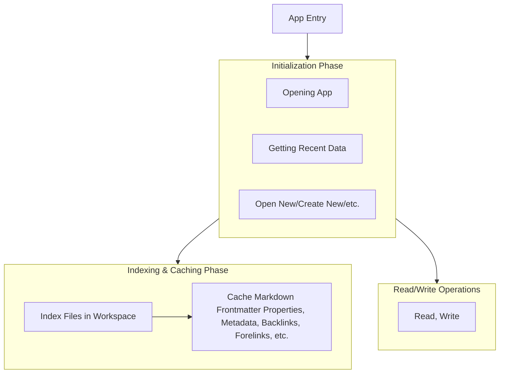
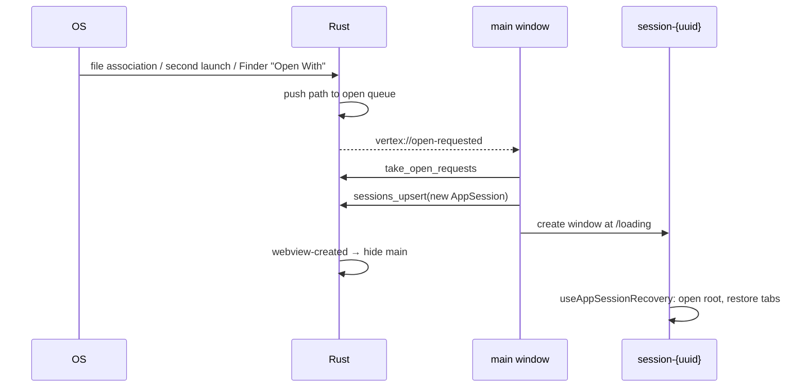
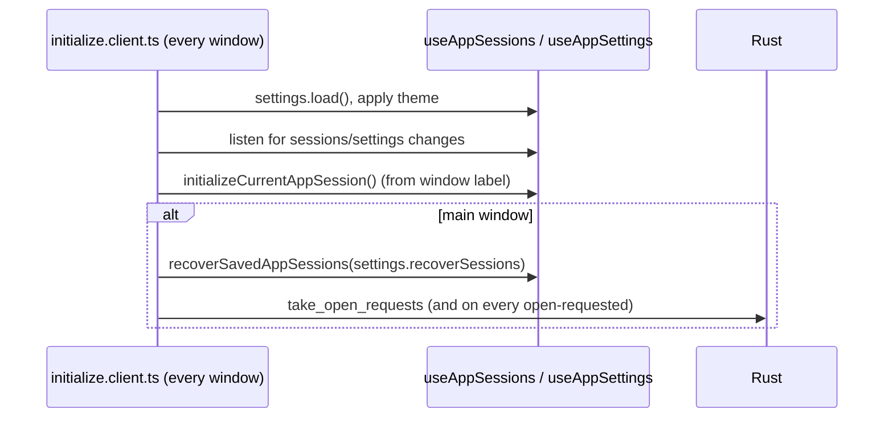

# Concepts and Structures

## Two Modes, One App

The Editor has two main modes: Workspace Mode, and Singlespace Mode.

A Workspace is a folder that contains groups of markdown files and other types of files, which the editor will index everything in the folder and use that indexed information to enhance markdown editing features, i.e. internal links, embeds and etc.
Singlespace is when the Vertex editor is editing a single file without the context of all the files in a folder. Like Notepad, but Rich text editing with Markdown.

When the user opens a folder using Vertex, it automatically opens that folder in Workspace Mode.
When the user opens a file using Vertex, it automatically opens that folder in the Singlespace Mode.

Context is the core difference between a Workspace and a Singlespace/Single-File.

## Operating Flow



---

## Sessions: Two Layers, Two Concepts

Vertex has **two distinct types of sessions** that work together to provide seamless multi-window functionality with persistent state across app restarts.

### ActiveSession (Runtime Layer)

**Purpose**: Represents a workspace or singlespace that's currently active during runtime.

**Characteristics**:
- Lives only in memory (not persisted to disk)
- Created when a user opens a folder (workspace) or file (singlespace)
- Managed by `useActiveSessions()` composable
- Used for current editing context and file indexing

**Structure**:
[Type definition file](shared/types/active/sessions.d.ts)

**Lifecycle**: Created → Used during editing → Destroyed when window closes

### AppSession (Persistence Layer)

**Purpose**: A workspace or single file Vertex has opened: the recents list, and what its window restores.

**Characteristics**:
- Persisted to disk (`sessions.json`) by Rust; webviews never write the file
- Contains recovery information (opened tabs, focused tab, expanded folders), as paths relative to the root (the index's `relativePath`), so a moved folder keeps its tabs; old absolute paths are read too (`defaultAppSessionContext`)
- `open` (its window is open now) and `lastOpened` (when its window last opened or closed; recents are newest first) are Rust's, from window events; a webview's copy is ignored on upsert. `pinned` keeps it first and past the cap
- Mirrored per window by `useAppSessions()` (normalized by `defaultAppSession`), kept fresh by the `vertex://sessions-changed` event
- Updated continuously by `useAppSessionPersistence()` while the window is open

**Structure**:
[Type definition file](shared/types/app/sessions.d.ts)

**Lifecycle**: Created on first open → Updated on every tab/folder change → `open` cleared when you close its window, left set when Vertex quits → at the next launch Rust turns `open` into `reopen` → Recovered (per the *Reopen windows on launch* setting) → dropped when you remove it, or past the cap (50 workspaces, 20 files, unpinned, oldest first)

**Recents** (`useRecents`, shared by the start page and the workspace switcher): workspaces and files, pinned first; a gone folder or file is checked whenever the list changes and shown dimmed ("Not found"). Opening one whose path is gone says so with Remove from recents (`useAppSessionActions.openFromPath`). The start page lists both with pin and remove on hover; the switcher (`WorkspaceSwitcher.vue`, title bar: the left sidebar's header, or the tabs header when it's collapsed or in a singlespace window, where it's an icon) has New Workspace…, Open…, the open workspaces (this one ticked) and the recent ones (remove on hover). Badges are the first letters of the folder name's first and last words on a colour hashed from the path (`workspaceBadge`). New Workspace… (start page, switcher, File menu) asks where and what to name the folder, creates it and opens it.

### Why Two Session Types?

This separation follows the **Single Responsibility Principle**:

- **ActiveSession** handles runtime editing context
- **AppSession** handles persistence and recovery

This design prevents confusion between "what's currently happening" (ActiveSession) and "what needs to be saved/recovered" (AppSession).

---

## State Ownership

Anything shared between windows lives in Rust (`src-tauri/src/state.rs`), which is the **only writer** of
`sessions.json` and `settings.json`. Windows call commands and listen for change events; they never read or
write those files themselves. This removes the cross-window lost-update races the old design had.

| Rust command | Purpose |
|---|---|
| `sessions_list` / `sessions_upsert` / `sessions_remove` | AppSession CRUD; every write is persisted (atomic temp-file + rename) and broadcast as `vertex://sessions-changed`. On first read, `sanitize_sessions` drops invalid and duplicate entries, migrates old ones (`lastUpdated` → `lastOpened`, `trustedDeviceIds` dropped; no `open` means closed), turns `open` into `reopen` and caps the list |
| `settings_get` / `settings_set` | App settings; every write is broadcast as `vertex://settings-changed` |
| `take_open_requests` | Drains the queue of paths the OS asked us to open |
| `quit_app` | Marks the app quitting (windows destroyed from then on keep their session `open`), asks every session window to flush (`vertex://flush-requested` → `vertex://flush-done`), then exits |

The frontend wrapper is `app/utils/stateClient.ts`. It has no Vue lifecycle, so it is safe from plugins and callbacks.

### AI requests

Every AI call goes through Rust (`src-tauri/src/ai.rs`) so provider API keys never reach the webview:

| Rust command | Purpose |
|---|---|
| `ai_key_set` / `ai_key_has` | Provider API keys in the OS keychain (`ai-provider:<id>`). There is no getter. No keychain → error, never a plaintext fallback |
| `ai_request` / `ai_request_cancel` | One HTTP request for a provider: the URL must share the provider's `baseURL` origin, Rust adds `Authorization`, and the body streams back over a `Channel` |
| `ai_model_catalog` | The models.dev catalog, cached for a day, for model badges |

- `app/utils/aiFetch.ts` wraps `ai_request` as a `fetch`, which ai-sdk (`@ai-sdk/openai-compatible`) and the editor's `aiAssistant({ endpoint: { fetch } })` use unchanged.
- Model parameters: `AiModelProfile.params` (`AiModelParams`: temperature, top P/K, min P, frequency/presence/repetition penalties, max output tokens, seed, stop, `extra`; ranges in `AI_NUMBER_PARAMS`, `shared/utils/aiParams.ts`; `sanitizeModelParams` clamps and drops). `createAiFetch(providerId, params)` adds them as snake_case fields (then `extra` as it is) to POST `…/chat/completions` bodies, only where the request doesn't set the field itself (`withModelParams`; Test's `max_tokens: 5` wins). Chat replies (`ChatSendSetup.params`, the replying profile's), the editor assistant (its profile's; part of `useAiEditorExtension`'s key) and the profile's Test send them; chat titles don't. Edited in the profile's Parameters (`SettingsAiModelParams`): a switch per parameter (off = not sent), a slider saved when let go plus a number input, stop sequences as tags, the extra fields as JSON (saved on blur when it's an object).
- Changing a provider's `baseURL` or removing it deletes its key in `settings_set`, so a saved key can't be pointed at another host.
- `settings.aiConfig`: provider profiles → model profiles (provider + model + system prompt) → features (`shared/constants/ai.ts`), each falling back to the default model profile. Workspace-overridable: `aiConfig.enabled` and `aiConfig.features` (trusted folders only: a shared vault can pick among your own profiles or turn a feature off, never add a provider, model or prompt, nor turn AI back on), `aiConfig.chatStorage`, `aiConfig.chatMode`, `aiConfig.chatTitles` and `aiConfig.editorAssistant` (any folder).
- Switches (Settings → Assistive AI → Features): `enabled` turns off every feature; each feature has a switch beside its profile select (off stores `''`; on again removes the entry, or in a workspace whose global choice is off, overrides it with the default profile). `aiFeatureOn` (`useAiConfig.ts`) is the switch state, `resolveAiFeature` adds the model and returns `null` when off. `editorAssistant = {toolbar, slash, shortcut}` goes to `aiAssistant()` (`useAiEditorExtension`; shortcut off passes `shortcut: false`); `chatTitles` gates `autoTitle`. With Chat off (or AI off), the Chats and Chat views are unavailable (`CHAT_VIEWS` in `usePanels`), Ask in chat leaves the editor menu and File → New Chat is disabled; chats stay on disk and open chat tabs stay. The Providers and Model profiles pages show a banner while AI is off (`SettingsAiOffBanner`).
- Settings pages (`pages/settings/ai/`): Providers and Model profiles are searchable lists (`SettingsAiList`: a search field, checkboxes with "select all shown", Remove selected after a confirmation; `selectable` keeps the default profile out) whose rows open a page per item (`providers/[id].vue`, `models/[id].vue`). The search is the list's `?q=`, which a page's Back link returns with. A profile's page has General (name, provider, model), Behaviour (tools, system prompt) and Parameters, with Test, Set as default and Remove in its header; a provider's has its connection (name, base URL, key) and its enabled models (the same list, to search and remove several). Profile rows show provider · model and badges (default, tools off, custom parameters), the default first; Duplicate copies a profile. `useAiConfig` removes several at once (`removeProviders`, `removeModelProfiles`; the default profile never). Profile pickers (Features, the chat prompt) search names, providers and model ids; Features and the chat's context window link to a profile's page (`createOrFocusSettingsWindow(scope, path)`: an open Settings window gets `vertex://settings-route` and navigates). The nav keeps Providers or Model profiles highlighted on their items' pages.

### Chats

Chats belong to a workspace (singlespace has none) and are stored by Rust (`src-tauri/src/chats.rs`); the webview only
calls `app/utils/chatClient.ts`.

| `aiConfig.chatStorage` | Where | Format |
|---|---|---|
| `app` (default) | `<app_data>/chats/<workspaceId>/` | Plain JSON; never in the workspace, never synced |
| `workspace` | `<root>/.vertex/chats/` | age-encrypted; needs the workspace's chat password |

- The workspace id is in `<root>/.vertex/workspace.json` (`{"id": …}`, other keys kept), so app-data chats follow the folder through moves and renames. A *copy* of the folder keeps the id, so both copies share their app-data chats.
- Encryption: `key.age` is a per-workspace X25519 identity encrypted with the password (age scrypt, about 1 s per unlock); each `<id>.chat` and `folders.chat` is encrypted to it. The unlocked identity stays in Rust memory; "Remember on this device" also puts it in the keychain (`chat-key:<workspaceId>`). There's no password recovery. Change password (`chat_vault_change`, Chats view's empty-space menu while unlocked) re-encrypts only `key.age`: the identity, the chats and a remembered key stay as they are.
- Folders are virtual: each chat stores its `folder` inside its (encrypted) content and `folders.chat` keeps empty ones, so folder names never show on disk. Files are flat `<id>.chat`; the index skips the dot-folder.
- Changes from elsewhere (sync from another device): the workspace watcher turns any event under `.vertex/chats/` into a `chats` index event; the left sidebar batches them (500 ms) into `useChats.syncExternal`, which re-reads the list and reloads each loaded chat whose file is newer than its own copy (its own saves come back with the same `updated`), unless it's replying. App-data chats only change through Vertex, so they aren't watched.
- Switching `chatStorage` leaves existing chats where they are; each location lists its own.
- The chat file is `{version, id, title, folder, created, updated, profileId?, messages, forks?, mode?, scope?}`; Rust reads only the summary fields and the messages' text parts (search), and keeps every other field as it is (`ChatFile.rest`).
- Mode and scope (the prompt's toolbar; icons only in the side panel): a chat is in Read (changes nothing), Suggest (proposals decided in the editor) or Write (staged changes reviewed after the reply). A stored `ask` (Read's old name) loads as Read (`toChatMode` in `shared/utils/defaults/apps.ts`, for the setting and a chat's `mode`). New chats take `aiConfig.chatMode` (default Suggest; Settings → Assistive AI → Features → Chat mode); a chat without one follows it. In Suggest and Write, the scope says which notes may change: Named notes (default: the open note, every note and folder attached in the conversation, and the notes the chat created), a folder (at any depth), or the whole workspace (`inScope`, `scopeText` in `chatTools.ts`). It limits changes only: the model reads any note. The system prompt (`toolsPrompt`, with or without tools) names the current mode and says what all three allow, and words the scope; a change outside it fails with that wording, so the model can ask to widen it.
- Mode switches: a user message records the mode it was sent in (`metadata.mode`), and the model's copy of the first one after a switch starts "(The user switched this chat to … mode.)" (`markModeSwitches`, applied by the transport), as a history of one mode's tool calls otherwise outweighs the system prompt.
- Write mode: `createNote`, `writeNote` and `editNote` (with `execute`) stage instead of writing (`useChats.stage`, into `LiveChat.staging` while the reply runs; `readNote` sees staged text). A new note's path is checked by `newNotePath` (`app/utils/chatChanges.ts`: workspace-relative, no dot folders, `.md` added); outside a folder scope, new notes are allowed anywhere and count as named. When the reply ends (stopped or failed too), its changes go on it as `metadata.changes` (`ChatChange`: path, `before` (`null` = new), `after`, state), one per note, and `ChatChanges.vue` shows them under the reply: per note +/− lines and a line diff (`diff`'s `diffLines`), and Apply/Discard for the ticked pending ones.
  - Apply (`applyChanges`): only while the note still reads as `before` (else `conflict`, left alone). A note with a mounted editor gets the change dispatched into it (`textChange`: one span, `input.ai`), so ⌘Z undoes it and autosave writes it; otherwise, and for new notes and their missing folders, through `useWorkspaceVault` (the workflows' Vault: self-write marks, index, tab reload).
  - Each send's system prompt says what became of earlier staged changes (`changesSummary`: latest per note).
  - Rewind to a reply undoes the changes applied from the replies it drops, newest first, each only while the note still reads as `after` (a new note moves to `.vertex/trash/chat-<id>/<time>/`); the confirm lists them and a toast says what was undone or left alone. Notes don't follow branch switches.
- Message actions (`ChatView`'s `actions` slot, none while replying): Copy on both sides; Edit on the user's (inline; Enter sends, Esc cancels); Retry on replies, its chevron retrying once with another model profile (`LiveChat.retryProfileId`), and Rewind to here (not on the last reply; native confirm), which drops everything after it; Info on both, opening the context view at that message. Edit, Retry, Rewind and branch switches first withdraw the chat suggestions still waiting in the session's editors (`withdrawSuggestions`).
- Context view (`ChatContextModal.vue`; a chat's ⋯ menu → Context…, or a message's Info): the messages as of opening, with totals (messages, model calls, tokens, time) and per message its parts and raw JSON; a reply's model calls each show the model and profile, start, duration, finish reason, tokens (in, out, reasoning, cached), the notes sent with the characters sent of each, the tools sent loaded and those deferred to tool search, and the instructions without the notes' text; then its tool calls by step. The transport records each call in the reply's `metadata.requests` (`ChatRequestInfo`) on `start`, completes it on `finish`, and carries a continued reply's earlier calls over (metadata arrays replace on merge). Tokens need `includeUsage` (`stream_options.include_usage`); replies from before this have no `requests` and say so.
- Branches (`app/utils/chatForks.ts`): Edit and Retry keep what they replace in `forks`, keyed by the message before the fork point (`''` = the start); each entry lists the alternative rests, `null` marking the one in `messages`. A `‹ n/m ›` switcher shows on the message where a fork starts; switching swaps the rests and saves. Rewind keeps only the forks still reachable (`pruneForks`). Only the shown branch is searched. Replies record `modelId` and `profileId`, and a tool round goes on with the reply's own profile, so a retry with another model keeps it through its tool calls.
- Frontend: `useChats(session)` (`app/composables/ai/useChats.ts`) holds the index, the vault state and one live `@ai-sdk/vue` `Chat` per chat, shared by its tab and the right panel. `app/utils/chatTransport.ts` runs `streamText` in the webview through `createAiFetch`; each send's instructions are the profile prompt plus the active note (live buffer) and every note attached in the conversation (capped at ~60k characters). The chat saves after each sent message and finished reply; a failed save shows in the chat with Retry.
- Notes and folders are attached from the prompt's Attach picker or by typing `@` (at the start or after whitespace; the query may contain spaces, the list shows while something matches; ↑/↓, Enter/Tab, Esc). In the prompt both share one list, a folder's path ending in `/`; a sent message stores them apart (`metadata.notes`, `metadata.folders`). A referenced folder sends no note text: the system prompt lists its notes' paths (200 per folder) and the model reads what it needs. Replies render with `@comark/nuxt`'s `<Markdown>` on Nuxt UI's prose components, with Comark's `math` (KaTeX) and `rangi` (highlighting; dark colors via `--shiki-dark` in `main.css`) plugins and two of ours in `app/utils/comarkPlugins.ts`: `[[wikilinks]]` and Obsidian callouts (`> [!type] Title`, every Obsidian type and alias, as ProseCallout; the title line keeps its formatting; `-`/`+` make the title a native `<details>` toggle, closed/open; it replaces Comark's GitHub-only `alert` plugin by name). `ChatMarkdown.vue` overrides `a` (wikilinks open the note; other links open the browser) and `pre` (` ```mermaid ` through Pele, the rest through `ProsePre`), and maps `icon` (a folding callout's) to UIcon.
- A reply has no frontmatter: `frontmatterAsCode` (same file) replaces Comark's default `frontmatter` plugin by name and shows a leading `---` block (a quoted note's properties) as a ```yaml block. The default parsed it as YAML, hiding it and throwing `YAMLException` on a half-streamed key.
- A chat tab uses the file viewers' `LayoutWrapper` header: centred breadcrumbs (its folders, then the title, renamed in place), the chat's menu (`useChatActions`, shared with the Chats view) on the left and "move to side panel" on the right. The side panel keeps a compact header.
- The prompt floats over the messages (`absolute` at the bottom; the scroll area is padded by its measured height, which `UChatMessages` counts when it sizes the last message), so they scroll on under its backdrop blur; the `@` list is blurred glass too.
- Search (Chats view): titles are filtered in the palette; message text is searched by Rust (`chat_search`: case-insensitive, text parts only, newest first, 50 results, a snippet around the first match), so decrypted chats never cross to the webview in bulk.
- A chat tab is an `ActiveTab` with `kind: 'chat'` and the chat id as its id; `AppSessionContext.openedChatIds` restores them, and `lastFocusedChatId` (instead of `lastFocusedAbsoluteFilePath`) refocuses one.
- Folders: Move to… (folder and chat menus) never offers a folder itself or its subfolders; moving onto an existing name merges. Which folders are open is kept per session (`StateKey.chatsExpanded`), read back from each folder's accordion trigger after a click (mouse, Enter or Space).
- Drag and drop (Chats view): a chat or folder onto a folder, onto a chat (its folder) or onto empty space (top level), with the same rules as Move to…. Rows carry `data-drag` (`chat:<id>` / `folder:<path>`) and a mutation observer makes them draggable, because Nuxt UI passes only `data-`/`aria-` attributes on to a row.
- Titles: a new chat is titled by its first message; after the first reply, the chat's own model writes a 3–6 word title (`generateChatTitle`, cleaned by `cleanTitle`), unless the title was changed meanwhile. A failure keeps the first message's.
- New chat: File → New Chat (⌘⇧L, workspace windows) opens one in a tab.
- Ask in chat: the markdown editor's right-click menu (`RichText.vue`; Cut, Copy, Paste, Select all, then Ask in chat in workspaces) replaces the webview's own, so spelling suggestions and Look Up aren't there. Paste goes through a synthetic `paste` event so CodeMirror's and the editor's paste handling apply; a table's own menu takes its right-clicks first. Ask in chat quotes the selection into the side-panel chat's prompt (a new chat when none is shown) and attaches the note, through `useChats.pendingPrompt`; it runs once the menu has closed, so focus ends in the prompt.
- Tools (`app/utils/chatTools.ts`, sent unless the model profile's Tools switch is off, `AiModelProfile.tools: false`):
  - One list in every mode: a tool made for one mode starts its description with it ("Suggest mode: …"), and called in another it answers with `modeError` (the mode it needs, this mode's equivalent: `proposeEdit`/`proposeInsert` ↔ `editNote`, `writeNote` → `proposeEdit`; in Read, ask the user to switch) instead of running: `execute` tools through `gated`, the editor tools in `onToolCall`.
  - Note tools, run in the webview: `searchNotes` (Rust `notes_search` in `src-tauri/src/notes.rs`: paths and text, case-insensitive, dot-names skipped, 20 hits with a snippet), `readNote` (a path or a note's name, even partial when only one note matches, or no path for the open note; the mounted editor's buffer, else the file; `startLine`/`endLine`, 1-based and inclusive; `readLines` ends a read at the last whole line under 20k characters and returns `endLine`, `totalLines` and `truncated` so the model reads on; it never shows the note), `openInEditorTab` (shows a note in its tab with the chat beside it, `editorFor`; reads nothing), `findFiles` (every file and folder in the index but dot-named ones, by part of the path, folder and kind, 200 at most; it replaced `listNotes`, whose rows in older chats keep their name). Older chats' `readDocument` rows keep their name; the tool is gone (`readNote` without a path replaced it).
  - `fetchUrl` (`url`, `offset`; any mode): Rust `web_fetch` (`src-tauri/src/web.rs`) GETs it with no cookies, keys or proxy, 15 s, 5 redirects, 2 MB, a UTF-8 body only for text types; a resolver that drops non-public addresses (loopback, private, link-local, CGNAT, …) and a check of IP-literal URLs at the start and every redirect refuse this machine and the local network. `fetchPage` (`app/utils/webPage.ts`) turns HTML into Markdown-like text with the webview's `DOMParser` (`main`/`article` else `body`; scripts, styles, nav, footer, aside, forms and hidden parts dropped; headings, absolute links, lists, quotes, code and tables kept) and returns 20k characters from `offset` with `nextOffset` when there's more. `needsApproval` unless the chat allows the URL's `hostname` (`ChatFile.allowedHosts`, kept by Rust's `rest`): the row shows the URL with Fetch, "Always for <host>" (`useChats.allowHost`, then approves) and Don't fetch; typing in the prompt declines.
  - Editor tools: the editor package's `readSelection` (any mode; the open note: the shown one, or from a chat tab the note shown last, `lastShownNoteOf`, while its tab is open; the system prompt names it; run on that editor without showing anything), and our `proposeEdit`/`proposeInsert` (Suggest), the package's with an optional `path` (path or name, `findNote`) for a note that isn't open; it must be in the scope (`editTargetFor`). They have no `execute`: `useChats`' `onToolCall` runs them; a proposal first shows the note with the chat beside it (`editorFor`: a chat tab moves to the side panel, the note's tab opens, and it waits for the editor to mount; `editorViewOf` is a shallow-reactive registry fed by the outline plugin in `useActiveEditorExtensions`), then runs `runEditorTool`. An insert without `after` into a note that wasn't open goes at its end. A proposal shows in the editor's preview and answers once accepted or rejected, and `sendAutomaticallyWhen` continues the reply. The preview is the editor assistant's: with only Chat on, `useAiEditorExtension` installs it on Chat's model with its own toolbar, slash items and shortcut off.
  - Closing a chat's tab (`closeChatTab`, `editorFor`) moves the route off it first: a route left on a closed tab falls back to SessionTab, which sends the window to the empty page.
  - `askUser` (any mode, no `execute`): 1–4 questions, each open or with options (one, or several with `multiple`). The system prompt tells the model to ask with it rather than in its reply, so the answer continues the same reply instead of costing a new one. `ChatQuestions.vue` shows it in the reply (options, a line for the user's own answer, Answer/Skip) and answers through `addToolOutput` (`{answers}` or `{skipped: true}`); answered, it shows the answers. While it waits, the prompt says so and sending answers it (`{reply}`, with what the message attached) instead of starting a new message (`useChats.send`, `waitingCall`).
  - `runWorkflow` (`path` or name, `note`, `dryRun`): a dry run in any mode (the runner's `dryRun`: `wouldChange`); a real run only in Write, with `needsApproval`, so the row shows Run / Don't run (`addToolApprovalResponse`; typing in the prompt declines it with the text as the reason) and `sendAutomaticallyWhen` also continues on an approval response. Then the session's `useWorkflowRunner` (one per session, made in `runWithContext`, so it and `useWorkflowManifest` use `$i18n` rather than `useI18n`) asks for trust when the file isn't trusted, runs it on `note` (else the open note) and reports in its toast with Undo; the model gets the status, steps, fault and the changes (`opText`, 50 at most). Runs aren't staged, limited by the scope or undone by Rewind. The transport sends the model plain copies of the messages: an approved call's input is `structuredClone`d, which Vue's proxies refuse.
  - Tool search: every tool but `findTools` (the AI SDK's `toolSearch`, with `rankTools`: words in the name count double, plurals match singulars, this mode's tools before other modes'; all tools when none match, so a model searching with the user's topic still finds them) and `askUser` is `deferLoading`. The system prompt explains tool search before the mode: placed after it, a small model called made-up tools. Discovery lasts one generation, so tools the conversation already used or found (`usedToolNames`) are sent loaded. At most 8 steps per reply.
  - Tool calls render as `UChatTool` rows (name, its query/path or the outcome: accepted, rejected, failed, declined, asks to run, the raw result when opened). A provider error saying the model can't take tools (`toolsUnsupported`) clears the error and asks (native dialog) to turn Tools off for that profile and retry.

---

## Window Model

| Window | Label | Notes |
|---|---|---|
| Main | `main` | Anchor. Never destroyed at runtime. Hidden while any session window exists, shown when the last one closes — enforced by Rust (`sync_main_visibility`) on real window create/destroy events. Recovers saved sessions and serves the OS open queue. Always opens centred. |
| Session | `session-{uuid}` | One per workspace/singlespace. `uuid` is the AppSession uuid. Starts at `/loading` and initializes itself. Its creation and destruction set the session's `open` (`AppState::session_window`). Reopens at its last size and place (`tauri-plugin-window-state`, by label; pulled back on screen when that monitor is gone). |
| Settings | `settings` | Singleton utility window. Not persisted; keeps its size and place like a session window. |

Labels, routes and `useState` keys come from `shared/constants/app.ts`; never hand-build them.

### Opening something



Menu/button opens (`useAppSessionActions`) skip the queue and start at `sessions_upsert`. Opening a path that
already has a window brings that window forward (unminimized) instead; a path that's gone shows a toast instead.

### Closing and quitting

- **Close window**: a single `onCloseRequested` handler (`useAppSessionPersistence.registerCloseHandlers`) awaits the
  last pending session write, then lets Tauri destroy the window. Because state was persisted continuously,
  teardown (`clearTabs`, `clearIndex`) can never overwrite it. Rust shows `main` if this was the last session window,
  and clears the session's `open`.
- **Quit (Cmd+Q)**: `quit_app` marks the app quitting (so destroyed windows keep `open`; `RunEvent::ExitRequested`
  does the same for any other route: Dock, shutdown), sends `flush-requested`, waits for every session window's
  `flush-done` (3 s guard against a hung webview), then exits. No fixed sleeps. A crash leaves `open` set too.

### Startup recovery

The main window reopens the windows that were open when Vertex last quit (`reopen`), according to **Settings →
General → Reopen windows on launch**: `none`, `workspaces`, `singlespaces` or `both`. They open oldest first, so the
most recent ends up in front. One whose folder or file is gone isn't opened; the start page lists those once, with
Remove from recents. Older settings files with `openLastOpenedWindows: true` migrate to `workspaces`. Sessions from
before `open` existed count as closed, so the first launch after that change reopens nothing.

### Side panels

- Views are registered in code (`app/utils/panelViews.ts`): `definePanelView({id, label, icon, defaultArea, component | action, when?, scroll?, kbds?})`. The built-ins are files, chats, search, forelinks, backlinks, writersTools, toc and chat; a new view is one call there, nothing else. `component` is a lazy loader; `action` (Search) runs in the Nuxt app's context instead of showing a panel; `when` says whether the window can show it (a workspace, Chat on, not a Bases file); `scroll` wraps it in the panel's fading scroll area. Views own their behaviour: the TOC jumps through the editor dispatcher, the side-panel chat is `ChatSidePanelView`.
- Header actions: a view declares its buttons from inside its component, `usePanelActions(() => [{id, label, icon, onSelect, disabled?}])` (labels already translated), so they can use its state; `DashboardSidePanel` provides the slot (`PANEL_ACTIONS`) and draws them, swapping them as the shown view changes. Strip style: beside the view's name in the header. Buttons style: in a row under the header, only while there are any (on the left without the name, which the button list already shows). Chats has New chat and New folder (none while the encrypted store is locked); Chat has New chat. Outside a pane, `usePanelActions` does nothing.
- Views sit on either side, in any order with separators, or hidden: `viewConfig.panels = {style, left, right, hidden}`, overridable per workspace like all of `viewConfig`. View ids are strings (`PanelViewId`); `normalizePanelLayout` (`shared/utils/panelLayout.ts`) keeps any well-formed id (`isPanelViewId`, registered or not, so a view that's missing for a while keeps its place), keeps each view where it first appears (hidden first), tidies separators and puts built-in views missing from a saved layout back on their stock side (`DEFAULT_PANEL_LAYOUT`, also the settings' default). Other registered views a layout doesn't hold yet go to their `defaultArea` (`withRegisteredViews`). Ids that aren't registered aren't drawn or offered, in a window or in Settings. `search` is an action: it opens the chats' search while Chats shows on its side, else the file palette.
- `usePanels(session)` narrows the layout to what the window can show (each view's `when`), and keeps each side's view and collapsed state (`useActiveLayouts`; saved in the session context, the right side collapsed by default). A side's panel (`DashboardSidePanel`, one component for both) shows while it has a view and isn't collapsed, and draws the view from the registry. `showView(id)` opens whichever side holds a view; `useChats` shows a chat with it, and opens it in a tab when the Chat view is hidden.
- Styles: `buttons` (default) keeps the buttons in the panels: labelled on the left, icons in the right panel's header, with collapse buttons. `strip` puts them in a 2.75 rem strip at each window edge (`PanelStrip`); clicking the shown view's icon collapses its panel, and the panel's header shows the view's name. Both strips always show, even empty: the editor centres in the centre panel (a `flex-1` sibling of the sidebars), so equal strips leave it centred in the window while no panel is open, and an open panel moves it by half its width (as panels always did). The traffic-light spacers shrink by the strip's width.
- Rearranging (`PanelButtons`, in all three looks and the Settings editor): HTML5 drag and drop (`usePanelDrag`, one state per window via `provide`, so a view goes from one side's list to the other's), and a right-click menu (`panelSlotMenu`: move up or down, to the other side, hide, add or remove a separator, show a hidden view here, reset). In a window, a change is saved to the workspace when it already overrides the arrangement, else globally. Settings → View → Side Panels has the style and the same editor (left, right, hidden) for the scope being edited.
- The sidebars have stable ids (`left`, `right`), so Nuxt UI keeps their resized widths in its cookie for every window.

---

## Composables

| Composable | Responsibility |
|---|---|
| `usePanels` | A session window's side panels: the arrangement narrowed to what it can show, each side's view, select/toggle/`showView`, rearranging and its menu |
| `useAppSessions` | Per-window mirror of AppSessions; CRUD via `stateClient`; current window's session; startup recovery |
| `useAppSettings` | Per-window mirror of settings; `set` (memory) / `save` (persist + broadcast) |
| `useAppSessionActions` | User-facing "open folder/file" actions; one AppSession + window per path |
| `useAppSessionNavigator` | Turns a path into an ActiveSession in the current window and routes to it |
| `useAppSessionRecovery` | Restores a session window's tabs/folders from its AppSession |
| `useAppSessionPersistence` | Writes the window's tabs/focus/folders back to its AppSession on change; owns the close path |
| `useAppFileStartHandler` | Main window: drains the OS open queue |
| `useAppWebviewWindows` | Find/create webview windows; no session logic |

Dependency direction is one-way: actions → navigator/sessions; recovery → navigator; persistence → sessions.
Nothing in `app/composables/app` is imported by `shared/`.

### Initialization



`app.vue` builds the native menu on mount, on focus and on route change. Session windows continue in `/loading`
→ `useAppSessionRecovery` → the workspace/singlespace layout, which builds the index, restores tabs and then starts
`useAppSessionPersistence`.
