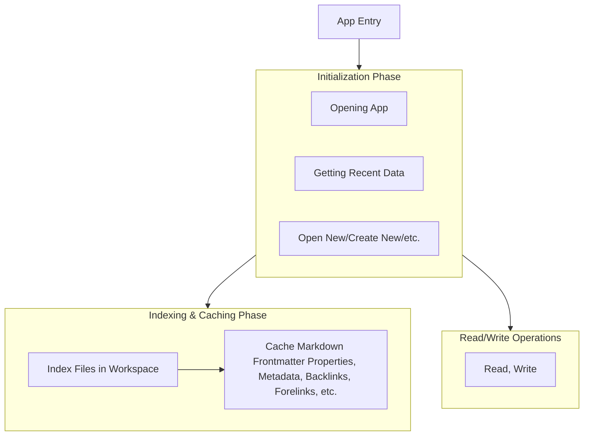
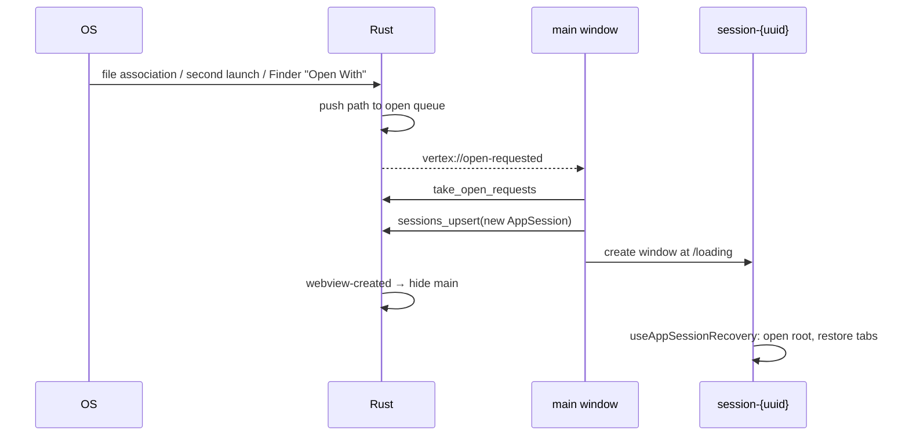
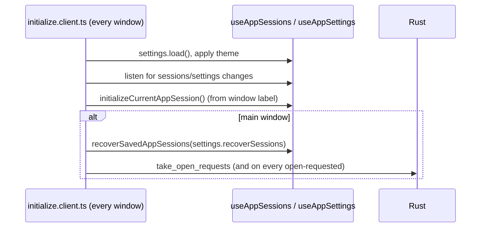

# Concepts and Structures

## Two Modes, One App

The Editor has two main modes: Workspace Mode, and Singlespace Mode.

A Workspace is a folder that contains groups of markdown files and other types of files, which the editor will index everything in the folder and use that indexed information to enhance markdown editing features, i.e. internal links, embeds and etc.
Singlespace is when the Vertex editor is editing a single file without the context of all the files in a folder. Like Notepad, but Rich text editing with Markdown.

When the user opens a folder using Vertex, it automatically opens that folder in Workspace Mode.
When the user opens a file using Vertex, it automatically opens that folder in the Singlespace Mode.

Context is the core difference between a Workspace and a Singlespace/Single-File.

## Operating Flow



---

## Sessions: Two Layers, Two Concepts

Vertex has **two distinct types of sessions** that work together to provide seamless multi-window functionality with persistent state across app restarts.

### ActiveSession (Runtime Layer)

**Purpose**: Represents a workspace or singlespace that's currently active during runtime.

**Characteristics**:
- Lives only in memory (not persisted to disk)
- Created when a user opens a folder (workspace) or file (singlespace)
- Managed by `useActiveSessions()` composable
- Used for current editing context and file indexing

**Structure**:
[Type definition file](shared/types/active/sessions.d.ts)

**Lifecycle**: Created → Used during editing → Destroyed when window closes

### AppSession (Persistence Layer)

**Purpose**: Represents a window's state for recovery across app restarts.

**Characteristics**:
- Persisted to disk (`sessions.json`) by Rust; webviews never write the file
- Contains recovery information (opened tabs, focused tab, expanded folders)
- Mirrored per window by `useAppSessions()`, kept fresh by the `vertex://sessions-changed` event
- Updated continuously by `useAppSessionPersistence()` while the window is open

**Structure**:
[Type definition file](shared/types/app/sessions.d.ts)

**Lifecycle**: Created → Updated on every tab/folder change → Loaded on restart → Recovered (per the *Reopen windows on launch* setting)

### Why Two Session Types?

This separation follows the **Single Responsibility Principle**:

- **ActiveSession** handles runtime editing context
- **AppSession** handles persistence and recovery

This design prevents confusion between "what's currently happening" (ActiveSession) and "what needs to be saved/recovered" (AppSession).

---

## State Ownership

Anything shared between windows lives in Rust (`src-tauri/src/state.rs`), which is the **only writer** of
`sessions.json` and `settings.json`. Windows call commands and listen for change events; they never read or
write those files themselves. This removes the cross-window lost-update races the old design had.

| Rust command | Purpose |
|---|---|
| `sessions_list` / `sessions_upsert` / `sessions_remove` | AppSession CRUD; every write is persisted (atomic temp-file + rename) and broadcast as `vertex://sessions-changed` |
| `settings_get` / `settings_set` | App settings; every write is broadcast as `vertex://settings-changed` |
| `take_open_requests` | Drains the queue of paths the OS asked us to open |
| `quit_app` | Asks every session window to flush (`vertex://flush-requested` → `vertex://flush-done`), then exits |

The frontend wrapper is `app/utils/stateClient.ts`. It has no Vue lifecycle, so it is safe from plugins and callbacks.

### AI requests

Every AI call goes through Rust (`src-tauri/src/ai.rs`) so provider API keys never reach the webview:

| Rust command | Purpose |
|---|---|
| `ai_key_set` / `ai_key_has` | Provider API keys in the OS keychain (`ai-provider:<id>`). There is no getter. No keychain → error, never a plaintext fallback |
| `ai_request` / `ai_request_cancel` | One HTTP request for a provider: the URL must share the provider's `baseURL` origin, Rust adds `Authorization`, and the body streams back over a `Channel` |
| `ai_model_catalog` | The models.dev catalog, cached for a day, for model badges |

- `app/utils/aiFetch.ts` wraps `ai_request` as a `fetch`, which ai-sdk (`@ai-sdk/openai-compatible`) and the editor's `aiAssistant({ endpoint: { fetch } })` use unchanged.
- Changing a provider's `baseURL` or removing it deletes its key in `settings_set`, so a saved key can't be pointed at another host.
- `settings.aiConfig`: provider profiles → model profiles (provider + model + system prompt) → features (`shared/constants/ai.ts`), each falling back to the default model profile. Workspace-overridable: `aiConfig.features` (trusted folders only: a shared vault can pick among your own profiles or turn a feature off, never add a provider, model or prompt) and `aiConfig.chatStorage` (any folder).

### Chats

Chats belong to a workspace (singlespace has none) and are stored by Rust (`src-tauri/src/chats.rs`); the webview only
calls `app/utils/chatClient.ts`.

| `aiConfig.chatStorage` | Where | Format |
|---|---|---|
| `app` (default) | `<app_data>/chats/<workspaceId>/` | Plain JSON; never in the workspace, never synced |
| `workspace` | `<root>/.vertex/chats/` | age-encrypted; needs the workspace's chat password |

- The workspace id is in `<root>/.vertex/workspace.json` (`{"id": …}`, other keys kept), so app-data chats follow the folder through moves and renames. A *copy* of the folder keeps the id, so both copies share their app-data chats.
- Encryption: `key.age` is a per-workspace X25519 identity encrypted with the password (age scrypt, about 1 s per unlock); each `<id>.chat` and `folders.chat` is encrypted to it. The unlocked identity stays in Rust memory; "Remember on this device" also puts it in the keychain (`chat-key:<workspaceId>`). There's no password recovery. Change password (`chat_vault_change`, Chats view's empty-space menu while unlocked) re-encrypts only `key.age`: the identity, the chats and a remembered key stay as they are.
- Folders are virtual: each chat stores its `folder` inside its (encrypted) content and `folders.chat` keeps empty ones, so folder names never show on disk. Files are flat `<id>.chat`; the index skips the dot-folder.
- Changes from elsewhere (sync from another device): the workspace watcher turns any event under `.vertex/chats/` into a `chats` index event; the left sidebar batches them (500 ms) into `useChats.syncExternal`, which re-reads the list and reloads each loaded chat whose file is newer than its own copy (its own saves come back with the same `updated`), unless it's replying. App-data chats only change through Vertex, so they aren't watched.
- Switching `chatStorage` leaves existing chats where they are; each location lists its own.
- Frontend: `useChats(session)` (`app/composables/ai/useChats.ts`) holds the index, the vault state and one live `@ai-sdk/vue` `Chat` per chat, shared by its tab and the right panel. `app/utils/chatTransport.ts` runs `streamText` in the webview through `createAiFetch`; each send's instructions are the profile prompt plus the active note (live buffer) and every note attached in the conversation (capped at ~60k characters). The chat saves after each sent message and finished reply; a failed save shows in the chat with Retry.
- Notes are attached from the prompt's Attach picker or by typing `@` (at the start or after whitespace; the query may contain spaces, the list shows while something matches; ↑/↓, Enter/Tab, Esc). Replies render with `@comark/nuxt`'s `<Markdown>` on Nuxt UI's prose components, with Comark's `math` (KaTeX) and `rangi` (highlighting; dark colors via `--shiki-dark` in `main.css`) plugins and two of ours in `app/utils/comarkPlugins.ts`: `[[wikilinks]]` and Obsidian callouts (`> [!type] Title`, every Obsidian type and alias, as ProseCallout; the title line keeps its formatting; `-`/`+` make the title a native `<details>` toggle, closed/open; it replaces Comark's GitHub-only `alert` plugin by name). `ChatMarkdown.vue` overrides `a` (wikilinks open the note; other links open the browser) and `pre` (` ```mermaid ` through Pele, the rest through `ProsePre`), and maps `icon` (a folding callout's) to UIcon.
- A reply has no frontmatter: `frontmatterAsCode` (same file) replaces Comark's default `frontmatter` plugin by name and shows a leading `---` block (a quoted note's properties) as a ```yaml block. The default parsed it as YAML, hiding it and throwing `YAMLException` on a half-streamed key.
- A chat tab uses the file viewers' `LayoutWrapper` header: centred breadcrumbs (its folders, then the title, renamed in place), the chat's menu (`useChatActions`, shared with the Chats view) on the left and "move to side panel" on the right. The side panel keeps a compact header.
- Search (Chats view): titles are filtered in the palette; message text is searched by Rust (`chat_search`: case-insensitive, text parts only, newest first, 50 results, a snippet around the first match), so decrypted chats never cross to the webview in bulk.
- A chat tab is an `ActiveTab` with `kind: 'chat'` and the chat id as its id; `AppSessionContext.openedChatIds` restores them, and `lastFocusedChatId` (instead of `lastFocusedAbsoluteFilePath`) refocuses one.
- Folders: Move to… (folder and chat menus) never offers a folder itself or its subfolders; moving onto an existing name merges. Which folders are open is kept per session (`StateKey.chatsExpanded`), read back from each folder's accordion trigger after a click (mouse, Enter or Space).
- Drag and drop (Chats view): a chat or folder onto a folder, onto a chat (its folder) or onto empty space (top level), with the same rules as Move to…. Rows carry `data-drag` (`chat:<id>` / `folder:<path>`) and a mutation observer makes them draggable, because Nuxt UI passes only `data-`/`aria-` attributes on to a row.
- Titles: a new chat is titled by its first message; after the first reply, the chat's own model writes a 3–6 word title (`generateChatTitle`, cleaned by `cleanTitle`), unless the title was changed meanwhile. A failure keeps the first message's.
- New chat: File → New Chat (⌘⇧L, workspace windows) opens one in a tab.
- Ask in chat: the markdown editor's right-click menu (`RichText.vue`; Cut, Copy, Paste, Select all, then Ask in chat in workspaces) replaces the webview's own, so spelling suggestions and Look Up aren't there. Paste goes through a synthetic `paste` event so CodeMirror's and the editor's paste handling apply; a table's own menu takes its right-clicks first. Ask in chat quotes the selection into the side-panel chat's prompt (a new chat when none is shown) and attaches the note, through `useChats.pendingPrompt`; it runs once the menu has closed, so focus ends in the prompt.
- Tools (`app/utils/chatTools.ts`, sent unless the model profile's Tools switch is off, `AiModelProfile.tools: false`):
  - Note tools, run in the webview: `searchNotes` (Rust `notes_search` in `src-tauri/src/notes.rs`: paths and text, case-insensitive, dot-names skipped, 20 hits with a snippet), `readNote` (a path or a note's name, even partial when only one note matches; the mounted editor's buffer, else the file; 20k characters), `listNotes`.
  - Editor tools, for one note (`editTarget`): the shown note, or, from a chat tab, the note shown last (`lastShownNoteOf`, set when a markdown editor mounts) while its tab is open; the system prompt names it. They're the editor package's `editorTools` (`readDocument`, `readSelection`, `proposeEdit`, `proposeInsert`) and have no `execute`: `useChats`' `onToolCall` first shows that note with the chat beside it (`editorFor`: a chat tab moves to the side panel, the note's tab opens, and it waits for the editor to mount; `editorViewOf` is a shallow-reactive registry fed by the outline plugin in `useActiveEditorExtensions`), then runs `runEditorTool`. A proposal shows in the editor's preview and answers once accepted or rejected, and `sendAutomaticallyWhen` continues the reply. The preview is the editor assistant's: with only Chat on, `useAiEditorExtension` installs it on Chat's model with its own toolbar, slash items and shortcut off.
  - Closing a chat's tab (`closeChatTab`, `editorFor`) moves the route off it first: a route left on a closed tab falls back to SessionTab, which sends the window to the empty page.
  - Tool search: every tool but `findTools` (the AI SDK's `toolSearch`, with `rankTools`: words in the name count double; all tools when none match, so a model searching with the user's topic still finds them) is `deferLoading`. Discovery lasts one generation, so tools the conversation already used or found (`usedToolNames`) are sent loaded. At most 8 steps per reply.
  - Tool calls render as `UChatTool` rows (name, its query/path or the proposal's outcome, the raw result when opened). A provider error saying the model can't take tools (`toolsUnsupported`) clears the error and asks (native dialog) to turn Tools off for that profile and retry.

---

## Window Model

| Window | Label | Notes |
|---|---|---|
| Main | `main` | Anchor. Never destroyed at runtime. Hidden while any session window exists, shown when the last one closes — enforced by Rust (`sync_main_visibility`) on real window create/destroy events. Recovers saved sessions and serves the OS open queue. |
| Session | `session-{uuid}` | One per workspace/singlespace. `uuid` is the AppSession uuid. Starts at `/loading` and initializes itself. |
| Settings | `settings` | Singleton utility window. Not persisted. |

Labels, routes and `useState` keys come from `shared/constants/app.ts`; never hand-build them.

### Opening something



Menu/button opens (`useAppSessionActions`) skip the queue and start at `sessions_upsert`. Opening a path that
already has a window focuses that window instead.

### Closing and quitting

- **Close window**: a single `onCloseRequested` handler (`useAppSessionPersistence.registerCloseHandlers`) awaits the
  last pending session write, then lets Tauri destroy the window. Because state was persisted continuously,
  teardown (`clearTabs`, `clearIndex`) can never overwrite it. Rust shows `main` if this was the last session window.
- **Quit (Cmd+Q)**: `quit_app` sends `flush-requested`, waits for every session window's `flush-done`
  (3 s guard against a hung webview), then exits. No fixed sleeps.

### Startup recovery

The main window reopens saved sessions according to **Settings → General → Reopen windows on launch**:
`none`, `workspaces`, `singlespaces` or `both`. Older settings files with `openLastOpenedWindows: true` migrate to
`workspaces`, which was the previous behaviour.

---

## Composables

| Composable | Responsibility |
|---|---|
| `useAppSessions` | Per-window mirror of AppSessions; CRUD via `stateClient`; current window's session; startup recovery |
| `useAppSettings` | Per-window mirror of settings; `set` (memory) / `save` (persist + broadcast) |
| `useAppSessionActions` | User-facing "open folder/file" actions; one AppSession + window per path |
| `useAppSessionNavigator` | Turns a path into an ActiveSession in the current window and routes to it |
| `useAppSessionRecovery` | Restores a session window's tabs/folders from its AppSession |
| `useAppSessionPersistence` | Writes the window's tabs/focus/folders back to its AppSession on change; owns the close path |
| `useAppFileStartHandler` | Main window: drains the OS open queue |
| `useAppWebviewWindows` | Find/create webview windows; no session logic |

Dependency direction is one-way: actions → navigator/sessions; recovery → navigator; persistence → sessions.
Nothing in `app/composables/app` is imported by `shared/`.

### Initialization



`app.vue` builds the native menu on mount, on focus and on route change. Session windows continue in `/loading`
→ `useAppSessionRecovery` → the workspace/singlespace layout, which builds the index, restores tabs and then starts
`useAppSessionPersistence`.
