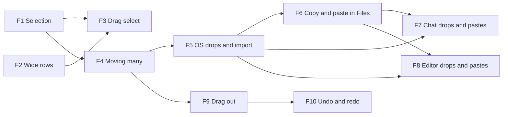

# File Explorer Plan

The Files tree should behave like a file manager rather than a styled hierarchy. That means:
- selecting several items with a click and Shift, Cmd/Ctrl or a drag box;
- moving the selection by dragging, with a stacked preview of what's moving and a clear outline around the target folder;
- copying files and folders in from Finder or Explorer;
- deeply nested rows scroll sideways instead of squeezing their names;
- copying and pasting files within Files, and dragging them out to Finder or Explorer;
- files reaching chat and the editor the way users expect:
  - dragged from Files or the OS, or pasted, into chat, they get attached;
  - pasted or dropped into a note, they're inserted as embeds or links;
- undo and redo for what Files does (moves, renames, deletes, copies), with deleted files going to the Trash rather than gone for good.

Today:
- The tree selects nothing; the open tab is the only highlighted row.
- A drag moves one row (O3).
- A file dragged in from the OS lands on the webview, which navigates to the file and loses the app.
- **Chat:** attaches only `.md` notes and folders (by path, with `@` or the picker), and sends their text when the message goes out. Nothing can be dropped or pasted into it. The model never gets images, though `inputModalities` already tells which models accept them.
- **Editor:** `@type32/codemirror-rich-obsidian-editor` 0.3.6 has no paste or drop handling for files, so a pasted screenshot does nothing.

F1–F5 are in `FileTreeComponent.vue` and `useActiveWorkspaceTools.ts`, plus one new dialog and one global listener. F6–F9 build on F5's import.

## Decisions

| Topic | Decision |
|---|---|
| Selection | Our own state, a set of uuids plus an anchor, kept in `FileTreeComponent`. Ranges run over the rows as shown (expanded folders only). Reka's tree selection is not used: it has no Shift-click or Cmd/Ctrl-click, only Shift+arrow, and our items already override `onSelect`. |
| Click rules | **Plain click:** opens a file or toggles a folder, as now, and selects only that row. **Cmd** (macOS) or **Ctrl** (others): toggles the row in the selection. **Shift:** the range from the anchor; Cmd/Ctrl+Shift adds the range. A click with a modifier never opens or toggles anything: the folder's `onToggle` gets `preventDefault`. |
| Look | Selected rows `bg-elevated`. The open tab's row keeps its primary style, which wins over the selection's. |
| Where a drag starts | Pressing on a row's icon and name drags it. Pressing on the rest of the row, or below the last row, draws a selection box, as in Windows Explorer's details view. So only the icon and name part is `draggable`. |
| Wide rows | Names stop truncating. The tree scrolls horizontally when rows are wider than the panel, with only the horizontal scrollbar shown. Every row is as wide as the widest one on screen (at least the panel's width). Extension tags and fold arrows stay pinned to the panel's right edge (decided after trying it); a name long enough to run under its tag is covered there. |
| What a drag moves | Dragging a selected row moves the whole selection. Dragging an unselected row selects it alone first. A selected item inside a selected folder goes with its folder. Items already in the target folder are skipped. A folder can't go into itself or below it, and that refuses the whole drop. |
| Drop target | The target folder's row and its shown contents get one `border-primary` outline (top on the folder's row, sides down its contents, bottom on its last shown row) over the existing `bg-primary/10`. The top level gets `ring-primary` around the whole tree. |
| Drag preview | `setDragImage` with a small card: the first item's icon and name, two offset cards behind it when there are more, and a count badge ("3 items"). The element stays mounted off-screen and is filled in directly at `dragstart`; Vue can't render it within the event. |
| Many moves | One move path, `moveFiles(uuids, destDir)`. `renameFile` and `moveFile` (O3) become a list of one. Links get one pass, with at most one links dialog for the whole move ("Update links to 5 items?"). |
| Name clashes | Always asked, as a file manager does. Folders merge, as in Windows Explorer: their contents move in, and only clashing files ask. A file clash offers **Replace**, **Keep both** ("Note 2.md") or **Skip**. With more clashes left, "Do this for the remaining N" applies the choice to the rest. **Cancel**: everything is asked before anything happens, so Cancel changes nothing, for moves and imports alike (as built: one planner, `planInto`). The same dialog serves tree moves (before, a clash only showed an error toast) and OS imports. |
| OS drops | `dragDropEnabled` stays `false`: Tauri's own handler would give paths but turns off HTML5 drag & drop on every platform (tauri#14373), which the tree, the Chats list and the panels use. A dropped item's contents are read through the browser File API (`webkitGetAsEntry` for folders) and written with plugin-fs `writeFile`/`mkdir`, then indexed parent-first (`addFileToIndex`). A drop is a copy. `.DS_Store` and `Thumbs.db` are skipped. |
| Drops anywhere else | A window-level guard: an OS file drag that no handler accepts gets `dropEffect = 'none'` and `preventDefault`, so the webview never navigates. The tree (F5), chat (F7) and the editor (F8) accept OS files; everything else shows the "not allowed" cursor. |
| Items already in the workspace | **Detection:** an item whose name, size and modified time match an indexed one at the drop is treated as that item. If the probe (F5) finds the webview exposes the item's path (`text/uri-list`), the path decides instead. **Handling:** a found item moves, exactly as a tree drag would (links updated, refusals, its own folder a no-op). This is what Finder and Explorer do on the same disk. Holding Option/Alt at the drop copies instead, through the clash dialog. **Risk:** a false match (an identical outside copy, such as a backup) moves the workspace's file instead of copying the outside one. Nothing is lost. |
| Keyboard | With the tree focused: Esc clears the selection; Cmd/Ctrl+A selects every shown row; Delete (and Cmd+Backspace on macOS) opens the existing delete dialog for the selection. Shift+arrow ranges: not now. |
| One import | F5's import (copy outside items into a workspace folder, clash dialog, "already in the workspace" detection) is one function, `importItems(items, destDir)` in `useActiveWorkspaceTools`. The tree, chat, the editor and paste all use it, and it returns the new items' uuids. |
| Attachments folder | New setting `fileConfig.attachmentsFolder`, default `Attachments` at the top level, like Obsidian's "Default location for new attachments". `fileConfig` is already workspace-overridable, so each workspace can set its own (Settings → View → Files). Files copied in for chat or the editor and pasted screenshots land there; the folder is created on first use. The tree's own drops and pastes go where they're dropped or pasted, not here. |
| Pasted screenshots | Image data with no file behind it is saved as `Pasted image YYYYMMDDHHmmss.png` (Obsidian's naming) in the attachments folder. |
| Chat attachments | Notes (`.md`) and folders as now, plus images (`png`, `jpg`, `jpeg`, `webp`, `gif`) sent as images to models whose `inputModalities` include `image`. With a text-only model, attaching an image is refused with a toast naming the model; switching to one with images attached warns before sending. Images over 5 MB are refused (common provider limits). **PDFs and other files: deferred.** You'll come back with more on PDFs and new chat tools. |
| Chat copy dialog | OS files dropped or pasted into chat are first copied into the attachments folder, then attached. A dialog asks "Add N file(s) to the workspace and attach them?", showing the folder, with "Remember my decision for this workspace". New setting `fileConfig.importToChat`: `'ask'` (default) or `'always'`, workspace-overridable like `updateLinks`. Items already in the workspace are attached as they are: no copy, no dialog. |
| Copy and paste in Files | **Cmd/Ctrl+C** on the selection: • puts the items on Vertex's own clipboard (uuids); • puts their relative paths, one per line, on the system clipboard as text.  **Cmd/Ctrl+V** in Files copies them into the selected folder (a selected file's folder, or the top level): • pasting into the folder they're in names them like Keep both ("Note 2.md") without asking, as Finder does; • elsewhere, clashes ask through the dialog.  The disabled **Duplicate** menu item becomes copy and paste into the same folder. Pasting copied rows into chat attaches them; pasting them into a note inserts links. No cut: dragging already moves. |
| Editor drops and pastes | A Vertex CodeMirror extension in `useActiveEditorExtensions` (`domEventHandlers` `paste`/`drop`); the editor package doesn't change. • **A pasted screenshot:** saved, then `![[Pasted image ….png]]` at the cursor. • **A pasted or dropped OS file:** copied into the attachments folder, then `![[…]]` for an image or `[[…]]` otherwise, at the cursor or drop point. No dialog: pasting into a note is a clear intent, as in Obsidian. • **Rows dragged from Files:** `[[links]]`, one per line, with no copy. |
| Drag out | Rows dragged out of Vertex copy into Finder or Explorer through a native drag: CrabNebula's `tauri-plugin-drag` (drag-rs, macOS/Windows/Linux). A new dependency, since HTML5 can't hand the OS real files and WebKit has no `DownloadURL`. How it coexists with the HTML5 tree drag is F9's first step. |
| Deleted files | Deleting is permanent today (`deleteFiles` → `removePath`). New setting `fileConfig.deletedFiles`, workspace-overridable like the other `fileConfig` keys (Settings → View → Files), like Obsidian's "Deleted files": • `'trash'` (default): the system Trash or Recycle Bin; • `'workspaceTrash'`: a `.trash/` folder in the workspace, hidden from Files like every dot-folder; • `'permanent'`: as today.  Moving to a trash asks nothing; Finder and Explorer don't, and Undo is right there. A permanent delete keeps the confirmation dialog. |
| Undo and redo | A history of what Files did, per session and in memory, about 50 steps. Each step records how to reverse itself: • a move or rename: the items back where they were, and the notes whose links were rewritten get their old text back if they haven't changed since; • a delete: the items back from the trash; • an import, copy, paste or duplicate: what was created goes to the trash (redo brings it back); • a Replace in the clash dialog: the replaced item back from the trash.  **How:** **Cmd/Ctrl+Z** and **Cmd/Ctrl+Shift+Z** while Files has focus, so the editor's own undo is untouched, plus an **Undo** button in the toast after each operation. Anything changed or moved outside Vertex since is skipped with a toast, never overwritten. With `'permanent'`, a delete isn't undoable and its toast has no Undo. Undo/Redo items in the Files menu are wanted, but low priority. |

## F1: Selection

### Change
- `selected` (a `shallowRef<Set<string>>`, replaced on change so rows react) and `anchor`.
- `shownIds()`: the visible rows in order, walked from `formattedTreeData` and `expandedFolders` when a range needs it.
- The item `onSelect`/`onToggle` hooks read the click's modifiers (`e.detail.originalEvent`): plain, Cmd/Ctrl or Shift, as in Decisions.
- Rows get `bg-elevated` when selected. **As built:** Reka's tree receives the selection (`multiple`, `model-value`, `color="neutral"`) only to mark rows. Folder rows then use its own selected style, file rows `data-selected:bg-elevated`, and `aria-selected` comes for free.
- Collapsing a folder deselects what's inside it, so no action hits rows the user can't see. Ids that leave the index drop out.
- Clicking below the last row clears the selection.
- Right-click on an unselected row selects it alone, as now. Right-click inside a selection of two or more opens a menu for all of them:
  - Open in new tabs (files only);
  - Reveal in file explorer (`revealFilesInFileManager` already takes a list);
  - Copy full paths / Copy relative paths (one per line);
  - Delete (`DeleteFilesModal` already takes ids; its title already counts them).
- Keyboard: Esc, Cmd/Ctrl+A, Delete / Cmd+Backspace, as in Decisions.

### Acceptance
- Cmd/Ctrl-click adds and removes rows without opening them. Shift-click selects the range from the last plain or Cmd/Ctrl click, across folders. A plain click opens and selects just one row.
- Collapsing a folder deselects its contents.
- With three selected, the menu offers the four group actions, and Delete asks once for all three.

### Results (done)
Checked on the stubbed production build with real mouse clicks and macOS keys:
- A plain click opened M0_2 and selected only it.
- Cmd-click added M0_5, and a second Cmd-click took M0_2 out again.
- Shift-click on M0_8 selected M0_2 to M0_8; Cmd+Shift on Sub added Sub to M0_1.
- Cmd-click on the closed Big selected it and left it closed.
- Collapsing F00 dropped its contents from the selection.
- The selection's menu: Open in New Tabs, Copy full paths, Copy relative paths, Reveal in File Explorer, Delete.
- Esc cleared the selection; Cmd+A selected all 37 shown rows; Delete with two selected asked "Delete 2 file(s)?".
- A click below the rows cleared the selection, and a drag still moved a note.

Unverified: Ctrl on Windows and Linux, and the menu actions' own effects (they reuse `openTabs`, `writeText` and `revealFilesInFileManager`).

## F2: Wide rows

### Change
- Each row is split into a grab part (icon and name: `draggable`, `data-grab`) and the rest of the row. **As built:** the extension tag and fold arrow (`data-tail`) are not part of the grab part.
- Names lose `truncate`, and the tree scrolls sideways: the new `scrollbar-x` utility shows a thin horizontal scrollbar and hides the vertical one.
- **As built, widths:** Reka's virtualizer positions rows absolutely, so rows can't size each other.
  - `fitRows` measures the rows on screen and sets `--row-w` on the tree. Each row is `min-w-full w-(--row-w)`, so every row and its highlight span the whole scroll width.
  - It is set straight on the DOM, so the tree doesn't re-render.
  - It runs on mount and row changes (a mutation observer), on scroll, on resize and when a web font loads. That last one matters: the first measurement came out 8 px wide before the font arrived.
- **As built, tails:** the tag or arrow is `sticky right-2.5`, pinned at the panel's right edge in the same spot as before.
  - A row whose name runs under its tail gets `data-clip` and `--clip` (where the tag starts, measured from the name). In main.css those mask the name so it fades out just before the tag.
  - The mask is on the name only, so the row's highlight stays whole.
  - **Superseded:** the first version backed the tail with the panel's color. On a hovered or selected row, that backing showed as a block cut out of the highlight (reported from Vertex).
- The nesting guides, drop highlight and selection background span the row's full width.

### Acceptance
- A row five levels deep with a long name shows the whole name and scrolls sideways with a trackpad or the scrollbar. The vertical scrollbar stays hidden.
- Dragging by the name moves the row. Pressing on the blank part doesn't start a move.

### Results (done)
Checked on the stubbed production build, with a note four levels deep named "A very long note name that keeps going well past the panel edge":
- **Widths and tags:**
  - Every row was 497 px wide in a 271 px panel. Scrolled fully right, the whole name showed and every tag stayed at the panel's edge (269 px).
  - At rest, only that row was marked clipped, and its name faded out before its tag. Selected, its highlight ran unbroken under the tag.
  - Scrolled 100 px, the fade moved with it (`--clip` 153 → 253 px). Fully right, the row was no longer clipped.
  - Collapsing its folder shrank the rows back to 271 px. A 600 px panel gave 600 px rows with the tags at its edge.
- **Dragging:** a real mouse drag from a row's blank part started no drag. One from the name dragged the note and moved it.
- **Selection:** still worked.

Unverified: whether the thin scrollbar shows (headless Chromium uses overlay scrollbars) and trackpad scrolling. Both need WKWebView.

## F3: Drag select

### Change
- A pointer press on a row's blank part, or below the rows, followed by more than 4 px of movement, draws a box (`border-primary bg-primary/10`). **As built:** the box is tracked in the tree's content coordinates and drawn as a fixed element (teleported to `body`), clipped to the tree.
- Rows in the box are found from their index in `shownIds()` times the row height, not from the DOM, so rows the virtual list has unmounted still count. All rows measured 28 px (files and folders alike), so the virtualizer's offsets weren't needed.
- A plain drag replaces the selection; a drag with Cmd/Ctrl adds to it. The box updates the selection as it moves, and only a change re-renders the tree.
- Near the top or bottom edge the tree scrolls, by the same 40 px zone and 12 px step as O3's edge scroll.
- A press without movement is a normal click. The click that ends a box is swallowed, so it neither opens the row it ends on nor clears the selection (as a click below the rows would).
- **As built:** the tree lost `data-tauri-drag-region`. A press on its empty area used to start a window drag, which now has to start a box.

### Acceptance
- Dragging from blank space over eight rows selects those eight. Continuing past the bottom edge scrolls and keeps selecting. Cmd/Ctrl+drag adds to an existing selection.

### Results (done)
Checked on the stubbed production build with a real mouse:
- **Selecting:**
  - A box from M0_1's blank part to M0_8 selected exactly those eight, with no long task. The open tab didn't change.
  - Cmd+box over M0_12–14 added those three; a plain box over M0_3–5 replaced everything with those three.
- **Auto-scroll:** a box from M0_14 held near the bottom edge scrolled 744 px and selected M0_14 to M0_44. Scrolled back to the top, M0_14 was still selected.
- **Below the rows:** a box drawn up from there to Data.base selected the ten rows in between.
- **Clicks:** a 2 px press on Big acted as a click (selected and opened it); one below the rows cleared the selection.
- **Moves:** a drag by the name still moved a note.

Unverified: Windows/Linux Ctrl, and losing the window drag on the tree's empty area in Tauri.

## F4: Moving many

### Change
- **Moves in `useActiveWorkspaceTools`:**
  - `relocateFile` takes a list of `{uuid, relocate}` and gathers the link impact of all of them before any move.
  - `moveFiles(uuids, destDir)`:
    - drops items inside another moved folder and those already in `destDir`;
    - resolves clashes through the dialog; a folder clash merges, which expands into its children's moves and removes the emptied source folder;
    - moves the rest;
    - makes one link pass, with one dialog.
  - **Replace** removes the existing item first (index, open tab).
  - **Keep both** relocates under a free name, and its links follow like a rename.
- **Free names:** `freeName(name, taken)` in `shared/utils/fs/filenames.ts`. "Note.md" becomes "Note 2.md", then "Note 3.md"; "Folder" becomes "Folder 2". A small test covers extensions, dotfiles and numbers already taken.
- **`FileConflictModal`:**
  - It shows the clashing name, the folder, and both sides' size and modified date.
  - Its result is `{action: 'replace' | 'keepBoth' | 'skip' | 'cancel', all: boolean}`. The "Do this for the remaining N" checkbox appears only when N is at least 1.
  - `UpdateLinksModal` gets an "N items" title for moves of several items.
- **The tree:**
  - `dragged` becomes the list of uuids, and `canDrop` checks all of them.
  - The drop outline and top-level ring are as in Decisions.
  - The drag preview element is as in Decisions.
  - After a drop, the target folder opens and the moved items stay selected.
- **Strings:** the clash dialog, "{count} item(s)", the links dialog's plural title, and the multi-select menu labels, in `en` and `zh-CN`.

### Acceptance
- Dragging three selected files and a folder onto a folder moves all four, with one links dialog. The preview shows a stack with "4 items".
- Hovering a folder outlines it and its shown contents in primary; the empty space below outlines the whole tree.
- Moving a note onto a folder with a note of the same name asks:
  - Keep both gives "Note 2.md" with its links updated;
  - Replace leaves one note, and the replaced one's tab closes;
  - Skip leaves both where they were.
- Two clashes with "Do this for the remaining 1" checked ask once.
- A folder moved onto a same-named folder merges.

### As built
- `relocateFiles(relocations)` replaces `relocateFile`. It gathers the link impact of every item before any move, and moves each item (one failure doesn't stop the rest). Then `updateMovedLinks` makes one pass with at most one dialog, and the first failure is thrown afterwards. `renameFile` is a list of one; `moveFile` became `moveFiles`. The private `relocate` in `utils/fs.ts` is now the exported `relocatePath`, and `movePath` is gone.
- **`moveFiles`:**
  - It plans first: it walks the items and expands folder-onto-folder merges into their children, and finds clashes by name, ignoring case.
  - Two items of the same move bound for the same name clash with each other, and Replace there means the other one stays put.
  - Then it asks everything, deletes what's replaced, relocates the rest, and removes merged source folders left empty (deepest first). It returns false when cancelled.
- `deleteFiles` now closes the tabs of everything it removes, a deleted folder's notes included (before, only the folder's own uuid).
- **Drop target and preview:**
  - The drop outline is `dropEdges` (a map of row id to border classes) over the rows as shown.
  - The preview is `fillGhost`: it clones the row's icon and name, the stacked cards are `border-accented`, and the badge reads "{count} item(s)".
- **The target folder opens before the move.** A selection prune on index changes dropped moved rows: `moveFileInIndex` awaits between adding the moved entry and listing it in its new folder, and the watcher ran in that gap. Now only a collapse prunes by what's shown; an index change prunes only ids that are gone.
- The clash dialog shows sizes in narrow units ("4B", "1.2KB") and dates in the app's locale.

### Results (done)
Checked on the stubbed production build (dispatched drag events, real clicks):
- **Multi-item drag:**
  - Selecting Sub and M0_2–M0_4, then dragging M0_3: the preview read "M0_3" with "4 item(s)" and two stacked cards.
  - Dropping on Big made four renames into Big, with no dialog (no links changed). Big opened, and the four stayed selected.
  - Hovering inside their own folder F00 was refused.
- **Outline:** hovering F01 outlined its row (top), every shown row inside it (sides) and its last row, Sub (bottom). Hovering a top-level file ringed the tree.
- **Keep both:** F00/M0_1 onto F01, which holds an M0_1, asked "“M0_1.md” already exists in F01" with both sides' size and date. Keep both made `F01/M0_1 2.md`, and the links dialog rewrote `[[F00/M0_1]]` to `[[F01/M0_1 2]]` in Links.md.
- **Replace for all:** M0_6 and M0_7 onto F01 (both clash) asked once with "Do this for the remaining 1 conflict(s)" ticked. Replace removed both F01 notes, then moved the two in. The replaced note's open tab closed.
- **Cancel:** no rename.
- **Merge:**
  - Big/Sub onto F01 (whose Sub holds S0.md) moved Deep, S1 and S2 into F01/Sub and asked only about S0. Skip kept Big/Sub with S0 in it.
  - Again with Keep both, it made `S0 2.md` and removed the emptied Big/Sub.
- **Same-named pair:** F00/M0_1 and F01/M0_1 dragged together onto Big asked about the second against the first. Keep both gave `Big/M0_1.md` and `Big/M0_1 2.md`, under one links dialog titled "Update links to 2 moved item(s)?".
- **Rename:** from the menu, it still renamed and asked about links.

Unverified: the drag preview as WKWebView draws it (headless only shows the element), and real pointer drags in WebKit.

## F5: OS drops and import

### Change
- **Probe first**, in Vertex on macOS (needs the user). It answers two questions:
  - **A Finder drop on the tree:** log `dataTransfer.types`, and `text/uri-list` if present. That shows whether paths are available for detection.
  - **A Finder Cmd+C, then Cmd+V into the app:** log the paste event's `clipboardData.types` and `clipboardData.files`. That shows whether a copied file arrives as a `File` (F6–F8 paste depends on it). If it doesn't, a small Rust command reads the copied files' paths from the system clipboard (`NSPasteboard` on macOS, `CF_HDROP` on Windows), and paste imports by path instead.
  - On Windows, check that the guard alone stops the navigation.
- **`importItems(items, destDir)`** in `useActiveWorkspaceTools`, the one import (Decisions). It takes `File`s, directory entries or, if the probe needs it, paths, and returns the new or found uuids.
- **Guard:** a window-level `dragover`/`drop` listener in `app.vue`, for drags carrying `Files` that no handler accepted (`defaultPrevented`): `dropEffect = 'none'` and `preventDefault`. Other windows load the same app, so the guard covers them too.
- **The tree accepts `Files`:**
  - It uses the same targets, outline and hover-to-open as tree drags. The effect is `copy`, or `move` for items already in the workspace.
  - On drop, the entries are taken synchronously (`items[i].webkitGetAsEntry()`, falling back to `getAsFile()` when there's no entry), then walked: `readEntries` repeats until it returns nothing.
  - Items already in the workspace go to `moveFiles`, unless Option/Alt is held.
  - The rest are copied:
    - a clash asks through `FileConflictModal`;
    - folders merge;
    - each path is marked `markSelfWrite` before it is written, then indexed parent-first.
  - Afterwards the imported items are selected, with one toast: "Added N item(s)", plus anything that failed.
- `ponytail:` file bytes cross the IPC in memory, so a multi-GB file is slow and memory-heavy. If that matters, enable Tauri's path-based drops (paths, copied in Rust) once Tauri stops making them exclusive with HTML5 drag & drop.

### Acceptance
- **Guard:** an OS file dropped anywhere that doesn't take files does nothing, and the app stays where it was. That means the panels, plus the editor and chat until F7 and F8.
- **Copies:**
  - A Finder file dropped on a folder row is copied in and opens like any note; its links are indexed.
  - A Finder folder with subfolders arrives whole.
- **Clashes:** a clash asks, and many clashes offer "Do this for the remaining N".
- **Items already in the workspace:** dropped back onto a different folder, a file moves (links updated). Onto its own folder, nothing happens. With Option/Alt held, it's copied through the clash dialog.

### As built
- **`planInto(items, destDir)`** in `useActiveWorkspaceTools` plans for moves and imports alike. It handles merges, clashes with indexed items and between incoming ones, the questions, and Keep both names. `moveFiles` feeds it the workspace's items (`asIncoming`); `importItems` feeds it outside ones. Moves behave exactly as in F4.
- **`app/utils/outsideItems.ts`:**
  - `outsideItems(transfer)` takes a drop's or paste's items before its first `await` (`webkitGetAsEntry`, else `getAsFile`), then reads folders whole (`readEntries` until empty).
  - It skips `.DS_Store`, `Thumbs.db` and `desktop.ini`, and adds `path` from `text/uri-list` when there is one.
- **`importItems(items, destDir, {copy})`:**
  - It moves what `indexedMatch` recognizes (by path, else a single item with the same name, size and modified time within 2 s; a folder by the same contents).
  - It copies the rest: `writeFile`/`mkdir`, `markSelfWrite`, `addFileToIndex` parent-first.
  - One toast says "Added N item(s)." and another lists failures. It returns the uuids that ended up in the folder.
- **The tree:** OS files are `copy` drags with the same targets, outline and hover-to-open. The target opens first, and what arrives is selected. Option/Alt at the drop copies.
- **The guard:** two window listeners in `app.vue`.
- **The editor refuses OS files (until F8).** CodeMirror's own drop handler inserted a dropped file's bytes as text: a Finder note's text, or an image as garbage. That was one way an OS drop wrecked a tab. `refuseOsFiles` (a `domEventHandlers` extension in `useActiveEditorExtensions`) shows "not allowed" there now.
- The probe (path availability, Finder paste) is still to be run in Vertex. Without a path, detection uses name, size and modified time, as planned.

### Results (done)
Checked on the stubbed production build with synthetic OS drops; a fake directory entry stood in for a Finder folder:
- **Copies into a folder:** two files dropped on F01 (a note and a PNG, plus a `.DS_Store`) wrote `F01/Two.md` and `F01/pic.png`, binary intact, and skipped `.DS_Store`. A note dropped where no row was hit landed at the top level, and "Added 1 item(s)." showed.
- **The workspace's own file:** a file matching F00/M0_3 by name, size and modified time, dropped on Big, was moved there (a rename), not copied. With Option/Alt, it was copied: Big now had an M0_3, so the clash dialog asked, and Keep both wrote `Big/M0_3 2.md`, which was selected.
- **Folders:** a folder `Trip` with `Plan.md`, `.DS_Store` and `Photos/a.png` became `mkdir Big/Trip`, `Plan.md`, `mkdir Big/Trip/Photos`, `a.png`, in that order, with Trip selected.
- **A different outside file** with a workspace name (different size) asked, and Skip wrote nothing.
- **Guard:** an OS file over the editor or a plain element was refused (`dropEffect` `none`, drop cancelled), and the page stayed. The note's text was unchanged; before `refuseOsFiles`, the editor had inserted the file's text.

Unverified: real Finder and Explorer drops (WKWebView's entries, sizes and modified times, and whether `text/uri-list` comes along); WebView2 on Windows.

## F6: Copy and paste in Files

### Change
- **Cmd/Ctrl+C with the tree focused, or Copy in the menu:**
  - Vertex's clipboard (a `useState`) holds the selection's uuids, minus items inside a selected folder.
  - The system clipboard gets their relative paths as text.
- **Cmd/Ctrl+V with the tree focused, or Paste in the menu:**
  - The target is the selected folder, a selected file's folder, or the top level.
  - Paste copies the items with plugin-fs `copyFile`, and `mkdir` plus recursion for folders; each path gets `markSelfWrite` and is then indexed.
  - Pasting into the folder an item is in names the copy like Keep both, without asking. Anywhere else, clashes go through `FileConflictModal`.
  - The copies end up selected.
  - When Vertex's clipboard is empty but the system clipboard holds OS files (per the F5 probe), paste imports them with `importItems`.
- **Duplicate** (the disabled menu item) copies the selection and pastes it into its own folder.
- **Links in copies:** a copied note's `[[links]]` are kept as written. They resolve by name, and path links still point at the originals, as Obsidian does.

### Acceptance
- Copying two notes and a folder, then pasting them into another folder, copies all three; the folder arrives with its contents, and the copies are selected.
- Pasting into the same folder gives "Note 2.md" without asking; Duplicate does the same.
- A clash elsewhere asks.
- The system clipboard holds the paths as text.
- A file copied in Finder pastes into Files as an import (if the probe allows).

## F7: Chat drops and pastes

### Change
- **Settings** (`AppFileConfig`, `defaultAppFileConfig`, Settings → View → Files), both workspace-overridable through `fileConfig`:
  - `attachmentsFolder` (default `Attachments`);
  - `importToChat` (`'ask' | 'always'`).
- **Attachable files** are notes, folders and images (Decisions). The `@` list and the picker include images, with an image icon, when the chosen model accepts images.
- **Drop targets:** the whole chat view (its messages and its prompt) accepts drops, with a primary ring while something hovers over it.
  - Rows from Files: a custom type (`application/x-vertex-files`, set at the tree's `dragstart`) carries the uuids. They're attached, with no dialog.
  - OS files:
    - those already in the workspace (F5's detection) are attached as they are;
    - for the rest, unless `importToChat` is `'always'`, a new `ImportToChatModal` asks: "Add N file(s) to the workspace and attach them?", with the folder and "Remember my decision for this workspace";
    - then `importItems` copies them into the attachments folder, and they're attached.
- **Pasting into the prompt:**
  - Vertex's clipboard (F6): attached.
  - OS files: the same as a drop.
  - Image data: saved as a pasted screenshot (Decisions), through the same dialog, then attached.
  - Plain text: pasted as text, as now.
- **Sending images:**
  - The message keeps image paths in `metadata.notes`, as it does notes, so the encrypted chat file holds no image bytes.
  - At send, `chatTransport` reads each attached image (`readFile`) and adds it to that user message as a `file` part (`mediaType` from the extension). Only the model's request carries the bytes; the stored chat doesn't.
  - Refusals:
    - an image over 5 MB is refused when attached, with a toast;
    - with a text-only model, attaching an image is refused with a toast naming the model;
    - sending with images attached after switching to a text-only model shows a send error, not a silent drop.
- **Shown in the thread:** a user message with images attached shows small thumbnails (`convertFileSrc`), not just names.

### Acceptance
- **From Files:** dragging two notes and an image from Files onto the chat attaches all three. The image reaches a vision model, checked in the request's parts.
- **From Finder, never remembered:** a dropped image asks, is copied into `Attachments/` and attached. The thread shows its thumbnail.
- **Remember:** with "Remember my decision" ticked, the next drop doesn't ask, and the workspace's Files settings show it.
- **Paste:**
  - A pasted screenshot becomes `Attachments/Pasted image ….png`, attached.
  - Pasting Vertex-copied rows attaches them.
- **Refusals:** with a text-only model, attaching an image is refused with the model named. Dropping a PDF is refused (for now).
- **Unchanged:** the stored chat has paths only, and other chats and the Chats list are unaffected.

## F8: Editor drops and pastes

### Change
- **An editor extension** (`useActiveEditorExtensions`): `EditorView.domEventHandlers({paste, drop, dragover})`. It returns true only when it handles the event, so text paste and the editor's own drags stay as they are.
- **Paste:**
  - image data → a pasted screenshot (Decisions), then `![[Pasted image ….png]]`;
  - OS files → `importItems` into the attachments folder, then `![[name]]` for images and `[[name]]` for others, one per line;
  - Vertex-copied rows (F6) → `[[links]]`.
- **Drop:**
  - OS files are handled as when pasted, at the drop position (`posAtCoords`).
  - Rows from Files (`application/x-vertex-files`) become `[[links]]` at the drop position, and the drop cursor shows where they'll go.
- **Link text:** the shortest link that resolves, using the index's link resolution: the name when it's unique, otherwise the path.
- **In Files:** files saved into the attachments folder are indexed like any file, so they show in Files at once.

### Acceptance
- A pasted screenshot inserts `![[Pasted image ….png]]`, and the image shows inline.
- A Finder image dropped mid-paragraph inserts its embed there.
- Dragging two notes from Files inserts two links; a note with a duplicate name gets its path.
- Text paste and the editor's own drags (tables, text) behave as before.

## F9: Drag out

### Change
- **First, decide the trigger**, by probing `tauri-plugin-drag` in Vertex.
  - **The question:** when a native drag started by the plugin comes back over Vertex's own window, does it arrive as HTML5 drag events carrying `Files`? With `dragDropEnabled: false`, OS drags do arrive that way.
  - **If it does:** tree rows start the native drag instead of an HTML5 one.
    - Inside Vertex, the tree, chat and editor recognize it as ours, since the tree knows what it started, and handle it as today: move, attach, link.
    - Outside, Finder or Explorer copies the files.
    - The drag image becomes a PNG of F4's card (rendered at `dragstart`) passed as the plugin's icon.
  - **If it doesn't:** HTML5 stays for drags inside Vertex, and drag-out needs its own trigger, such as a modifier held at the start of the drag. Bring that choice back as a question.
- **Dependencies:** the Rust crate and its JS package, a capability for its command, and a note in `Concepts and Structures.md`.

### Acceptance
- Dragging two notes out to Finder copies them there, and the originals stay.
- Dragging inside Vertex still moves, attaches or links as before.
- macOS first; Windows checked in SMOKE.

## F10: Undo and redo

After the other phases, as decided; their operations are wired in here.

### Change
- **Setting:** `fileConfig.deletedFiles` (`AppFileConfig`, `defaultAppFileConfig`, Settings → View → Files), as in Decisions.
- **Trash**, a Rust command `trash_items(paths)` returning where each item went:
  - **macOS:** `NSFileManager trashItemAtURL:resultingItemURL:` gives the trashed path, which the history keeps. Restoring moves it back. macOS has no Trash listing to fall back on, so after a restart only Finder's Put Back works.
  - **Windows and Linux:** the `trash` crate; restoring finds the item in its trash listing by original path and deletion time.
  - **`'workspaceTrash'`:** a move into `<root>/.trash/`, with Keep both names on a clash; restoring moves it back.
  - **New dependencies:** the `trash` crate (Windows, Linux) and `objc2-foundation` (macOS), unless Tauri's own objc2 covers it.
- **`deleteFiles`** follows the setting. `DeleteFilesModal` stays for `'permanent'` only.
- **History** (`useFilesHistory`, per session):
  - **Steps:** `moveFiles`, `relocateFiles` (rename), `deleteFiles`, `importItems`, paste and duplicate (F6), and the chat and editor imports (F7, F8) each push a step `{label, undo, redo}` with what they need.
  - **A move's step:** each item's uuid with its old and new path; the rewritten notes with their before and after text; the merged folders it removed; the items it replaced.
  - **Limits:** at most 50 steps, and a new step clears the redo side.
  - **Undo is careful:**
    - An item is only moved back if it's still where the step left it.
    - A note's links are only restored if its text is still the step's "after".
    - Created items are only trashed if they're unchanged (size and modified time).
    - Whatever is skipped is named in one toast.
- **Keys:** Cmd/Ctrl+Z and Cmd/Ctrl+Shift+Z (Ctrl+Y too on Windows) in `FileTreeComponent`'s `onKeydown`.
- **Toasts:** each operation's toast gets an **Undo** action (`useQuickToasts` gains actions). After a move, the toast is "Moved N item(s)", which today has no toast at all.
- **Low priority:** "Undo …" and "Redo …" items naming the step, in the Files menu.

### Acceptance
- **Moves:** moving three notes, then Cmd+Z, puts them back. Their links are restored, and a note edited since keeps its edit (named in the toast). Cmd+Shift+Z moves them again.
- **Deletes:**
  - Deleting a note with `'trash'` puts it in the system Trash with no dialog. The toast's Undo brings it back, links and all, with the same uuid if Vertex still tracks it, otherwise re-indexed.
  - With `'workspaceTrash'` it goes to `.trash/` and doesn't show in Files.
  - With `'permanent'` the dialog asks, and there's no Undo.
- **Imports and pastes:** undoing one trashes what it created; redoing restores it.
- **Outside changes:** a step whose files changed outside Vertex since undoes what it still can and says what it skipped.
- **The editor:** Cmd+Z in a note still undoes typing, not file operations.

## Checks
- **Each phase:**
  - Browser runs on the stubbed production build, as in the Performance Plan: dispatched pointer, mouse, drag and paste events, and a synthetic `DataTransfer` with `File`s for F5–F8. Selection, ranges, the box over unmounted rows, multi-moves with clashes, the outline, the preview's content, attachments and the model request's parts, and the inserted editor text.
  - Then `bun run typecheck`, `bun run lint` and `bun run test`.
  - The docs: `Concepts and Structures.md` (the Files tree, chat attachments, the editor) and a `SMOKE.md` row.
- **Only in Vertex (SMOKE):**
  - real Finder and Explorer drops and pastes;
  - the drag preview's look in WKWebView and WebView2;
  - trackpad sideways scrolling;
  - the guard on Windows;
  - an image reaching a real vision model;
  - drag-out to Finder and Explorer;
  - the system Trash on macOS and Windows: deleting, Undo, and Finder's Put Back.
