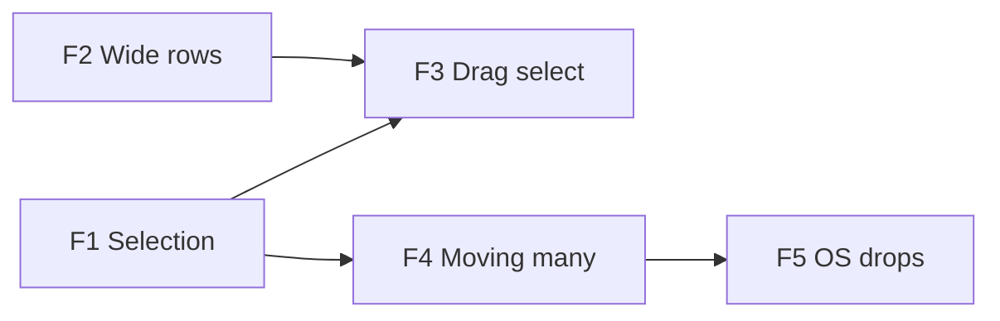

# File Explorer Plan

The Files tree should behave like a file manager rather than a styled hierarchy. That means:
- selecting several items with a click and Shift, Cmd/Ctrl or a drag box;
- moving the selection by dragging, with a stacked preview of what's moving and a clear outline around the target folder;
- copying files and folders in from Finder or Explorer;
- deeply nested rows scroll sideways instead of squeezing their names.

Today:
- The tree selects nothing; the open tab is the only highlighted row.
- A drag moves one row (O3).
- A file dragged in from the OS lands on the webview, which navigates to the file and loses the app.

All the work is in `FileTreeComponent.vue` and `useActiveWorkspaceTools.ts`, plus one new dialog and one global listener.

## Decisions

| Topic | Decision |
|---|---|
| Selection | Our own state, a set of uuids plus an anchor, kept in `FileTreeComponent`. Ranges run over the rows as shown (expanded folders only). Reka's tree selection is not used: it has no Shift-click or Cmd/Ctrl-click, only Shift+arrow, and our items already override `onSelect`. |
| Click rules | **Plain click:** opens a file or toggles a folder, as now, and selects only that row. **Cmd** (macOS) or **Ctrl** (others): toggles the row in the selection. **Shift:** the range from the anchor; Cmd/Ctrl+Shift adds the range. A click with a modifier never opens or toggles anything: the folder's `onToggle` gets `preventDefault`. |
| Look | Selected rows `bg-elevated`. The open tab's row keeps its primary style, which wins over the selection's. |
| Where a drag starts | Pressing on a row's icon and name drags it. Pressing on the rest of the row, or below the last row, draws a selection box, as in Windows Explorer's details view. So only the icon and name part is `draggable`. |
| Wide rows | Names stop truncating. The tree scrolls horizontally when rows are wider than the panel, with only the horizontal scrollbar shown. Every row is as wide as the widest one on screen (at least the panel's width). Extension tags and fold arrows stay pinned to the panel's right edge (decided after trying it); a name long enough to run under its tag is covered there. |
| What a drag moves | Dragging a selected row moves the whole selection. Dragging an unselected row selects it alone first. A selected item inside a selected folder goes with its folder. Items already in the target folder are skipped. A folder can't go into itself or below it, and that refuses the whole drop. |
| Drop target | The target folder's row and its shown contents get one `border-primary` outline (top on the folder's row, sides down its contents, bottom on its last shown row) over the existing `bg-primary/10`. The top level gets `ring-primary` around the whole tree. |
| Drag preview | `setDragImage` with a small card: the first item's icon and name, two offset cards behind it when there are more, and a count badge ("3 items"). The element stays mounted off-screen and is filled in directly at `dragstart`; Vue can't render it within the event. |
| Many moves | One move path, `moveFiles(uuids, destDir)`. `renameFile` and `moveFile` (O3) become a list of one. Links get one pass, with at most one links dialog for the whole move ("Update links to 5 items?"). |
| Name clashes | Always asked, as a file manager does. Folders merge, as in Windows Explorer: their contents move in, and only clashing files ask. A file clash offers **Replace**, **Keep both** ("Note 2.md") or **Skip**. With more clashes left, "Do this for the remaining N" applies the choice to the rest, and **Cancel** stops; what's done stays done. The same dialog serves tree moves (today a clash only shows an error toast) and OS imports. |
| OS drops | `dragDropEnabled` stays `false`: Tauri's own handler would give paths but turns off HTML5 drag & drop on every platform (tauri#14373), which the tree, the Chats list and the panels use. A dropped item's contents are read through the browser File API (`webkitGetAsEntry` for folders) and written with plugin-fs `writeFile`/`mkdir`, then indexed parent-first (`addFileToIndex`). A drop is a copy. `.DS_Store` and `Thumbs.db` are skipped. |
| Drops anywhere else | A window-level guard: an OS file drag that no handler accepts gets `dropEffect = 'none'` and `preventDefault`, so the webview never navigates. Only the tree accepts OS files. The editor, chat and panels show the "not allowed" cursor. |
| Items already in the workspace | **Detection:** an item whose name, size and modified time match an indexed one at the drop is treated as that item. If the probe (F5) finds the webview exposes the item's path (`text/uri-list`), the path decides instead. **Handling:** a found item moves, exactly as a tree drag would (links updated, refusals, its own folder a no-op). This is what Finder and Explorer do on the same disk. Holding Option/Alt at the drop copies instead, through the clash dialog. **Risk:** a false match (an identical outside copy, such as a backup) moves the workspace's file instead of copying the outside one. Nothing is lost. |
| Keyboard | With the tree focused: Esc clears the selection; Cmd/Ctrl+A selects every shown row; Delete (and Cmd+Backspace on macOS) opens the existing delete dialog for the selection. Shift+arrow ranges: not now. |

## F1: Selection

### Change
- `selected` (a `shallowRef<Set<string>>`, replaced on change so rows react) and `anchor`.
- `shownIds()`: the visible rows in order, walked from `formattedTreeData` and `expandedFolders` when a range needs it.
- The item `onSelect`/`onToggle` hooks read the click's modifiers (`e.detail.originalEvent`): plain, Cmd/Ctrl or Shift, as in Decisions.
- Rows get `bg-elevated` when selected. **As built:** Reka's tree receives the selection (`multiple`, `model-value`, `color="neutral"`) only to mark rows. Folder rows then use its own selected style, file rows `data-selected:bg-elevated`, and `aria-selected` comes for free.
- Collapsing a folder deselects what's inside it, so no action hits rows the user can't see. Ids that leave the index drop out.
- Clicking below the last row clears the selection.
- Right-click on an unselected row selects it alone, as now. Right-click inside a selection of two or more opens a menu for all of them:
  - Open in new tabs (files only);
  - Reveal in file explorer (`revealFilesInFileManager` already takes a list);
  - Copy full paths / Copy relative paths (one per line);
  - Delete (`DeleteFilesModal` already takes ids; its title already counts them).
- Keyboard: Esc, Cmd/Ctrl+A, Delete / Cmd+Backspace, as in Decisions.

### Acceptance
- Cmd/Ctrl-click adds and removes rows without opening them. Shift-click selects the range from the last plain or Cmd/Ctrl click, across folders. A plain click opens and selects just one row.
- Collapsing a folder deselects its contents.
- With three selected, the menu offers the four group actions, and Delete asks once for all three.

### Results (done)
Checked on the stubbed production build with real mouse clicks and macOS keys:
- A plain click opened M0_2 and selected only it.
- Cmd-click added M0_5, and a second Cmd-click took M0_2 out again.
- Shift-click on M0_8 selected M0_2 to M0_8; Cmd+Shift on Sub added Sub to M0_1.
- Cmd-click on the closed Big selected it and left it closed.
- Collapsing F00 dropped its contents from the selection.
- The selection's menu: Open in New Tabs, Copy full paths, Copy relative paths, Reveal in File Explorer, Delete.
- Esc cleared the selection; Cmd+A selected all 37 shown rows; Delete with two selected asked "Delete 2 file(s)?".
- A click below the rows cleared the selection, and a drag still moved a note.

Unverified: Ctrl on Windows and Linux, and the menu actions' own effects (they reuse `openTabs`, `writeText` and `revealFilesInFileManager`).

## F2: Wide rows

### Change
- Each row is split into a grab part (icon and name: `draggable`, `data-grab`) and the rest of the row. **As built:** the extension tag and fold arrow (`data-tail`) are not part of the grab part.
- Names lose `truncate`, and the tree scrolls sideways: the new `scrollbar-x` utility shows a thin horizontal scrollbar and hides the vertical one.
- **As built, widths:** Reka's virtualizer positions rows absolutely, so rows can't size each other.
  - `fitRows` measures the rows on screen and sets `--row-w` on the tree. Each row is `min-w-full w-(--row-w)`, so every row and its highlight span the whole scroll width.
  - It is set straight on the DOM, so the tree doesn't re-render.
  - It runs on mount and row changes (a mutation observer), on scroll, on resize and when a web font loads. That last one matters: the first measurement came out 8 px wide before the font arrived.
- **As built, tails:** the tag or arrow is `sticky right-2.5`, pinned at the panel's right edge in the same spot as before.
  - A row whose name runs under its tail gets `data-clip` and `--clip` (where the tag starts, measured from the name). In main.css those mask the name so it fades out just before the tag.
  - The mask is on the name only, so the row's highlight stays whole.
  - **Superseded:** the first version backed the tail with the panel's color. On a hovered or selected row, that backing showed as a block cut out of the highlight (reported from Vertex).
- The nesting guides, drop highlight and selection background span the row's full width.

### Acceptance
- A row five levels deep with a long name shows the whole name and scrolls sideways with a trackpad or the scrollbar. The vertical scrollbar stays hidden.
- Dragging by the name moves the row. Pressing on the blank part doesn't start a move.

### Results (done)
Checked on the stubbed production build, with a note four levels deep named "A very long note name that keeps going well past the panel edge":
- **Widths and tags:**
  - Every row was 497 px wide in a 271 px panel. Scrolled fully right, the whole name showed and every tag stayed at the panel's edge (269 px).
  - At rest, only that row was marked clipped, and its name faded out before its tag. Selected, its highlight ran unbroken under the tag.
  - Scrolled 100 px, the fade moved with it (`--clip` 153 → 253 px). Fully right, the row was no longer clipped.
  - Collapsing its folder shrank the rows back to 271 px. A 600 px panel gave 600 px rows with the tags at its edge.
- **Dragging:** a real mouse drag from a row's blank part started no drag. One from the name dragged the note and moved it.
- **Selection:** still worked.

Unverified: whether the thin scrollbar shows (headless Chromium uses overlay scrollbars) and trackpad scrolling. Both need WKWebView.

## F3: Drag select

### Change
- A pointer press on a row's blank part, or below the rows, followed by more than 4 px of movement, draws a box (`border-primary bg-primary/10`). **As built:** the box is tracked in the tree's content coordinates and drawn as a fixed element (teleported to `body`), clipped to the tree.
- Rows in the box are found from their index in `shownIds()` times the row height, not from the DOM, so rows the virtual list has unmounted still count. All rows measured 28 px (files and folders alike), so the virtualizer's offsets weren't needed.
- A plain drag replaces the selection; a drag with Cmd/Ctrl adds to it. The box updates the selection as it moves, and only a change re-renders the tree.
- Near the top or bottom edge the tree scrolls, by the same 40 px zone and 12 px step as O3's edge scroll.
- A press without movement is a normal click. The click that ends a box is swallowed, so it neither opens the row it ends on nor clears the selection (as a click below the rows would).
- **As built:** the tree lost `data-tauri-drag-region`. A press on its empty area used to start a window drag, which now has to start a box.

### Acceptance
- Dragging from blank space over eight rows selects those eight. Continuing past the bottom edge scrolls and keeps selecting. Cmd/Ctrl+drag adds to an existing selection.

### Results (done)
Checked on the stubbed production build with a real mouse:
- **Selecting:**
  - A box from M0_1's blank part to M0_8 selected exactly those eight, with no long task. The open tab didn't change.
  - Cmd+box over M0_12–14 added those three; a plain box over M0_3–5 replaced everything with those three.
- **Auto-scroll:** a box from M0_14 held near the bottom edge scrolled 744 px and selected M0_14 to M0_44. Scrolled back to the top, M0_14 was still selected.
- **Below the rows:** a box drawn up from there to Data.base selected the ten rows in between.
- **Clicks:** a 2 px press on Big acted as a click (selected and opened it); one below the rows cleared the selection.
- **Moves:** a drag by the name still moved a note.

Unverified: Windows/Linux Ctrl, and losing the window drag on the tree's empty area in Tauri.

## F4: Moving many

### Change
- **Moves in `useActiveWorkspaceTools`:**
  - `relocateFile` takes a list of `{uuid, relocate}` and gathers the link impact of all of them before any move.
  - `moveFiles(uuids, destDir)`:
    - drops items inside another moved folder and those already in `destDir`;
    - resolves clashes through the dialog; a folder clash merges, which expands into its children's moves and removes the emptied source folder;
    - moves the rest;
    - makes one link pass, with one dialog.
  - **Replace** removes the existing item first (index, open tab).
  - **Keep both** relocates under a free name, and its links follow like a rename.
- **Free names:** `freeName(name, taken)` in `shared/utils/fs/filenames.ts`. "Note.md" becomes "Note 2.md", then "Note 3.md"; "Folder" becomes "Folder 2". A small test covers extensions, dotfiles and numbers already taken.
- **`FileConflictModal`:**
  - It shows the clashing name, the folder, and both sides' size and modified date.
  - Its result is `{action: 'replace' | 'keepBoth' | 'skip' | 'cancel', all: boolean}`. The "Do this for the remaining N" checkbox appears only when N is at least 1.
  - `UpdateLinksModal` gets an "N items" title for moves of several items.
- **The tree:**
  - `dragged` becomes the list of uuids, and `canDrop` checks all of them.
  - The drop outline and top-level ring are as in Decisions.
  - The drag preview element is as in Decisions.
  - After a drop, the target folder opens and the moved items stay selected.
- **Strings:** the clash dialog, "{count} item(s)", the links dialog's plural title, and the multi-select menu labels, in `en` and `zh-CN`.

### Acceptance
- Dragging three selected files and a folder onto a folder moves all four, with one links dialog. The preview shows a stack with "4 items".
- Hovering a folder outlines it and its shown contents in primary; the empty space below outlines the whole tree.
- Moving a note onto a folder with a note of the same name asks:
  - Keep both gives "Note 2.md" with its links updated;
  - Replace leaves one note, and the replaced one's tab closes;
  - Skip leaves both where they were.
- Two clashes with "Do this for the remaining 1" checked ask once.
- A folder moved onto a same-named folder merges.

## F5: OS drops

### Change
- **Probe first**, in Vertex on macOS (needs the user): log `dataTransfer.types`, and `text/uri-list` if present, for a Finder drop on the tree. That shows whether paths are available for detection. On Windows, check that the guard alone stops the navigation.
- **Guard:** a window-level `dragover`/`drop` listener in `app.vue`, for drags carrying `Files` that no handler accepted (`defaultPrevented`): `dropEffect = 'none'` and `preventDefault`. Other windows load the same app, so the guard covers them too.
- **The tree accepts `Files`:**
  - It uses the same targets, outline and hover-to-open as tree drags. The effect is `copy`, or `move` for items already in the workspace.
  - On drop, the entries are taken synchronously (`items[i].webkitGetAsEntry()`, falling back to `getAsFile()` when there's no entry), then walked: `readEntries` repeats until it returns nothing.
  - Items already in the workspace go to `moveFiles`, unless Option/Alt is held.
  - The rest are copied:
    - a clash asks through `FileConflictModal`;
    - folders merge;
    - each path is marked `markSelfWrite` before it is written, then indexed parent-first.
  - Afterwards the imported items are selected, with one toast: "Added N item(s)", plus anything that failed.
- `ponytail:` file bytes cross the IPC in memory, so a multi-GB file is slow and memory-heavy. If that matters, enable Tauri's path-based drops (paths, copied in Rust) once Tauri stops making them exclusive with HTML5 drag & drop.

### Acceptance
- **Guard:** an OS file dropped on the editor, the chat or a panel does nothing, and the app stays where it was.
- **Copies:**
  - A Finder file dropped on a folder row is copied in and opens like any note; its links are indexed.
  - A Finder folder with subfolders arrives whole.
- **Clashes:** a clash asks, and many clashes offer "Do this for the remaining N".
- **Items already in the workspace:** dropped back onto a different folder, a file moves (links updated). Onto its own folder, nothing happens. With Option/Alt held, it's copied through the clash dialog.

## Checks
- **Each phase:**
  - Browser runs on the stubbed production build, as in the Performance Plan: dispatched pointer, mouse and drag events, and a synthetic `DataTransfer` with `File`s for F5. Selection, ranges, the box over unmounted rows, multi-moves with clashes, the outline, and the preview's content.
  - Then `bun run typecheck`, `bun run lint` and `bun run test`.
  - The docs: `Concepts and Structures.md` (the Files tree) and a `SMOKE.md` row.
- **Only in Vertex (SMOKE):**
  - real Finder and Explorer drops;
  - the drag preview's look in WKWebView and WebView2;
  - trackpad sideways scrolling;
  - the guard on Windows.
