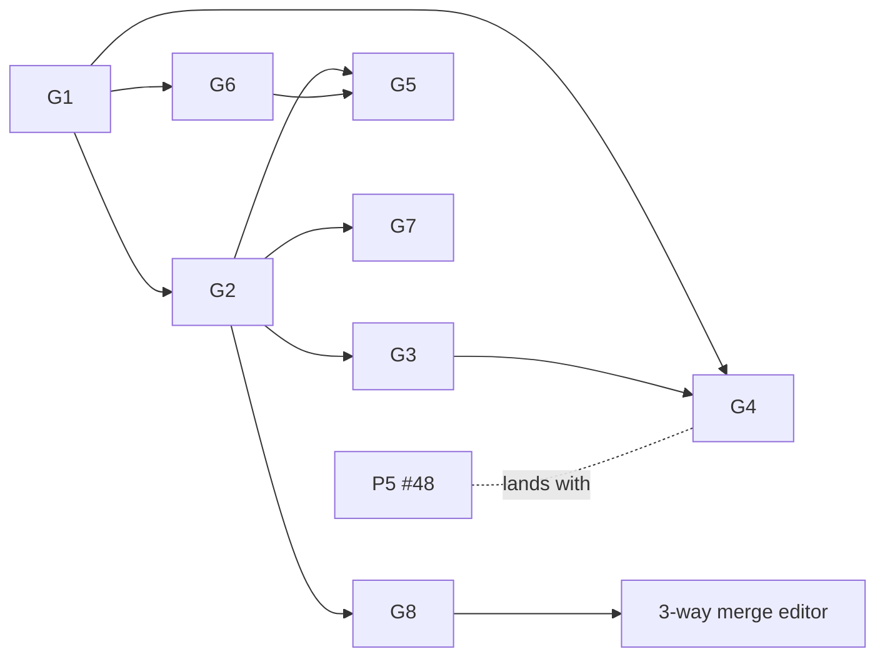

# Git Integration Plan

Tracking issue: #42. The panel groundwork (#43, P1–P4) is done; P5 (#48, a view as a tab) lands with G4.

Users sync workspaces with git until Vertex Hub exists. The interface has to work for developers and be easy to set
up for people who have never used git.

## Decisions

| Topic | Decision |
|---|---|
| Engine | The installed `git`, spawned from Rust: the user's config, credential helpers, SSH agent, hooks and LFS apply. No libgit2. |
| Sign-in | git's credential helpers first; otherwise a personal access token kept in the OS keychain per host and handed to git for one run. |
| Sync | A Sync button (commit everything, pull, push); auto-sync settings are opt-in, off by default. |
| Wording | Git terms (Commit, Push, Pull, Branch), each with a one-line tooltip; the tour explains them. |
| Pull | Merge, not rebase, unless the user's own `pull.rebase` says otherwise. |
| Conflicts | Per file (mine / theirs / edit the markers) first; a 3-way merge editor is a follow-up. |
| Chats | The setup asks whether to sync workspace-stored chats (`.vertex/chats`, encrypted binary files). |
| Diffs | `ChatChanges`' rendering on `diff` (installed); no `@codemirror/merge` until the merge editor. |
| Views | Two registered views, Changes (left) and History (bottom); panes put them together when wanted. |

## G1: Git backend (#49)

### Change
- `src-tauri/src/git.rs` (commands) and `app/utils/gitClient.ts` (`GitCommand`, `GitError`, `gitClient`), like `chats.rs` / `chatClient.ts`; types in `shared/types/app/git.d.ts`.
- Finding git, cached once found:
  - `gitConfig.path` (global settings only: a workspace must not choose an executable), else
  - on macOS `/opt/homebrew/bin/git`, `/usr/local/bin/git` (an app opened from Finder doesn't get the shell's `PATH`), then
  - `PATH`. `/usr/bin/git` on macOS only counts when `xcode-select -p` succeeds; otherwise running it pops the "install developer tools" dialog.
- Every run: `GIT_TERMINAL_PROMPT=0` (never waits on a prompt), `GIT_OPTIONAL_LOCKS=0` (a status refresh never takes `index.lock`), `LC_ALL=C` (English output, so errors can be recognised), stdin closed, no console window on Windows.
- One mutating operation at a time per repository (a lock per top folder); reads don't wait.
- Commands (all take the workspace `root`; paths are relative to the repository's top folder):
  - `git_version` → `{path, version}`.
  - `git_status` → top folder, branch (none when detached), head, upstream, ahead/behind, merging, files (path, original path for renames, index and worktree state, conflicted).
  - `git_log(skip, limit)` → commits of every branch, remote branch and tag, newest first: id, parents, author, email, time, refs, subject, body.
  - `git_commit_files(id)` → the files a commit changed against its first parent.
  - `git_diff(staged)` → the patch of the working copy or of what's staged.
  - `git_show_file(rev?, path)` → a file's text at a commit, or in the index when `rev` is absent.
  - `git_stage(paths)`, `git_unstage(paths)` (also before the first commit), `git_discard(paths)` (back to the last commit; untracked files are deleted).
  - `git_commit(message, all)` → the new commit's id; `all` stages everything first (Sync).
  - `git_fetch`, `git_pull` (`--no-rebase` unless `pull.rebase` is configured), `git_push` (a branch without an upstream is pushed to its only remote, or `origin`, and tracks it).
  - `git_branches`, `git_switch(name, create)`.
  - `git_init` (`main` unless `init.defaultBranch` is set), `git_clone(url, dest)`, `git_remotes`, `git_remote_set(name, url)` (adds or changes).
  - `git_merge_abort`.
- Expected failures come back as `GitError` strings: `missing` (no git), `not-repo`, `auth`, `conflict`, `rejected` (push needs a pull first), `no-remote`, `no-upstream` (pull without tracking, or several remotes and no `origin`), `identity` (no `user.name`/`user.email`). Anything else is git's own message.

### Acceptance
- [x] Rust tests: status, log, branch and remote parsing; error classification; a round trip against a real repository in a temp folder (init, commit, stage/unstage, discard, status, log, commit files, show file, branch, a bare remote with push/pull and a conflict).
- [x] `gitClient` types match what Rust returns.
- [x] `Concepts and Structures.md` describes the backend.

## G2: Changes view (#50)

Blocked by G1.

### Change
- `definePanelView({id: 'git', defaultArea: 'left', when: workspace windows})`.
- Top: branch with ahead/behind; **Sync** (stage all, commit with a default or generated message, pull, push), with progress and errors explained in plain words.
- Changed files in two lists, Staged and Changes: stage, unstage, discard (asks first), open the file; tooltips explain staging and each status letter.
- Commit box: message, Commit (with nothing staged it commits every change), Commit and Push; ⌘↩ commits.
- Header actions (`usePanelActions`): Fetch, Pull, Push, Refresh. Branch picker on the branch name: switch, check out a remote branch, type a new name to create one.
- Refresh: every watcher event under the workspace (`.git/` and the app's own saves included), debounced; and on window focus (a repository above the workspace isn't watched).
- Not a repository: **Create repository** (`git_init` with `.gitignore` lines: `.DS_Store`, `Thumbs.db`, `desktop.ini`, `.vertex/trash/`, `.vertex/**/*.tmp`; with chats stored in the workspace, a **Sync chats** checkbox, unticked adds `.vertex/chats/`). G5's wizard builds on it.

### Acceptance
- [ ] Edit, stage, commit and push from the view against a real remote; Sync does it in one click.
- [ ] A commit or branch switch made in a terminal shows within a second.
- [x] Errors from G1 show as explanations with a next step (sign in, pull first, set your name).
- [x] SMOKE row; Concepts doc; en + zh-CN strings.

## G3: Diff tabs (#51)

Blocked by G2.

### Change
- A file's diff opens as a tab (`kind: 'diff'`, `GitDiffView`): working copy vs last commit (Changes rows), staged vs last commit (Staged rows), or a commit vs its first parent (G4). The tab id holds the whole spec (`diffTabId`, URL-safe), so the page renders from the route and the same diff reopens the same tab; diff tabs aren't restored after a relaunch.
- `lineDiff` / `splitRows` (`shared/utils/textDiff.ts`, on `diff`): numbered lines, unchanged runs folded to 3 lines of context (click to unfold; unfolded stays open across reloads), a missing final newline ignored; side by side from 760 px, one column below; read-only; binary files (a NUL in the first 8000 characters) say so.
- From a row: click (or Enter) opens the diff, Open file opens the note; a conflicted file opens itself, to fix its markers. Right-click: Open changes. The diff's header has the side, what it compares with, new / deleted / renamed, +/− counts and Open file.

### Acceptance
- [ ] Modified, added, deleted and renamed files diff correctly; binary files say so. (Modified, new, staged and binary checked; deleted and renamed not yet.)
- [x] The tab follows the file: a new edit updates the diff.
- [x] SMOKE row; en + zh-CN strings.

## G4: History ("Git Map") (#52)

Blocked by G1 and G3. Lands P5 (#48).

### Change
- `definePanelView({id: 'gitHistory', defaultArea: 'bottom', tab: true})`, available only where the workspace is a git repository (`isGitRepo`, kept by `watchGitPresence`: checked when the window opens and when `.git` comes or goes), so other workspaces get no bottom area for it. The Git view's History button shows it in its panel (moving it out of Hidden if needed) or, failing that, in a tab.
- Commit graph: `graphRows` (`shared/utils/gitGraph.ts`) lays out lanes from parent ids (a lane waits for the commit it leads to; parents another lane waits for are joined at once; lanes never move sideways); colored per lane, merge commits hollow, HEAD larger; branch, remote branch and tag badges (the current branch solid), so ahead/behind shows as separate tips.
- Paging: `git_log` 300 at a time as the list nears its end; only the rows on screen are drawn (`useVirtualList`). It reloads (as many rows as are loaded) when the head, branch, upstream or ahead/behind change.
- Selecting a commit: subject, body, author, date, copyable id, parents (click to select), changed files (`git_commit_files`), each opening a G3 diff against the first parent. Side by side from 720 px, stacked below.
- P5 (#48): History opens as a tab too (see Concepts → Panels).

### Acceptance
- [ ] A repository with merges draws without crossing lanes needlessly; 5 000 commits scroll smoothly. (Merges and branches checked; 5 000 laid out in 18 ms and 1 200 paged and scrolled; 5 000 not scrolled in the app.)
- [x] Graph lane layout has unit tests (linear, branch, merge, octopus).
- [x] SMOKE row; Concepts doc; en + zh-CN strings.

## G5: Setup and onboarding (#53)

Blocked by G2 and G6.

### Change
- The Changes view shows a setup card when:
  - git is missing: on macOS **Install developer tools** (`git_install_tools`: `xcode-select --install`), then **Install git** (git-scm.com's page for the OS), a **Locate git…** button (`gitConfig.path`; once set, the card says it isn't a working git and offers **Find git automatically**), Check again;
  - the workspace isn't a repository: the wizard.
- Wizard (`GitSetup`, a stepper): create the repository → `.gitignore` (system files, `.vertex/trash/`, `.vertex/**/*.tmp`; the **Sync chats** checkbox explaining the conflict risk, adding `.vertex/chats/` when off) → your name and email (`git_identity` / `git_identity_set`, repository config; prefilled from what git uses) → connect a remote (paste a URL; a link to create a repository on GitHub, kept empty) → first push (`sync`; sign-in from G6 on the way). Remote and push can wait (Later). A failed commit (`identity`) or push (`no-remote`) offers that step from its toast.
- Home page: **Clone Workspace…** (URL, a folder to put it in, the new folder's name from the URL; sign-in from G6), then opens it.
- `useTour` tour of the Changes view (Sync, Branch, ahead/behind, Fetch/Pull/Push, the lists and staging, Commit, History), once after setup and from a Tour button; terms explained once.

### Acceptance
- [ ] A user with git installed and a GitHub account goes from a plain folder to a pushed repository without a terminal. (Browser, stubbed: create → name and email → GitHub's new-repository page → connect → commit and push → token → pushed; the pieces' Rust side is tested (identity round trip; push with a token against GitHub in G6); not yet in Vertex.)
- [ ] Cloning opens the new workspace. (Browser, stubbed: clone, token, clone again, a new workspace window; not yet in Vertex.)
- [x] The tour reaches every part of the view. (All 7 steps outlined their targets; Back, Skip and the Tour button.)
- [x] SMOKE row; Concepts doc; en + zh-CN strings.

## G6: Sign-in (#54)

Blocked by G1.

### Change
- git's credential helpers are used as configured (Git Credential Manager on Windows opens a browser login).
- When a fetch, pull, push or clone fails with `auth`: `GitSignInModal` explains personal access tokens (a button to the token page of github.com, gitlab.com or codeberg.org, scopes filled in; other hosts are told where), takes a token and an optional username, saves it in the keychain per host (`keyring`, one `git-tokens` entry), and the operation runs again. A host whose saved token was refused says so; ssh-only repositories get the toast instead (add the key to the agent).
- A stored token is handed to git for that run only: `-c credential.helper=` (the user's helpers off for that run, so none stores it) `-c credential.helper=<a shell function>` that reads `VERTEX_GIT_CREDENTIALS` and answers only https requests for that host. It never reaches the repository's config, the arguments or the disk; hooks of that run do inherit the variable.
- Settings → Git: list stored hosts, remove a token.

### Acceptance
- [ ] Push to a private HTTPS remote with no helper configured works after entering a token once, and again after a relaunch. (The Rust path checked against GitHub with a real token from the keychain: refused without one, refused with a wrong one, accepted with the right one; the modal and retry checked in the browser; not yet in Vertex.)
- [ ] A wrong token asks again; removing it from Settings makes git ask again. (Browser, stubbed; Rust: removed token → `auth`.)
- [ ] The token doesn't appear in `.git/config`, the process list or logs. (Not in `.git/config`, the arguments or `GIT_TRACE`, which shows only Vertex's helper running; but the environment of that git process, hooks included, is readable by the same user while it runs, e.g. `ps eww`.)
- [x] SMOKE row; en + zh-CN strings.

## G7: AI commit messages (#55)

Blocked by G2.

### Change
- `commitMessage` entry in `AI_FEATURES` (its model picker and switch in Settings → Assistive AI → Features; on by default with AI, like the others; its description says the diff goes to the model).
- `generateCommitMessage` beside `generateChatTitle` (`useCommitMessage` gathers it): the files with their status letters, the diff of what the commit takes (the index, plus the working copy when it takes everything; new files only listed), cut at 16 000 characters and saying so (`commitPrompt`), and the 10 latest subjects, so it follows the repository's style. `cleanCommitMessage` drops reasoning, a code fence and quotes.
- ✨ button in the commit box (for what Commit would take: the staged changes, or every change when none are staged); Sync uses it for every change when the feature is on and the box is empty ("Writing message…"), falling back to "Update N file(s)" when the model fails.

### Acceptance
- [x] The button fills the box from the staged diff; turned off, the button hides. (Browser, stubbed `ai_request`: the staged diff and recent subjects sent, the reply filling the box; off: no button and Sync makes no AI call.)
- [x] Large diffs are trimmed, not rejected. (`commitPrompt` test; browser: a 50 101-character diff sent as its first 16 000 with the note.)
- [x] SMOKE row; en + zh-CN strings.

## G8: Conflicts and auto-sync (#56)

Blocked by G2.

### Change
- A pull that conflicts lists the conflicted files first (Conflicts): keep mine, keep theirs (`git_resolve`; a side that deleted the file deletes it), or open the file to edit the conflict markers; Mark resolved (asks when `git_conflict_markers` still finds markers); Finish merge (`git_merge_continue`, enabled once none are left); Abort merge always available. Merge only: with the user's own `pull.rebase`, a rebase's conflicts show in the list but finish in a terminal.
- `gitConfig.autoSync` (`useGitAutoSync`, in every workspace window, with or without the Git view): every N minutes (5, 15, 30, 60), when the workspace opens, pull when the window gets focus (at most once a minute). All off by default; Settings → Git. It commits as "Update N file(s)" (no AI).
- Auto-sync never runs during a merge or after the remote refused to sign in (until an operation from the Git view succeeds); failures show once, not every interval.

### Acceptance
- [x] Two clones editing the same note: the conflict resolves each way and both clones end up equal. (Rust round trip with real git: one clone keeps its own side and pushes, the other takes theirs; both files equal; a side that deleted a file removes it.)
- [x] Auto-sync runs on its schedule and stops on a conflict. (Browser, stubbed with a 3-second interval: sync on open and on each interval; no calls and one toast during a merge, running again after; after a sign-in failure, no more runs until a manual Push worked.)
- [x] SMOKE row; Concepts doc; en + zh-CN strings.

## Follow-up: 3-way merge editor (#57)

Blocked by G8. A merge tab with both versions and the result (`@codemirror/merge`), opened from a conflicted file.
