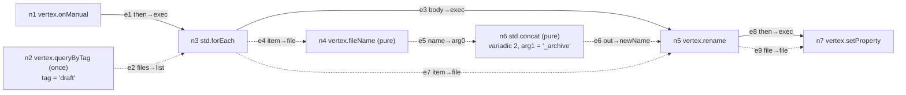

# Node Engine — Specification (Draft 2)

> **Status**: Spec; M1 (`validate`), M2 (runtime, `std`), M3 (functions, variables, `migrate`, `hashProgram`), M4 (`testing`, typed run contexts), M5 (`vue`), M6 (Vertex language, `.workflow` tab, dry run, trust, undo), M7 (editor history, clipboard, selection, menus, quick-add), M8 (categories, sentence labels, workbench, inspector, view aids), M9 (groups, comments, variables, My Blocks, named exits, make block, references), M10 (live runs, cancel, pause and step, interactive time) and M11 (std operators, Vertex notes/files/tags/ask nodes, `ui` capability, VaultPicker, runs from the tree and palette, zh-CN node labels) implemented. Supersedes the execution, trust and schema sections of [Workflows.md](Workflows.md).
> **Date**: October 2026. Draft 2 (2026-10-31) adds subtyping and `Dictionary` (§3), the decision log (Appendix A) and research notes (Appendix B). Implementation decisions are recorded as Appendix A #17–23 (M1), #24–30 (M2), #31–37 (M3), #38–43 (M4), #44–53 (M5), #54–63 (M6), #64–69 (plan for M8–M11), #70–75 (M7), #76–81 (M8), #82–88 (M9), #89–94 (M10) and #95–106 (M11).
> **Name**: `@type32/workflows` (repo `CTRL-Neo-Studios/workflows-scripting-engine`), with subpath exports `./core`, `./core/std`, `./core/testing` and `./vue`. `engine/…` below means `@type32/workflows/…`.

---

## 1. Goal and Roles

A visual node-scripting toolkit. Developers define their own languages (types, nodes, logic) in TypeScript. End users build programs from those nodes on a canvas. The engine validates and runs those programs. Vertex is the first language.

| Role | Writes | Uses |
|---|---|---|
| Engine authors | `engine/core`, `engine/vue` | — |
| Language developers (Vertex) | Types, nodes, effect interfaces, effect handlers | SDK, `engine/core/testing` |
| Script authors (end users) | Documents (`.workflow` in Vertex) | Editor components, runner |

**Trust boundary.** Language code is trusted: it ships with the host app. Documents are untrusted data. The engine never evaluates code that comes from a document.

**Core split.** Every node is a *manifest*, which is serializable JSON, plus an *implementation*, which is code.
- `validate(doc, manifest)` needs only the manifest. Editors can load any language from JSON.
- `compile(doc, language)` needs the implementation. Only the host that runs programs has it.

---

## 2. Packages

| Package | Contents | Dependencies |
|---|---|---|
| `engine/core` | Type system, language definition, manifest, document format, validation, migrations, runtime | none |
| `engine/core/std` | Standard nodes (control flow, logic, strings, lists) | `engine/core` |
| `engine/core/testing` | `record(effects)` (recording proxy, `log()` lines like `fs.rename(/v/a.md, a_archive)`), `buildDocument(language, spec)` (node versions from the manifest, edges as `"a.port > b.port"`), `run(language, doc, { event, effects, … })` (compile, dispatch, captured trace), `formatTrace`, `assertValid`. No test framework dependency | `engine/core` |
| `engine/vue` | `useWorkflowEditor`, `WorkflowCanvas`, `WorkflowNode`, `WorkflowPalette`, `WorkflowWidget`, `WorkflowDiagnostics`; `style.css` (§2.1) | `engine/core`, `vue`, `@vue-flow/core`, `@nuxt/ui` (optional peers) |

Rules:
- `engine/core` uses no DOM, Vue or Node APIs. It runs in a browser, a Worker, Node and Bun.
- A hard kill, for example of a node that loops forever without awaiting, is the host's job: run the program in a Worker or `worker_threads`. The runtime itself stops cooperatively (§8.6).
- New packages are split out only when a second consumer needs them.

**Rete.js** was evaluated and rejected as the runtime. `rete-engine@2.1.1` `ControlFlow.execute` calls `forward()` without awaiting it, and `execute()` returns `void`. A test showed a two-iteration loop firing `done` before either async body finished. It also has no cancellation, limits or per-iteration values. VueFlow is used only for the canvas.

### 2.1 `engine/vue`

- **State.** `useWorkflowEditor(manifest, doc, options?)` holds the document (deeply reactive), the current graph (`'main'` or a function id) and `analysis`, which is `validate` rerun on every program change. Edits go through its methods: `addNode`, `removeNodes`, `moveNode(s)`, `connect`, `removeEdges`, `disconnect`, `setLiteral`, `setTypeArg`, `setVariadic`, `setRef`, `paste`, `duplicate`, `addWired`; frames `addGroup`, `addComment`, `updateFrame` (the node methods take their ids too); declarations `addVariable`, `updateVariable`, `removeVariable`, `addFunction`, `updateFunction`, `removeFunction`, `addPort`, `renamePort`, `setPortType`, `removePort`; `makeBlock`. `snapshot()` returns a plain copy to save or run. Editors need only the manifest (§1). `options`: `messages` (every built-in string, e.g. a translation; a getter keeps it reactive) and `clipboard` (default `navigator.clipboard`).
  - **Ids** are `n<k>`/`e<k>` for nodes and edges, `v`/`f`/`g`/`c` for variables, functions, groups and comments, unique across the whole document (core's `nextId`).
  - **Declarations.** Renaming a block's input, output or exit (`renamePort`) rewrites the edges, literals and return `ref`s that use it; a name the call's exec and data ports already use (`exec`, `then`, the exits, the outputs) is refused. Removing one drops what used it, an exit its returns; the last exit stays. Removing a variable or block removes its get/set or call nodes (`analysis.references`); turning a block pure drops its exits and the exec wires at it and its calls. New variables are strings; a new type drops the default.
  - **Wiring** a used data input or exec output replaces its edge.
  - **Connection checks.** `connectionProblem(from, to)` validates a copy with the edge added. It returns the first new error other than `E_REQUIRED_INPUT`, `E_LITERAL_INVALID` and `E_UNRESOLVED_TYPE`. While dragging, the canvas shows that message and refuses the drop, so the canvas never has a second rule set.
  - **Trace.** `trace` holds the last run's events and is cleared on any program change. `traced` maps them to nodes (run count, fault, last output values) and to taken edges: exec edges from `exit`/`fire` ports, data edges from `value` ports.
  - **History.** `undo`/`redo` step through JSON snapshots of the document without its viewport, taken by watching it, so edits count however they're made (methods, a host replacing the document). Repeats of one small edit under 500 ms apart are one step: typing into one literal, nudging one node. Everything else is its own step, however quickly it follows. Up to 200 steps; in memory.
  - **Clipboard.** `copy(ids)` takes the nodes and the edges between them; `paste(clip, at?)` adds them with fresh ids, top-left at `at` or offset 32 px, and refuses a clip of another language. The clip goes to the clipboard as JSON; `parseClip` checks its shape (pasted text is untrusted; `validate` reports the rest). An unreadable clipboard (denied, or no answer within 500 ms) falls back to the last copy made in the app.
  - **Wiring new nodes.** `fit(type, init, ends, replacing?)` tries a new node against existing ports on a copy, as connection checks do, and returns the port of it for each end. `addWired` adds the node and those edges, replacing `replacing` (inserting into an edge). Quick-add filters its list with `fit`.
- **Canvas.** Exec ports are arrows. Data ports are circles (one value), squares (`List`) or diamonds (`Dictionary`), colored by resolved type and hollow until wired.
  - Nodes are `UCard`s. The header carries the node's category color (§5; the node's own `color` wins): a tinted background and a solid icon tile, with the node's `icon`, else its category's, else its mode's. Nodes without a color keep the mode's tile and a neutral header; bodies are always neutral. The header holds the label, as a sentence when it has placeholders (§4.1): an unwired input's editor inline, a wired one as a chip; those inputs keep their body row for the wire without a second editor, and inline settings (`wire: false`) have no row. Core nodes are titled by their declaration (`editor.title`): the variable's name, "Set name", the block's name, Entry, Return or "Return · exit". Then `UBadge`s for `requires`, run count and diagnostics (`UTooltip` lists them). Values are badges, faults a `UAlert`. A footer holds type-parameter pins (`USelect`), the variadic count (`UInputNumber`) and, on a return in a block with several exits, the exit it leaves through. Hovering a data handle shows its type. The card's ring shows state: selected (primary), invalid (error), ran (success), faulted (error, glow).
  - **Groups** (`view.groups`) are frames drawn under the nodes, dragged by their header; dragging one carries everything wholly inside it (nodes, comments, smaller groups) in one undo step. The header holds the label (double-click or the pencil to rename) and, on hover, color and delete; the corner resizes. Clicks and selection boxes pass through a group's body, and frames aren't selectable, so a box never catches one. **Comments** (`view.comments`) are sticky notes (yellow by default) with a text field, the same header buttons and resize corner, and don't carry anything. Both are view-only (§6).
  - Edges are drawn invalid (red, dashed), converted (dotted) or taken (glowing, animated for exec).
  - Edges whose node or port can't be rendered are left out; the diagnostics list them.
- **Widgets.** An unwired input gets a Nuxt UI editor picked from its type's literal schema: `enum` → `USelect`, `boolean` → `USwitch`, `number`/`integer` → `UInputNumber`, `string` → `UInput`, anything else → JSON in a `UInput`. Opaque and unresolved types get none. Empty text unsets the literal.
- **Overrides.** `WorkflowCanvas` slots: `#widget` replaces one input's editor (props: node, port, resolved type, schema, value, fallback, `update`, `messages`; `editor.widgetFor(node, port)` builds them); `#node` replaces a whole node (render `WorkflowNode` inside it to keep the default body). A `WorkflowNode` rendered from `#node` takes its own `#widget` slot; the canvas's applies only to nodes it renders. `WorkflowInspector` takes the same `#widget` slot, and the workbench passes its own to both.
- **Styling.** Components are built from Nuxt UI (`@nuxt/ui/components/*.vue` imports), so they follow the host's theme: semantic colors, radius, light/dark. Modes map to semantic colors (event `error`, exec `info`, pure `success`, once `warning`) for nodes without a category color. The host needs Nuxt UI set up and Tailwind scanning this package (`@source` on its `dist`). `style.css` covers the canvas grid, ports, wires, category tints and the type palette: 17 named `--wf-*` colors and `--wf-type-*`. `TypeDef.color`, `CategoryDef.color` and `NodeManifest.color` take a palette name or any CSS color (`paletteColor`); a type without one takes its nearest ancestor's, else a stable pick. `List`/`Dictionary` take their item's color.
- **Categories.** `editor.categories`: the language's categories in `order` (those with entries in the current graph), with the two built-ins, always (Variables, orange; My Blocks, pink), after those of order 0 or less and before the rest, then one neutral group per namespace for uncategorized nodes. So a language puts its own sections after Variables and My Blocks with `order: 1`, as Scratch does. `editor.look(type)` gives a node's category, CSS color and icon.
- **Palette** (`WorkflowPalette`, the node library): a rail of categories (colored round icons, Scratch-style; clicking one scrolls to its section, scrolling marks the section at the top) beside a search box and node cards (icon tile, label with its placeholders as slots, description, `requires`). `editor.entries` lists language nodes, variable get/set, calls, a body's missing entry, and its returns (one per exit; a pure body's while it has none); event nodes are hidden inside function bodies. Click adds a node at the middle of the uncovered canvas; drag drops it at the cursor (`PALETTE_MIME`).
  - **Variables** lists the document's variables, and inside a block its locals (house icon), with New variable (inside a block: for this block only, or for the whole workflow). Clicking or dragging a variable adds a Get, with ⌥ a Set; its pencil opens `WorkflowVariable` (name, type, default, delete).
  - **My Blocks** has New block (creates an exec block with a wired entry and return, and opens it) and each block's call card with an open button.
- **Inspector** (`WorkflowInspector`): for one selected node, its title, category, description, problems, inputs (wired ones as a link to the source node, unwired ones with their editor) and outputs (last value after a run, else type); a get/set adds its variable's `WorkflowVariable`, a call, entry or return its block's `WorkflowSignature` (name, exec switch, inputs and outputs with `WorkflowTypeSelect`, exits, open, delete). For several, the list of them; for none, the open block's signature, then the workflow's capabilities and problems (`WorkflowDiagnostics`). Deleting a variable or block in use asks again, saying how many nodes go with it. Types offered: the param-less ones and `List`s of them. The canvas keeps `editor.selection`.
- **Workbench** (`WorkflowWorkbench`): the canvas full-bleed with the palette (left, w-72) and the inspector (right, w-80) as floating cards, each shown or hidden by a button above it (`v-model:library`, `v-model:inspector`). Slots: `#toolbar` (buttons beside the inspector toggle), `#inspector` (more content under the inspector), `#widget`, `#selection`. The canvas's `insets` prop keeps its own controls, hints and fitting clear of the cards.
- **View aids.** A control bar (bottom left): zoom in, zoom out, fit (into the part the cards leave free), snap to grid (`v-model:snap`; the dot grid's 22 px), minimap (`v-model:minimap`; `WorkflowMinimap`, bottom right: nodes in their category colors and the visible area; pointing or dragging in it moves the view). An empty graph shows a hint on how to add nodes. The selection bar's Arrange menu aligns edges or centers and spaces three or more nodes evenly (`arrange(rects, op)`, one undo step via `moveNodes`).
- **Interaction.** Dragging empty canvas draws a selection box (touching nodes are selected); scroll, two-finger, Space+drag and the middle button pan; ⇧/⌘-click adds to the selection. Shortcuts, read on the window while the canvas was the last thing used and no field has focus: ⌘Z, ⇧⌘Z/⌘Y, ⌘C, ⌘X, ⌘V (at the cursor), ⌘D, ⌘A, Tab (quick-add at the cursor), Esc, arrows (nudge; ⇧ for bigger steps), Delete/Backspace.
  - **Quick-add** (`WorkflowQuickAdd`, a `UCommandPalette` card): opened by Tab, double-clicking empty canvas, the canvas menu, a port's menu, an edge's "Insert node…", or dropping a wire on empty space; the last three list only nodes that `fit`.
  - **Context menus** (one `UContextMenu`, items built when it opens): canvas (add node, add comment, paste, select all, undo, redo, fit view; also on a frame's header); node, acting on the selection when the node is in it (copy, cut, duplicate, disconnect all, make block, go to definition for a call, find references for a call, get or set: a submenu of "Graph › node" items that focus each one, delete); edge (insert node, delete); port (add node, disconnect, reset value). The `menu` prop gets the target and the items and returns the items to show. Fields keep the browser's menu.
  - **Selection bar:** with two or more nodes selected, a capsule above the controls: "Selected N nodes", the `#selection` slot, Group (a frame around them), Make block, Arrange, Duplicate, Delete.
  - **Blocks.** Double-clicking a call opens its block; inside one, a breadcrumb at the top (Main › block) leads back. Make block runs `extractFunction` (§4.4) on the selection and selects the new call, or shows why it can't.
- **Live runs.** `editor.run(start)` calls `start(live)` with `{ onTrace, signal, beforeStep }` for the host to spread into `dispatch` (or core's `run`); the host keeps compiling, effects and trust. While it runs: `running`; `trace` fills in, shown at most once per frame; `active` holds the nodes entered and not yet left, which glow (a pulsing info ring; a steady glow under reduced motion). A run bar at the top center ("Running…", Pause, Cancel) replaces the need for host buttons. Pause sets `stepping`: the run stops before its next event or exec node (`pausedAt`, amber ring), the canvas brings that node into view (opening its block) and selects it, so the inspector shows its inputs and last values; Step goes on one node, Continue clears `stepping`. A host can set `stepping` before starting to stop at the first node. `cancel()` aborts, also from a pause. One run at a time.
- **Not yet:** copying groups and comments; go to definition for variables (their editor is in the inspector); type parameters in the signature editor; pins to parameterized types (the footer offers param-less types).

---

## 3. Type System

### 3.1 Terms

```ts
export type TypeTerm =
	| { kind: 'con'; id: string; args?: TypeTerm[] }   // number, vertex.File, List<T>, Dictionary<K, V>
	| { kind: 'var'; name: string; rigid?: true; bound?: TypeTerm }   // rigid: a function's type parameter inside its own body; bound: set by the engine
```

- **Ground type:** a term containing no `var`.
- **Fresh variables:** each node instance gets its own copies of its manifest's type variables, renamed `<nodeId>.<name>`. This is what lets two ForEach nodes bind `T` independently.
- **Nesting is unrestricted.** `List<List<string>>` and `Dictionary<string, List<vertex.File>>` are ordinary terms. A ForEach over `List<List<string>>` gets `item: List<string>`. `std.flatten<T>(List<List<T>>)` resolves `T = string`.

### 3.2 Type definitions

```ts
export type Variance = 'out' | 'inv'   // out = covariant (read-only position), inv = invariant

export interface TypeDef {
	id: string                // 'string', 'List', 'vertex.File'
	params?: { name: string; variance: Variance }[]
	extends?: TypeTerm        // single parent, nominal. Only on types without params, and the parent has none either. Default: any
	key?: true                // may be used as a Dictionary key
	schema?: SchemaTemplate   // absent = opaque: values only arrive over wires, never as literals
	label?: string
	color?: string
}

/** A JSON Schema subset (type: string | number | integer | boolean | array | object, enum, const, items, properties, required,
 *  additionalProperties, minimum, maximum, minLength, maxLength, pattern). Unsupported keywords are rejected when the type is defined.
 *  `{ $param: 'T' }` is replaced by the schema of the type bound to T. */
export type SchemaTemplate = Record<string, unknown>

export interface ConversionDef { from: TypeTerm; to: TypeTerm }   // both ground, e.g. number → string
```

Built in, in core:

| Type | Params | Extends | Key | Schema |
|---|---|---|---|---|
| `any` | — | (top) | — | none (opaque) |
| `string`, `number`, `boolean` | — | `any` | yes | primitive |
| `List<T>` | `T: out` | `any` | — | `{ type: 'array', items: $T }` |
| `Dictionary<K, V>` | `K: inv`, `V: out` | `any` | — | `{ type: 'object', additionalProperties: $V }` (K = `string` only; otherwise opaque) |

There is no bottom type and no `null`: an absent value is modeled by the node, e.g. an empty `List` (§13).

Run-time values: `List` is an array, `Dictionary` is a `ReadonlyMap` (so `number` and `boolean` keys stay distinct). Literals are JSON, so the runtime decodes a `Dictionary` literal (a JSON object, K = `string`) into a `Map`, recursively through `List` and `Dictionary`. Language types with a schema stay plain JSON. Values are immutable: nodes must not mutate their inputs.

Rules `defineLanguage` enforces:
- `extends` chains are acyclic and end at `any`.
- `key` is inherited: `vertex.Path extends string` is a key type.
- A type with params can't declare `extends`. Parameterized types are related only through variance (§3.3).

Core ships a validator for exactly the schema subset above, so literals can be checked without any dependency.

**Why invariant K and covariant V.** Values in the engine are immutable: a node that "adds" to a list returns a new list. That makes read-only covariance sound, so `List<vertex.Note>` may flow into `List<vertex.Entry>`. Keys stay invariant, because lookups compare keys by value and widening a key type changes which keys match.

### 3.3 Subtyping

`A <: B` ("A can flow into B") holds when any of these applies:
1. `B` is `any`.
2. `A` and `B` have no params, and `B` is `A` or one of `A`'s `extends` ancestors.
3. `A` and `B` are the same constructor. For each argument: an `out` param requires `Aᵢ <: Bᵢ`; an `inv` param requires `Aᵢ <: Bᵢ` and `Bᵢ <: Aᵢ`.

Downcasts (`any` → `vertex.File`, `vertex.Entry` → `vertex.File`) are never implicit. A language provides a cast node, typically an exec node with `ok` / `fail` outputs, so a failed cast is an explicit branch instead of a fault.

**Join** (least upper bound), used when one type variable receives several types:
- `join(A, B)` = `B` if `A <: B`, `A` if `B <: A`.
- Same constructor: join each `out` argument; `inv` arguments must already be equal.
- Otherwise the nearest common `extends` ancestor **other than `any`**.
- No such ancestor: no join (`E_NO_COMMON_TYPE`). The engine never widens to `any` on its own. A user who wants `any` pins it (§3.4 step 1).

### 3.4 Inference

Inference runs over the whole graph on every validation. Graphs are small, and incremental inference is a source of bugs. Each data edge from output type `O` to input type `I` adds the constraint `O <: I`.

1. **Pins.** A `typeArgs` entry fixes that variable. A pinned variable is never solved; its constraints are only checked. The editor writes `typeArgs` when the user picks a type for a generic port.
2. **Decompose.** Break each constraint down structurally:
   - Same constructor: `out` arguments give `Oᵢ <: Iᵢ`; `inv` arguments give both directions.
   - `G <: var` gives the variable a **lower bound** `G`; `var <: G` gives it an **upper bound** `G` (G ground after substituting what's solved so far).
3. **Solve.** Repeat until nothing changes:
   - Each unpinned variable with lower bounds becomes the join of its lower bounds. That is the most specific type every source fits into.
   - Only when that settles, each variable that has no lower bounds but has upper bounds becomes the most specific of its upper bounds. Example: an `emptyList<T>` wired into a `List<vertex.File>` input resolves `T = vertex.File`.
   - A `typeParams` bound adds the upper bound `T <: bound` per instance, so a variable with no other bounds resolves to its bound. A solution from lower bounds is checked against the bound (`E_TYPE_MISMATCH`).
   - More than 64 rounds beyond one per unpinned variable is a type that never settles: `E_INFINITE_TYPE`. A round moves a solution one edge further, so a chain of n generic nodes needs n rounds.
4. **Check.** With all variables substituted:
   - every constraint must hold, else `E_TYPE_MISMATCH` on that edge;
   - every `Dictionary` key argument must be a key type, else `E_KEY_TYPE`.
5. **Conversions.** Retry each failed edge. If both sides are ground and a `ConversionDef` matches exactly, the edge is marked as converted, the error is dropped, and the runtime applies the conversion. Conversions never apply inside type arguments: `List<number>` doesn't flow into `List<string>`.
6. **Literals.** For each input that is unconnected and has a literal:
   - the resolved type must be ground, else `E_UNRESOLVED_TYPE`;
   - the type must have a schema, else `E_LITERAL_INVALID` (opaque types can't be literals);
   - the value must validate against that schema, else `E_LITERAL_INVALID`.

Properties:
- **Order-independent.** Results don't depend on edge order, so the transactional, ordered unification of draft 1 is no longer needed.
- **Rigid variables** (a generic function's own type parameters inside its body) are fixed opaque types: `T <: T`, `T <: any`, and `T <: X` whenever its bound is a subtype of `X`; nothing but `T` is a subtype of `T`. A join involving `T` falls back to its bound. `T` is a key type if its bound is. No literal fits `T`, but `[]` fits `List<T>` and `{}` fits `Dictionary<string, T>`. Documents can't write rigid variables: `typeArgs` inside a body may name the function's parameters, and the engine rebuilds them as rigid with their bounds.
- **Subtyping is erased at run time.** Upcasts need no code, because a `vertex.Note` value already is a `vertex.File` value.

The analysis exposes `typeOf(nodeId, port, 'in' | 'out')`. The editor uses it to colour ports and render widgets.

---

## 4. Nodes

### 4.1 Manifest

```ts
export type NodeMode = 'event' | 'exec' | 'pure' | 'once'

export interface DataPortDef {
	type: TypeTerm
	label?: string
	default?: Json         // inputs only
	wire?: boolean         // inputs only; false = setting that takes only a literal (dropdowns etc.). Default true
	required?: boolean     // inputs only; no edge, literal or default → E_REQUIRED_INPUT
}

export interface VariadicDef {
	kind: 'input' | 'execOut'
	prefix: string         // ports are `${prefix}0` … `${prefix}${n-1}`, n stored on the instance
	type?: TypeTerm        // required for kind 'input'
	min?: number
	max?: number
}

export interface NodeManifest {
	type: string                              // namespaced: 'std.forEach', 'vertex.rename'
	version: number
	mode: NodeMode
	exec?: { in?: string[]; out: string[]; labels?: Record<string, string> }   // exec: `in` defaults to ['exec']. event: `in` not allowed. `labels`: shown instead of port names (a translation, say)
	inputs?: Record<string, DataPortDef>
	outputs?: Record<string, DataPortDef>
	variadic?: VariadicDef
	typeParams?: TypeParamDef[]               // every type variable in a port must be declared here
	requires?: string[]                       // capability ids (§7)
	label: string                             // may embed inputs as {name}: 'Rename {file} to {newName}'
	category?: string                         // a CategoryDef id; uncategorized nodes group by namespace
	description?: string
	icon?: string
	color?: string                            // overrides the category's color: palette name or any CSS color
}
```

Settings are not a separate concept: they are inputs with `wire: false`.

**Sentence labels.** `{name}` placeholders in `label` name inputs (`checkManifest` rejects any other name). Editors render the label as a sentence with those inputs' editors inline (Scratch-style), and show it as plain text elsewhere with `labelText` (each placeholder replaced by the input's label). `parseLabel` splits a label into `{ text }` and `{ input }` parts.

### 4.2 Modes

| Mode | Exec ports | When it runs | Caching | May require mutating capabilities |
|---|---|---|---|---|
| `event` | out only | `dispatch(eventType)` (§8.1) | — | — |
| `exec` | in and out | When control reaches it | Outputs stored in the current scope (§8.3) | yes |
| `pure` | none | When pulled by a consumer | Once per consumer activation | no |
| `once` | none | When first pulled | Once per run | no |

`once` replaces "query results are snapshots" from Workflows.md with a declaration on the node. `defineLanguage` rejects a `pure` or `once` node that requires a mutating capability.

### 4.3 Implementation

```ts
export interface PureContext<E> {
	inputs: Record<string, unknown>
	effects: E           // only the node's `requires`; other capabilities are absent at run time
	signal: AbortSignal
	variadic: number     // this instance's variadic port count
}

export interface ExecContext<E> {
	/** With `scope`: read in a child scope where those values are this node's outputs, recomputing the pure nodes it reads. */
	input(port: string, opts?: { scope: Record<string, unknown> }): Promise<unknown>
	inputs(): Promise<Record<string, unknown>>
	output(port: string, value: unknown): void
	/** Runs the chain connected to `port` and resolves when it finishes. Rejects with that chain's fault. */
	fire(port: string, opts?: { scope?: true | Record<string, unknown> }): Promise<void>
	effects: E
	signal: AbortSignal
	variadic: number
}

export type PureRun<E> = (ctx: PureContext<E>) => Record<string, unknown> | Promise<Record<string, unknown>>
/** The returned exec output continues the chain; `void` ends it. */
export type ExecRun<E> = (ctx: ExecContext<E>) => string | void | Promise<string | void>
```

- A pure or once node must return every declared output, else the run faults with `E_OUTPUT_MISSING`.
- `input`, `output` and `fire` on an undeclared port, or `run` returning an unknown exec output, fault `E_NODE_THREW`.
- **Typed contexts.** `defineLanguage<E, V>()`: `E` is the effect interface, `V` maps the language's type ids to TypeScript value types (e.g. `{ "vertex.File": string }`). `.node()` infers each port from the definition, so inside `run`:
  - `ctx.input`, `ctx.inputs()`, `ctx.output` (pure: `inputs` and the returned object) use the ports' value types: built-ins map themselves, `List` → `readonly T[]`, `Dictionary` → `ReadonlyMap`, ids in `V` → `V[id]`; variables and unmapped ids are `unknown`, recursively (`List<T>` → `readonly unknown[]`).
  - An input without `required` or a `default` may be `undefined`. Variadic ports are `${prefix}${number}`, typed `T | undefined`.
  - `ctx.effects` is `Pick<E, requires>`; `fire(port)` and `run`'s return take only declared exec outputs.
  - Port-name typos, wrong value types, unknown exec outputs and undeclared capabilities are compile errors.

### 4.4 Built-in nodes in core

These live in core rather than std because their ports come from the document, not from the manifest.

| Type | Mode | Ports come from |
|---|---|---|
| `core.entry` | `exec` or `pure` (matches the function) | The function's inputs, as outputs |
| `core.return` | consumer | The function's outputs, as inputs; in an exec function `ref` names the exit it leaves through (omitted: the first) |
| `core.call` | `exec` or `pure` | `ref` → the function's signature, instantiated fresh per call node; an exec function's exits are its exec outputs |
| `core.get` | `pure` | `ref` → the variable's type |
| `core.set` | `exec` | `ref` → the variable's type |

Rules: a function body has exactly one `core.entry`; a pure function exactly one `core.return`, an exec function at least one (several may leave through one exit). They appear nowhere else (`E_FUNCTION_SHAPE`). A body has no event nodes: only a call starts it (`E_FUNCTION_SHAPE`). In an exec function the entry starts the body like an event (out port `then`) and the returns are exec nodes; in a pure function both are pure, and the body may contain no exec nodes. Every return input is required. **Exits** (`FunctionDecl.exits`, default `['then']`; Appendix A #65): only exec functions have them, at least one, named, unique and not also an output name (`E_FUNCTION_SHAPE`); a return naming another is `E_UNKNOWN_REF`. `core.get`/`core.set` resolve `ref` to a local of the enclosing function first, then to a document variable; a bad `ref` is `E_UNKNOWN_REF`.

**Make block** (`extractFunction(doc, manifest, nodes, name)`, from core): moves nodes of one graph into a new function and puts a call where they were; returns a changed copy (`{ doc, function, call }`) or `{ error }`. Data wires into the selection become inputs (one per outside source port), wires out become outputs (one per inside source port, fed to every return); exec wires in must all reach one port, which the entry then wires to, else the one selected exec node nothing inside leads to; exec wires out become exits (one named `then`, several named after their ports), each with a return; with none, one `then` exit whose return takes the selection's only loose exec output, if it has just one. The function is exec when a selected node is. Refused: entry, return and event nodes, nodes from two graphs, nodes with errors, a local's get/set, and crossing wires whose type isn't known. A generic home function lends its type parameters, pinned through on the call.

### 4.5 Standard nodes (`engine/core/std`, finalized in M2)

`std.if`, `std.forEach`, `std.sequence` (variadic `execOut`), `std.try` (`body` / `catch`; `catch` scope gets `error: string`), `std.filter<T>` and `std.map<T, U>` (exec), `std.dictGet<K, V>` (`found` / `missing` exec outputs); pure: `std.equals<T>` (`{a} = {b}`), `std.not`, `std.and`, `std.or`, `std.add`, `std.subtract`, `std.multiply`, `std.divide`, `std.remainder`, `std.round`, `std.lessThan`, `std.greaterThan`, `std.formatDate`, `std.concat` (Join; variadic string input), `std.textContains`, `std.replace`, `std.split`, `std.trim`, `std.upperCase`, `std.lowerCase`, `std.letterOf`, `std.length<T>` (Count of), `std.append<T>`, `std.flatten<T>`, `std.first<T>`, `std.last<T>`, `std.itemAt<T>`, `std.sort<T>`, `std.unique<T>`, `std.listContains<T>`, `std.dictSet<K, V>`, `std.dictKeys<K, V>`; once: `std.now`. Categories, colored after Scratch: `std.control` (amber), `std.operators` (green: logic, math, compare, dates), `std.text` (lime), `std.lists` (red), `std.dictionaries` (rose).

Semantics: `std.if` fires `then` or `else`, then continues on `done`, so values set in the branch stay visible (§8.3). `std.sequence` fires `then0` … `then{n-1}` in order. `std.try` fires `body`, on a fault fires `catch` with `error`, then continues on `done`. `std.filter` and `std.map` read `keep` / `value` once per item with `ctx.input(port, { scope: { item, index } })`, so the pure nodes behind it see that item, then continue on `then` with the new `list`. `std.dictSet` is pure and returns a new `Dictionary`. `std.equals`, `std.unique` and `std.listContains` are structural for `List`, `Dictionary` and JSON objects and use identity for opaque values. Indexes count from 0, like `std.forEach`'s. `std.textContains` ignores case; `std.replace` replaces every literal occurrence. `std.sort` puts numbers first (numerically), then text (`localeCompare`). Dates are ISO strings: `std.now` is read once per run; `std.formatDate` writes local time through `YYYY MM DD HH mm ss`. What can't produce a value faults the node (catchable): dividing by 0, `first`/`last` of an empty list, an index out of range, an unreadable date.

None of these are special to the runtime. Any language could write its own version.

---

## 5. Language Definition

```ts
export interface CapabilityDef { id: string; mutates: boolean; label: string; description?: string }

// A palette section, and the tint of its nodes' headers. `order` sorts (lowest first, default 0); ties keep
// declaration order, included languages first. Ids are namespaced; 'core.' is reserved.
export interface CategoryDef { id: string; label: string; color?: string; icon?: string; order?: number }

export interface LanguageManifest {
	manifest: 1
	language: { id: string; version: number }
	types: TypeDef[]
	conversions: ConversionDef[]
	capabilities: CapabilityDef[]
	categories?: CategoryDef[]     // absent in manifests from before categories
	nodes: NodeManifest[]          // already flattened: included languages (std) are merged in
}

export interface Language<E> {
	manifest: LanguageManifest
	nodes: ReadonlyMap<string, { run: PureRun<E> | ExecRun<E>; migrate?: Record<number, NodeMigration> }>
	conversions: ReadonlyMap<string, (value: unknown) => unknown>   // keyed by "from→to"
	migrate?: Record<number, DocumentMigration>                    // language version n → n+1
}

export type NodeMigration = (node: NodeInstance) => NodeInstance          // version n → n+1
export type DocumentMigration = (program: Program) => Program
```

Sketch of the authoring API (`E` is the developer's effect interface):

```ts
export const vertex = defineLanguage<VertexEffects>({ id: 'vertex', version: 1, include: [std] })
	.type({ id: 'vertex.File', label: 'File', color: 'sky' })
	.capability({ id: 'fs', mutates: true, label: 'Modify files' })
	.node({
		type: 'vertex.rename', version: 1, mode: 'exec', label: 'Rename',
		exec: { out: ['then'] },
		inputs: { file: { type: t('vertex.File') }, newName: { type: t('string') } },
		outputs: { file: { type: t('vertex.File') } },
		requires: ['fs'],
		async run(ctx) {
			const { file, newName } = await ctx.inputs()
			ctx.output('file', await ctx.effects.fs.rename(file, newName))
			return 'then'
		},
	})
	.build()   // flattens includes and runs every manifest check; throws on the first problem

vertex.manifest   // JSON-serializable: everything except the code

export interface TypeParamDef { name: string; bound?: TypeTerm }   // bound must be ground
```

---

## 6. Document Format

```ts
export interface DocumentV1 {
	format: 1
	language: { id: string; version: number }
	meta?: { name?: string; description?: string }
	program: Program
	view: View
}

export interface Program { graph: Graph; variables: VariableDecl[]; functions: FunctionDecl[] }
export interface Graph { nodes: NodeInstance[]; edges: EdgeInstance[] }

export interface NodeInstance {
	id: string                        // unique across the whole document, function bodies included
	type: string
	version: number
	literals?: Record<string, Json>
	typeArgs?: Record<string, TypeTerm>
	variadic?: number
	ref?: string                      // core.call → function id; core.get / core.set → variable id
}

export interface PortRef { node: string; port: string }
export interface EdgeInstance { id: string; from: PortRef; to: PortRef }

export interface VariableDecl { id: string; name: string; type: TypeTerm; default?: Json }   // type must be ground

export interface FunctionDecl {
	id: string
	name: string
	typeParams?: TypeParamDef[]       // rigid inside the body, fresh per core.call outside it
	exec: boolean                     // false = pure function: the body may contain no exec nodes
	inputs: Record<string, DataPortDef>
	outputs: Record<string, DataPortDef>
	exits?: string[]                  // an exec function's exec outputs; default ['then']
	locals?: VariableDecl[]           // types may use typeParams; created fresh per call from their defaults
	graph: Graph                      // exactly one core.entry; one core.return (pure) or at least one (exec)
}

export interface View {
	positions: Record<string, { x: number; y: number }>
	groups: Group[]
	comments?: Comment[]
	viewport?: { x: number; y: number; zoom: number }
}
export interface Frame { id: string; graph: 'main' | string; x: number; y: number; width: number; height: number; color?: string }
export interface Group extends Frame { label?: string }      // carries the nodes wholly inside it when dragged
export interface Comment extends Frame { text: string }       // a sticky note
```

- **Groups and comments** are view-only. They don't affect validation, execution or hashing. A group's members are whatever lies inside its rectangle, worked out when it's dragged, not a stored list.
- **Program hash:** SHA-256 of the canonical JSON (sorted keys, no whitespace) of `{ format, language, program }`.
  - Moving nodes, regrouping or renaming `meta` doesn't change it.
  - Hosts key their trust records by this hash. The file itself never contains the hash.

### 6.1 Edge rules

| Rule | Diagnostic |
|---|---|
| Both ends must be the same kind (exec→exec, data→data) | `E_KIND_MISMATCH` |
| An exec output has at most one edge | `E_EXEC_FANOUT` |
| A data input has at most one edge | `E_DATA_FANIN` |
| Exec inputs and data outputs may have any number of edges | — |
| No cycle through exec edges | `E_EXEC_CYCLE` |
| No cycle through pure or once nodes | `E_DATA_CYCLE` |
| Edges stay inside one graph (main or a single function body) | `E_CROSS_GRAPH` |

Loops exist only inside node implementations, such as `std.forEach`. The exec graph is always acyclic.

### 6.2 Versioning and migration

`migrate(doc, language)` runs three levels, in this order:
1. **Document format:** engine-owned migrations, from `doc.format` up to the current format.
2. **Language:** `language.migrate[n]` for n from `doc.language.version` up to the language's version.
3. **Nodes:** for each instance, `node.migrate[v]` from `instance.version` up to the manifest's version.

Rules:
- A document or node newer than the code (`E_NEWER_FORMAT`, `E_NEWER_LANGUAGE`, `E_NEWER_NODE`) is not migrated, and the host opens it read-only.
- Migrations are code, so an editor that only has the manifest shows outdated nodes as read-only (`E_NODE_OUTDATED`).
- Migration never writes to disk. The host saves only on an explicit user action.
- Migration code is kept indefinitely. A missing step for a declared version is a bug in the language: `migrate` throws.
- `migrate` is the boundary for untrusted input. It parses `unknown` into a new `DocumentV1` that keeps only known fields (no `Object.assign`), defines keys with `Object.fromEntries` so `__proto__` can't reach a prototype, drops rigid flags and bounds from terms, and caps nesting (types 64, JSON literals 256). Anything else is `E_INVALID_DOCUMENT` with a path, e.g. `program.graph.nodes[7].version: expected an integer ≥ 1`.

---

## 7. Effects and Capabilities

- Nodes reach the outside world only through `ctx.effects`, which contains only the capabilities in the node's `requires`.
- The host passes the handlers to `dispatch`. A required capability with no handler fails before the run starts (`E_MISSING_EFFECT`).
- `program.capabilities` is the static set of capabilities used by nodes reachable from event nodes, including through called functions.
  - This replaces the document-declared `permissions` from Workflows.md: a document can't under-declare what it does.
- **Dry run:** the host passes recording or simulating handlers for mutating capabilities. The engine has no special mode for it.
- **Tests:** `engine/core/testing` provides recording handlers for any effect interface.

---

## 8. Runtime

### 8.1 API

```ts
export function validate(doc: DocumentV1, manifest: LanguageManifest): Analysis
export function migrate<E>(doc: unknown, language: Language<E>): { doc: DocumentV1; changed: boolean } | { diagnostics: Diagnostic[] }
export function compile<E>(doc: DocumentV1, language: Language<E>): CompiledProgram<E>   // throws CompileError on any error diagnostic
export function hashProgram(doc: DocumentV1): Promise<string>

export interface Analysis {
	diagnostics: Diagnostic[]
	typeOf(node: string, port: string, dir: 'in' | 'out'): TypeTerm | undefined   // undefined for exec or unknown ports; unsolved variables stay `var`
	convertedEdges: ReadonlySet<string>
	ports(node: string): NodePorts | undefined   // variadics expanded, core.* ports from the document; undefined for nodes left out of analysis
	capabilities: ReadonlySet<string>
	references(id: string): { graph: string; node: string }[]   // core.call of function id, core.get/set of variable id (locals too), in document order
}

export interface CompiledProgram<E> {
	capabilities: ReadonlySet<string>
	/** Runs every instance of `eventType`, one after another, in document order. */
	dispatch(eventType: string, payload: Record<string, unknown> | undefined, opts: RunOptions<E>): Promise<RunResult>
}

export interface RunOptions<E> {
	effects: E
	signal?: AbortSignal
	limits?: { steps?: number; depth?: number; timeoutMs?: number }   // defaults: 100_000 steps, depth 64, no timeout
	trace?: 'off' | 'nodes' | 'values'                                 // default 'off'
	onTrace?: (event: TraceEvent) => void
	interactive?: readonly string[]          // capabilities that wait on the user; their time doesn't count toward timeoutMs
	beforeStep?: (node: string) => void | Promise<void>   // awaited before each event and exec node; its time doesn't count either
}

export interface RunResult { status: 'ok' | 'fault' | 'aborted'; fault?: Fault; steps: number }
```

The event payload becomes the event node's data outputs in the root scope.

### 8.2 Control flow

1. **Event activation.** An event node activates and counts as one step. Control continues on its first exec output (`then` by convention). Each event instance gets a fresh root scope.
2. **Exec activation.** Activating an exec node counts one step and calls `run`.
   - Inside `run`, `fire(port)` runs the chain connected to `port` and resolves when it finishes.
   - The value `run` returns names the exec output to continue on, as a tail call. `void` or an unconnected output ends the chain.
3. **One fire at a time.** A node may have only one `fire` in progress. Calling it again before the first finishes faults with `E_CONCURRENT_FIRE`. There are no parallel branches.
4. **Faults.** An error thrown by `run`, or a fault from a fired chain, rejects the enclosing `fire`. `std.try` catches it; otherwise it ends the run with `status: 'fault'`.

### 8.3 Scopes

- A scope maps node ids to the outputs that node has set. Scopes form a chain through `parent` links.
- `output(port, v)` writes into the current scope.
- `fire(port)` runs the chain in the same scope, so values set in an If branch stay visible afterwards.
- `fire(port, { scope: true | values })` creates a child scope. With `values`, they are stored as the firing node's own outputs in the child; this is how ForEach exposes `item` and `index`. Every iteration gets a new child, so nothing leaks between iterations.
- A data input wired to an exec node's output reads the nearest scope, walking up the chain. If nothing is found, the run faults with `E_UNSET_VALUE`. For example, reading a loop body's output after the loop ends faults.
- **Function calls** start a new scope with **no parent**. A function body sees its entry values, its locals and the document variables, but none of the caller's values.

### 8.4 Data evaluation

Inputs resolve in this order:
1. the connected edge;
2. otherwise the literal;
3. otherwise the manifest default.

For a connected edge, the source decides how the value is produced:
- **`pure` source:** evaluated on demand and cached for the current consumer activation. The cache is shared by all `input` and `inputs` calls of one exec activation, so values inside a loop body are fresh on every iteration.
- **`once` source:** evaluated on first pull and cached for the whole run.
- **`exec` or `event` source:** read from the scope chain.
- **Converted edge:** the conversion is applied to the value.

Every pure or once evaluation that is not a cache hit counts one step.

### 8.5 Variables and functions

- **Document variables** are mutable slots for the whole run, initialized from their `default`. Locals are created fresh per call. Reading a slot that has no value yet faults `E_UNSET_VALUE`.
- `core.get` reads the slot at the moment it's pulled. `core.set` writes it.
- **Calling a function** increases the call depth; exceeding the limit faults with `E_DEPTH_LIMIT` (fatal, like the step limit). Recursion is allowed.
  - An exec function runs its entry chain. Reaching a `core.return` ends the call at once, even inside a `std.forEach` or `std.try` (the unwind can't be caught), and the call continues on that return's exit. A chain that ends without reaching `core.return` faults `E_NO_RETURN` at the call node (catchable).
  - A pure function evaluates its `core.return` inputs in the callee's frame; entry and return each count one step.
- **Generic functions:** the body is type-checked once, with `typeParams` as rigid variables. Each call node instantiates them fresh.

### 8.6 Limits and cancellation

| Condition | Fault |
|---|---|
| Steps over `limits.steps` | `E_STEP_LIMIT` |
| Call depth over `limits.depth` | `E_DEPTH_LIMIT` |
| `signal` aborted or `timeoutMs` reached | `status: 'aborted'` |

- The runtime checks the signal at every node boundary and passes it to `run` as `ctx.signal`; nodes hand it on to their effect calls.
- `timeoutMs` is wall-clock time the run spends on its own: the clock stops while an `interactive` capability's method is pending (they're wrapped and awaited, at any depth) and while `beforeStep` is (Appendix A #67). Aborting while either waits stops the run before the next node.
- Cooperative cancellation can't stop a node that loops forever without awaiting. Use a Worker (§2).
- Limit faults (`E_STEP_LIMIT`, `E_DEPTH_LIMIT`) and aborts are **fatal**: once raised, every later step re-throws them, so `std.try` can't swallow them. Node errors, `E_UNSET_VALUE`, `E_CONCURRENT_FIRE` and `E_OUTPUT_MISSING` are catchable.
- When `dispatch` returns, the run is over: a chain still running (e.g. the other side of a concurrent fire) stops at its next step.

### 8.7 Trace events

```ts
export type TraceEvent =
	| { t: 'enter'; node: string; depth: number }            // pure: emitted after its inputs resolve
	| { t: 'exit'; node: string; port?: string; depth: number }
	| { t: 'fire'; node: string; port: string; depth: number }     // exec node's fire(port), before that chain runs
	| { t: 'value'; node: string; port: string; value: unknown }   // only with trace: 'values'
	| { t: 'fault'; node: string; fault: Fault }
```

---

## 9. Diagnostics

```ts
export interface Diagnostic {
	code: DiagnosticCode
	severity: 'error' | 'warning'
	message: string
	at?: { node?: string; port?: string; edge?: string; variable?: string; function?: string }
}
export interface Fault { code: FaultCode; message: string; node?: string; cause?: unknown }
```

| Kind | Codes |
|---|---|
| Structure | `E_DUPLICATE_ID`, `E_UNKNOWN_NODE_TYPE`, `E_UNKNOWN_PORT`, `E_UNKNOWN_REF`, `E_KIND_MISMATCH`, `E_EXEC_FANOUT`, `E_DATA_FANIN`, `E_EXEC_CYCLE`, `E_DATA_CYCLE`, `E_CROSS_GRAPH`, `E_FUNCTION_SHAPE`, `E_VARIADIC_COUNT`, `E_INVALID_DOCUMENT` |
| Types | `E_TYPE_MISMATCH`, `E_NO_COMMON_TYPE`, `E_INFINITE_TYPE`, `E_KEY_TYPE`, `E_UNRESOLVED_TYPE`, `E_LITERAL_INVALID`, `E_REQUIRED_INPUT`, `E_INVALID_TYPE` |
| Versions | `E_LANGUAGE_MISMATCH`, `E_NEWER_FORMAT`, `E_NEWER_LANGUAGE`, `E_NEWER_NODE`, `E_NODE_OUTDATED` |
| Runtime faults | `E_MISSING_EFFECT`, `E_STEP_LIMIT`, `E_DEPTH_LIMIT`, `E_UNSET_VALUE`, `E_CONCURRENT_FIRE`, `E_OUTPUT_MISSING`, `E_NO_RETURN`, `E_NODE_THREW` |

---

## 10. Worked Example — "Archive every file tagged `draft`"

Rename each file tagged `draft` to `<name>_archive`, then set `status: archived` in its frontmatter.


Solid lines are exec edges; dotted lines are data edges. `n7` has `literals { key: 'status', value: 'archived' }` and `typeArgs { T: string }`.

Node signatures used:

| Type | Mode | Inputs → outputs | Requires |
|---|---|---|---|
| `vertex.queryByTag` | once | `tag: string` → `files: List<vertex.File>` | `index` |
| `std.forEach` | exec (`body`, `done`) | `list: List<T>` → `item: T`, `index: number` | — |
| `vertex.fileName` | pure | `file: vertex.File` → `name: string` | — |
| `std.concat` | pure | `arg0…argN-1: string` → `out: string` | — |
| `vertex.rename` | exec (`then`) | `file: vertex.File`, `newName: string` → `file: vertex.File` | `fs` |
| `vertex.setProperty` | exec (`then`) | `file: vertex.File`, `key: string`, `value: T` | `fs` |

**Inference** (§3.4):
- `e2` gives `n3.T` the lower bound `vertex.File`. It's the only one, so `n3.T = vertex.File`. That types `n3.item` as `vertex.File`, and `e4` and `e7` check.
- `n7.T` is pinned to `string` by `typeArgs`, so the literal `'archived'` validates.
- `program.capabilities = { index, fs }`.

**Execution** (index returns `/v/a.md`, `/v/b.md`):

| Step | Node | What happens |
|---|---|---|
| 1 | n1 | event fires `then` |
| 2 | n3 | pulls `list` |
| 3 | n2 | `index.byTag('draft')`; cached for the run |
| — | n3 | iteration 0: `fire('body', { scope: { item: a, index: 0 } })` |
| 4 | n5 | `inputs()`: `file` ← scope `n3.item`; `newName` ← n6 |
| 5 | n4 | `name = 'a'` |
| 6 | n6 | `out = 'a_archive'` → `fs.rename(/v/a.md, a_archive)`; `output('file', /v/a_archive.md)` into the iteration scope |
| 7 | n7 | `file` ← scope `n5.file` → `fs.setProperty(/v/a_archive.md, status, archived)` |
| 8–11 | n5, n4, n6, n7 | iteration 1, same pattern for `b` |
| — | n3 | returns `'done'`; no edge, so the run ends |

Result: `status: 'ok'`, `steps: 11`. Effect calls in order:
```
index.byTag(draft)
fs.rename(/v/a.md, a_archive)
fs.setProperty(/v/a_archive.md, status, archived)
fs.rename(/v/b.md, b_archive)
fs.setProperty(/v/b_archive.md, status, archived)
```

**Negative cases:**

| Change | Result |
|---|---|
| `e7` rewired to `n4.name → n5.file` | `E_TYPE_MISMATCH e7: string → vertex.File` |
| `n7.typeArgs` removed | `E_UNRESOLVED_TYPE n7.value` |
| New `n8 vertex.rename` on `n3.done`, reading `n5.file` | Run faults `E_UNSET_VALUE n5.file`: the value lived in the iteration scope |
| `limits.steps = 5` | Run faults `E_STEP_LIMIT` |

The inference, effect order, step count, trace order and all four negative cases were checked with a throwaway prototype on 2026-10-30.
The subtyping rules in §3.3–3.4 were checked by a second throwaway prototype:
- the §10 example infers the same types as before;
- variance: `List<Note> <: List<Entry>`; `Dictionary` V covariant, K invariant;
- join `Note | Folder` gives `Entry`; `File | number` gives `E_NO_COMMON_TYPE`, not `any`;
- nested generics through `forEach` and `flatten`;
- inference of a variable with only an upper bound;
- key-type checks, including a language type that extends `string`;
- `T` pinned to `any` accepts both `File` and `number`;
- a self-referential type variable fails to settle in under three rounds instead of looping;
- results don't depend on edge order.

**Not checked yet:** functions and rigid variables, conversions, variadic exec outputs, migrations, hashing, `std.try`.

---

## 11. Vertex as the First Language

As built in M6 and grown in M11. Pure logic lives in `shared/workflows/` (node-tested against a vault on disk); the app wiring in `app/composables/workflows/`, `app/components/ViewerEditor/WorkflowViewer.vue`, `app/components/Workflow/` and the workflow modals.

| Concern | Where it lives |
|---|---|
| Node set (`vertex.*`) | `shared/workflows/vertex.ts`, `defineLanguage<VertexEffects, VertexValues>({ id: 'vertex', include: [std] })`, with sentence labels. Categories after Scratch's order, colors and names: Events (yellow, first), then std's Control, Operators, Text, Lists, Dictionaries, then Variables and My Blocks, then (order 1) Notes, Files & Folders, Properties, Tags & Links, Ask |
| Events, Notes | On Run (event); Current note (once); Create note {name} in {folder} (optional template note), Write {text} to {file}, Append {text} to {file} (on a new line), {file} as a note (`ok` / `fail`), Open {file} (exec); Text of {file} (pure) |
| Files & Folders | Entries in {folder} (pure: in subfolders, files, folders, extensions, tag, pattern), Find {pattern} (name with or without extension, or glob: `*` and `?` within a name, `**` across folders; with a `/` against the path), Name of {file}, Info of {file} (name, extension, folder, size, created, modified) (pure); Rename, Move, Copy {file} to {folder} (a folder with everything in it), Create folder {name} in {folder}, Trash {file} (exec) |
| Properties, Tags & Links | Property {key} of {file} (pure), Set {key} of {file} to {value} (exec); Notes tagged {tag} (once), Add tag / Remove tag (frontmatter `tags`, or `tag` when a note uses only that; removing takes exactly that tag, nested ones stay) (exec), Links from {file}, Links to {file} (pure, resolved files, by path) |
| Ask | Ask {question}, Ask for a number, Ask {question} with choices {choices}, Ask yes or no (`yes` / `no`), Form {title} (variadic fields → `Dictionary<string, string>`), Pick a file, Pick files (optional extensions), Pick a folder, Pick folders, Show {message} (exec). Asked at their point in the run, on every dry and real run (Appendix A #66); cancelling faults the node |
| Type hierarchy | `vertex.Entry` ← `vertex.File` ← `vertex.Note` (markdown); `vertex.Entry` ← `vertex.Folder`. Values are vault-relative paths (`Notes/a.md`). Rename, Move and Copy are `<T: Entry>` and return the same `T`, so a Note stays a Note (§13 #7). All four take a typed path (string schema), so a node can name a specific file (Appendix A #68); the handlers check it exists and is the right kind (file, markdown note, folder) when the node runs |
| Queries | The `index` handlers read the workspace index: Notes tagged gives markdown notes whose frontmatter `tags` contain the tag, without `#`, case-insensitive, nested tags included; every list is sorted by path. `@type32/obsidian-bases-parser` does evaluate filters (Bases uses it); a Bases-filter query node is left for later |
| Effects | `shared/workflows/effects.ts` `createVertexEffects(vault, { yaml, runId, ui })` over a `Vault` interface (entry with size and times, entries, linksTo, linksFrom, read, write, create, createFolder, move; creating needs an existing folder). The app's `useWorkspaceVault` implements it over the index and Tauri fs, the same way the app's own edits go (self-write marks, `addFileToIndex`/`moveFileInIndex`/`updateIndex`, `notifyModified`), so the tree, backlinks and open tabs stay in sync |
| `index` capability (not mutating) | `tagged`, `property`, `list`, `find`, `read`, `linksFrom`, `linksTo`, `info` |
| `fs` capability (mutating) | `rename`, `move`, `trash`, `setProperty`, `write`, `append`, `createNote`, `createFolder`, `copy`, `tag`. Rename and Move rewrite every link to the file, with the app's link graph and `rewriteLinks`; those writes are ops too |
| `ui` capability (not mutating, interactive) | `askText`, `askNumber`, `askChoice`, `askYesNo`, `form`, `pick`, `message` (a toast), `currentNote` (the note it was run on, else asks), `open` (a tab; not in dry runs), `confirmTrash`. The app's handlers (`uiFor` in `useWorkflowRunner`) show `WorkflowAskModal` and `WorkflowPickModal`; runs pass `interactive: ['ui']`, so time spent asking doesn't count toward the timeout |
| Path confinement | `vaultPath` in the handlers: rejects absolute paths, drive letters, `~`, backslashes, empty/`.`/`..` segments and `.vertex/`. Symlinks inside the vault aren't resolved (known limit) |
| Trash | Moves to `.vertex/trash/<runId>/<path>` (hidden from the index). Never deletes. The Trash node asks `ui.confirmTrash()` first: once per real run (setting `confirmTrash`), never in a dry run |
| Dry run | The same effects over `overlayVault(vault)`, an in-memory overlay that also records created entries; its ops are the planned diff (moves by name, writes by changed lines, new files with their first lines) |
| Undo | The last real run's ops, reverted newest first. In memory only. A created entry moves to its own slot, `.vertex/trash/<runId>/new-<n>/<path>`. A file edited since the run (or a path taken since) is skipped with a reason, and so is anything depending on it |
| Trust | Trusted folders and files in `trust.json` in app data (`shared/workflows/trust.ts`), never in a workspace, so a vault can't trust its own workflows. Rust (`state.rs`) is its only writer: each command changes one entry (or moves or swaps entries) and broadcasts `vertex://trust-changed`, so a revoke reaches every window and a stale window can't bring it back. A workflow runs without asking when its file is trusted, its folder is, or a parent folder is with its subfolders. Files are trusted by path and program by default ("Trusted files remember", Settings → Workflows; "path" is the other choice): an edit in the workflow editor carries the trust to the new program (`trust_follow_edit`, a compare-and-swap on the hash), and a program changed anywhere else (sync, git, another app, a workflow writing the file) no longer matches, so the next run revokes the record and asks. Renames and moves inside an open workspace, Vertex's own and ones its watcher sees, move the records with them (`trust_move`). Otherwise a first real run shows the capabilities and, for a program without `ui`, its dry-run diff, and trusts the file, its folder (with or without subfolders) or the whole workspace. Settings → Workflows lists both with search, adds a folder or file, toggles subfolders, revokes one or all, and says when a file is also trusted by a folder |
| Settings scopes | Global settings (`settings.json` in app data) and a workspace's own, `<root>/.vertex/settings.json`: a `DeepPartial<AppSettings>` holding only what it changes, written by Rust per dotted path (`workspace_settings_update`, `null` removes and empty objects go) and broadcast as `vertex://workspace-settings-changed`; an edit from outside is picked up by the workspace's watcher (`workspace_settings_reload`). `WORKSPACE_OVERRIDABLE` (`shared/utils/settings/scopes.ts`) lists what a workspace may change: `themeConfig`, `viewConfig`, and `advancedThemeConfig.customCss` only while the workspace's folder is trusted. A workspace window uses `effectiveSettings` (global, then the applicable overrides, through the same sanitizer); theme values that would reach CSS text are checked (color names, numeric radius), and custom CSS goes in with `textContent`. The Settings window has a scope switcher (User, or a workspace); opened from a workspace window it starts on that workspace. Rows show "Changed in this workspace · Use global" or "Global only"; General and Workflows are global only |
| `.workflow` tab | `viewers.ts` entry `workflow` (`modes: ['workspace']`, singlespace falls back to the code editor). The file is loaded through `migrate` (`parseWorkflow`); a file that doesn't load stays read-only with its diagnostics. Edits serialize back into the tab's text model, which autosaves. A new (empty) workflow starts with On Run. ⌘↵ runs, ⇧⌘↵ dry-runs. Entry, File, Note and Folder literals get `WorkflowPathWidget`, a button opening `WorkflowVaultPicker`; List and Dictionary literals get `WorkflowDataWidget`: a list of text as chips, anything else in a popover with `yaml-editor-form`'s `YamlFormField`, and emptying it removes the literal (both on the canvas and in the inspector) |
| `VaultPicker` | `app/components/Workflow/VaultPicker.vue`: the index as a `UTree` (files, folders or either; single or several; comma-separated extensions; a search lists matches flat; folders offer the vault root) |
| Running elsewhere | File tree: Run and Dry run on a `.workflow`; on a note, Run workflow on this note (a submenu of the vault's workflows, run with that note as Current note). Command palette: Run workflow, one item per workflow, run on the open note when it's one. Those runs report in a toast, with Undo (`runFile`) |
| Language | `localizeManifest(manifest, lookup)` (`shared/workflows/localize.ts`) rewrites node labels and descriptions, port labels (exec ones through `exec.labels`), category, type and capability labels from `app.editor.ui.workflowLanguage.*`; en.json mirrors the manifest, so the locale test checks every translation keeps its placeholders. The tab's nodes follow the language they were opened in |

Settings (Settings → Workflows, `AppSettings.workflowConfig`):
- `maxLoopIterations` → `limits.steps` (default 100 000)
- `maxStackDepth` → `limits.depth` (default 64)
- `wallClockTimeoutMs` → `limits.timeoutMs` (default 30 000; 0 = none)
- `runBehavior` is removed: `std.try` covers it
- `destructiveBehavior` became `confirmTrash`: a prompt before a run's first trash, asked through the `ui` capability

### 11.1 Fate of the old `t32/feature/workflows` code

By M6 the branch had been rebased onto `dev` and none of this code remained; M6 was built from scratch on the engine. The table records what the old design mapped to.

| Old | Became |
|---|---|
| `WorkflowNodeTypeDefinition`, `WorkflowNodePort*` | `NodeManifest`, `DataPortDef` |
| `WorkflowNodeExecutor`, `WorkflowNodeExecutorResult` | `ExecRun` / `PureRun` |
| `detectGraphCycles`, `findEntryNodes`, `validateWorkflowSchema` | Core `validate` |
| `migrateWorkflowSchema` (iterates the wrong way) | Core `migrate` |
| `isPathConfined`, `resolvePathRelative` (lets escapes through) | Vertex `fs` handler, fixed |
| `topologicalSort`, `WorkflowUndoCommand`, stored `edgeType`, in-file `graphHash`, `permissions` | Deleted; replaced by §8, §7, §6 |
| `WorkflowParameter` vs `WorkflowParameterDefinition`, `exposedInputs`, `input/outputMapping`, `subGraph`, `"group"` category | Deleted; replaced by `wire: false` inputs, functions and view groups |
| `WorkflowExecutionState`, `WorkflowExecutionContext`, `WorkflowRuntimeVariable` and their defaults | Deleted; replaced by `RunResult`, `TraceEvent` and runtime internals |

Known defects in the old branch code, observed 2026-10-30. They are why the code was replaced rather than extended (each is covered by M6: `vaultPath`, hash-keyed trust in app data, capabilities from analysis, core `migrate`):
- **Path confinement fails open.** `isPathConfined` is a raw string-prefix check. `resolvePathRelative('../../etc/passwd', '/vault')` gives `/vault/../../etc/passwd`, which passes. `/vault-evil/x` also passes for root `/vault`.
- **`graphHash` is stored in the file it protects**, so an attacker just recomputes it. It also covers `position`, so moving a node invalidates trust.
- **`WorkflowTrustedRecord` is keyed by `workflowId`**, with no hash. A malicious file can reuse the ID of a trusted workflow.
- **`permissions` is declared by the document**, which can therefore under-declare.
- **`topologicalSort`** runs both If branches, ignores data edges (a consumer can run before its producer), and silently drops nodes caught in a cycle.
- **Edge kind is stored twice** (`edge.edgeType`, `edge.data.edgeType`). `buildGraphFromVueFlow` reads `data`, while cycle detection and the sort read the top-level field.
- **`migrateWorkflowSchema`** loops from `fromVersion` to the file's own version instead of from the file's version to the current one. Newer files pass through unchanged. Unversioned input is `Object.assign`ed, junk fields included.
- **`parseWorkflowFile`** is an unchecked `JSON.parse` cast on an untrusted file.
- **`useActiveWorkflows()`** was empty. There was no registry, runner, canvas or `.workflow` tab.

---

## 12. Milestones

| # | Deliverable | Done when |
|---|---|---|
| M1 | `core`: terms, subtyping, constraint solving, `TypeDef`/schema-subset validator, manifest, document types, `validate` | §10 inference, both static negative cases and the §10 subtyping checks pass as tests. **Done 2026-10-31** |
| M2 | Runtime: modes, scopes, limits, faults, trace; `std` | §10 run, trace and both runtime negative cases pass as tests. **Done 2026-11-01** |
| M3 | Variables, functions, rigid type parameters, call depth; `migrate`; `hashProgram` | A generic `map<T,U>` function type-checks and runs; migration chains tested. **Done 2026-11-01** |
| M4 | `engine/core/testing`; typed run contexts | The Vertex language test suite is written with it. **Done 2026-11-01** for this repo's §10 vertex-language, runtime, std, function and migration suites; the Vertex suite (`shared/workflows/workflows.test.ts`) uses it for §10 against a vault on disk (Appendix A #38) |
| M5 | `engine/vue`: canvas, palette, widgets, live diagnostics, trace overlay, overrides | The §10 document is built and run by hand in a demo page. **Done 2026-11-01**: `bun run play`, built by real pointer and keyboard input, run gives §10's 11 steps and effect order; the `e7` drag is refused and the `n8` fault shows on the node (Appendix A #44–52) |
| M6 | Vertex language plus the `.workflow` tab, dry run, trust and undo | The §10 workflow runs against a real vault. **Done 2026-11-01**: the app (web build, Tauri IPC answered over a real folder) opened `Archive drafts.workflow`, dry-ran it (11 steps, disk untouched), asked to trust it, ran it (renames, `status: archived`, links rewritten on disk, tree updated), undid it byte for byte; a hand-built Trash workflow asked to trust, asked before trashing, moved `c.md` to `.vertex/trash/<run>/`, and undid. Live `tauri dev` check pending (SMOKE.md #25–28) (Appendix A #54–63) |
| M7 | Editor basics (`vue`): history, clipboard, selection, menus, quick-add, i18n | Undo/redo over every document edit; copy/cut/paste/duplicate keeping inner edges, fresh ids, across documents via JSON on the clipboard; box select, ⇧-click, ⌘A; a selection bar; context menus on canvas, node, edge and port, adjustable by the host (`menu` prop); quick-add at the cursor (Tab/double-click) and on dropping a wire in empty space, filtered to compatible nodes and auto-connected; insert into an edge; arrow-key nudge; every built-in string through `messages` (§2.1). Done when the §10 document is built by hand without the palette panel and every action above is undoable. **Done 2026-11-01**: in `bun run play`, §10 was built from an empty document with Tab and wire drops only (pointer and keyboard, no palette), ran `ok · 11 steps` with §10's effect order; box select, ⌘D/⌘Z/⇧⌘Z/⌘Y, copy and paste at the cursor, menu delete and undo, port disconnect, edge insert, nudge and undo, wheel/Space/middle-button pan checked the same way, light and dark (Appendix A #70–75). Group and Make block in the selection bar, and Find references in the node menu, moved to M9 with the features they need |
| M8 | Whiteboard look (`core` + `vue`) | `.category({ id, label, color, icon, order })` in the language, checked by `checkManifest`; node headers tinted by category color (a node's own `color` overrides it; body stays neutral); full-bleed canvas with palette and inspector as floating, toggleable cards; Scratch-style category rail in the node library (colored icons, click scrolls to the section; nodes listed as cards with icon, label, description); inspector card for the selected node (description, inputs, diagnostics, last values); port type tooltips; minimap toggle; snap to grid; align/distribute; empty-canvas hint. Sentence labels: a manifest `label` may embed inputs (`'Rename {file} to {newName}'`), rendered with inline widgets. **Done 2026-11-01** (§2.1, §4.1, §5): in `bun run play` on `WorkflowWorkbench`, light and dark: the §10 nodes render with tinted headers and sentence labels (inline literal editors, wired inputs as chips), the rail jumps to a section, the inspector edits a selected node's literals and lists a multi-selection, Align left moves three nodes and ⌘Z restores them, snapping lands a drag on the 22 px grid, dragging in the minimap moves the view, fitting keeps nodes clear of the cards; Vertex's tab uses the workbench with its Run / Dry run / Undo in the toolbar and the last run under the inspector, checked by its tests and typecheck but not yet run in the app (SMOKE.md #31) (Appendix A #76–81) |
| M9 | Structure (`core` + `vue`): groups, comments, variables, My Blocks | Group frames (label, color, resize; dragging moves members); sticky comments in `view` (not hashed); Variables panel (declare, rename, type, default; drag → Get, ⌥-drag → Set; rename updates uses; delete warns when used); My Blocks panel (create, edit signature, open body, breadcrumbs Main › Block, double-click a call opens it); **named exits**: an exec function may declare several exec outputs and each `core.return` names one (Appendix A #65); "Make block from selection" as a tested core transform (crossing data wires → inputs/outputs, crossing exec wires → entry/exits); `analysis.references(id)` drives find references and the rename/delete warnings. Group and Make block join the selection bar; Find references and Go to definition join the node menu. **Done 2026-11-01** (§2.1, §4.4, §6, §8.1, §8.5): core tests cover exits (a call branching on two exits, several returns to one, the shape and ref errors), `references`, `nextId` and `extractFunction` (pure and exec selections run with the same effects as before; every refusal); editor tests cover port renames and removals, deleting declarations with their uses, make block as one undo step, and frames through the node methods. In `bun run play`, light and dark: grouping two nodes, dragging the group (members follow; ⌘Z puts all back), renaming and recoloring it, adding a comment from the canvas menu (focused, typed into) and resizing it; a new variable added as Get and ⌥ Set, its editor in the inspector, Find references listing both uses; Make block on §10's Rename and Set Property, then running it (`ok · 17 steps`, §10's effects in order), double-clicking the call into the block (breadcrumb Main › block 1), New block with a second exit (Return · then / Return · exit1 in the palette, the exit picker on the return), deleting a block in use (asks first). Vertex passes the new strings (en, zh-CN); not yet run in the app (SMOKE.md #32) (Appendix A #82–88) |
| M10 | Running UX (`core` + `vue`) | Running node glows live from `onTrace`; cancel button; `dispatch(…, { interactive: ['ui'] })` pauses `timeoutMs` while those capability calls are pending (Appendix A #67); optional step mode last. **Done 2026-11-02** (§2.1, §8.1, §8.6): core tests show a 40 ms interactive call and 10 ms `beforeStep` waits finishing under a 20 ms timeout, `beforeStep` seeing §10's event and exec nodes in order, and an abort from inside it stopping before that node; an editor test steps a live run node by node and cancels it (`aborted`, state reset). In `bun run play` (effects slowed to 300 ms): Run shows the run bar and the glowing nodes (For Each and Rename together), the trace count climbs; Pause stops before Set Property, Step moves to the next Rename (zoomed in, inspector on it), Continue finishes `ok · 11 steps`; Step through stops before On Run and Cancel ends it `aborted`, vault untouched. Vertex runs and dry runs go through `editor.run`; not yet run in the app (SMOKE.md #33) (Appendix A #89–94) |
| M11 | Vertex on M7–M10 | Scratch-like categories (Events, Control, Operators, Text, Lists, Variables, My Blocks, Notes, Files & Folders, Properties, Tags & Links, Ask) with zh-CN labels; `std` operators: math, compare, text (join, contains, replace, split, trim, case, letter of), lists (count, first/last, item at, sort, unique, contains, filter, map), dates (now, format); vault nodes: List folder (recursive; files/folders/both; extension, tag, glob, hidden filters), Find by name/glob, read/write/append text, create note (optional template), create folder, copy, add/remove tag, links from/to, file info, current note, open note, Show message; `ui` capability (non-mutating) with Ask text/number/choice/yes-no, Pick file(s)/folder, Form, asked on every dry and real run (Appendix A #66), the trash confirmation among them, so its wait stops the clock (#94); `VaultPicker` (tree; files, folders or both; filters; single/multi), also the literal widget for Entry/File/Note/Folder inputs (Appendix A #68); run from the tree (`.workflow` → Run / Dry run), from a note ("Run workflow on this note…"), from the command palette, ⌘↵; new workflows start with On Run placed. **Done 2026-11-02** (§2.1, §4.1, §4.3, §4.5, §11), except the hidden-files filter (Appendix A #104): std tests cover every new operator, its faults, and filter and map recomputing a pure chain on their own `item` per item; an editor test puts a language's order-1 categories after My Blocks. Vertex tests (against a vault on disk) cover List folder's filters, Find's names and globs, links both ways, file info, a note from a template in a new folder and its undo into the trash, copying a folder, appending and retagging, a dry run of new files planning the same ops as the real one with the disk untouched, a program asking for a name and making a tagged note, and the trash prompt through `ui`; the locale test checks every zh-CN node label keeps its placeholders. In `bun run play`: std's sections in order, the §10 example still `ok · 11 steps`, the inspector's editors through the new slot. Not yet run in the app (SMOKE.md #34) (Appendix A #95–106) |
| Later | Playground app (b); composite nodes, i.e. functions promoted into a language library (c); Bases-filter query node; file-watch events | — |

**Next step:** the live `tauri dev` pass of SMOKE.md #25–34; then the Later row.

---

## 13. Open Questions

1. **Static detection of unset values.** A dominance analysis could warn about §10's `n8` case at edit time instead of at run time. Proposed: warning `W_MAYBE_UNSET` in M2 or M3.
2. **Optional values.** There's no `Option<T>` yet. Queries that might return nothing return an empty `List`. Revisit when a node needs "maybe one".
3. **Conversions on the canvas.** Provisionally a marker: converted edges are drawn dotted (Appendix A #51). An explicit inserted node is still open.
4. **Worker host helper.** Should `core` ship a `runInWorker` helper, or leave it to hosts? Only matters once a second host exists.
5. **Interfaces / multiple parents.** Single nominal inheritance can't express "File and Folder are both Renameable" without a common base class. If a language needs that, add structural interfaces, or allow several `extends` parents with join returning a set. Deferred until a real language needs it; Vertex's `Entry` base covers its cases.
6. **Contravariant parameters.** No `in` variance yet, because there are no function-typed values (callbacks as data). Add it together with first-class function values, if those ever exist.
7. **Bounded generics.** **Decided**: Appendix A #18. A node can say "any `T` that is a `vertex.Entry`, returned as the same `T`", so Rename keeps `Note`.
8. **Name and location** of the library. **Decided**: Appendix A #17.

---

## Appendix A. Decision Log

| # | Date | Decision | Rationale |
|---|---|---|---|
| 1 | 2026-10-30 | The library is a language toolkit. Language developers define types, nodes and logic in TypeScript. End users build documents on a canvas. Vertex is the first language | Owner's vision: like C#/C++ language developers vs. language users |
| 2 | 2026-10-30 | Runner in TypeScript, not a Rust `run_workflow` command | Reuses the in-memory workspace index and file tools. The Rust trust-boundary argument from Workflows.md doesn't hold: `src-tauri/capabilities/default.json` already grants the frontend `fs:read-all` / `fs:write-all` on `**/*`. The real threat is a malicious document, handled by the closed node set and effects (§7) |
| 3 | 2026-10-30 | Wrap existing libraries first and build only when a need appears. Result: VueFlow for the canvas, our own runtime | Rete's engine can't await a branch (Appendix B), so the need for our own runtime already exists |
| 4 | 2026-10-30 | Tooling order: (a) TypeScript SDK and `testing` first, then (b) the playground app, then (c) composite nodes | Owner's choice. (c) reuses functions (§8.5), so the document format reserves room for it now |
| 5 | 2026-10-30 | Core runs in browser, Worker, Node and Bun. Vertex Hub (#22) will **not** execute user workflows for now | Owner isn't yet confident in hardening auth/authorization for server-side execution of untrusted documents |
| 6 | 2026-10-30 | Generics in V1 | Owner: "pain first". They're what make ForEach, Filter and Map type-safe, and they're hard to add later |
| 7 | 2026-10-30 | Variables, functions and canvas groups in V1. Groups are view-only | Owner's choice. Functions turn a node graph into a language; groups don't affect the program hash |
| 8 | 2026-10-30 | No while/do-while. Loops exist only inside nodes, and the exec graph is acyclic | Removes non-termination as a category. Keeps cycle detection valid. Limits become backstops |
| 9 | 2026-10-30 | One target per exec output, no parallel branches (`E_CONCURRENT_FIRE`) | Unambiguous ordering. `std.sequence` covers "run these in order" |
| 10 | 2026-10-30 | Function bodies get a scope with no parent. Recursion is allowed up to the depth limit | Functions behave like functions. Composite nodes (decision 4c) depend on that isolation |
| 11 | 2026-10-30 | Dry run, undo and permissions come from effects (§7), not from engine modes | One mechanism covers preview, tests and capability reporting. Capabilities are computed, never declared |
| 12 | 2026-10-30 | Trust is keyed by the program hash, stored by the host and never in the file | Fixes the in-file hash and ID-keyed trust defects (§11.1) |
| 13 | 2026-10-30 | Two packages (`core`, `vue`) with `std` and `testing` as subpath exports | Fewest moving parts until a second consumer exists |
| 14 | 2026-10-31 | Subtyping: nominal single inheritance, declared variance, no implicit downcasts, no automatic widening to `any` | Owner pointed to Unity. Took Unity's upcasts. Rejected silent downcasts and silent widening, which turn type errors into runtime faults (Appendix B) |
| 15 | 2026-10-31 | `Dictionary<K, V>` built in, with K invariant, V covariant, and K limited to key types | Owner request. Covariance is sound because values are immutable |
| 16 | 2026-10-30 | Vertex's trash moves files to `.vertex/trash/<runId>/` and never hard-deletes | Makes undo uniform. [Not re-verified] the `trash` crate's restore APIs (`os_limited`) don't cover macOS |
| 17 | 2026-10-31 | The library is `@type32/workflows`, in its own repo, with subpath exports | Owner's choice |
| 18 | 2026-10-31 | Bounded generics in M1: `typeParams: { name, bound? }[]` on `NodeManifest` and `FunctionDecl`. Every type variable in a port must be declared | Owner's choice (§13 #7). Declaring them catches typos at definition time |
| 19 | 2026-10-31 | `defineLanguage(…).build()` returns the `Language`. `build` flattens includes and runs the same `checkManifest` an editor runs on JSON | One explicit point where checks run, with no chain-order dependence |
| 20 | 2026-10-31 | The schema subset adds `additionalProperties` and `type: 'integer'`. Schemas aren't inherited through `extends` | `Dictionary`'s schema needs `additionalProperties`. Inheriting would silently turn a `string` literal into a `vertex.Path`, an implicit downcast (#14) |
| 21 | 2026-10-31 | New diagnostics: `E_VARIADIC_COUNT`, `E_INVALID_TYPE` (`typeArgs` naming an unknown parameter or type, not ground, or nested deeper than 32), `E_LANGUAGE_MISMATCH`. An edge into a `wire: false` input is `E_KIND_MISMATCH` | Cases the draft list didn't cover. The depth cap keeps hostile documents from overflowing the stack |
| 22 | 2026-10-31 | Variadic inputs need an edge or a literal (`E_REQUIRED_INPUT`). Document-chosen variadic counts are capped at 1024 | They have no default. The cap bounds the work a document can request |
| 23 | 2026-10-31 | A node reported as unknown, outdated or newer is left out of further checks, but its outgoing edges still count as wiring their targets | One diagnostic per broken node instead of follow-on errors |
| 24 | 2026-11-01 | `Dictionary` values are `ReadonlyMap`s at run time; `Dictionary` literals are decoded to `Map` | Owner's choice. Correct for every key type; a plain object would coerce `number` keys to strings |
| 25 | 2026-11-01 | Typed run contexts are deferred to M4 | Owner's choice. Additive later; nodes cast until then |
| 26 | 2026-11-01 | Limit faults and aborts are fatal and re-thrown at every later step | `std.try` stays an ordinary node and still can't swallow a backstop |
| 27 | 2026-11-01 | Contexts carry `variadic: number` | `std.sequence` needs to know how many outputs to fire |
| 28 | 2026-11-01 | `std.if` and `std.try` continue on `done` after their branch | §8.3 relies on values from a branch staying visible afterwards |
| 29 | 2026-11-01 | `ctx.effects` is narrowed at run time, not only in types | A node can't use a capability it didn't declare, so `program.capabilities` stays truthful |
| 30 | 2026-11-01 | `E_MISSING_EFFECT` checks only capabilities reachable from the dispatched event type | Dispatching one event mustn't need handlers for the others |
| 31 | 2026-11-01 | M3's `map<T,U>` is a lookup map, `map<T: string, U>(list: List<T>, table: Dictionary<T, U>) → List<U>`, built from `forEach`, `dictGet`, a local and the new pure `std.append` | Owner's choice. There are no function values (§13 #6); this exercises rigid parameters, bounds, locals and generic calls |
| 32 | 2026-11-01 | `core.return` is an early return that unwinds the whole call | Owner's choice. What every language does; it unwinds like the fatal faults, so `std.try` stays an ordinary node |
| 33 | 2026-11-01 | An exec function that ends without `core.return` faults `E_NO_RETURN` | Owner's choice. A missing branch is visible instead of silently stopping the caller |
| 34 | 2026-11-01 | A rigid variable carries its bound on the term | Keeps `TypeTable` free of function context; rigid terms only ever come from the engine |
| 35 | 2026-11-01 | Locals may use the function's type parameters; no literal fits a rigid `T`, but `[]` fits `List<T>` | An accumulator starting empty is the common case; anything more would be a downcast |
| 36 | 2026-11-01 | `migrate` parses into a fresh document with known fields only and depth caps | Fixes the `Object.assign` and unchecked-cast defects of §11.1 |
| 37 | 2026-11-01 | Each call frame gets a root scope without a parent, plus its own local slots | §8.3's isolation; recursion can't see the caller's values |
| 38 | 2026-11-01 | M4's acceptance is met by rewriting this repo's tests on `testing`; the real Vertex language suite comes with M6 | Owner's choice. The Vertex language lives in the app (§11), which is M6 |
| 39 | 2026-11-01 | Value types come from `defineLanguage<E, V>()`, one map per language | Owner's choice. Simple and fast to check |
| 40 | 2026-11-01 | `.node()` infers one type parameter per property (inputs, outputs, exec outputs, requires, variadic) over a union discriminated by `mode`, with `NoInfer` on `run`'s result | A single parameter for the whole definition makes inference circular (`ctx` became `any`); overloads gave misleading errors. Checked on TS 7 and the TS 6.0.3 floor |
| 41 | 2026-11-01 | Generic parts are `unknown` recursively, not whole ports | `List<T>` → `readonly unknown[]` still types `.length` and iteration |
| 42 | 2026-11-01 | `testing` has no test framework dependency; `record` is a Proxy | Works with any runner; follows class-based effect objects and later method replacement |
| 43 | 2026-11-01 | Event nodes are rejected inside function bodies | `dispatch` would otherwise start a body without a call frame |
| 44 | 2026-11-01 | Components are SFCs, type-checked by vue-tsc on TypeScript 6.0.3; TypeScript 7 checks `src/core` alone with no DOM lib | Owner's choice. vue-tsc needs the TS API, which 7.0 lacks. The core-only check also enforces §2's no-DOM rule. `isolatedDeclarations` stays on for core; Volar's generated SFC code fails it |
| 45 | 2026-11-01 | Connection checks validate a copy of the document with the edge added | One rule set (core's), including inference, cycles and conversions. Checks sit on each Handle: VueFlow's flow-level `isValidConnection` also runs on existing edges and drops invalid ones, which the editor must show |
| 46 | 2026-11-01 | Wiring a used data input or exec output replaces its edge | Blueprint behavior; refusing with `E_DATA_FANIN`/`E_EXEC_FANOUT` makes rewiring a two-step chore |
| 47 | 2026-11-01 | The canvas sets VueFlow's store (`setNodes`/`setEdges`) from the document instead of binding `:nodes`/`:edges` | VueFlow pauses its prop watcher while it applies its own changes; a document update in that window (trace cleared by a delete) was dropped |
| 48 | 2026-11-01 | New trace event `fire` | Without it a trace can't tell which exec output fired mid-run; guessing from "both ends ran" is wrong for If branches merging into one node |
| 49 | 2026-11-01 | `Analysis.ports(node)` | Editors render core.* and variadic ports from the same code `validate` uses |
| 50 | 2026-11-01 | ~~Plain CSS with `--wf-*` variables; no Nuxt UI dependency~~ Superseded by #53 | — |
| 51 | 2026-11-01 | Converted edges are drawn dotted | §13 #3, provisionally |
| 52 | 2026-11-01 | Node selection doesn't raise nodes (`elevateNodesOnSelect: false`) | Otherwise a node added from the palette lands under the selected one and can't be grabbed |
| 53 | 2026-11-01 | `engine/vue` is built from Nuxt UI components; `@nuxt/ui` is an optional peer dependency | Owner's choice, for visual consistency with the host app. Nuxt UI runs in Nuxt and plain Vue (its Vite plugin); explicit component imports keep the dist free of auto-import assumptions. Type colors on ports and wires stay library CSS |
| 54 | 2026-11-01 | Vertex values are vault-relative `/` paths | Handlers confine one shape; traces and diffs read as `Notes/a.md`, not absolute paths |
| 55 | 2026-11-01 | One effects implementation over a `Vault` interface; dry runs use an in-memory overlay vault | A dry run executes the real code, so the plan can't drift from what a run does. The op journal is the diff and the undo log |
| 56 | 2026-11-01 | Rename and Move rewrite links automatically, without the interactive prompt | Owner's choice. Uses the app's link graph and `rewriteLinks`; the link writes are ops, so they show in the diff and undo |
| 57 | 2026-11-01 | Undo skips files edited since the run, and ops that depend on them | Never overwrite later edits; report what was left |
| 58 | 2026-11-01 | Trust records live in `AppSettings.workflowConfig`, keyed by program hash | `tauri-plugin-store` is gone from the app; the Rust settings writer already persists in app data, outside any vault, and broadcasts changes to every window |
| 59 | 2026-11-01 | `vertex.Folder` has a string schema; Entry, File and Note stay opaque | Move needs a target; files only come from queries, so typed paths can't name arbitrary files |
| 60 | 2026-11-01 | Notes Tagged matches without `#`, case-insensitively, nested tags included; markdown only | Obsidian's tag semantics; only markdown carries frontmatter tags, which makes the output `List<Note>` |
| 61 | 2026-11-01 | Trash prompt once per run, before the first trash (`confirmTrash`, default on) | Replaces `destructiveBehavior`; per-call prompts in a loop would be unusable, and undo covers mistakes |
| 62 | 2026-11-01 | `getInternalLinks` moved into Vertex (`shared/utils/index/rewriteLinks.ts`), on the same scanner as `rewriteLinks` | The editor package no longer exports it (0.2.x), which broke link indexing and three test files. One grammar for finding and rewriting links |
| 63 | 2026-11-01 | Vertex depends on `@type32/workflows` via `file:../workflows` until it's published | Owner's choice. Vertex CI/release can't install it until the range points at npm |
| 64 | 2026-11-01 | Scratch look, wires kept: only the node header is tinted by its category color; the body stays neutral. Language authors set colors per category and may override per node | Owner's choice. Scratch-familiar color coding without turning the canvas into solid color blocks; snap-stacking would rewrite the canvas for little gain over wires |
| 65 | 2026-11-01 | Macros are functions with named exits: an exec function declares several exec outputs, each `core.return` names one | Owner's choice. One concept ("My Blocks") covers UE macros' multi-exit use without inline expansion |
| 66 | 2026-11-01 | Ask/Pick nodes ask on every run, dry runs included | Owner's choice. Simple and honest: the dry-run diff matches the answers given; answers aren't cached between runs |
| 67 | 2026-11-01 | Time spent in `interactive` capability calls doesn't count toward `timeoutMs` | A prompt waiting on the user must not fault the run; the runtime already wraps effects per node, so it can pause its clock there |
| 68 | 2026-11-01 | Entry, File and Note get a string schema; picked literals are checked when the node runs (exists, right kind) | Owner's choice. Reverses #59: a workflow can name a specific file through `VaultPicker` |
| 69 | 2026-11-01 | Box select is the default drag on empty canvas; pan is scroll, two-finger, Space+drag or middle button | Owner's choice (Figma/tldraw convention), matching casual whiteboard tools rather than a map |
| 70 | 2026-11-01 | Undo history snapshots the whole document (minus viewport) by watching it; only repeats of one named small edit (`setLiteral` on one port, `moveNode` on one node) under 500 ms merge | Covers every edit path, hosts included, with no command layer. A plain time window merged unrelated quick edits (a load and a duplicate 430 ms apart undid together) |
| 71 | 2026-11-01 | Shortcuts are read on the window while the canvas was last used (pointer or focus), not on the canvas element | An edit can remove the focused element (undo replaces every node; a delete removes the focused one), and focus falls to `<body>`; a canvas listener would then miss the next key |
| 72 | 2026-11-01 | Clipboard I/O is injectable (`options.clipboard`) with an in-app fallback, and shortcuts use keydown, not `copy`/`paste` events | WebKit (Tauri on macOS) fires no copy/paste event without a text selection; browsers may deny or delay `readText` |
| 73 | 2026-11-01 | Quick-add opens on Tab and double-click, not Space | Space is the pan key (#69) |
| 74 | 2026-11-01 | The host adjusts context menus through a `menu(target, items)` prop, not a slot | Nuxt UI menus take item data; a function can add, remove and reorder |
| 75 | 2026-11-01 | The canvas sets VueFlow's nodes and then edges from one watcher | Two watchers of one component run in trigger order; an edit that removed an edge before adding a node (insert into an edge) had its new edges dropped by VueFlow as dangling |
| 76 | 2026-11-01 | Categories are declared (`.category`) and a node's `category` must name one; uncategorized nodes still work, grouped by namespace and drawn neutral | Colors and icons need a definition to hang on; free-text categories would let a typo make a second section. Uncategorized nodes keep old languages and small ones working |
| 77 | 2026-11-01 | Variables and My Blocks are built-in editor categories (orange, pink), not manifest entries | Their nodes are `core.*`, which no language declares |
| 78 | 2026-11-01 | Sentence labels are `{input}` placeholders in `label`, checked by `checkManifest`; the inputs keep their body rows for wiring | Wires attach at the card's edge, so the sentence can hold the editors but not the handles. One string per label keeps translation (M11) to one key per node |
| 79 | 2026-11-01 | Own minimap (`WorkflowMinimap`) instead of `@vue-flow/minimap` | About a hundred lines with category colors and inset-aware centering, versus another peer dependency every host must install |
| 80 | 2026-11-01 | Fit view is the canvas's own (`fit`, from `getRectOfNodes` and `insets`) | VueFlow's `fitView` pads evenly, so nodes landed under the floating cards |
| 81 | 2026-11-01 | Selection is mirrored into `editor.selection`; arranging stays in the canvas | The inspector lives outside the canvas; aligning needs rendered sizes, which only the canvas has |
| 82 | 2026-11-01 | Groups are rectangles; their members are what lies wholly inside when one is dragged (Unreal's comment boxes), replacing `Group.nodes` | Resizing and dropping a node into a frame need no bookkeeping; a stored list goes stale when nodes move. Format 1 isn't released, so the field changed in place |
| 83 | 2026-11-01 | Frames aren't selectable: they're dragged by their header and edited from its buttons | A selection box over a group's nodes would otherwise catch the group too, and Delete would remove it with them |
| 84 | 2026-11-01 | A call's exec and data ports share names per direction: its exits and outputs, its inputs and `exec` | The editor refuses clashing names; `validate` reports an exit that's also an output |
| 85 | 2026-11-01 | A `core.return` without `ref` leaves through the first exit | Every function written before exits existed keeps working unchanged |
| 86 | 2026-11-01 | Make block refuses crossing wires of unknown type instead of typing them `any` | `any` flows into nothing but `any` (§3.3), so the call's outputs would break every wire they fed |
| 87 | 2026-11-01 | The Variables and My Blocks sections are the declaration editors (New buttons, rows, a popover), with the inspector editing the declaration behind a selected get/set/call/entry/return; no separate panels | Scratch puts Make a Variable and Make a Block in those palette sections; one place to look, and no third floating card |
| 88 | 2026-11-01 | `Json` lists `string` before `boolean` | Vue derives runtime prop types from the union's order, and Boolean ahead of String turned an empty-string literal into `true` in `WorkflowWidget` |
| 89 | 2026-11-02 | Live runs go through `editor.run(start)`, which hands the host `onTrace`, `signal` and `beforeStep`; the editor never calls `dispatch` | Editors need only the manifest (§1); compiling, effects, trust and dry runs stay the host's |
| 90 | 2026-11-02 | A live trace is one array, re-shown at most once per animation frame (`triggerRef`) | Runs emit thousands of events a second; copying or re-rendering per event would cost more than the run |
| 91 | 2026-11-02 | Step mode stops before event and exec nodes only (`beforeStep`) | Pure nodes run inside the inputs of the node that pulls them; stepping each would mostly show plumbing |
| 92 | 2026-11-02 | `timeoutMs` runs on the runtime's own clock (a timer and a hold count) instead of `AbortSignal.timeout` | A platform timeout signal can't be paused |
| 93 | 2026-11-02 | An interactive capability's methods are wrapped and awaited, so they return promises even if the handler is synchronous | The clock has to know when a call ends; asking the user is asynchronous anyway |
| 94 | 2026-11-02 | Vertex's trash confirmation still counts toward its 30 s timeout until M11 moves it onto the `ui` capability | It's asked from inside `fs`, and marking `fs` interactive would let slow file work escape the timeout |
| 95 | 2026-11-02 | Filter and Map are exec nodes reading `keep` / `value` per item through `ctx.input(port, { scope })`: a child scope holding the item as the node's output, with a fresh pure cache | The wire-only model stays: what to keep is a pure chain on the canvas reading `item`, not a block reference or an expression language. One runtime addition, shared with `fire`'s scopes |
| 96 | 2026-11-02 | std indexes count from 0 (Item, Letter), like For Each's `index` | One convention inside std; Scratch's 1-based lists would disagree with the index For Each already gives |
| 97 | 2026-11-02 | Variables and My Blocks sit after categories of order 0 or less; a language's order-1 categories follow them | Scratch's order (Operators, Variables, My Blocks, then extensions) without the editor knowing any language's ids |
| 98 | 2026-11-02 | Translation lives in the host: Vertex rewrites the manifest's labels from its i18n files (`localizeManifest`) and en.json mirrors the manifest. Exec outputs gained `exec.labels` so they can be translated too | The engine stays string-free; one i18n system in the app, and its locale test already checks placeholders match. A tab keeps the language it was opened in, since the editor takes its manifest once |
| 99 | 2026-11-02 | Trash asks `ui.confirmTrash()` before `fs.trash` (the node requires both); the app's handler asks once per real run and never in a dry run | Closes #94: the prompt's wait now stops the clock like any `ui` call, without marking `fs` interactive |
| 100 | 2026-11-02 | Ask and Pick nodes are exec nodes; cancelling faults the node | A prompt must come at a set point in the run, once, not whenever a consumer pulls; a fault stops the run unless a Try catches it |
| 101 | 2026-11-02 | Current note is the note a workflow was run on; run from elsewhere, it asks which note | Works from the tab, the tree and the palette alike, instead of faulting outside a note's menu |
| 102 | 2026-11-02 | Undoing a created file or folder moves it to its own slot, `.vertex/trash/<run>/new-<n>/…` | Undo never deletes either; per-op slots keep a created folder and the note created in it from colliding in the trash |
| 103 | 2026-11-02 | Create note and Create folder need an existing folder; `Vault.create`/`createFolder` don't make parents | One way to make folders, visible in the diff; chain Create folder first |
| 104 | 2026-11-02 | List folder has no hidden-files filter | The index skips dot names, as the scan does, so a program can't see them to filter; offering the switch would do nothing |
| 105 | 2026-11-02 | Runs outside the tab report in a toast with Undo; the palette lists one Run item per workflow, the note menu a submenu of them | No chooser modal to build or learn; the palette already searches |
| 106 | 2026-11-02 | Open does nothing in a dry run; Show message shows in both | A dry run mustn't change what's open; a message is what the user would see either way |
| 107 | 2026-11-02 | The trust prompt dry-runs only programs without `ui`; one that asks questions gets the capabilities alone and a pointer to Dry run | Its dry run asked every question and showed every message before the prompt, then the real run did it all again: it looked like running twice |
| 108 | 2026-11-02 | The trust prompt can trust the whole workspace (`trustedWorkspaces`, revocable in Settings). Superseded by #111 | Owner's choice. Per-hash trust asks again after every edit, which is constant while building a workflow; a workspace you write your own workflows in is the unit people mean to trust |
| 109 | 2026-11-02 | List and Dictionary literals are edited with chips (text lists) or the frontmatter form's field editor, not JSON text; the library's default widget gets chips for text lists too | JSON is no way to type a list of choices; Vertex already ships that form. The form can add an item of the wrong type, which the compiler then flags, rather than a second editor that knows the schema |
| 110 | 2026-11-02 | Pick folders (several), like Pick files; picking none or cancelling faults, like Pick a folder | Owner's request; the picker already picked several folders |
| 111 | 2026-11-03 | Trust is trusted folders (optionally with subfolders) and trusted files by path, in its own `trust.json` with per-entry Rust commands; per-program hash records and trusted workspaces are gone (workspaces migrate to folders with subfolders) | Revoking a workflow while its workspace stayed trusted looked like revoke didn't work: two overlapping lists with nothing linking them. One list of paths, where a file row says which folder also covers it, shows the whole picture. Whole-settings saves could also restore a revoked record from a stale window |
| 112 | 2026-11-03 | Trusted files remember their path by default; "path and content" (a global setting) asks again after an edit. Every record keeps the program hash, so switching modes loses nothing | Owner's choice. Trusting a program by hash alone, wherever its file lives, may still be worth having later; it was dropped for now |
| 113 | 2026-11-03 | Files are trusted by path and program by default; Vertex's own edits carry the trust, anything else breaks it and the next run revokes it; trust follows renames and moves inside an open workspace | Owner's call with a cloud vault (Vertex Hub) in mind: a synced or pulled change to a trusted workflow mustn't run unasked. Following the user's own edits keeps that from asking after every change, the reason path trust was the default |
| 114 | 2026-11-03 | Global and workspace settings: one `AppSettings` type, the workspace file a partial of it, an allowlist of what it may override; local CSS needs the workspace trusted | Owner's request, after VS Code (no per-vault reinstall of themes as in Obsidian). One type and a one-line allowlist keep a new overridable setting cheap. A vault's file is untrusted input, so its values are sanitized and CSS, which can hide the trust prompt, waits for trust |

---

## Appendix B. Research Notes

**Rete.js** (`rete@2.0.6`, `rete-engine@2.1.1`), probed headless in Bun on 2026-10-30:
- **`ControlFlow.execute` doesn't wait for anything.** It calls `setup.execute(input, forward)`, and `forward` calls `this.execute(...)` on each connected target without awaiting or returning anything. A loop node with two async 10 ms body iterations logged `body start, body start, done, body end, body end`: `done` ran before either body finished.
- **`execute()` returns `void`**, so a run can't be awaited and its errors can't be caught.
- **No cancellation, step limits or call stack.**
- **Dataflow caches one result per node id**, so it can't hold a per-iteration value like "current item". It also only runs attached to a `NodeEditor`.
- **Its Vue renderer** needs `rete`, `rete-area-plugin` and `rete-render-utils` as peer dependencies.

**BaklavaJS**: a Vue node editor with typed interface ports and an engine. Not evaluated in depth. This library's reasons to exist are serializable language manifests, effects with dry runs, and per-node migrations. Whether Rete or Baklava lack all three is not confirmed.

**Unity Visual Scripting** (package 1.9 docs, read 2026-10-31):
- **Automatic connections:** number ↔ number, child → base class, **base → child class**, custom operators, GameObject ↔ component, component → component on the same GameObject, enum → array/list.
- **`ConversionUtility.ConversionType`** lists `Identity`, `Upcast`, `Downcast`, `NumericImplicit`, `NumericExplicit`, `UserDefinedImplicit`, `UserDefinedExplicit`, `UserDefinedThen*`, `EnumerableToArray`, `EnumerableToList`, `ToString`, `UnityHierarchy`, `Impossible`.
- **A port typed `Object` accepts any input.** Our `any` is the same idea.
- **Taken:** upcasts, and the top type.
- **Rejected:**
  - implicit downcasts, which fail only when the graph runs; we use explicit cast nodes with `ok` / `fail` instead;
  - implicit numeric narrowing; a language can declare it as a `ConversionDef` if it wants it.
- **Not confirmed:** whether Unity's graph-level `List` ports are generic.

**Unreal Blueprints**: the model for exec pins plus pure nodes (§4.2, §8.2). Its pin-type rules were not researched for this spec.

**Throwaway prototypes** (2026-10-30, 2026-10-31; deleted after use): results recorded in §10.
