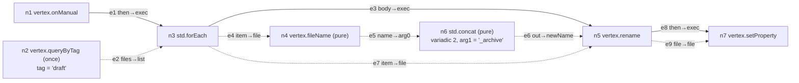

# Node Engine — Specification (Draft 2)

> **Status**: Spec, pre-implementation. Supersedes the execution, trust and schema sections of [Workflows.md](Workflows.md).
> **Date**: October 2026. Draft 2 (2026-10-31) adds subtyping and `Dictionary` (§3), the decision log (Appendix A) and research notes (Appendix B).
> **Working name**: `engine` (packages `engine/core`, `engine/vue`). Rename once the home of the library is decided.

---

## 1. Goal and Roles

A visual node-scripting toolkit. Developers define their own languages (types, nodes, logic) in TypeScript. End users build programs from those nodes on a canvas. The engine validates and runs those programs. Vertex is the first language.

| Role | Writes | Uses |
|---|---|---|
| Engine authors | `engine/core`, `engine/vue` | — |
| Language developers (Vertex) | Types, nodes, effect interfaces, effect handlers | SDK, `engine/core/testing` |
| Script authors (end users) | Documents (`.workflow` in Vertex) | Editor components, runner |

**Trust boundary.** Language code is trusted: it ships with the host app. Documents are untrusted data. The engine never evaluates code that comes from a document.

**Core split.** Every node is a *manifest*, which is serializable JSON, plus an *implementation*, which is code.
- `validate(doc, manifest)` needs only the manifest. Editors can load any language from JSON.
- `compile(doc, language)` needs the implementation. Only the host that runs programs has it.

---

## 2. Packages

| Package | Contents | Dependencies |
|---|---|---|
| `engine/core` | Type system, language definition, manifest, document format, validation, migrations, runtime | none |
| `engine/core/std` | Standard nodes (control flow, logic, strings, lists) | `engine/core` |
| `engine/core/testing` | Recording effects, document builder, run helpers | `engine/core` |
| `engine/vue` | Canvas, palette, input widgets, diagnostics and trace overlays, override slots | `engine/core`, `@vue-flow/core` |

Rules:
- `engine/core` uses no DOM, Vue or Node APIs. It runs in a browser, a Worker, Node and Bun.
- A hard kill, for example of a node that loops forever without awaiting, is the host's job: run the program in a Worker or `worker_threads`. The runtime itself stops cooperatively (§8.6).
- New packages are split out only when a second consumer needs them.

**Rete.js** was evaluated and rejected as the runtime. `rete-engine@2.1.1` `ControlFlow.execute` calls `forward()` without awaiting it, and `execute()` returns `void`. A test showed a two-iteration loop firing `done` before either async body finished. It also has no cancellation, limits or per-iteration values. VueFlow is used only for the canvas.

---

## 3. Type System

### 3.1 Terms

```ts
export type TypeTerm =
	| { kind: 'con'; id: string; args?: TypeTerm[] }   // number, vertex.File, List<T>, Dictionary<K, V>
	| { kind: 'var'; name: string; rigid?: true }      // rigid: a function's type parameter inside its own body
```

- **Ground type:** a term containing no `var`.
- **Fresh variables:** each node instance gets its own copies of its manifest's type variables, renamed `<nodeId>.<name>`. This is what lets two ForEach nodes bind `T` independently.
- **Nesting is unrestricted.** `List<List<string>>` and `Dictionary<string, List<vertex.File>>` are ordinary terms. A ForEach over `List<List<string>>` gets `item: List<string>`. `std.flatten<T>(List<List<T>>)` resolves `T = string`.

### 3.2 Type definitions

```ts
export type Variance = 'out' | 'inv'   // out = covariant (read-only position), inv = invariant

export interface TypeDef {
	id: string                // 'string', 'List', 'vertex.File'
	params?: { name: string; variance: Variance }[]
	extends?: TypeTerm        // single parent, nominal. Only on types without params. Default: any
	key?: true                // may be used as a Dictionary key
	schema?: SchemaTemplate   // absent = opaque: values only arrive over wires, never as literals
	label?: string
	color?: string
}

/** A JSON Schema subset (type, enum, const, items, properties, required, minimum, maximum, minLength, maxLength, pattern).
 *  `{ $param: 'T' }` is replaced by the schema of the type bound to T. */
export type SchemaTemplate = Record<string, unknown>

export interface ConversionDef { from: TypeTerm; to: TypeTerm }   // both ground, e.g. number → string
```

Built in, in core:

| Type | Params | Extends | Key | Schema |
|---|---|---|---|---|
| `any` | — | (top) | — | none (opaque) |
| `string`, `number`, `boolean` | — | `any` | yes | primitive |
| `List<T>` | `T: out` | `any` | — | `{ type: 'array', items: $T }` |
| `Dictionary<K, V>` | `K: inv`, `V: out` | `any` | — | `{ type: 'object', additionalProperties: $V }` (K = `string` only; otherwise opaque) |

There is no bottom type and no `null`: an absent value is modeled by the node, e.g. an empty `List` (§13).

Rules `defineLanguage` enforces:
- `extends` chains are acyclic and end at `any`.
- `key` is inherited: `vertex.Path extends string` is a key type.
- A type with params can't declare `extends`. Parameterized types are related only through variance (§3.3).

Core ships a validator for exactly the schema subset above, so literals can be checked without any dependency.

**Why invariant K and covariant V.** Values in the engine are immutable: a node that "adds" to a list returns a new list. That makes read-only covariance sound, so `List<vertex.Note>` may flow into `List<vertex.Entry>`. Keys stay invariant, because lookups compare keys by value and widening a key type changes which keys match.

### 3.3 Subtyping

`A <: B` ("A can flow into B") holds when any of these applies:
1. `B` is `any`.
2. `A` and `B` have no params, and `B` is `A` or one of `A`'s `extends` ancestors.
3. `A` and `B` are the same constructor. For each argument: an `out` param requires `Aᵢ <: Bᵢ`; an `inv` param requires `Aᵢ <: Bᵢ` and `Bᵢ <: Aᵢ`.

Downcasts (`any` → `vertex.File`, `vertex.Entry` → `vertex.File`) are never implicit. A language provides a cast node, typically an exec node with `ok` / `fail` outputs, so a failed cast is an explicit branch instead of a fault.

**Join** (least upper bound), used when one type variable receives several types:
- `join(A, B)` = `B` if `A <: B`, `A` if `B <: A`.
- Same constructor: join each `out` argument; `inv` arguments must already be equal.
- Otherwise the nearest common `extends` ancestor **other than `any`**.
- No such ancestor: no join (`E_NO_COMMON_TYPE`). The engine never widens to `any` on its own. A user who wants `any` pins it (§3.4 step 1).

### 3.4 Inference

Inference runs over the whole graph on every validation. Graphs are small, and incremental inference is a source of bugs. Each data edge from output type `O` to input type `I` adds the constraint `O <: I`.

1. **Pins.** A `typeArgs` entry fixes that variable. A pinned variable is never solved; its constraints are only checked. The editor writes `typeArgs` when the user picks a type for a generic port.
2. **Decompose.** Break each constraint down structurally:
   - Same constructor: `out` arguments give `Oᵢ <: Iᵢ`; `inv` arguments give both directions.
   - `G <: var` gives the variable a **lower bound** `G`; `var <: G` gives it an **upper bound** `G` (G ground after substituting what's solved so far).
3. **Solve.** Repeat until nothing changes:
   - Each unpinned variable with lower bounds becomes the join of its lower bounds. That is the most specific type every source fits into.
   - Only when that settles, each variable that has no lower bounds but has upper bounds becomes the most specific of its upper bounds. Example: an `emptyList<T>` wired into a `List<vertex.File>` input resolves `T = vertex.File`.
   - More than 64 rounds is a type that never settles: `E_INFINITE_TYPE`.
4. **Check.** With all variables substituted:
   - every constraint must hold, else `E_TYPE_MISMATCH` on that edge;
   - every `Dictionary` key argument must be a key type, else `E_KEY_TYPE`.
5. **Conversions.** Retry each failed edge. If both sides are ground and a `ConversionDef` matches exactly, the edge is marked as converted, the error is dropped, and the runtime applies the conversion. Conversions never apply inside type arguments: `List<number>` doesn't flow into `List<string>`.
6. **Literals.** For each input that is unconnected and has a literal:
   - the resolved type must be ground, else `E_UNRESOLVED_TYPE`;
   - the type must have a schema, else `E_LITERAL_INVALID` (opaque types can't be literals);
   - the value must validate against that schema, else `E_LITERAL_INVALID`.

Properties:
- **Order-independent.** Results don't depend on edge order, so the transactional, ordered unification of draft 1 is no longer needed.
- **Rigid variables** (a generic function's own type parameters inside its body) are treated like pinned opaque types: `T <: T` only, and `T <: any`.
- **Subtyping is erased at run time.** Upcasts need no code, because a `vertex.Note` value already is a `vertex.File` value.

The analysis exposes `typeOf(nodeId, port, 'in' | 'out')`. The editor uses it to colour ports and render widgets.

---

## 4. Nodes

### 4.1 Manifest

```ts
export type NodeMode = 'event' | 'exec' | 'pure' | 'once'

export interface DataPortDef {
	type: TypeTerm
	label?: string
	default?: Json         // inputs only
	wire?: boolean         // inputs only; false = setting that takes only a literal (dropdowns etc.). Default true
	required?: boolean     // inputs only; no edge, literal or default → E_REQUIRED_INPUT
}

export interface VariadicDef {
	kind: 'input' | 'execOut'
	prefix: string         // ports are `${prefix}0` … `${prefix}${n-1}`, n stored on the instance
	type?: TypeTerm        // required for kind 'input'
	min?: number
	max?: number
}

export interface NodeManifest {
	type: string                              // namespaced: 'std.forEach', 'vertex.rename'
	version: number
	mode: NodeMode
	exec?: { in?: string[]; out: string[] }   // exec: `in` defaults to ['exec']. event: `in` not allowed
	inputs?: Record<string, DataPortDef>
	outputs?: Record<string, DataPortDef>
	variadic?: VariadicDef
	requires?: string[]                       // capability ids (§7)
	label: string
	category?: string
	description?: string
	icon?: string
}
```

Settings are not a separate concept: they are inputs with `wire: false`.

### 4.2 Modes

| Mode | Exec ports | When it runs | Caching | May require mutating capabilities |
|---|---|---|---|---|
| `event` | out only | `dispatch(eventType)` (§8.1) | — | — |
| `exec` | in and out | When control reaches it | Outputs stored in the current scope (§8.3) | yes |
| `pure` | none | When pulled by a consumer | Once per consumer activation | no |
| `once` | none | When first pulled | Once per run | no |

`once` replaces "query results are snapshots" from Workflows.md with a declaration on the node. `defineLanguage` rejects a `pure` or `once` node that requires a mutating capability.

### 4.3 Implementation

```ts
export interface PureContext<E> {
	inputs: Record<string, unknown>
	effects: E           // narrowed to the node's `requires`
	signal: AbortSignal
}

export interface ExecContext<E> {
	input(port: string): Promise<unknown>
	inputs(): Promise<Record<string, unknown>>
	output(port: string, value: unknown): void
	/** Runs the chain connected to `port` and resolves when it finishes. Rejects with that chain's fault. */
	fire(port: string, opts?: { scope?: true | Record<string, unknown> }): Promise<void>
	effects: E
	signal: AbortSignal
}

export type PureRun<E> = (ctx: PureContext<E>) => Record<string, unknown> | Promise<Record<string, unknown>>
/** The returned exec output continues the chain; `void` ends it. */
export type ExecRun<E> = (ctx: ExecContext<E>) => string | void | Promise<string | void>
```

- A pure or once node must return every declared output, else the run faults with `E_OUTPUT_MISSING`.
- `defineNode` infers `inputs` and `output()` types for ports whose types are ground. Generic ports are typed `unknown`.

### 4.4 Built-in nodes in core

These live in core rather than std because their ports come from the document, not from the manifest.

| Type | Mode | Ports come from |
|---|---|---|
| `core.entry` | `exec` or `pure` (matches the function) | The function's inputs, as outputs |
| `core.return` | consumer | The function's outputs, as inputs |
| `core.call` | `exec` or `pure` | `ref` → the function's signature, instantiated fresh per call node |
| `core.get` | `pure` | `ref` → the variable's type |
| `core.set` | `exec` | `ref` → the variable's type |

### 4.5 Standard nodes (`engine/core/std`, finalized in M2)

`std.if`, `std.forEach`, `std.sequence` (variadic `execOut`), `std.try` (`body` / `catch`; `catch` scope gets `error: string`), `std.equals<T>`, `std.not`, `std.and`, `std.or`, `std.concat` (variadic string input), `std.length<T>`, `std.flatten<T>`, `std.dictGet<K, V>` (`found` / `missing` exec outputs), `std.dictSet<K, V>`, `std.dictKeys<K, V>`.

None of these are special to the runtime. Any language could write its own version.

---

## 5. Language Definition

```ts
export interface CapabilityDef { id: string; mutates: boolean; label: string; description?: string }

export interface LanguageManifest {
	manifest: 1
	language: { id: string; version: number }
	types: TypeDef[]
	conversions: ConversionDef[]
	capabilities: CapabilityDef[]
	nodes: NodeManifest[]          // already flattened: included languages (std) are merged in
}

export interface Language<E> {
	manifest: LanguageManifest
	nodes: ReadonlyMap<string, { run: PureRun<E> | ExecRun<E>; migrate?: Record<number, NodeMigration> }>
	conversions: ReadonlyMap<string, (value: unknown) => unknown>   // keyed by "from→to"
	migrate?: Record<number, DocumentMigration>                    // language version n → n+1
}

export type NodeMigration = (node: NodeInstance) => NodeInstance          // version n → n+1
export type DocumentMigration = (program: Program) => Program
```

Sketch of the authoring API (`E` is the developer's effect interface):

```ts
export const vertex = defineLanguage<VertexEffects>({ id: 'vertex', version: 1, include: [std] })
	.type({ id: 'vertex.File', label: 'File', color: 'sky' })
	.capability({ id: 'fs', mutates: true, label: 'Modify files' })
	.node({
		type: 'vertex.rename', version: 1, mode: 'exec', label: 'Rename',
		exec: { out: ['then'] },
		inputs: { file: { type: t('vertex.File') }, newName: { type: t('string') } },
		outputs: { file: { type: t('vertex.File') } },
		requires: ['fs'],
		async run(ctx) {
			const { file, newName } = await ctx.inputs()
			ctx.output('file', await ctx.effects.fs.rename(file, newName))
			return 'then'
		},
	})

vertex.manifest   // JSON-serializable: everything except the code
```

---

## 6. Document Format

```ts
export interface DocumentV1 {
	format: 1
	language: { id: string; version: number }
	meta?: { name?: string; description?: string }
	program: Program
	view: View
}

export interface Program { graph: Graph; variables: VariableDecl[]; functions: FunctionDecl[] }
export interface Graph { nodes: NodeInstance[]; edges: EdgeInstance[] }

export interface NodeInstance {
	id: string                        // unique across the whole document, function bodies included
	type: string
	version: number
	literals?: Record<string, Json>
	typeArgs?: Record<string, TypeTerm>
	variadic?: number
	ref?: string                      // core.call → function id; core.get / core.set → variable id
}

export interface PortRef { node: string; port: string }
export interface EdgeInstance { id: string; from: PortRef; to: PortRef }

export interface VariableDecl { id: string; name: string; type: TypeTerm; default?: Json }   // type must be ground

export interface FunctionDecl {
	id: string
	name: string
	typeParams?: string[]             // rigid inside the body, fresh per core.call outside it
	exec: boolean                     // false = pure function: the body may contain no exec nodes
	inputs: Record<string, DataPortDef>
	outputs: Record<string, DataPortDef>
	locals?: VariableDecl[]
	graph: Graph                      // exactly one core.entry; exactly one core.return
}

export interface View {
	positions: Record<string, { x: number; y: number }>
	groups: Group[]
	viewport?: { x: number; y: number; zoom: number }
}
export interface Group { id: string; graph: 'main' | string; label?: string; color?: string; nodes: string[] }
```

- **Groups** are view-only. They don't affect validation, execution or hashing.
- **Program hash:** SHA-256 of the canonical JSON (sorted keys, no whitespace) of `{ format, language, program }`.
  - Moving nodes, regrouping or renaming `meta` doesn't change it.
  - Hosts key their trust records by this hash. The file itself never contains the hash.

### 6.1 Edge rules

| Rule | Diagnostic |
|---|---|
| Both ends must be the same kind (exec→exec, data→data) | `E_KIND_MISMATCH` |
| An exec output has at most one edge | `E_EXEC_FANOUT` |
| A data input has at most one edge | `E_DATA_FANIN` |
| Exec inputs and data outputs may have any number of edges | — |
| No cycle through exec edges | `E_EXEC_CYCLE` |
| No cycle through pure or once nodes | `E_DATA_CYCLE` |
| Edges stay inside one graph (main or a single function body) | `E_CROSS_GRAPH` |

Loops exist only inside node implementations, such as `std.forEach`. The exec graph is always acyclic.

### 6.2 Versioning and migration

`migrate(doc, language)` runs three levels, in this order:
1. **Document format:** engine-owned migrations, from `doc.format` up to the current format.
2. **Language:** `language.migrate[n]` for n from `doc.language.version` up to the language's version.
3. **Nodes:** for each instance, `node.migrate[v]` from `instance.version` up to the manifest's version.

Rules:
- A document or node newer than the code (`E_NEWER_FORMAT`, `E_NEWER_LANGUAGE`, `E_NEWER_NODE`) is not migrated, and the host opens it read-only.
- Migrations are code, so an editor that only has the manifest shows outdated nodes as read-only (`E_NODE_OUTDATED`).
- Migration never writes to disk. The host saves only on an explicit user action.
- Migration code is kept indefinitely.

---

## 7. Effects and Capabilities

- Nodes reach the outside world only through `ctx.effects`, which contains only the capabilities in the node's `requires`.
- The host passes the handlers to `dispatch`. A required capability with no handler fails before the run starts (`E_MISSING_EFFECT`).
- `program.capabilities` is the static set of capabilities used by nodes reachable from event nodes, including through called functions.
  - This replaces the document-declared `permissions` from Workflows.md: a document can't under-declare what it does.
- **Dry run:** the host passes recording or simulating handlers for mutating capabilities. The engine has no special mode for it.
- **Tests:** `engine/core/testing` provides recording handlers for any effect interface.

---

## 8. Runtime

### 8.1 API

```ts
export function validate(doc: DocumentV1, manifest: LanguageManifest): Analysis
export function migrate<E>(doc: unknown, language: Language<E>): { doc: DocumentV1; changed: boolean } | { diagnostics: Diagnostic[] }
export function compile<E>(doc: DocumentV1, language: Language<E>): CompiledProgram<E>   // throws CompileError on any error diagnostic
export function hashProgram(doc: DocumentV1): Promise<string>

export interface Analysis {
	diagnostics: Diagnostic[]
	typeOf(node: string, port: string, dir: 'in' | 'out'): TypeTerm
	convertedEdges: ReadonlySet<string>
	capabilities: ReadonlySet<string>
}

export interface CompiledProgram<E> {
	capabilities: ReadonlySet<string>
	/** Runs every instance of `eventType`, one after another, in document order. */
	dispatch(eventType: string, payload: Record<string, unknown> | undefined, opts: RunOptions<E>): Promise<RunResult>
}

export interface RunOptions<E> {
	effects: E
	signal?: AbortSignal
	limits?: { steps?: number; depth?: number; timeoutMs?: number }   // defaults: 100_000 steps, depth 64, no timeout
	trace?: 'off' | 'nodes' | 'values'                                 // default 'off'
	onTrace?: (event: TraceEvent) => void
}

export interface RunResult { status: 'ok' | 'fault' | 'aborted'; fault?: Fault; steps: number }
```

The event payload becomes the event node's data outputs in the root scope.

### 8.2 Control flow

1. **Event activation.** An event node activates and counts as one step. Control continues on its `then` output.
2. **Exec activation.** Activating an exec node counts one step and calls `run`.
   - Inside `run`, `fire(port)` runs the chain connected to `port` and resolves when it finishes.
   - The value `run` returns names the exec output to continue on, as a tail call. `void` or an unconnected output ends the chain.
3. **One fire at a time.** A node may have only one `fire` in progress. Calling it again before the first finishes faults with `E_CONCURRENT_FIRE`. There are no parallel branches.
4. **Faults.** An error thrown by `run`, or a fault from a fired chain, rejects the enclosing `fire`. `std.try` catches it; otherwise it ends the run with `status: 'fault'`.

### 8.3 Scopes

- A scope maps node ids to the outputs that node has set. Scopes form a chain through `parent` links.
- `output(port, v)` writes into the current scope.
- `fire(port)` runs the chain in the same scope, so values set in an If branch stay visible afterwards.
- `fire(port, { scope: true | values })` creates a child scope. With `values`, they are stored as the firing node's own outputs in the child; this is how ForEach exposes `item` and `index`. Every iteration gets a new child, so nothing leaks between iterations.
- A data input wired to an exec node's output reads the nearest scope, walking up the chain. If nothing is found, the run faults with `E_UNSET_VALUE`. For example, reading a loop body's output after the loop ends faults.
- **Function calls** start a new scope with **no parent**. A function body sees its entry values, its locals and the document variables, but none of the caller's values.

### 8.4 Data evaluation

Inputs resolve in this order:
1. the connected edge;
2. otherwise the literal;
3. otherwise the manifest default.

For a connected edge, the source decides how the value is produced:
- **`pure` source:** evaluated on demand and cached for the current consumer activation. The cache is shared by all `input` and `inputs` calls of one exec activation, so values inside a loop body are fresh on every iteration.
- **`once` source:** evaluated on first pull and cached for the whole run.
- **`exec` or `event` source:** read from the scope chain.
- **Converted edge:** the conversion is applied to the value.

Every pure or once evaluation that is not a cache hit counts one step.

### 8.5 Variables and functions

- **Document variables** are mutable slots for the whole run, initialized from their `default`. Locals are created fresh per call.
- `core.get` reads the slot at the moment it's pulled. `core.set` writes it.
- **Calling a function** increases the call depth; exceeding the limit faults with `E_DEPTH_LIMIT`. Recursion is allowed.
  - An exec function runs its entry chain, and the call continues on `then` once `core.return` is reached.
  - A pure function evaluates its `core.return` inputs.
- **Generic functions:** the body is type-checked once, with `typeParams` as rigid variables. Each call node instantiates them fresh.

### 8.6 Limits and cancellation

| Condition | Fault |
|---|---|
| Steps over `limits.steps` | `E_STEP_LIMIT` |
| Call depth over `limits.depth` | `E_DEPTH_LIMIT` |
| `signal` aborted or `timeoutMs` reached | `status: 'aborted'` |

- The runtime checks the signal at every node boundary and passes it to `run` and to effects.
- Cooperative cancellation can't stop a node that loops forever without awaiting. Use a Worker (§2).

### 8.7 Trace events

```ts
export type TraceEvent =
	| { t: 'enter'; node: string; depth: number }            // pure: emitted after its inputs resolve
	| { t: 'exit'; node: string; port?: string; depth: number }
	| { t: 'value'; node: string; port: string; value: unknown }   // only with trace: 'values'
	| { t: 'fault'; node: string; fault: Fault }
```

---

## 9. Diagnostics

```ts
export interface Diagnostic {
	code: DiagnosticCode
	severity: 'error' | 'warning'
	message: string
	at?: { node?: string; port?: string; edge?: string; variable?: string; function?: string }
}
export interface Fault { code: FaultCode; message: string; node?: string; cause?: unknown }
```

| Kind | Codes |
|---|---|
| Structure | `E_DUPLICATE_ID`, `E_UNKNOWN_NODE_TYPE`, `E_UNKNOWN_PORT`, `E_UNKNOWN_REF`, `E_KIND_MISMATCH`, `E_EXEC_FANOUT`, `E_DATA_FANIN`, `E_EXEC_CYCLE`, `E_DATA_CYCLE`, `E_CROSS_GRAPH`, `E_FUNCTION_SHAPE` |
| Types | `E_TYPE_MISMATCH`, `E_NO_COMMON_TYPE`, `E_INFINITE_TYPE`, `E_KEY_TYPE`, `E_UNRESOLVED_TYPE`, `E_LITERAL_INVALID`, `E_REQUIRED_INPUT` |
| Versions | `E_NEWER_FORMAT`, `E_NEWER_LANGUAGE`, `E_NEWER_NODE`, `E_NODE_OUTDATED` |
| Runtime faults | `E_MISSING_EFFECT`, `E_STEP_LIMIT`, `E_DEPTH_LIMIT`, `E_UNSET_VALUE`, `E_CONCURRENT_FIRE`, `E_OUTPUT_MISSING`, `E_NODE_THREW` |

---

## 10. Worked Example — "Archive every file tagged `draft`"

Rename each file tagged `draft` to `<name>_archive`, then set `status: archived` in its frontmatter.


Solid lines are exec edges; dotted lines are data edges. `n7` has `literals { key: 'status', value: 'archived' }` and `typeArgs { T: string }`.

Node signatures used:

| Type | Mode | Inputs → outputs | Requires |
|---|---|---|---|
| `vertex.queryByTag` | once | `tag: string` → `files: List<vertex.File>` | `index` |
| `std.forEach` | exec (`body`, `done`) | `list: List<T>` → `item: T`, `index: number` | — |
| `vertex.fileName` | pure | `file: vertex.File` → `name: string` | — |
| `std.concat` | pure | `arg0…argN-1: string` → `out: string` | — |
| `vertex.rename` | exec (`then`) | `file: vertex.File`, `newName: string` → `file: vertex.File` | `fs` |
| `vertex.setProperty` | exec (`then`) | `file: vertex.File`, `key: string`, `value: T` | `fs` |

**Inference** (§3.4):
- `e2` gives `n3.T` the lower bound `vertex.File`. It's the only one, so `n3.T = vertex.File`. That types `n3.item` as `vertex.File`, and `e4` and `e7` check.
- `n7.T` is pinned to `string` by `typeArgs`, so the literal `'archived'` validates.
- `program.capabilities = { index, fs }`.

**Execution** (index returns `/v/a.md`, `/v/b.md`):

| Step | Node | What happens |
|---|---|---|
| 1 | n1 | event fires `then` |
| 2 | n3 | pulls `list` |
| 3 | n2 | `index.byTag('draft')`; cached for the run |
| — | n3 | iteration 0: `fire('body', { scope: { item: a, index: 0 } })` |
| 4 | n5 | `inputs()`: `file` ← scope `n3.item`; `newName` ← n6 |
| 5 | n4 | `name = 'a'` |
| 6 | n6 | `out = 'a_archive'` → `fs.rename(/v/a.md, a_archive)`; `output('file', /v/a_archive.md)` into the iteration scope |
| 7 | n7 | `file` ← scope `n5.file` → `fs.setProperty(/v/a_archive.md, status, archived)` |
| 8–11 | n5, n4, n6, n7 | iteration 1, same pattern for `b` |
| — | n3 | returns `'done'`; no edge, so the run ends |

Result: `status: 'ok'`, `steps: 11`. Effect calls in order:
```
index.byTag(draft)
fs.rename(/v/a.md, a_archive)
fs.setProperty(/v/a_archive.md, status, archived)
fs.rename(/v/b.md, b_archive)
fs.setProperty(/v/b_archive.md, status, archived)
```

**Negative cases:**

| Change | Result |
|---|---|
| `e7` rewired to `n4.name → n5.file` | `E_TYPE_MISMATCH e7: string → vertex.File` |
| `n7.typeArgs` removed | `E_UNRESOLVED_TYPE n7.value` |
| New `n8 vertex.rename` on `n3.done`, reading `n5.file` | Run faults `E_UNSET_VALUE n5.file`: the value lived in the iteration scope |
| `limits.steps = 5` | Run faults `E_STEP_LIMIT` |

The inference, effect order, step count, trace order and all four negative cases were checked with a throwaway prototype on 2026-10-30.
The subtyping rules in §3.3–3.4 were checked by a second throwaway prototype:
- the §10 example infers the same types as before;
- variance: `List<Note> <: List<Entry>`; `Dictionary` V covariant, K invariant;
- join `Note | Folder` gives `Entry`; `File | number` gives `E_NO_COMMON_TYPE`, not `any`;
- nested generics through `forEach` and `flatten`;
- inference of a variable with only an upper bound;
- key-type checks, including a language type that extends `string`;
- `T` pinned to `any` accepts both `File` and `number`;
- a self-referential type variable fails to settle in under three rounds instead of looping;
- results don't depend on edge order.

**Not checked yet:** functions and rigid variables, conversions, variadic exec outputs, migrations, hashing, `std.try`.

---

## 11. Vertex as the First Language

| Concern | Where it lives |
|---|---|
| Node set (`vertex.*`) | Vertex app, `defineLanguage({ id: 'vertex', include: [std] })` |
| Type hierarchy | `vertex.Entry` ← `vertex.File` ← `vertex.Note` (markdown); `vertex.Entry` ← `vertex.Folder`. Move and Trash take `vertex.Entry`. `vertex.asNote` is the cast node (`ok` / `fail`). Frontmatter nodes should take `vertex.Note`, but a node that passes its input through (Rename returns the renamed file) can only keep the caller's subtype with bounded generics (§13 #7). Until then, §10 types these nodes with `vertex.File` |
| Queries | `vertex.query*` nodes are `once` and wrap `useActiveWorkspaceIndex().getFilteredFiles`. To check first: whether `@type32/obsidian-bases-parser` evaluates Bases filter expressions. If it does, Query takes Bases filter syntax instead of a custom filter UI |
| `index` capability (not mutating) | Handler wraps `useActiveWorkspaceIndex` |
| `fs` capability (mutating) | Handler wraps `useActiveWorkspaceTools` / `useFileIO`, so the index and file watchers stay in sync |
| Path confinement | `fs` handler. Rejects `..` segments, drive letters and `~`; compares against root + separator. Symlink escapes need canonicalizing in Rust (known limit) |
| Trash | `fs` handler moves to `.vertex/trash/<runId>/`. Hard delete is never used |
| Dry run | Simulating `fs` handler: a virtual path map plus a list of planned ops, shown as a diff |
| Undo | The inverse of the applied op list. In memory only |
| Trust | Keyed by program hash in `tauri-plugin-store`. First run of an unknown hash shows `program.capabilities` and the dry-run diff |
| `.workflow` tab | Workspace mode only (singlespace has no index), next to `showBasesEditor` |

Settings mapping:
- `maxLoopIterations` → `limits.steps`
- `maxStackDepth` → `limits.depth`
- `wallClockTimeoutMs` → `limits.timeoutMs`
- `runBehavior` is removed: `std.try` covers it
- `destructiveBehavior` stays as a host-side prompt before `fs.trash`

### 11.1 Fate of the current `t32/feature/workflows` code

| Current | Becomes |
|---|---|
| `WorkflowNodeTypeDefinition`, `WorkflowNodePort*` | `NodeManifest`, `DataPortDef` |
| `WorkflowNodeExecutor`, `WorkflowNodeExecutorResult` | `ExecRun` / `PureRun` |
| `detectGraphCycles`, `findEntryNodes`, `validateWorkflowSchema` | Core `validate` |
| `migrateWorkflowSchema` (iterates the wrong way) | Core `migrate` |
| `isPathConfined`, `resolvePathRelative` (lets escapes through) | Vertex `fs` handler, fixed |
| `topologicalSort`, `WorkflowUndoCommand`, stored `edgeType`, in-file `graphHash`, `permissions` | Deleted; replaced by §8, §7, §6 |
| `WorkflowParameter` vs `WorkflowParameterDefinition`, `exposedInputs`, `input/outputMapping`, `subGraph`, `"group"` category | Deleted; replaced by `wire: false` inputs, functions and view groups |
| `WorkflowExecutionState`, `WorkflowExecutionContext`, `WorkflowRuntimeVariable` and their defaults | Deleted; replaced by `RunResult`, `TraceEvent` and runtime internals |

Known defects in the current branch code, observed 2026-10-30. They are why the code is replaced rather than extended:
- **Path confinement fails open.** `isPathConfined` is a raw string-prefix check. `resolvePathRelative('../../etc/passwd', '/vault')` gives `/vault/../../etc/passwd`, which passes. `/vault-evil/x` also passes for root `/vault`.
- **`graphHash` is stored in the file it protects**, so an attacker just recomputes it. It also covers `position`, so moving a node invalidates trust.
- **`WorkflowTrustedRecord` is keyed by `workflowId`**, with no hash. A malicious file can reuse the ID of a trusted workflow.
- **`permissions` is declared by the document**, which can therefore under-declare.
- **`topologicalSort`** runs both If branches, ignores data edges (a consumer can run before its producer), and silently drops nodes caught in a cycle.
- **Edge kind is stored twice** (`edge.edgeType`, `edge.data.edgeType`). `buildGraphFromVueFlow` reads `data`, while cycle detection and the sort read the top-level field.
- **`migrateWorkflowSchema`** loops from `fromVersion` to the file's own version instead of from the file's version to the current one. Newer files pass through unchanged. Unversioned input is `Object.assign`ed, junk fields included.
- **`parseWorkflowFile`** is an unchecked `JSON.parse` cast on an untrusted file.
- **`useActiveWorkflows()`** is empty. There is no registry, runner, canvas or `.workflow` tab yet.

---

## 12. Milestones

| # | Deliverable | Done when |
|---|---|---|
| M1 | `core`: terms, subtyping, constraint solving, `TypeDef`/schema-subset validator, manifest, document types, `validate` | §10 inference, both static negative cases and the §10 subtyping checks pass as tests |
| M2 | Runtime: modes, scopes, limits, faults, trace; `std` | §10 run, trace and both runtime negative cases pass as tests |
| M3 | Variables, functions, rigid type parameters, call depth; `migrate`; `hashProgram` | A generic `map<T,U>` function type-checks and runs; migration chains tested |
| M4 | `engine/core/testing` | The Vertex language test suite is written with it |
| M5 | `engine/vue`: canvas, palette, widgets, live diagnostics, trace overlay, overrides | The §10 document is built and run by hand in a demo page |
| M6 | Vertex language plus the `.workflow` tab, dry run, trust and undo | The §10 workflow runs against a real vault |
| Later | Playground app (b); composite nodes, i.e. functions promoted into a language library (c) | — |

**Next step:** decide the library's name and location (§13 #8) and bounded generics (§13 #7). Then start M1, with §10's checks as the first tests.

---

## 13. Open Questions

1. **Static detection of unset values.** A dominance analysis could warn about §10's `n8` case at edit time instead of at run time. Proposed: warning `W_MAYBE_UNSET` in M2 or M3.
2. **Optional values.** There's no `Option<T>` yet. Queries that might return nothing return an empty `List`. Revisit when a node needs "maybe one".
3. **Conversions on the canvas.** Should converted edges show a marker or an explicit inserted node?
4. **Worker host helper.** Should `core` ship a `runInWorker` helper, or leave it to hosts? Only matters once a second host exists.
5. **Interfaces / multiple parents.** Single nominal inheritance can't express "File and Folder are both Renameable" without a common base class. If a language needs that, add structural interfaces, or allow several `extends` parents with join returning a set. Deferred until a real language needs it; Vertex's `Entry` base covers its cases.
6. **Contravariant parameters.** No `in` variance yet, because there are no function-typed values (callbacks as data). Add it together with first-class function values, if those ever exist.
7. **Bounded generics.** Type parameters have no bound, so a node can't say "any `T` that is a `vertex.Entry`, returned as the same `T`". Without it, Rename either returns `vertex.Entry` and loses `Note`, or accepts anything. The solver already supports this: a bound is one extra upper-bound constraint `T <: bound` per instance. What's needed: an explicit `typeParams: { name, bound? }[]` on `NodeManifest`, and the bound as the fallback for an unconstrained variable. Proposed: decide before M1, because §11's node set depends on it.
8. **Name and location** of the library.

---

## Appendix A. Decision Log

| # | Date | Decision | Rationale |
|---|---|---|---|
| 1 | 2026-10-30 | The library is a language toolkit. Language developers define types, nodes and logic in TypeScript. End users build documents on a canvas. Vertex is the first language | Owner's vision: like C#/C++ language developers vs. language users |
| 2 | 2026-10-30 | Runner in TypeScript, not a Rust `run_workflow` command | Reuses the in-memory workspace index and file tools. The Rust trust-boundary argument from Workflows.md doesn't hold: `src-tauri/capabilities/default.json` already grants the frontend `fs:read-all` / `fs:write-all` on `**/*`. The real threat is a malicious document, handled by the closed node set and effects (§7) |
| 3 | 2026-10-30 | Wrap existing libraries first and build only when a need appears. Result: VueFlow for the canvas, our own runtime | Rete's engine can't await a branch (Appendix B), so the need for our own runtime already exists |
| 4 | 2026-10-30 | Tooling order: (a) TypeScript SDK and `testing` first, then (b) the playground app, then (c) composite nodes | Owner's choice. (c) reuses functions (§8.5), so the document format reserves room for it now |
| 5 | 2026-10-30 | Core runs in browser, Worker, Node and Bun. Vertex Hub (#22) will **not** execute user workflows for now | Owner isn't yet confident in hardening auth/authorization for server-side execution of untrusted documents |
| 6 | 2026-10-30 | Generics in V1 | Owner: "pain first". They're what make ForEach, Filter and Map type-safe, and they're hard to add later |
| 7 | 2026-10-30 | Variables, functions and canvas groups in V1. Groups are view-only | Owner's choice. Functions turn a node graph into a language; groups don't affect the program hash |
| 8 | 2026-10-30 | No while/do-while. Loops exist only inside nodes, and the exec graph is acyclic | Removes non-termination as a category. Keeps cycle detection valid. Limits become backstops |
| 9 | 2026-10-30 | One target per exec output, no parallel branches (`E_CONCURRENT_FIRE`) | Unambiguous ordering. `std.sequence` covers "run these in order" |
| 10 | 2026-10-30 | Function bodies get a scope with no parent. Recursion is allowed up to the depth limit | Functions behave like functions. Composite nodes (decision 4c) depend on that isolation |
| 11 | 2026-10-30 | Dry run, undo and permissions come from effects (§7), not from engine modes | One mechanism covers preview, tests and capability reporting. Capabilities are computed, never declared |
| 12 | 2026-10-30 | Trust is keyed by the program hash, stored by the host and never in the file | Fixes the in-file hash and ID-keyed trust defects (§11.1) |
| 13 | 2026-10-30 | Two packages (`core`, `vue`) with `std` and `testing` as subpath exports | Fewest moving parts until a second consumer exists |
| 14 | 2026-10-31 | Subtyping: nominal single inheritance, declared variance, no implicit downcasts, no automatic widening to `any` | Owner pointed to Unity. Took Unity's upcasts. Rejected silent downcasts and silent widening, which turn type errors into runtime faults (Appendix B) |
| 15 | 2026-10-31 | `Dictionary<K, V>` built in, with K invariant, V covariant, and K limited to key types | Owner request. Covariance is sound because values are immutable |
| 16 | 2026-10-30 | Vertex's trash moves files to `.vertex/trash/<runId>/` and never hard-deletes | Makes undo uniform. [Not re-verified] the `trash` crate's restore APIs (`os_limited`) don't cover macOS |

---

## Appendix B. Research Notes

**Rete.js** (`rete@2.0.6`, `rete-engine@2.1.1`), probed headless in Bun on 2026-10-30:
- **`ControlFlow.execute` doesn't wait for anything.** It calls `setup.execute(input, forward)`, and `forward` calls `this.execute(...)` on each connected target without awaiting or returning anything. A loop node with two async 10 ms body iterations logged `body start, body start, done, body end, body end`: `done` ran before either body finished.
- **`execute()` returns `void`**, so a run can't be awaited and its errors can't be caught.
- **No cancellation, step limits or call stack.**
- **Dataflow caches one result per node id**, so it can't hold a per-iteration value like "current item". It also only runs attached to a `NodeEditor`.
- **Its Vue renderer** needs `rete`, `rete-area-plugin` and `rete-render-utils` as peer dependencies.

**BaklavaJS**: a Vue node editor with typed interface ports and an engine. Not evaluated in depth. This library's reasons to exist are serializable language manifests, effects with dry runs, and per-node migrations. Whether Rete or Baklava lack all three is not confirmed.

**Unity Visual Scripting** (package 1.9 docs, read 2026-10-31):
- **Automatic connections:** number ↔ number, child → base class, **base → child class**, custom operators, GameObject ↔ component, component → component on the same GameObject, enum → array/list.
- **`ConversionUtility.ConversionType`** lists `Identity`, `Upcast`, `Downcast`, `NumericImplicit`, `NumericExplicit`, `UserDefinedImplicit`, `UserDefinedExplicit`, `UserDefinedThen*`, `EnumerableToArray`, `EnumerableToList`, `ToString`, `UnityHierarchy`, `Impossible`.
- **A port typed `Object` accepts any input.** Our `any` is the same idea.
- **Taken:** upcasts, and the top type.
- **Rejected:**
  - implicit downcasts, which fail only when the graph runs; we use explicit cast nodes with `ok` / `fail` instead;
  - implicit numeric narrowing; a language can declare it as a `ConversionDef` if it wants it.
- **Not confirmed:** whether Unity's graph-level `List` ports are generic.

**Unreal Blueprints**: the model for exec pins plus pure nodes (§4.2, §8.2). Its pin-type rules were not researched for this spec.

**Throwaway prototypes** (2026-10-30, 2026-10-31; deleted after use): results recorded in §10.
