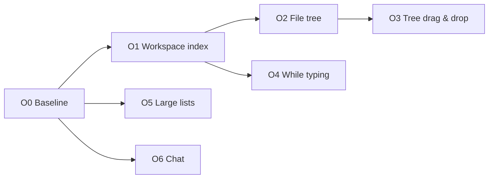

# Performance Plan

Big workspaces and long chats have to stay fast: no list may render every item, and no typing, streaming or autosave may re-render a list that didn't change. Precedent: the Git view's commit box shared a render with 500 file rows, about half a second per keystroke (fixed by `GitCommitBox` plus `useVirtualList`). The file tree also gets drag & drop.

Sizes to hold: a 10k-file vault (a 3k-note folder among them), a note with 300 headings and 1k backlinks, a 500-message chat with tool calls, 2k chats, a 20k-line diff, 2k branches, 800 fonts.

## Decisions

| Topic | Decision |
|---|---|
| Virtual lists | Nuxt UI's `virtualize` where the component has it (`UTree`, `UTable`, `USelectMenu`, `UCommandPalette`, `UScrollArea`); `useVirtualList` for fixed-height custom lists, as in the Git views. |
| Inputs | A text input never shares a render with a big list: its own component, or the list reads a debounced copy. |
| Per-row cost | One context menu per list (the right-clicked row remembered on `contextmenu`), not one per row; menus built when opened; `title` over `UTooltip` where a row needs only a hint. |
| Reactivity | Derived data copies only the fields it shows; writes that change nothing are skipped; library data stays raw (`markRaw`). |
| Root first | The workspace index (autosave → whole tree rebuilt about once a second) is fixed once in `useActiveWorkspaceIndex`, which covers the tree, backlinks, Bases and chat links. |
| Moves | Drag & drop and Rename share one move path (`moveFile`): the rename on disk, the index (uuids kept, so tabs and expanded folders follow) and the link update. Folder moves update links too. The link dialog always asks unless the workspace remembers a choice. |
| Long chats | Only the view is windowed (the latest 50 messages). The chat state, what the model gets, branches, undo and the context window keep using every message. |
| Not in scope | Files dragged in from Finder/Explorer (`dragDropEnabled: false` keeps HTML5 drag & drop working); multi-select. |

## O0: Baseline

### Change
- A browser harness on the stubbed Tauri setup (as in the Git smokes): a 10k-file vault, a 300-heading note with 1k backlinks, a 500-message chat, a 20k-line diff, 2k branches. Measures `PerformanceObserver('longtask')` and keystroke-to-paint while typing in a note with Files, Outline and Backlinks open; opening and streaming in the long chat; opening the diff, Bases, the branch picker.
- Numbers go in this file (before / after per phase). Throwaway: not committed (the harness lives in the eval session, `/tmp/vertex-perf-harness.js`).

### Results (before)
Production build (`nuxt generate`) served statically, headless Chromium on an Apple Silicon Mac, CPU unthrottled, Tauri stubbed. Workspace: 10 003 files (`Big/` with 3000 notes, 70 folders of 100), 1000 notes linking to `Hub.md` (300 headings, 1200 lines), 500 changes plus a 20 000-line untracked file, 2001 branches, 2000 chats, one with 500 messages (a tool call in every third reply). Long tasks are main-thread tasks over 50 ms; "per key" is keydown to the next frame. The key floor is about 80 ms here with nothing open (headless frame pacing), so compare long tasks first.

| Scenario | Long tasks | Longest | Total | Note |
|---|---|---|---|---|
| Type 60 characters above the headings: Files (`F00` open, 100 rows) and Outline | 61 | 744 ms | 6.6 s | per key p50 4.0 s: input queues up |
| … Outline only | 60 | 186 ms | 5.8 s | about 97 ms per keystroke |
| … Files only | 1 | 778 ms | 0.8 s | one freeze per autosave |
| … Backlinks only (1000) | 1 | 130 ms | 0.1 s | |
| … nothing open | 0 | | 0 | |
| Switch tabs ×10: Files and Outline | 21 | 756 ms | 8.3 s | |
| … Files only | 10 | 731 ms | 7.1 s | about 700 ms per switch |
| … Chats (2000) only | 9 | 2169 ms | 19.2 s | about 2 s per switch |
| … nothing open | 0 | | 0 | |
| Open a workspace of 10 003 files, folders closed | 4 | 233 ms | | the index itself is fine |
| Open a workspace of 5000 files with the 3000-note folder open | 6 | 9759 ms | | grows with rows × files |
| Open the 3000-note folder in the 10 003-file workspace | | | | the renderer crashed (twice) |
| Open the 20 000-line new-file diff | 2 | 1012 ms | 1.1 s | 180 701 DOM nodes |
| Open Bases (10 004 rows) | 2 | 692 ms | 0.9 s | |
| Type 3 characters in Bases' search | 3 | 571 ms | 0.8 s | up to 846 ms per key |
| Open the branch picker (2001 branches) | 2 | 202 ms | 0.3 s | 13 rows drawn (capped); search typing fine |
| Open the 500-message chat (from load, with Chats) | 6 | 1745 ms | 4.7 s | |
| Type 3 characters in the chat prompt, 500 messages, Chats open | 3 | 1790 ms | 5.3 s | about 1.8 s per key |
| … 500 messages, Chats closed | 3 | 255 ms | 0.7 s | about 250 ms per key |
| … 40 messages, Chats open or closed | 0 | | 0 | |
| Stream 300 chunks (20 ms apart, 6.1 s) into the 500-message chat | 4 | 716 ms | 1.2 s | took 8.0 s; the request held all 586 model messages |
| … into a 40-message chat | 2 | 81 ms | 0.2 s | took 7.2 s |

Findings the surveys missed: typing in the chat prompt is the commit-box bug again (it grows with the messages and is worse with the Chats list open), and switching tabs with the Chats list open costs about 2 s. Both go into O6. Not measured yet: the font and vault pickers (O5), a burst of watcher events (O1; the stub has no watcher).

### Acceptance
- Each later phase shows its number before and after.

## O1: Workspace index churn

### Change
- Done: `fileTree` copies only what the tree shows (`UITreeNode` is now `uuid`, `fileName`, `relativePath`, `isFolder`, `icon`, `children`; `defaultUITreeNode` removed), so a save no longer rebuilds it.
- Done: `applyProperties` and `syncLinks` skip the write when the value is equal: a save that changes no property or link triggers nothing (backlinks and forelinks panels included).
- Done: `FileTreeComponent`: the workflow list is one `computed`, not a scan of the whole index per `.md` row.
- Done: `ChatLink` resolves through the link graph (`resolveLink` in `useActiveWorkspaceIndex`, reactive to files added, removed or renamed) instead of scanning every file per link.
- Dropped: batching watcher events. 500 modify events in a row, each changing the note's links, made no long task.

### Acceptance
- Typing in a note with Files and Backlinks open: no tree or backlinks render after an autosave that changed no link or property.

### Results (after)
| Scenario | Before | After |
|---|---|---|
| Type 60 characters, Files open | 1 long task, 778 ms | none |
| Type 60 characters, Backlinks (1000) open | 1 long task, 130 ms | none |
| Switch tabs ×10, Files open (`F00`, 100 rows) | 7.1 s, 731 ms each | 0.57 s, longest 71 ms |
| Open 5000 files with the 3000-note folder open | 9.8 s | 2.1 s |
| Open the 3000-note folder in the 10 003-file workspace | renderer crashed | 2.0 s |
| Switch tabs ×10 with that folder open | (crashed before) | 28 s, 2.8 s each: every row re-renders (O2) |
| Type 60 characters with that folder open | (crashed before) | none |
| Open the 500-message chat (from load, with Chats) | 4.7 s, longest 1745 ms | 2.9 s, longest 1401 ms |
| 500 watcher modify events (same text, or new links) | not measured | none |

Checked in the browser: a modify event that adds `icon:` to a note's properties shows the icon on its row, and chat `[[Hub]]` links resolve and open the note.

## O2: File tree

### Change
- One `UContextMenu` around the tree; the row's `data-id` on `contextmenu` picks its items.
- The active row through `UTree`'s `v-model` / `data-selected` instead of each row reading `activeTabUuid`, so a tab switch doesn't re-render every row.
- `UTree :virtualize`: the tree is the scroll container (replacing `PanelFilesView`'s `UScrollArea`; the scroll fade on the tree), indentation from the row's `level` (flat rows lose the nested guide line; a per-level CSS guide replaces it), keys stay uuids, keyboard navigation from reka.
- Revealing the active file scrolls with the virtualizer (`scrollToIndex`), as the tab header does.

### Acceptance
- A 3k-note folder expands, scrolls and switches tabs without long tasks; right-click, rename, keyboard arrows and expand/collapse work as before.

## O3: File tree drag & drop

### Change
- Rows are `draggable` with `data-drag` (uuid); delegated listeners on the tree (ChatsPanel's pattern without its `MutationObserver`).
- Targets: a folder row → into it; a file row → its folder; empty space → the workspace root. Refused (no highlight, no drop): the item itself, its descendants, its current folder.
- The highlight is a DOM attribute on the target row, not part of the tree's items (rebuilding 10k items per `dragover` is the trap ChatsPanel's list falls into).
- Hovering a closed folder for about 600 ms opens it; near the top or bottom edge the tree scrolls; Escape or a drop outside cancels; state also clears on a window `dragend`, since a virtualized source row can unmount mid-drag.
- `moveFile(uuid, destDir)` in `useActiveWorkspaceTools`, taken out of `renameFile` (which then uses it): `markSelfWrite` both paths, `movePath`, `moveFileInIndex`, then the link update. A folder move gathers the links to every file inside it (today's rename does files only, so path-style links into a moved folder break). A name already taken in the target refuses with a toast.
- Link update choice: `UpdateLinksModal` asks on every move or rename that changes links, with a **Remember my decision for this workspace** checkbox. Ticked, Update or Keep is saved as the workspace's `fileConfig.updateLinks` (`'ask' | 'update' | 'keep'`, default `'ask'`; a new settings section, `'fileConfig': 'workspace'` in `WORKSPACE_OVERRIDABLE`, so it lands in `.vertex/settings.json`). Afterwards that workspace moves without the dialog. Settings → View gets a Files section with the same choice per scope, the only way back to Ask.

### Acceptance
- Drag a note into a folder, a folder into another folder, a file to the root; open tabs, the active tab and expanded folders follow; links to moved notes (including ones inside a moved folder) are offered for update and resolve after; dropping a folder into itself or its child does nothing.
- Remember ticked with Update: the next move in that workspace updates links without asking, another workspace still asks; setting it back to Ask in Settings brings the dialog back.

## O4: While typing

### Change
- Outline (`TableOfContentsPanelComponent`, `MinimalLineToc`): rows keyed by index (typing above a heading no longer remounts every heading below it); `sync()` stores `markRaw` headings, throttled to about 100 ms.
- `WordCounter` reads a debounced copy of the text.
- `GitDiffView` reloads only when its own file (or the index, for staged) changed, and skips re-diffing identical text, instead of on every save anywhere.
- `WorkflowViewer`'s deep document watch is debounced.

### Acceptance
- Typing above 300 headings with the Outline open: no long tasks; an open diff tab doesn't re-render while another note is typed in.

## O5: Large lists

### Change
- `TextDiff`: `UScrollArea :virtualize` (measured rows; wrapped lines vary). Find in page only reaches drawn lines; accepted.
- `BasesViewer`: `UTable` `virtualize` and `:watch-options="{deep: false}"`, one link lookup map instead of a scan per cell, the search through `refDebounced`.
- `VaultPicker`: `UTree :virtualize`, search debounced.
- `FontPicker`: `USelectMenu virtualize`.
- `GitHistoryView`: the selected commit's file list in its own component (it re-renders on every scroll step today).
- `GitChangesView`: the branch picker in its own component (`GitBranchPicker`, its search no longer re-renders the file rows), `virtualize` for 2k branches; one context menu for the list, as in O2.
- Settings → provider page: the inline `:confirm` arrow hoisted, so typing in Name, Base URL or key doesn't re-render the model list.

### Acceptance
- Opening a 20k-line new-file diff, Bases over 10k notes, the branch picker with 2k branches and the font picker: each without a long task over 100 ms; typing in their searches stays under one frame per keystroke.

## O6: Chat

### Change
- The prompt: find what a keystroke re-renders (O0: 250 ms per key with 500 messages, 1.8 s with the Chats list open too; none with 40) and cut it off, as `GitCommitBox` did: the prompt in its own component if the messages share its render. Profile on a dev build first; the survey's guess (isolated by `createReusableTemplate`) is wrong.
- `ChatMarkdown` parses a throttled copy (about 100 ms) while streaming; complete messages as before.
- Tool cards: `unmount-on-hide`; whether a card has a body from its state, not by serializing its output twice per render.
- A message's body in its own component (`ChatMessageBody`), so a streamed chunk re-renders the streaming message, not all 500 (`UChatMessages`' dynamic slots force every message to update).
- A long chat mounts its latest 50 messages with **Show earlier** (50 more each time) above them. Only `ChatView`'s `UChatMessages` gets the slice; everything else keeps reading the whole `chat.messages`:
  - What the model gets: the transport is handed the SDK chat's own messages (`chatTransport.ts`, `convertToModelMessages`), never the rendered ones, so the context is always the whole branch. A check sends a message in a 120-message chat and asserts the request holds all of them.
  - Window anchoring: the window is a start index, not "the last 50", so streamed replies and new messages extend it instead of pushing older shown ones out. Reopening the chat (or switching chats) resets it to the latest 50.
  - Branches (`chatForks.ts`): switching a branch, editing a message or retrying a reply replaces everything after that message. The window then grows to keep the message acted on in view, so a longer branch doesn't push it out. `branches` and `branchOf` keep working by message id over the whole list. Their O(n²) `findIndex` per message becomes one pass.
  - Undo and changes (`appliedAfter`, `undoChanges`, rewind): they read the whole list. A rewind to a shown message only cuts after it, so the window stays valid; clamp it if it ends past the new end.
  - Diffs (`ChatChanges`): each message's own. Hidden messages' applied changes stay applied and undoable from a later message.
  - Context window (`ChatContextModal`) and the token totals: the whole list, as now. Its jump to a message works inside the modal, not the view.
  - Show earlier keeps the scroll position (adjusted by the added height), so the view doesn't jump. Auto-scroll and scroll-to-submitted only use the end of the list.
  - Message search opens the chat without jumping to the message today. If it ever jumps, the window grows to include it.
  - A chat open in a tab and in the side panel: each view has its own window.
  - Find in page only reaches loaded messages; accepted.
- Chats list: a row's menu built when opened, folders sorted once, one date formatter, the drop highlight off the items (as in O3); the `@` note list sorted with one `Intl.Collator`; the scope picker `virtualize`.
- Chats list on a tab switch: find why it costs about 2 s with 2000 chats (`activeTabUuid` in `items`, each row's `chatActions`) and stop it re-rendering every row. If it still costs over 100 ms after the row fixes, virtualizing the list comes back as a question.
- Not now: a custom chat state with throttled, shallow messages (replacing `new Chat()`); only if the above leaves streaming slow. Virtualizing the Chats list: row fixes only, decided.

### Acceptance
- Streaming into a 500-message chat: no long task per chunk; opening it under 200 ms; tab switches with 2k chats don't re-render every row.
- In a 120-message chat: the request carries every message; branch arrows, edit, retry, rewind and undo on shown messages behave as before; Show earlier doesn't move what's on screen.
