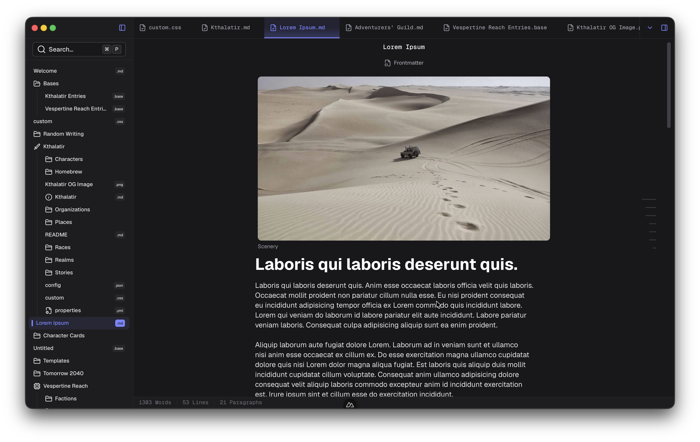

# Vertex


An OFM-compliant Markdown Editor built with Nuxt v4 + Nuxt UI v4 + Tauri v2.

> [!WARNING]
> Since the app is in ***EARLY ACCESS***, I highly suggest you to **NOT USE IT ON IMPORTANT VAULTS**. I've warned you here and I won't be responsible for any loss caused by the software.

> [!NOTE]
> This project falls strictly under the AGPL v3 License.
> 
> If you are going to fork this project, please make sure you mark this repository in your credits and in a visible place.

## Related Modules/Projects

- https://github.com/Type-32/obsidian-bases-parser
- https://github.com/CTRL-Neo-Studios/yaml-editor-form
- https://github.com/Type-32/codemirror-rich-obsidian
- https://github.com/CTRL-Neo-Studios/dispatcher
- https://github.com/CTRL-Neo-Studios/nuxt-predicates
- https://github.com/Type-32/tauri-sqlite-orm
- https://github.com/CTRL-Neo-Studios/workflows

## Learning

Please check out [Concepts and Structures.md](Concepts%20and%20Structures.md) to grasp general concepts of the Vertex.

For the history of this project, check out https://www.ctrl-neo.dev/projects/vertex

## Installation

- [Windows](https://ctrl-neo.dev/apps/download/vertex/windows-x86_64)
- [MacOS](https://ctrl-neo.dev/apps/download/vertex/darwin-aarch64)
- [Linux](https://ctrl-neo.dev/apps/download/vertex/linux-x86_64)

## Development Roadmap

https://github.com/orgs/CTRL-Neo-Studios/projects/5

## Dev & Building

Use bun.

Run dev:

```bash
bun i
bun pm trust --all
bun run tauri:dev
```

Run build:

```bash
bun i
bun pm trust --all
bun run tauri:build
```

## Use of AI Disclaimer

Areas where AI are used:
- AI-related coworking features
- Test Scripts & Bugfixing

Areas where no AI are used:
- Application Architecture
- UI Design
- UX Provisioning
- Application features
- Features Architecture

Used AI Models during Development (via OpenRouter):
- DeepSeek V4 Pro 0813
- DeepSeek V4.1 Flash 1017
- Claude Opus 5.5
- Claude Sonnet 5.5
- GPT-5.6 Sol

Used AI Harnesses:
- OpenCode

## Inspirations
- Obsidian (Cupertino Theme, Minimal Theme)
- Nuxt UI UEditor Slash Menu and Text Hover Menus
- Nuxt UI Chat Template
- JetBrains WebStorm
- DeepSeek Harness
- Tiptap AI Extensions
- tldraw
- OpenCode

---

**May this tool aid in your venture towards the unknown.**
