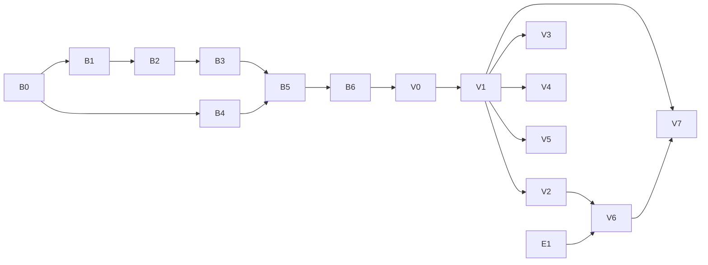

# Bases Plan

Obsidian Bases (`.base` files, [docs](https://obsidian.md/help/bases)) at parity with Obsidian 1.15.1. The query engine is an overhaul of the open-source library `@type32/obsidian-bases-parser` (local `../../obsidian-bases-parser`). The views are built in Vertex, replacing `BasesViewer.vue`.

Obsidian's behaviour was mapped by driving the app (Obsidian CLI against the "Kthalatir for Testing" vault plus throwaway probe bases) and from its help pages and UI strings. Everything is reimplemented clean-room from that behaviour; no Obsidian code is copied. Reference digests: `local://bases-docs.md` (docs), `local://bases-parser.md` (parser 0.4.0 audit), `local://vertex-bases.md` (Vertex today).

## Decisions

| Topic | Decision |
|---|---|
| Engine | Overhaul `@type32/obsidian-bases-parser` in place (same repo and name), released as `0.5.0`. The API breaks: it is plain TypeScript with no Vue peer, and Vertex owns reactivity. `useBase`/`ReactiveBase` are removed. Vertex is the only consumer. |
| Engine scope | Expression language, values and functions, query (filters → sort → limit → groups → summaries), `.base` read/write, edit operations, and the simple-filter model. It never touches a filesystem: the host passes rows and a link resolver. |
| Dependencies | `js-yaml` 5 (already a dependency): `dump(load(text), {lineWidth: -1, quoteStyle: 'double'})` reproduces all three Obsidian-written vault bases byte for byte (`quoteStyle: 'double'` gives Obsidian's `""` for empty strings; the default writes `''`). `dayjs` with `relativeTime`, `duration` and `customParseFormat` provides Moment-compatible `format()` tokens and "a year" / "2 months" wording. |
| Views | Vertex components (`app/components/ViewerEditor/Bases/**`) on Nuxt UI. They use Vertex's index, property editors, note editor and modals directly. No separate UI library. |
| Saving | Write what Obsidian writes: block style, 2-space indent, Obsidian's key order, `note.` dropped from `order`/`sort`/`summaries`/`groupBy`. Unknown keys round-trip (top-level unknown keys go first, unknown view keys go last), and comments are lost, as in Obsidian. |
| Map | Included: `maplibre-gl`, with OpenFreeMap tiles by default (network) and `mapTiles`/`mapTilesDark` honoured. |
| Embeds | ` ```base ` blocks, `![[x.base]]` / `![[x.base#View]]` in notes, and `.base` file cards in canvases. |
| Writes | Table cells edit note frontmatter. Dragging a kanban card writes the group property (or moves the file when grouped by `file.folder`). New creates a note prefilled from the filters. |
| View state | The selected view, search text, group folds and scroll position belong to the tab and are never written. Everything Obsidian writes on an action (sort, group, order, sizes, summaries, options) is written, debounced by about 1 s like Obsidian. |
| Errors | A file that doesn't parse shows Obsidian's message and is never written. Formula and filter errors show in their cell or view, never as dropped rows. |
| Not now | Property types as a workspace setting (Obsidian's `types.json` and the header's "Property type" item): Vertex infers a column's type from its values, as Obsidian does without `types.json`. Plugin-registered view types (an unknown `type` shows "Unknown view type" and keeps its keys). Mobile Display menu. |
| Old code | `BasesViewer.vue` and `Modals/Bases/NewBaseViewModal.vue` are rewritten. Their i18n keys under `app.editor.ui.bases` are reused where the wording still fits. |



Vertex phases may develop against the library's local build (as with Canvas: copy `dist` into `node_modules`) before B6 is published. Only the release items wait for the publish.

## B0: Library reset

### Change
- Layout: `src/expr/` (lexer, parser, AST), `src/values/` (types, functions), `src/query/`, `src/format/` (read, write, edits), `src/index.ts`. Delete `obsidian-bases-reactive.ts`, `obsidian-bases-example.ts`, `examples/`, `QUERY_TEST_RESULTS.md`, `USE_BASE_GUIDE.md` and the stale `llms*.txt` (rewritten in B6).
- Drop the `vue` peer. Keep `js-yaml`; add `dayjs`.
- vitest (`test`, `test:types`), eslint (`lint`), and a CI job (install, lint, test, build) on pushes and PRs.
- Obsidian's UI and function strings captured during exploration (`/tmp/obs/bases-strings.txt`, `/tmp/obs/formulas-strings.txt`) go to `test/fixtures/obsidian/`.
- Fixtures in `test/fixtures/`: `Kthalatir Entries.base`, `Anything Base.base`, `Untitled.base`, plus probe files Obsidian wrote during exploration (see Reference).

### Acceptance
- [ ] `bun run lint`, `test`, `test:types` and `build` pass in CI with the empty skeleton.

## B1: Expression language

### Change
- **Lexer and parser** for Obsidian's expression syntax, used by filters, formulas, summary formulas and the map's `center`:
  - Literals: strings (`'…'`/`"…"` with escapes), numbers, `true`/`false`/`null`, lists `[a, b]`, objects `{"k": v}`, regexes `/…/flags`.
  - Identifiers including non-ASCII names; `note["my prop"]` and `formula["x y"]` index access; member access, method calls and global calls.
  - Operators with JavaScript precedence: unary `!` `-`; `*` `/` `%`; `+` `-`; `<` `<=` `>` `>=`; `==` `!=`; `&&`; `||`; parentheses. Trailing tokens are an error (today `a === b` parses as `a`).
- **Namespaces:** `file.*`, `note.*`, `formula.*`, `this.*`. A bare name is a note property. Lambda variables `value`, `index`, `acc` and `key` exist only inside `filter`/`map`/`reduce` and object `map`/`filter`.
- **ASTs are parsed once per expression string** and cached.
- **Errors** use Obsidian's wording: "Failed to parse formula", "Cannot find function "x"", "Cannot find function "x" on type T", "not enough arguments", "too many arguments", "Type error in "f", parameter "p". Expected …, given …", "Cannot access index …", "Cannot find "k" on type T".

### Acceptance
- [ ] Unit tests: precedence table, every literal kind, index access, unicode names, the user's `tags.filter(value.containsAny('kthalatir'))`, and each error message with its position.

## B2: Values and functions

### Change
- **Types:** Null, Boolean, Number, String, Date (with a has-time flag), Duration, List, Object, Link, File, Image, Icon, HTML, RegExp, URL (a string that came from `link("https://…")`).
- **Arithmetic and comparison:**
  - `date ± "1M"`/duration gives a date. `date - date` gives a duration, rendered humanized ("a year").
  - Comparing dates with dates and strings parsed as dates works.
  - `list == list` compares element-wise. String `+` anything concatenates.
  - Duration units `y M w d h m s ms`, calendar-aware for `M`/`y`; `.days`/`.hours`/… fields.
- **Functions:** every function in Obsidian's list (77 entries in `test/fixtures/obsidian/formulas-strings.txt`; `bases-docs.md` §4).
  - Global: `if`, `now`, `today`, `date`, `duration`, `number`, `min`, `max`, `random`, `list`, `link`, `file`, `image`, `icon`, `html`, `escapeHTML`, `markdown`.
  - Any: `toString`, `isTruthy`, `isType`.
  - String: `contains*`, `startsWith`, `endsWith`, `isEmpty`, `lower`, `upper`, `title`, `trim`, `replace`, `repeat`, `reverse`, `slice`, `split`, `.length`.
  - Number: `abs`, `ceil`, `floor`, `round(digits?)`, `toFixed`, `isEmpty`.
  - List: `contains*`, `filter`, `map`, `reduce`, `flat`, `join`, `reverse`, `slice`, `sort`, `unique`, `isEmpty`, `.length`, plus the aggregates behind summaries (`sum`, `mean`, `median`, `min`, `max`, `stddev`, `earliest`, `latest`).
  - Date: `format`, `date`, `time`, `relative`, `isEmpty`, `year`…`millisecond`.
  - Object: `isEmpty`, `keys`, `values`, `map`, `filter`.
  - Link: `asFile`, `linksTo`.
  - File: `asLink`, `hasLink`, `hasProperty`, `hasTag` (any of; nested tags match; `#` optional), `inFolder` (recursive).
  - RegExp: `matches`. Tag: `matches`.
- **Display strings** for every type (the text a cell, a search or a CSV export uses):
  - Dates are `MM/DD/YYYY h:mm A`, or `MM/DD/YYYY` without a time.
  - Durations are humanized.
  - Lists are joined with `, ` for text output.

### Acceptance
- [ ] A table-driven test per function covering its normal case, empty or null input and wrong-type input (error message), with dates on a fixed clock.
- [ ] `today() - file.ctime` gives a Duration that displays as "a year" or "2 months" for the vault fixtures' ctimes.

## B3: Query

### Change
- **Input:** `rows: BaseRow[]`, where `BaseRow` is `{path, ctime, mtime, size, frontmatter, tags, links, embeds}`. `links` and `embeds` hold link text plus the resolved path.
- **Host callbacks:** `resolveLink(text, fromPath) → path | null`, `backlinks(path) → path[]`, `readFrontmatter(path)` for `asFile().properties` lookups, and `thisFile` (the base file, or the note that embeds it).
- **Formulas** are evaluated lazily per row and memoized, in dependency order. Cycles report "Infinite loop detected in formula". Formulas can be used in filters, sorts, groups and other formulas.
- **Pipeline:**
  1. Global `filters`, then view `filters` (`and`/`or`/`not` trees of expression strings; malformed trees use Obsidian's messages).
  2. Search: case-insensitive substring over the display strings of the view's `order` properties.
  3. `sort`: multi-key with type-aware comparison. Nulls go last in both directions; no sort means file order. The view is **not** sorted by `order` (as it is today).
  4. `limit`, applied after sort and before groups (observed: limit 2 left 2 rows in 2 groups).
  5. `groupBy`: the key is the whole value, so a list groups by its combination (observed in kanban). Null forms the "None" group, and `groupOrder` sets order and visibility (`null` stands for the None group).
  6. Summaries per group and in total. Built-ins: Average, Min, Max, Sum, Range (number or date), Median, Stddev, Earliest, Latest, Checked, Unchecked, Empty, Filled, Unique. Custom summaries come from the top-level `summaries` block, with `values` bound.
- **Results** are `{rows, groups, summaries, errors}`. A row error (a filter that throws) is reported and the row is left out; cell errors stay on the cell.
- **Relevant properties:** the set of note properties used by the base, so the host re-runs the query only when a changed note matters.

### Acceptance
- [ ] Each fixture against rows exported from the Kthalatir vault (a JSON snapshot) gives the same result counts as Obsidian: All Entries 213, Kthalatir Races 15, Kthalatir Characters 36, the kanban view 407 with the same column keys, and Templates excluded.
- [ ] The probe base gives Obsidian's grouped, limited and summed output (Sum 5, Sum 2, total 7).
- [ ] A 5 000-row synthetic vault queries in under 50 ms (formulas memoized, ASTs cached).

## B4: File format and edits

### Change
- **`parseBase(text) → {base, errors}`** validates with Obsidian's messages: "Unable to parse your base file", "Views must be an array", "Missing or invalid "name" in view N", `"filters" may only have one of …`, "Formula values must be strings…", and the rest of the `msgError*` entries in `test/fixtures/obsidian/bases-strings.txt`.
- **`stringifyBase(base)`** produces Obsidian's output:
  - Top-level order: unknown keys, then `filters`, `formulas`, `properties`, `summaries`, `views`.
  - View order: `type, name, filters, groupBy, order, sort, limit, summaries`, then layout options in the order they were set, then `columnSize`, then unknown keys.
  - Block style and 2-space indent; quotes only where YAML needs them; `note.` dropped from `order`/`sort`/`summaries`/`groupBy`.
- **Edits** (pure functions returning a new base):
  - `toggleHeaderSort`: ASC → DESC → none, moving the property to the front.
  - `setSort`, `setGroupBy` (changing the property resets `groupOrder`), `setGroupOrder`, `setLimit`, `setOrder`, `setColumnSize`, `setSummary`, `setLayoutOption`.
  - Views: `addView`, `duplicateView`, `deleteView`, `renameView`, with Obsidian's rules: a name can't be empty, duplicated or contain the forbidden characters.
  - `setDefaultView`: moves the view to first.
  - `setFormula`, `renameFormula` (references updated), `deleteFormula`, `setDisplayName`, `setSummaryFormula`, `setFilters`.

### Acceptance
- [ ] Round trip: every fixture → parse → stringify is byte-identical to what Obsidian writes for it.
- [ ] Each edit's output equals the file Obsidian wrote for the same action (probe captures in `test/fixtures/obsidian/`).

## B5: Simple filters

### Change
- `toSimpleFilter(filters) → FilterGroup | null` turns a filter tree into the builder's rows: All / Any / None groups, rows of property + operator + value, and nested groups. Anything the builder can't represent gives `null` ("This filter cannot be represented by the simple filter builder").
- `fromSimpleFilter(group)` writes the expressions back.
- **Observe first:** the operator list per property type (text, number, date, list, checkbox, file properties) and the expression each operator writes, captured from Obsidian's Filter menu into fixtures.

### Acceptance
- [ ] Every operator round-trips builder → expression → builder, and the expressions equal Obsidian's.

## B6: Release

### Change
- README and `llms.txt` describe the new API. CHANGELOG via changelogen.
- Publish `0.5.0` (the user publishes).

### Acceptance
- [ ] `prepack` builds and the package's types resolve from a clean consumer.
- [ ] Published as `0.5.0`.

## E1: Embed subpaths in `codemirror-rich-obsidian`

### Change
- `proseInternalLinkCodemirrorViewPlugin.ts` passes `subpath` (without `#`) to embed components as it already passes `display`. Release `0.3.8` (the user publishes).

### Acceptance
- [ ] `![[x.base#View]]` mounts the embed with `subpath: "View"`; `![[x.png]]` is unchanged.

## V0: Rows from the index

### Change
- `useBaseRows(session)` builds `BaseRow`s from `useActiveWorkspaceIndex`: all files, not only notes (Obsidian's kanban counted 407 files including `.svg`).
  - Frontmatter, plus tags from frontmatter and body (`file.tags` includes inline `#probe`).
  - Links and embeds as link text with resolved paths (today they are file ids, so `hasLink` can't match a name).
  - Backlinks from the link graph.
- **Live:** the rows follow index changes (create, edit, rename, delete). A note change re-runs the query only if the base uses something that changed (B3's relevant properties).
- `this` is the base file, or the note that embeds it.

### Acceptance
- [ ] Unit test: a fixture workspace gives `BaseRow`s matching what Obsidian reports for the probe notes: `file.tags` with the inline tag, `file.links` `[B, C]`, `file.embeds` `[B]`.
- [ ] Editing a note's property while its base is open updates the row without reopening the tab.

## V1: Viewer and toolbar

### Change
- **Viewer:** `BasesViewer.vue` is rewritten as a shell. It parses once and writes back through `stringifyBase` (a `written` guard, as in CanvasViewer). An invalid file shows the error and is never written. A view of unknown `type` shows "Unknown view type: x".
- **Toolbar:** views menu, results, Sort, Group, Filter, Properties, Search, New.
  - **Views menu:** a search box; views with their layout icons; a chevron opens Configure view (name, Layout, that layout's options, and a ⋯ menu with Default view / Duplicate view / Delete view); Add view; drag to reorder.
  - **Results:** the count (accent colour when a limit hides rows), Limit number of results, Show all, Copy to clipboard (TSV), Export CSV… (Tauri save dialog).
  - **Sort:** a draggable list of property and direction rows (A→Z, 0→1 or Old to new by type), Add sort, delete.
  - **Group:** Group by property and direction, or Manual: checkboxes, Show all / Hide all, drag, and Add group (writes `groupOrder`).
  - **Filter:** All views / This view sections built on B5, with a simple / advanced toggle per row and a code field with autocomplete.
  - **Properties:** a checklist of file, note and formula properties in `order` order with drag, Find or create…, Add formula (name, formula editor, valid check), Hide all, and a chevron per property for Display name and Edit formula.
  - **Search** and **New**. New creates a note in the base's folder (or the configured folder) with frontmatter keys from simple filters, and opens it in a popover. It warns "This note will be filtered out…" when the note won't match.
- Group headings fold per tab.
- Commands: Bases: Add view; Switch view…; Copy table; Add item.

### Acceptance
- [ ] On a copy of Kthalatir for Testing: each toolbar action writes the same `.base` text that Obsidian writes for it (compared against B4's fixtures), and opening and closing without changes writes nothing.

## V2: Table

### Change
- **Layout:** virtualized rows and columns; sticky header; columns in `order`; widths from `columnSize` (keys kept as written, `note.x`). Columns are resized by dragging, written on release. Rows use `rowHeight` short, medium, tall or extra tall.
- **Header:** the property icon and display name.
  - Click toggles the sort (B4 `toggleHeaderSort`); `^`/`⌄` mark sorted columns.
  - Drag reorders `order`.
  - Context menu: Hide column, Summarize…, Group by this property (note and formula properties), Sort A → Z, Sort Z → A, Clear sort, Edit property… / Edit formula…, Resize column…, Reset column size.
- **Cells:**
  - Values render per B2 type. Links are internal links (click opens a tab, hover previews).
  - Tags are pills. Images are thumbnails; icons are Lucide icons. HTML is sanitized.
  - Durations are humanized, and errors show as ⚠ with the message in the cell.
  - A value that doesn't match its column's type is orange; checkboxes are three-state.
- **Editing:**
  - Note-property cells edit in place with Vertex's property inputs (text, number, checkbox, date, datetime, list, tags) and write the note's frontmatter through the index.
  - File and formula cells are read-only; Enter on a formula cell opens its editor.
  - Undo and redo cover property changes.
- **Selection and keyboard** follow Obsidian's table keys (`bases-docs.md` §7.1): copy/paste cells, select row, column or all, Tab, Home/End, Esc, and Backspace to clear values.
- **Groups:** a heading (`status doing`) with that group's summary row on top. The grand-total summary row is at the bottom. Clicking a summary cell adds a summary for that column.

### Acceptance
- [ ] Kthalatir Entries' All Entries matches Obsidian's screenshot: column order, widths, display names ("Last Time of Edit"), humanized formulas, backlinks as links, and 213 rows.
- [ ] The probe base's grouped view matches (headings, Sum 5 / Sum 2 / total 7, tall rows).
- [ ] A status cell edited in Vertex is written to the note's frontmatter and the row re-sorts. Obsidian shows the new value.

## V3: Cards and list

### Change
- **Cards:**
  - A grid of `cardSize`-wide cards. The image comes from the `image` property: a wiki-linked file, a URL or a `#hex` colour. Cards without an image have no image area.
  - The image uses `imageFit` cover or contain and `imageAspectRatio`.
  - The file name is the title, followed by the other properties as label + value, with "—" for empty values.
- **List:** `markers` bullet, number or none. Properties go inline with the `separator`, or indented as sub-bullets when `indentProperties` is on.
- Both group like the table (headings, folding).

### Acceptance
- [ ] Kthalatir Races (15 cards, `cover` images, 0.55 ratio) and Kthalatir Characters (36 cards, 1.4 ratio) match Obsidian's screenshots. The probe list views L and L2 match too.

## V4: Kanban

### Change
- **Columns** come from `groupBy`: one per group key, with None first, the key's display as the header and a count. `groupOrder` sets order and hidden columns. Column width comes from `columnWidth`.
- **Cards** are like cards view, with the same image options and a 0.5 default ratio.
- **Changes:**
  - Drag between columns writes the property (lists replace the whole value) or moves the file for `file.folder`.
  - Drag columns to reorder (writes `groupOrder`).
  - "+ New" per column creates a note with that value.
  - The column menu has Hide column and Edit groups…
- Empty states: "Add columns / Choose a property to group by" and "No columns / Select groups to show as columns".

### Acceptance
- [ ] Kthalatir's kanban view shows 407 cards in Obsidian's columns.
- [ ] Moving a probe card from None to doing writes `status: doing` to the note.

## V5: Map

### Change
- `maplibre-gl`, with OpenFreeMap bright and dark styles by default.
  - `mapTiles`/`mapTilesDark`: one URL without `{z}/{x}/{y}` is a style URL; otherwise each URL is a raster layer.
  - `center` (a formula giving `[lat, lng]`), `defaultZoom` 4, `minZoom`, `maxZoom`.
  - `mapHeight` applies only when embedded.
- **Markers** come from `coordinates` (a `[lat, lng]` list or a `"lat, lng"` string), with `markerIcon` and `markerColor` properties. Clicking a marker opens a popup with the note. The map fits to the markers when there is no `center`.

### Acceptance
- [ ] The probe base's map shows London and Paris markers; Kthalatir's "View 2" (no coordinates) shows the default map at zoom 4.

## V6: Embeds

### Change
- **` ```base ` blocks:** a `base` entry in `useActiveEditorCodeblockMappings.ts`. The block's YAML is the base and `this` is the note. Edits are written back into the code block.
- **`![[x.base]]` and `![[x.base#View]]`:** `.base` files in SessionTab's `internalLinkList` with an embed component. E1 provides the `subpath`, which picks the view. The embed shows the full toolbar.
- **Canvas:** a `fileRenderers.base` entry for `JsonCanvas` reusing the embed component.
- **Shared component:** `BaseEmbed.vue` takes `{source: path | text, view?, thisPath}` and is used by all three.

### Acceptance
- [ ] A probe note with `![[Probe.base#K]]` and a ` ```base ` block matches Obsidian: kanban K with the note itself counted (4 results), and the inline table.
- [ ] A canvas card of `Kthalatir Entries.base` shows its first view.

## V7: Wiring and docs

### Change
- **Commands:**
  - `file.newBase`: File menu, Files' row and empty-space menus (the disabled "New Base" placeholder becomes real), and the palette.
  - Create new base (in the active file's folder) and Insert new base (create and embed in the current note).
  - New bases contain Obsidian's default content (observe first).
- **Files:** a `.base` icon (`i-lucide-table` as Obsidian; Canvas uses `layout-dashboard`).
- **Tauri:** `.base` file association.
- **Index:** `.base` files feed backlinks where their filters or formulas link notes. **Observe first** whether Obsidian counts them.
- **Strings:** en and zh-CN under `app.editor.ui.bases` (`i18n.test.ts` parity).
- **Docs:** a `### Bases` section in `Concepts and Structures.md`, and SMOKE rows (native menus, file association, Export CSV dialog, map tiles in WKWebView).

### Acceptance
- [ ] New Base from the File menu creates a base that opens with Obsidian's default view.
- [ ] `bun run test`, `typecheck` and `lint` are clean for Bases files. The SMOKE rows pass in `tauri:dev`.

## Reference values (Obsidian 1.15.1)

| Value | Observed |
|---|---|
| Layouts | Table `lucide-table`, Cards `lucide-layout-grid`, List `lucide-list`, Kanban `lucide-kanban-square` (core), Map `lucide-map` (Maps plugin 0.2.2) |
| Table options | `rowHeight`: `""` (Short), `medium`, `tall`, `extra` |
| Cards options | `cardSize` 50–800 step 10 (default 200); `image` (property); `imageFit` `""` (Cover) or `contain`; `imageAspectRatio` 0.25–2.5 step 0.05 (default 1) |
| List options | `markers` `bullet` (default), `number`, `none`; `indentProperties` (default false); `separator` (default `", "`, hidden when indented) |
| Kanban options | `columnWidth` 200–500 step 10 (default 280); `image`, `imageFit`; `imageAspectRatio` default 0.5 |
| Map options | `mapHeight` 200–800 step 20 (400); `center` (formula); `defaultZoom` 1–18 (4); `minZoom` 0–24 (0); `maxZoom` 0–24 (18); `coordinates`, `markerIcon`, `markerColor` (properties); `mapTiles`, `mapTilesDark` (lists) |
| Header click | Cycles ASC → DESC → none and moves the property to the front of `sort` |
| Header menu | Hide column, Summarize…, [Group by this property], Sort A → Z, Sort Z → A, [Clear sort], Edit property… or Edit formula…, [Property type] |
| Written view key order | `type, name, groupBy, order, sort, limit, summaries, <options>, columnSize`, then unknown keys |
| Written top-level order | unknown keys, `filters`, `formulas`, `summaries`, `views` (`properties`' position not yet observed) |
| Property ids | `note.` dropped in `order`, `sort`, `summaries`, `groupBy`; kept in `columnSize` and `properties` |
| Save | About 1 s debounce. Comments dropped, flow lists become block lists |
| Display | Dates `MM/DD/YYYY h:mm A`; date-only shown with a date input; durations humanized ("a year", "10 hours"); empty "—" in cards and kanban |
| Kanban | Group key is the whole value (a list makes one column per combination); None column first; "+ New" per column |
| New item | Creates `Untitled.md` with the filtered property keys (`tags:`) and opens it in a popover |
