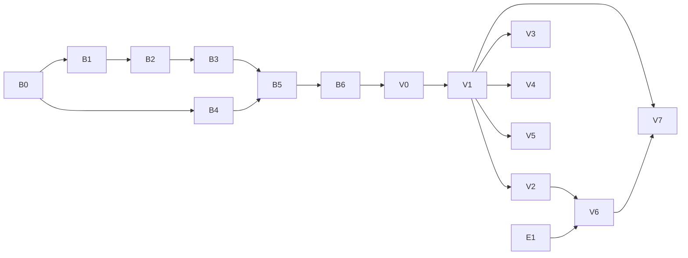

# Bases Plan

Obsidian Bases (`.base` files, [docs](https://obsidian.md/help/bases)) at parity with Obsidian 1.15.1. The query engine is an overhaul of the open-source library `@type32/obsidian-bases-parser` (local `../../obsidian-bases-parser`). The views are built in Vertex, replacing `BasesViewer.vue`.

Obsidian's behaviour was mapped by driving the app (Obsidian CLI against the "Kthalatir for Testing" vault plus throwaway probe bases) and from its help pages and UI strings. Everything is reimplemented clean-room from that behaviour; no Obsidian code is copied. Reference digests: `local://bases-docs.md` (docs), `local://bases-parser.md` (parser 0.4.0 audit), `local://vertex-bases.md` (Vertex today).

## Decisions

| Topic | Decision |
|---|---|
| Engine | Overhaul `@type32/obsidian-bases-parser` in place (same repo and name), released as `0.5.0`. The API breaks: it is plain TypeScript with no Vue peer, and Vertex owns reactivity. `useBase`/`ReactiveBase` are removed. Vertex is the only consumer. |
| Engine scope | Expression language, values and functions, query (filters → sort → limit → groups → summaries), `.base` read/write, edit operations, and the simple-filter model. It never touches a filesystem: the host passes rows and a link resolver. |
| Dependencies | `js-yaml` 5 (already a dependency), configured to write what Obsidian writes (B4): the YAML 1.2 core schema (so `n`, `yes` and dates stay unquoted text), null written empty, double quotes unless single quotes save escaping a `"`, tabs left plain, numbers as JavaScript prints them, and `- ` for a null list item. Earlier this row claimed `dump(load(text), {lineWidth: -1, quoteStyle: 'double'})` alone was enough; that held for the three vault files only, and B4's 21 captured files showed what else it needs. Obsidian itself reads and writes with the `yaml` package (its syntax errors are that package's), which would match without configuration. `dayjs` with `advancedFormat`, `localizedFormat` and `weekOfYear` provides Moment's `format()` tokens. |
| Views | Vertex components (`app/components/ViewerEditor/Bases/**`) on Nuxt UI. They use Vertex's index, property editors, note editor and modals directly. No separate UI library. |
| Saving | Write what Obsidian writes: block style, 2-space indent, Obsidian's key order, `note.` dropped from `order`/`sort`/`summaries`/`groupBy`. Unknown keys round-trip (top-level unknown keys go first, unknown view keys go last), and comments are lost, as in Obsidian. |
| Map | Included: `maplibre-gl`, with OpenFreeMap tiles by default (network) and `mapTiles`/`mapTilesDark` honoured. |
| Embeds | ` ```base ` blocks, `![[x.base]]` / `![[x.base#View]]` in notes, and `.base` file cards in canvases. |
| Writes | Table cells edit note frontmatter. Dragging a kanban card writes the group property (or moves the file when grouped by `file.folder`). New creates a note prefilled from the filters. |
| View state | The selected view, search text, group folds and scroll position belong to the tab and are never written. Everything Obsidian writes on an action (sort, group, order, sizes, summaries, options) is written, debounced by about 1 s like Obsidian. |
| Errors | A file that doesn't parse shows Obsidian's message and is never written. Formula and filter errors show in their cell or view, never as dropped rows. |
| Not now | Property types as a workspace setting (Obsidian's `types.json` and the header's "Property type" item): Vertex infers a column's type from its values, as Obsidian does without `types.json`. Plugin-registered view types (an unknown `type` shows "Unknown view type" and keeps its keys). Mobile Display menu. |
| Old code | `BasesViewer.vue` and `Modals/Bases/NewBaseViewModal.vue` are rewritten. Their i18n keys under `app.editor.ui.bases` are reused where the wording still fits. |



Vertex phases may develop against the library's local build (as with Canvas: copy `dist` into `node_modules`) before B6 is published. Only the release items wait for the publish.

## B0: Library reset

### Change
- Layout: `src/expr/` (lexer, parser, AST), `src/values/` (types, functions), `src/query/`, `src/format/` (read, write, edits), `src/index.ts`. Delete `obsidian-bases-reactive.ts`, `obsidian-bases-example.ts`, `examples/`, `QUERY_TEST_RESULTS.md`, `USE_BASE_GUIDE.md` and the stale `llms*.txt` (rewritten in B6).
- Drop the `vue` peer. Keep `js-yaml`; add `dayjs`.
- vitest (`test`, `test:types`), eslint (`lint`), and a CI job (install, lint, test, build) on pushes and PRs.
- Obsidian's UI and function strings go to `test/fixtures/obsidian/`.
- Fixtures in `test/fixtures/`: `Kthalatir Entries.base`, `Anything Base.base`, `Untitled.base`, plus probe files Obsidian wrote during exploration (see Reference).

### As built
- The whole 0.4.0 source went, not only the Vue layer: `obsidian-bases-parser.ts` (lexer, parser, evaluator), `-schema.ts`, `-utils.ts`, `-reactive.ts`, `-example.ts`, `examples/`, `QUERY_TEST_RESULTS.md`, `USE_BASE_GUIDE.md`, `llms*.txt`. B1–B5 rebuild each part to the new design, and git history keeps the old code. `src/index.ts` is an empty module until B1; the `src/` subfolders are created by the phases that fill them. README still describes 0.4.0 until B6.
- `package.json`: `vue` peer and dev dependency removed; `dayjs` added next to `js-yaml`; dev dependencies `vitest`, `eslint`, `@eslint/js`, `typescript-eslint`. Scripts `lint` (`eslint .`), `test` (`vitest run`), `test:types` (`tsc --noEmit`); description and keywords no longer mention Vue.
- `tsconfig.json`: `lib` is `ESNext` only (the engine never touches the DOM), `noUncheckedIndexedAccess`, and it covers `test/` and the config files. Tabs, per `.editorconfig`.
- `vitest.config.ts` runs `test/**/*.test.ts`, passing with none until B1. `eslint.config.mjs`: `@eslint/js` + `typescript-eslint` recommended.
- CI (`.github/workflows/ci.yml`): one bun job (`install --frozen-lockfile`, `lint`, `test`, `test:types`, `build`) on pushes and PRs to `main` and `dev`.
- Fixtures: `test/fixtures/vault/` holds the three bases from "Kthalatir for Testing" as Obsidian saved them. `test/fixtures/obsidian/bases-strings.json` (172 strings) and `formulas-strings.json` (86) are `OBSIDIAN_DEFAULT_I18N.plugins.bases` and `.formulas`, recaptured from the running 1.15.1 (the `/tmp/obs` copies were gone). Probe captures (before/after files for each action) wait for B4, which needs them as pairs.

### Acceptance
- [x] Locally: `bun install --frozen-lockfile`, `lint`, `test` (no tests), `test:types` and `build` (`dist/index.{mjs,js,d.mts,d.ts}`) pass.
- [ ] The same in CI, after the push.

## B1: Expression language

### Change
- **Lexer and parser** for Obsidian's expression syntax, used by filters, formulas, summary formulas and the map's `center`:
  - Literals: strings (`'…'`/`"…"` with escapes), numbers, `true`/`false`/`null`, lists `[a, b]`, objects `{"k": v}`, regexes `/…/flags`.
  - Identifiers including non-ASCII names; `note["my prop"]` and `formula["x y"]` index access; member access, method calls and global calls.
  - Operators with JavaScript precedence: unary `!` `-`; `*` `/` `%`; `+` `-`; `<` `<=` `>` `>=`; `==` `!=`; `&&`; `||`; parentheses. Trailing tokens are an error (today `a === b` parses as `a`).
- **Namespaces:** `file.*`, `note.*`, `formula.*`, `this.*`. A bare name is a note property. Lambda variables `value`, `index`, `acc` and `key` exist only inside `filter`/`map`/`reduce` and object `map`/`filter`.
- **ASTs are parsed once per expression string** and cached.
- **Errors** use Obsidian's wording: "Failed to parse formula", "Cannot find function "x"", "Cannot find function "x" on type T", "not enough arguments", "too many arguments", "Type error in "f", parameter "p". Expected …, given …", "Cannot access index …", "Cannot find "k" on type T".

### As built
- **Observed first:** 228 expressions were fed to Obsidian as formulas in a probe base, and the parsed tree (or error) it kept for each was captured into `test/fixtures/obsidian/expressions.json`. The parser reproduces those trees exactly, so the AST (`src/expr/ast.ts`) uses the same node shapes: `empty`, `primitive`, `ident`, `object_access`, `array_access`, `function` (`subject: null` for a global), `arithmetic`, `comparison` (also `&&`/`||`), `not`, `negate`, `paren_expr`, `array`, `regexp` (`pattern`, `flags`).
- **What Obsidian's syntax turned out to be** (the docs digest was wrong on some):
  - **No object literals:** `{}` and `{"a": 1}` don't parse. No exponents (`1e3`), hex, `_` separators, `===`, `and`/`not`, ternaries or backticks.
  - Numbers are `\d+(.\d*)?` or `.\d+` (`1.` and `007` are numbers). `-` directly before a number (spaces allowed) makes a negative number, unless a postfix follows: `-1 .abs()` is `negate(abs(1))`, and `--1` is `negate(-1)`.
  - Strings take JSON's escapes; single-quoted ones also take `\'`. A raw newline or tab in a string, or `\x`, doesn't parse.
  - A regex is `/…/` in operand position (else `/` divides). `/` inside `[…]` or escaped doesn't end it, the flags are checked by `RegExp`, and `//` is not a regex.
  - Names are any run of characters except whitespace and ASCII punctuation other than `$` and `_`, not starting with a digit. So `café`, `名前`, `emoji😀`, `a€b` and `$x` are names; `my-prop` is a subtraction. After `.`, `true`/`false`/`null` and digits are refused (`a.true`, `a.1`), other names (`a.if`) are fine.
  - Only a name (a global function) or `x.name` (a method) can be called. Anything else (`f()()`, `(n)()`, `a["b"]()`) is "Invalid function name".
  - Blank text is the `empty` node, which is what Obsidian keeps for `Untitled: ""` formulas.
- **API:** `parseExpression(text) → Expr`. It throws `ExpressionSyntaxError` (`message`, `position`) and caches results and errors per text in an unbounded map (a `ponytail:` note says why that's fine). Exported from `src/index.ts` with the AST types.
- **Errors:** "Unable to parse formula. (position N)", Obsidian's own wording. N is where this parser stopped: trailing text reports where the expression ended, as Obsidian does; elsewhere Obsidian's positions follow its own internals (`abc def` gives 0 but `a b` gives 1), so they aren't matched. Obsidian's other parse messages (V8's "Bad escaped character in JSON…", "Invalid flags supplied to RegExp constructor…") are engine leaks, so this parser reports those cases as "Unable to parse formula" too.
- **Moved to B2:** namespace resolution (`file`, `note`, `formula`, `this`, bare names, lambda variables) and the runtime error messages. They are evaluation, and B1 has no evaluator; in the AST these are plain `ident`s, as in Obsidian.

### Acceptance
- [x] `test/expr.test.ts`: all 228 captured expressions give Obsidian's tree, or fail where Obsidian fails ("Invalid function name" matched exactly, the rest as "Unable to parse formula. (position N)"). The corpus covers the precedence table, every literal kind, index access, unicode names, calls, whitespace, the vault's own formulas and filters (including `tags.filter(value.containsAny('kthalatir'))`), and 72 kinds of invalid text. Eight more tests check where a position points: trailing text, a missing operand or argument, an unterminated string, a raw newline, `a.true`, and `f()()`. 236 tests pass; changing number literals by one makes 62 fail.
- [x] `lint`, `test:types` and `build` pass. `vitest.config.ts` no longer passes with no tests.

## B2: Values and functions

### Change
- **Evaluation** of B1's AST, with what B1 left to it: names resolve as `file.*`, `note.*`, `formula.*` and `this.*`; a bare name is a note property; `value`, `index`, `acc` and `key` exist only inside `filter`/`map`/`reduce` and object `map`/`filter`. Runtime errors use Obsidian's wording ("Cannot find function "x"", "Cannot find function "x" on type T", "not enough arguments", "too many arguments", "Type error in "f", parameter "p". Expected …, given …", "Cannot access index …", "Cannot find "k" on type T"), from `test/fixtures/obsidian/formulas-strings.json`.
- **Types:** Null, Boolean, Number, String, Date (with a has-time flag), Duration, List, Object, Link, File, Image, Icon, HTML, RegExp, URL (a string that came from `link("https://…")`).
- **Arithmetic and comparison:**
  - `date ± "1M"`/duration gives a date. `date - date` gives a duration, rendered humanized ("a year").
  - Comparing dates with dates and strings parsed as dates works.
  - `list == list` compares element-wise. String `+` anything concatenates.
  - Duration units `y M w d h m s ms`, calendar-aware for `M`/`y`; `.days`/`.hours`/… fields.
- **Functions:** every function in Obsidian's list (77 entries in `test/fixtures/obsidian/formulas-strings.json`; `bases-docs.md` §4).
  - Global: `if`, `now`, `today`, `date`, `duration`, `number`, `min`, `max`, `random`, `list`, `link`, `file`, `image`, `icon`, `html`, `escapeHTML`, `markdown`.
  - Any: `toString`, `isTruthy`, `isType`.
  - String: `contains*`, `startsWith`, `endsWith`, `isEmpty`, `lower`, `upper`, `title`, `trim`, `replace`, `repeat`, `reverse`, `slice`, `split`, `.length`.
  - Number: `abs`, `ceil`, `floor`, `round(digits?)`, `toFixed`, `isEmpty`.
  - List: `contains*`, `filter`, `map`, `reduce`, `flat`, `join`, `reverse`, `slice`, `sort`, `unique`, `isEmpty`, `.length`, plus the aggregates behind summaries (`sum`, `mean`, `median`, `min`, `max`, `stddev`, `earliest`, `latest`).
  - Date: `format`, `date`, `time`, `relative`, `isEmpty`, `year`…`millisecond`.
  - Object: `isEmpty`, `keys`, `values`, `map`, `filter`.
  - Link: `asFile`, `linksTo`.
  - File: `asLink`, `hasLink`, `hasProperty`, `hasTag` (any of; nested tags match; `#` optional), `inFolder` (recursive).
  - RegExp: `matches`. Tag: `matches`.
- **Display strings** for every type (the text a cell, a search or a CSV export uses):
  - Dates are `MM/DD/YYYY h:mm A`, or `MM/DD/YYYY` without a time.
  - Durations are humanized.
  - Lists are joined with `, ` for text output.

### As built
- **Observed first:** about 1150 formulas were evaluated by Obsidian over probe notes covering every frontmatter shape, links, tags, embeds, a subfolder, an image, and root files. For each one, the value's type, text (`toString`), truthiness, displayed text and list item types were captured into `test/fixtures/obsidian/values.json`. The file also holds Obsidian's index data for those files: frontmatter, links with display text, embeds, tags, backlinks and times.
- **Values** (`src/values/value.ts`) are tagged objects named after Obsidian's types:
  - Null, Boolean, Number, String, URL, HTML, Image, Link, Date, Duration, List, Object, File, ThisFile, Formulas, RegExp and Error.
  - Errors are values, not exceptions, and they propagate through operators, arguments and members. A cell shows `Error: …` and the value is falsy.
  - Types have parents for `isType` and function lookup: Link, URL, HTML and Image are Strings, and ThisFile is a File. `icon()` is a String flagged as an icon, as in Obsidian.
  - Module functions: `toText` (Obsidian's `toString`), `toDisplay` (dates as `11/20/2026 10:30 AM`, ±∞), `isTruthy`, `looseEquals` and `compare`.
- **Frontmatter** (`src/values/convert.ts`) is converted by value, not by property type:
  - `YYYY-MM-DD` with an optional ` HH:mm[:ss[.f]]`/`T…` and a zone becomes a Date. A month outside 1–12 is an invalid date, and day overflow rolls over.
  - A whole `[[…]]` becomes a Link, and a URL with a scheme (not `javascript:`, no spaces, parseable) becomes a URL.
  - `tags` is always a list of `#tag`s. Quoted numbers stay text.
  - Vertex's index can pass frontmatter through as JSON.
- **Dates and durations** (`src/values/time.ts`, using dayjs with `advancedFormat`, `localizedFormat` and `weekOfYear` for Moment's `format` tokens):
  - A Duration keeps calendar months and days apart from clock time, plus the clock it was made at. Its fields (`.days`, `.months`, `.hours`, …) and its humanized text are measured from that clock as Moment's `diff` measures them. This is what Obsidian does: `duration("2M").days` was 61 on 12 November, `"18M"` reads "2 years", and `"300d".hours` was 7199 across DST.
  - Adding a duration works on the wall clock: `+ "24h"` keeps the hour across DST, and 31 January + 1M is 3 March.
  - Durations parse as `N unit` (`y`, `M`, `w`, `d`, `h`, `m`, `s` and their words; an optional space; a leading `-`) or ISO with a time part (`PT1H`). `1D`, `1ms`, `1.5h`, `1d 2h`, `+1d` and `P1D` are null, as in Obsidian.
- **Evaluation** (`src/expr/evaluate.ts`): `new RowScope({host, now, thisPath, formulas}, path)` with `evaluate(expr)` and `formula(name)`.
  - **Host** (`BaseHost`): `file(path)` returns path, times, size, frontmatter JSON, body tags, links and embeds; also `resolve(link, from)` and `backlinks(path)`. `now` is passed in, so evaluation is deterministic and the tests need no fake clock.
  - **Names:** a lambda variable comes first, then `file`, `note`, `formula` and `this`. `value`/`index`/`acc`/`key` outside a lambda are null, and any other name is a note property.
  - **Formulas** are evaluated on first use and kept per row. A formula that needs itself gives "Infinite loop detected in formula", and a blank or unparseable one is null.
- **Operators**, as observed:
  - `&&` and `||` always give Booleans. `!null` and `-null` are null.
  - `==` is JavaScript's loose equality for plain values. Lists compare item by item, and a one-item list equals its item. Dates compare by day when either has no time. Links compare by target, including against `"M"`, `"[[M|x]]"` and a File. A File equals its path.
  - `<` and `>` are null when either side is null.
  - Text joins anything (`null + "a"` is `"a"`). A date plus or minus a duration, or a duration string, gives a date. A date minus a date gives a duration.
  - Other mixes are "Invalid operator between X and Y".
- **Functions** (`src/values/functions.ts`): every function Obsidian 1.15.1 actually has, with its parameter names, arities and type checks ("Type error in "f", parameter "p". Expected T, given U.", "Cannot call function "f", not enough arguments.").
  - A null argument for a typed parameter makes the result null.
  - Missing from 1.15.1, despite the docs: `upper()`, `markdown()`, `duration.abs()`, `list.first()` and `list.average()`. Present but undocumented: the list aggregates `sum`, `mean`, `median`, `min`, `max`, `stddev`, `earliest` and `latest`.
  - Behaviours worth knowing:
    - `contains` on text ignores case, and `""` never matches.
    - List `contains` matches tags without `#` or case.
    - `sort()` is a numeric-aware, case- and accent-blind collation of the text.
    - `unique()` groups by text.
    - `round(digits ≤ 0)` rounds to an integer.
    - `linksTo(f)` is "this link points to f".
    - `file.name` drops `.md` but keeps other extensions.
    - `file.folder` is `/` at the root.
- **Not copied from Obsidian:** `now(1)`, `today(1)` and `random(1)` give "too many arguments", where Obsidian gives an internal TypeError. The `repeat` and `toFixed` range errors use V8's wording on every engine (Vertex's webview is JavaScriptCore).

### Acceptance
- [x] `test/values.test.ts`: all 1153 captured formulas give Obsidian's type, text and truthiness, plus its display for dates and numbers and its item types for lists. The host is rebuilt from Obsidian's captured index, and each case uses the clock it was captured at. The three `now(1)`-style cases check the documented divergence instead. Together with B1's 236 tests, 1389 pass. Moving one humanize threshold (26 → 25 days) or comparing date-only dates by time makes a test fail.
- [x] `today() - file.ctime` is a Duration reading "16 hours" for the probe note, and "a year" or "2 months" for the vault's spans (`duration("12M")`, `date - date` across a year, `duration("2M")`), all from the fixture.
- [x] `lint`, `test:types` and `build` pass. dayjs stays an external dependency.

## B3: Query

### Change
- **Input:** `rows: BaseRow[]`, where `BaseRow` is `{path, ctime, mtime, size, frontmatter, tags, links, embeds}`. `links` and `embeds` hold link text plus the resolved path.
- **Host callbacks:** `resolveLink(text, fromPath) → path | null`, `backlinks(path) → path[]`, `readFrontmatter(path)` for `asFile().properties` lookups, and `thisFile` (the base file, or the note that embeds it).
- **Formulas** are evaluated lazily per row and memoized, in dependency order. Cycles report "Infinite loop detected in formula". Formulas can be used in filters, sorts, groups and other formulas.
- **Pipeline:**
  1. Global `filters`, then view `filters` (`and`/`or`/`not` trees of expression strings; malformed trees use Obsidian's messages).
  2. Search: case-insensitive substring over the display strings of the view's `order` properties.
  3. `sort`: multi-key with type-aware comparison. Nulls go last in both directions; no sort means file order. The view is **not** sorted by `order` (as it is today).
  4. `limit`, applied after sort and before groups (observed: limit 2 left 2 rows in 2 groups).
  5. `groupBy`: the key is the whole value, so a list groups by its combination (observed in kanban). Null forms the "None" group, and `groupOrder` sets order and visibility (`null` stands for the None group).
  6. Summaries per group and in total. Built-ins: Average, Min, Max, Sum, Range (number or date), Median, Stddev, Earliest, Latest, Checked, Unchecked, Empty, Filled, Unique. Custom summaries come from the top-level `summaries` block, with `values` bound.
- **Results** are `{rows, groups, summaries, errors}`. A row error (a filter that throws) is reported and the row is left out; cell errors stay on the cell.
- **Relevant properties:** the set of note properties used by the base, so the host re-runs the query only when a changed note matters.

### As built
- **Observed first:** probe notes covering text, numbers, checkboxes, dates, lists, tags, a mixed column, empty values and a subfolder, with four probe bases:
  - 34 sort and group views;
  - 12 filter shapes;
  - 35 searches;
  - all 14 built-in summaries plus custom ones, for 11 columns over all rows, three rows and none (627 values, through Obsidian's own `getSummaryValue`).
  
  All are in `test/fixtures/obsidian/query.json`. `kthalatir.json` has every view of "Kthalatir Entries.base" as Obsidian ran it (rows in order, groups in order) over a snapshot of the vault's 407 files: paths, times, sizes and tags only, no note content.
- **API** (`src/query/`):
  - `runQuery(base, viewName, {host, paths, now, thisPath, search})` returns `{rows, groups, summaries, total, errors}`. Rows are `RowScope`s, with `row.property('note.x' | 'x' | 'file.x' | 'formula.x')` added in B3.
  - `summarize(base, context, rows, property, name)` serves the "Summarize…" menu.
  - `Base`, `BaseView`, `FilterNode` and `PropertyOrder` type a parsed `.base`; B4 reads and writes them.
- **What Obsidian does** (and this engine does):
  - **Filters:** global, then the view's. `not` is "none of". A filter that errors on a row leaves it out silently; this engine also lists such rows in `errors`. A plain string `filters:` works.
  - **Search:** the text splits into words and single punctuation marks, and each must appear, ignoring case, in the text of one of the view's shown values. Dates search as `2026-01-05`, not as displayed, so `-1` matches any row with a `-` and a `1`. With no `order`, only the file name is searched.
  - **Order:** rows start in file-name order (numeric-aware, case- and accent-blind; this engine breaks ties by path), and each sort key is applied stably on top.
    - Numbers, dates and durations sort by size; anything else by its text.
    - Empty values sort last in both directions.
    - A checkbox sorts by whether it's checked, so unchecked and empty tie.
  - **Limit** applies after sorting and before grouping. `total` counts the rows before the limit.
  - **Groups:**
    - A group is a value's text: a list `[x]` and a text `x` share one, and `Apple` and `apple` don't.
    - Groups are sorted like values, with the empty group last in both directions.
    - `groupOrder` lists the shown groups in order (`false`, `null`…); a listed group without rows shows empty. Shown rows keep the sort order.
  - **Summaries:**
    - Average divides by every row, empty or not (`123.5 / 10 = 12.35`). Average and Stddev (population) round to two decimals; Median doesn't. Min, Max, Sum, Median and Stddev take the numbers.
    - Range is max − min, or for a column of dates a duration ("2 months"). Earliest and Latest need a column of only dates; Checked and Unchecked a column of only checkboxes.
    - Empty counts empty values (`""` and `[]` are filled). Unique counts distinct values, empty included.
    - Empty, Filled and Unique are null over no rows.
    - Custom summaries evaluate with `values` (the list of the rows' values) in the base file's scope. An unknown name is null.
- **B2 corrections found here:**
  - An unknown method on an empty value is null, not an error, so `n.abs() > 1` doesn't error on a note without `n`.
  - `list.mean()` divides by every item, as Average does.
- **Not copied from Obsidian:**
  - Obsidian only computes formulas shown in the view's `order`, so sorting or grouping by any other formula does nothing. Here formulas are computed whenever used.
  - In a column mixing numbers, text, dates, lists and a checkbox, Obsidian's order comes from contradictory comparisons; here the order is consistent.
  - These five captured views are skipped in the tests, with the reason in the test.
- **Dropped:** relevant properties. A 5 000-note query takes about 9 ms on Bun (JavaScriptCore, Vertex's webview engine) and 24 ms with a search, so V0 re-runs the query on any index change. `ponytail:` add relevance if a large vault profiles slow.

### Acceptance
- [x] `test/query.test.ts` against "Kthalatir Entries.base" over the vault snapshot gives the same rows as Obsidian for every view: All Entries 213 by name, Kthalatir Races 15, Adventurers' Guild 70, Kthalatir Characters 36, the kanban "View" 407 in the same 84 groups with the same rows in each, and the map "View 2" 407. Rows are compared by file name, since Obsidian breaks ties between same-named files by its own internal order. Templates: the vault has no `Templates` folder, so the `not` filter is covered by the probe filters instead (`not many`, `not error`).
- [x] The probe captures: 29 sort and group views (5 skipped, with reasons), 12 filters, 35 searches and 627 summaries give Obsidian's rows, groups and values. The exploration's probe base (status grouped, limit 2) gives doing: B and todo: A, Sum 5 and 2, total 7. Making checkbox sorting a tie breaks 3 tests.
- [x] 5 000 synthetic notes with a filter, two formulas, two sort keys, grouping and two summaries: about 9 ms median on Bun (24 ms with a search); throwaway script, not a CI test.
- [x] All 2100 tests pass (5 skipped); `lint`, `test:types` and `build` pass.

## B4: File format and edits

### Change
- **`parseBase(text) → {base, errors}`** validates with Obsidian's messages: "Unable to parse your base file", "Views must be an array", "Missing or invalid "name" in view N", `"filters" may only have one of …`, "Formula values must be strings…", and the rest of the `msgError*` entries in `test/fixtures/obsidian/bases-strings.json`.
- **`stringifyBase(base)`** produces Obsidian's output:
  - Top-level order: unknown keys, then `filters`, `formulas`, `properties`, `summaries`, `views`.
  - View order: `type, name, filters, groupBy, order, sort, limit, summaries`, then layout options in the order they were set, then `columnSize`, then unknown keys.
  - Block style and 2-space indent; quotes only where YAML needs them; `note.` dropped from `order`/`sort`/`summaries`/`groupBy`.
- **Edits** (pure functions returning a new base):
  - `toggleHeaderSort`: ASC → DESC → none, moving the property to the front.
  - `setSort`, `setGroupBy` (changing the property resets `groupOrder`), `setGroupOrder`, `setLimit`, `setOrder`, `setColumnSize`, `setSummary`, `setLayoutOption`.
  - Views: `addView`, `duplicateView`, `deleteView`, `renameView`, with Obsidian's rules: a name can't be empty, duplicated or contain the forbidden characters.
  - `setDefaultView`: moves the view to first.
  - `setFormula`, `renameFormula` (references updated), `deleteFormula`, `setDisplayName`, `setSummaryFormula`, `setFilters`.

### As built
- **Observed first:** Obsidian's parsed base has its own writer, so `query.toString()` captured what it writes for 21 inputs: scrambled keys, unknown keys, `note.` ids, quoting, flow style, anchors, numbers, null, filters, the vault base and more. Another 38 malformed inputs captured its error messages or the clean-up it applies instead. 47 edits were captured from a fresh file each: 45 through its config API (`setSortProperty`, `setGroupBy`, `setGroupOrder`, `setLimit`, `setOrder`, `set`, `setSummaryKey`, `setFormulas`, `removeFormula`, `setSummaryFormula`, `renameSummaryFormula`, `deleteSummaryFormula`), plus Delete view and Default view through the real menus. All are in `test/fixtures/obsidian/format.json`.
- **`src/format/yaml.ts`:** js-yaml 5 configured as in the Decisions table; it reproduces all 21 captured files. An empty or comment-only file reads as an empty base (js-yaml 5 would throw).
- **`parseBase(text)`** (`src/format/file.ts`) returns `{base, error}`. The error is Obsidian's message without its "Unable to parse your base file:" header, which the UI adds.
  - **Errors, as Obsidian words them:** views not a list; a view that isn't a map; a missing name; a missing or non-text type; filters that aren't text or a map, have more than one of `and`/`or`/`not`, or don't hold a list (inside a view, prefixed "Unable to parse filters in view "T": "); non-text formulas or summaries; malformed `properties`; `order` not a list; a `groupBy` that isn't a map or lacks a direction; non-text view summaries; a top level that isn't a map.
  - **Cleaned up silently, as Obsidian does:**
    - `note.` is dropped from `order`, `sort`, `groupBy` and view `summaries`, but not from `columnSize` or `properties`.
    - Sorts without a valid property and an `ASC`/`DESC` direction are dropped; an invalid `limit` (including 0), an unknown `groupBy` direction and a non-list `groupOrder` are removed.
    - A property config whose display name isn't text is dropped, and `displayName` is written last in its config.
    - A list where a map belongs reads by index (`{"0": …}`).
    - A base without views gets one table named "View", written on its first save.
  - **Kept as they are:** an unknown view `type` (the viewer shows "Unknown view type"), duplicate view names, and filter or formula text that doesn't parse.
- **`stringifyBase(base)`:**
  - **Top level:** unknown keys first in their order. `summaries` stays among them if the file had it (Obsidian keeps a loaded `summaries` with the unknown keys, so a save moves it to the top). Then `filters`, `formulas`, a newly created `summaries`, `properties` and `views`.
  - **Each view:** `type, name, filters, groupBy, groupOrder, order, sort, limit, summaries`, then options and other keys as they were.
  - **Tracking `summaries`:** whether `summaries` came from the file is kept in a `WeakSet`. Edits carry it over (`derive`). A hand-made copy (`{...base}`) loses it, which only moves `summaries` below `formulas`.
- **Edits** (`src/format/edit.ts`, pure: base in, base out):
  - **Sorting:** `toggleSort` (header click: A→Z, Z→A, off; the property moves to the front) and `setSort` (an empty list stays `sort: []`).
  - **Grouping:** `setGroupBy` (another property empties a manual order to `[]`, a new direction keeps it, null removes both) and `setGroupOrder`.
  - **Columns and options:** `setLimit` (null or 0 removes), `setOrder`, `setColumnSize` (full ids), `setSummary` (the last removed leaves `{}`), `setViewOption` (a new key goes last, null removes) and `setFilters`.
  - **Formulas:** `setFormula`; `deleteFormula` removes the formula from order, sort, grouping, summaries and display names (not column widths), as observed.
  - **Custom summaries:** `setSummaryFormula`, `renameSummaryFormula` (moves last and updates the views using it) and `deleteSummaryFormula` (emptied blocks stay `{}`).
  - **Views:** `deleteView`, `setDefaultView` (moves first), `moveView`, `uniqueViewName` and `viewNameError` ("View name cannot be empty.", "View name already exists.").
- **Inferred, not observed:** Add view, Duplicate view, Rename view, renaming a formula and editing a display name. Obsidian opens a pending form for these that only commits on real input, so they couldn't be captured. Each edit says so in its doc comment.
  - `addView`: a table named "View" (or "View 2"), added last.
  - `duplicateView`: "T 2", right after the original.
  - `renameView`.
  - `renameFormula`: the same places `deleteFormula` touches, moved last.
  - `setDisplayName`: an emptied config is removed.
  - The names are what Obsidian's forms prefill ("View", "T 2"); placement is the inferred part. "View name cannot contain: …" isn't implemented: the forbidden characters weren't observable.
- **Not copied from Obsidian:**
  - YAML syntax errors use js-yaml's wording ("duplicated mapping key…").
  - A non-text `order` item gets the i18n message `"order" values must all be of type string in view "T"`, where Obsidian crashes ("o.startsWith is not a function").

### Acceptance
- [x] The three vault bases round-trip byte for byte, and all 21 captured inputs are written exactly as Obsidian's writer wrote them. That includes the vault base, unknown keys and `summaries` placement, `note.` ids, quoting (`'"a: b"'`, `""`, `yes`, `n`, tabs, multi-line `|-`), `1e+21`, null as empty, flow style and anchors.
- [x] 38 malformed inputs: Obsidian's exact message, or its exact clean-up, except the two js-yaml wordings and the `order` crash.
- [x] All 45 captured user actions written byte for byte: 43 through the config API and Delete/Default view through the menus. The two captures that passed raw API objects (`setFormulas({h: {text}})`) aren't user actions and are excluded. Plus tests for the inferred names and messages. Moving `groupBy` after `order` in the writer breaks 10 tests.
- [x] All 2209 tests pass (5 skipped from B3); `lint`, `test:types` and `build` pass.

## B5: Simple filters

### Change
- `toSimpleFilter(filters) → FilterGroup | null` turns a filter tree into the builder's rows: All / Any / None groups, rows of property + operator + value, and nested groups. Anything the builder can't represent gives `null` ("This filter cannot be represented by the simple filter builder").
- `fromSimpleFilter(group)` writes the expressions back.
- **Observe first:** the operator list per property type (text, number, date, list, checkbox, file properties) and the expression each operator writes, captured from Obsidian's Filter menu into fixtures.

### As built
- **Observed first** in Obsidian's Filter menu, captured into `test/fixtures/obsidian/filters.json`:
  - how it shows 84 expressions (a rule, or an advanced row);
  - the operator list for 17 kinds of property (note text, number, checkbox, date and list properties, tags, formulas, and each file property);
  - what it writes for each of the 168 operator choices;
  - that a structural edit keeps the other rows' text.
- **No whole filter is "unrepresentable".** A plain string `filters:` shows as an "All" group of one row, and every row the builder can't show as a rule shows individually as an advanced (expression) row. "This filter cannot be represented by the simple filter builder" never appeared, so there's no `null` result.
- **Kinds decide operators.** Obsidian uses its property-type registry: a text-typed date has no "after"; a checkbox has no "is empty". The library takes a `kindOf(property)` from the host (Vertex infers kinds from values, V2) and fixes file properties' kinds itself:
  - `file` is `file`;
  - `file.size` is a number;
  - `file.ctime` and `file.mtime` are dates;
  - `file.tags`, `links`, `embeds` and `backlinks` are lists;
  - the other `file.*` properties are text.
- **API** (`src/format/filters.ts`):
  - `toFilterGroup(filters, kindOf)` and `fromFilterGroup(group)` convert between filter trees and the builder's groups (`conjunction`, items: `FilterRule`, `{expression}` or nested groups).
  - `FilterRule` is `{property, operator, values, text?}`. `text` is the expression the rule was read from, written back unchanged until the rule is edited, as Obsidian keeps it (`n > "3"`, `note["s"]` survive a neighbour's removal).
  - `ruleExpression(rule)` writes a rule.
  - `OPERATORS` lists each kind's operators in menu order; `NO_VALUE` and `MANY_VALUES` give their arity.
  - Operator ids are semantic (`equals` is "is", "=", "on" or "is exactly" depending on the kind); the UI supplies the labels.
- **Writing, as observed:**
  - Rules: `s == "todo"`, `!s.startsWith("todo")`, `n >= 3`, `d < "2026-01-01"`, `!d.isEmpty()`, `l.containsAny("x")`.
  - A list "is exactly" with one value is written bare (`l == "x"`); with several, as a list.
  - The file kind: `file.hasTag("a", "b")`, `!file.inFolder("x")`, `file.hasLink("N")`.
  - Links: `rel == link("N")`, `file.links.contains(link("N"))`.
  - Property names: `note["my prop"]` and `formula["Time of Existence"]` where a bare name won't parse.
- **Reading, as observed:**
  - A rule is a property (`s`, `note.s`, `note["s"]`, `file.x`, `formula.x`) compared with or calling a known method on literal values (text, number, `true`/`false`, `link("x")`, a list for "is exactly").
  - A `[[N]]` text value reads as a link.
  - A number rule takes numeric text (`n > "3"` is 3), and its other text shows empty.
  - Anything else is an expression row: `date(…)`, `today()`, `"x" == s`, `s == x`, `b` alone, `this.*`, `||`, an operator the kind lacks.
- **Not observed:** the "Any of the following" conjunction change didn't register in the capture, and an empty new row or group isn't written by Obsidian until it's filled in. Both are UI behaviour for V1; the model writes whatever groups it's given.

### Acceptance
- [x] `test/filters.test.ts`: the 17 operator lists equal Obsidian's, in order; all 84 expressions read as Obsidian shows them (rule or advanced row, property, operator and value); all 168 operator choices write Obsidian's exact expression; removing a rule rewrites the file as Obsidian did, keeping the other rows' text. Allowing "is empty" on checkboxes breaks 2 tests; dropping link reading breaks 1. All 2486 tests pass (5 skipped from B3); `lint`, `test:types` and `build` pass.

## B6: Release

### Change
- README and `llms.txt` describe the new API. CHANGELOG via changelogen.
- Publish `0.5.0` (the user publishes).

### As built
- `README.md` rewritten for the new API: files and edits, running a view with a host, expressions and values, the filter builder, where it differs from Obsidian, development. Its examples are the ones run in the consumer check below.
- `llms.txt` (in the package's `files`) is a one-page summary of the API and its semantics.
- `package.json`:
  - `prepack` builds, so `bun publish` always ships a fresh `dist`; the `release:*` scripts no longer build first.
  - New `repository`, `homepage` and `bugs` fields.
  - Version stays `0.4.0` until the release bumps it.
- CHANGELOG: generated at release by changelogen from the B0–B5 commits (`refactor!:` drop Vue … `feat:` filter builder).
- **To release** (the user): `bunx changelogen --release -r 0.5.0 && bun publish && git push --follow-tags`.

### Acceptance
- [x] `bun pm pack` (running `prepack`) builds `dist` (ESM, CJS, `.d.mts`, `.d.ts`) and packs 22 files (93 KB).
- [x] In an empty project with the tarball installed, the README's examples typecheck under `moduleResolution` `bundler` and `nodenext` (strict, full library type checks on). They run as ESM, giving the README's results ("2", "a year", grouped rows and the written base), and as CommonJS (`require`).
- [x] Tests (2486, 5 skipped), `lint` and `test:types` pass.
- [ ] Published as `0.5.0`.

## E1: Embed subpaths in `codemirror-rich-obsidian`

### Change
- `proseInternalLinkCodemirrorViewPlugin.ts` passes `subpath` (without `#`) to embed components as it already passes `display`. Release `0.3.8` (the user publishes).

### As built
- `proseInternalLinkCodemirrorViewPlugin.ts`: an embed's component also gets `subpath`, the text after `#` (`View` for `![[x.base#View]]`). It's absent when the link has no `#`. A changed subpath remounts the embed, because the widget compares props.
- The `embedComponent` doc comment in `editor-types.d.ts` lists the props a component receives: `linkData`, `filePath`, `subpath`, `display` and `componentProps`.
- **To release** (the user): `bun run release` (changelogen picks `0.3.8` from the `feat:` commit).

### Acceptance
- [x] A throwaway test read the props of the plugin's widgets:
  - `![[x.base#View]]` → `{filePath: 'x.base', subpath: 'View'}`;
  - `![[x.base#My view|Alias]]` → `subpath: 'My view'`, `display: 'Alias'`;
  - `![[x.png]]` and `![[x.png|300]]` → unchanged (no `subpath`).
- [x] Tests (62) and `vue-tsc` pass. The repo has no ESLint config, so `lint` doesn't run.
- [ ] Published as `0.3.8`.

## V0: Rows from the index

### Change
- `useBaseRows(session)` builds `BaseRow`s from `useActiveWorkspaceIndex`: all files, not only notes (Obsidian's kanban counted 407 files including `.svg`).
  - Frontmatter, plus tags from frontmatter and body (`file.tags` includes inline `#probe`).
  - Links and embeds as link text with resolved paths (today they are file ids, so `hasLink` can't match a name).
  - Backlinks from the link graph.
- **Live:** the rows follow index changes (create, edit, rename, delete). Each change re-runs the query (B3: about 9 ms for 5 000 notes).
- `this` is the base file, or the note that embeds it.

### As built
- **Observed first** (Obsidian 1.15.1, probe notes `zz-v0/A.md`, B, C and a base with `file.tags`, `file.links`, `file.embeds` and `file.backlinks` formulas):
  - **Body tags:** a `#tag` counts at the start of a line or after whitespace (`a#notag` and `(#paren)` don't), needs a non-digit (`#123` doesn't), and follows the editor's hashtag characters (`#a-b/c_d`, `#émoji`). Tags in headings and `%% comments %%` count; tags in code, fenced code, HTML comments and math don't. `file.tags` is body tags, then frontmatter tags.
  - **Links:**
    - `file.links` is frontmatter links, then body wiki and markdown links in document order, then embeds.
    - A link keeps its subpath (`C#Sec`). Its display is the alias, or `C > Sec` without one.
    - `[[ B ]]` is trimmed. Markdown links count (`[md](B.md)` → `B.md`, shown "md").
    - Links in `%% %%` count; links in HTML comments don't.
    - Frontmatter links are whole values only (`rel: "[[C]]"`; `see [[D]] here` isn't one).
- **Index** (`useActiveWorkspaceIndex`): every entry gets `meta: NoteMeta` (`{tags, links, embeds}`). It's filled for notes by `parseNoteMeta(content, properties)` (`shared/utils/index/parse.ts`) wherever properties are parsed (scan, in-app save, outside edit, workflow writes), and written only when it changed. `scanLinks` (`rewriteLinks.ts`) is exported and reports embeds. The link graph (and so backlinks and rename) is unchanged.
- **Host:**
  - `baseFile(node)` (`shared/utils/index/baseFile.ts`) turns an index entry into the library's `BaseFile`.
  - `useBaseHost(session)` (`app/composables/bases/useBaseHost.ts`) returns `{host, paths}` over every file (not only notes), keyed by workspace-relative path.
  - Links resolve as the link graph does; backlinks come from it.
  - It's a `computed` over the index, so a query run in a `computed` re-runs when a file is created, edited, renamed or deleted.
  - The plan's `useBaseRows` became this host: the library's `runQuery` builds the rows.
- **Dates:** the index reads frontmatter with js-yaml's default schema, which turns `2026-11-20` and `2026-10-01T10:30:00` into Dates. `baseFile` writes them back as text, as Obsidian has them. Obsidian's own datetime format (`2026-10-01T10:30`) stays text anyway. `ponytail:` a Date doesn't keep its text, so `…T00:00:00` reads as a date and `…Z` / `+02:00` as local time. If those show up, re-read frontmatter with `CORE_SCHEMA` for Bases.
- **Viewer:** with 0.5.0, `useBase` is gone, so `BasesViewer.vue` was cut down to the new engine's core:
  - `parseBase` on the tab's text; an invalid file shows "Unable to parse your base file" (new key `app.editor.ui.bases.invalid`, en + zh-CN) and the error;
  - a views menu, and search passed to `runQuery`;
  - a virtualized table of the view's `order` (display names, `toDisplay` text, empty for null);
  - `this` is the base file.
  - It writes nothing. Header sort, column visibility, add/remove view and link/tag cells are gone until V1/V2 rebuild them. `NewBaseViewModal.vue` takes `BaseView` (rewritten in V1).
- **Not done:**
  - Links resolve by name or path globally, not relative to the linking note (`../x.md` doesn't resolve).
  - `$math$` isn't skipped for tags and links.
  - Canvases and other files have no tags or links in Bases.

### Acceptance
- [x] `shared/utils/index/baseFile.test.ts`: the probe notes go through Vertex's own parsing, `baseFile` and the link graph. They give, through the library's `RowScope`, exactly what Obsidian showed: `file.tags` with the inline tags in order then `#fm`; `file.links` (12, frontmatter `C` first, embeds last); `file.embeds` `[B, img.png|300]`; B's and C's backlinks `[[zz-v0/A.md|A]]`; `note.due` / `note.dt`; `file.hasLink("B")`. Not blanking HTML comments fails it, and so does dropping markdown links. 235 tests pass; `typecheck` (apart from `latex2vue`'s own errors in `node_modules`) and `lint` pass.
- [x] Live rows: every write to a note goes through `updateIndex` (in-app save `useActiveWorkspaceTools.ts:542`, the watcher's `reparse`, workflows). A throwaway test drove the index the way it changes (`ref` record → `useBaseHost`'s `computed` → the viewer's `runQuery` `computed`). A property edit, a create, a delete and a rename each re-ran the query once and changed the rows.
- [x] Editing a note's property while its base is open updates the row without reopening the tab. Checked in a browser against the dev server with Tauri stubbed (`/ws` with `Tasks.base`, A, B, C):
  - a watcher `modify` event for B (`status: done` → `todo`, plus `#fromdisk`) added B's row to the open "Todo" view, with formula `20` and the tag;
  - the views menu switched to "All", with links (`[[B|B]]`) and backlinks (`[[A.md|A]], [[C.md|C]]`);
  - breaking the YAML on disk showed "Unable to parse your base file" and js-yaml's message.
  - SMOKE row 111; unverified in `tauri dev`.

## V1: Viewer and toolbar

### Change
- **Viewer:** `BasesViewer.vue` is rewritten as a shell. It parses once and writes back through `stringifyBase` (a `written` guard, as in CanvasViewer). An invalid file shows the error and is never written. A view of unknown `type` shows "Unknown view type: x".
- **Toolbar:** views menu, results, Sort, Group, Filter, Properties, Search, New.
  - **Views menu:** a search box; views with their layout icons; a chevron opens Configure view (name, Layout, that layout's options, and a ⋯ menu with Default view / Duplicate view / Delete view); Add view; drag to reorder.
  - **Results:** the count (accent colour when a limit hides rows), Limit number of results, Show all, Copy to clipboard (TSV), Export CSV… (Tauri save dialog).
  - **Sort:** a draggable list of property and direction rows (A→Z, 0→1 or Old to new by type), Add sort, delete.
  - **Group:** Group by property and direction, or Manual: checkboxes, Show all / Hide all, drag, and Add group (writes `groupOrder`).
  - **Filter:** All views / This view sections built on B5, with a simple / advanced toggle per row and a code field with autocomplete.
  - **Properties:** a checklist of file, note and formula properties in `order` order with drag, Find or create…, Add formula (name, formula editor, valid check), Hide all, and a chevron per property for Display name and Edit formula.
  - **Search** and **New**. New creates a note in the base's folder (or the configured folder) with frontmatter keys from simple filters, and opens it in a popover. It warns "This note will be filtered out…" when the note won't match.
- Group headings fold per tab.
- Commands: Bases: Add view; Switch view…; Copy table; Add item.

### Acceptance
- [ ] On a copy of Kthalatir for Testing: each toolbar action writes the same `.base` text that Obsidian writes for it (compared against B4's fixtures), and opening and closing without changes writes nothing.

## V2: Table

### Change
- **Layout:** virtualized rows and columns; sticky header; columns in `order`; widths from `columnSize` (keys kept as written, `note.x`). Columns are resized by dragging, written on release. Rows use `rowHeight` short, medium, tall or extra tall.
- **Header:** the property icon and display name.
  - Click toggles the sort (B4 `toggleHeaderSort`); `^`/`⌄` mark sorted columns.
  - Drag reorders `order`.
  - Context menu: Hide column, Summarize…, Group by this property (note and formula properties), Sort A → Z, Sort Z → A, Clear sort, Edit property… / Edit formula…, Resize column…, Reset column size.
- **Cells:**
  - Values render per B2 type. Links are internal links (click opens a tab, hover previews).
  - Tags are pills. Images are thumbnails; icons are Lucide icons. HTML is sanitized.
  - Durations are humanized, and errors show as ⚠ with the message in the cell.
  - A value that doesn't match its column's type is orange; checkboxes are three-state.
- **Editing:**
  - Note-property cells edit in place with Vertex's property inputs (text, number, checkbox, date, datetime, list, tags) and write the note's frontmatter through the index.
  - File and formula cells are read-only; Enter on a formula cell opens its editor.
  - Undo and redo cover property changes.
- **Selection and keyboard** follow Obsidian's table keys (`bases-docs.md` §7.1): copy/paste cells, select row, column or all, Tab, Home/End, Esc, and Backspace to clear values.
- **Groups:** a heading (`status doing`) with that group's summary row on top. The grand-total summary row is at the bottom. Clicking a summary cell adds a summary for that column.

### Acceptance
- [ ] Kthalatir Entries' All Entries matches Obsidian's screenshot: column order, widths, display names ("Last Time of Edit"), humanized formulas, backlinks as links, and 213 rows.
- [ ] The probe base's grouped view matches (headings, Sum 5 / Sum 2 / total 7, tall rows).
- [ ] A status cell edited in Vertex is written to the note's frontmatter and the row re-sorts. Obsidian shows the new value.

## V3: Cards and list

### Change
- **Cards:**
  - A grid of `cardSize`-wide cards. The image comes from the `image` property: a wiki-linked file, a URL or a `#hex` colour. Cards without an image have no image area.
  - The image uses `imageFit` cover or contain and `imageAspectRatio`.
  - The file name is the title, followed by the other properties as label + value, with "—" for empty values.
- **List:** `markers` bullet, number or none. Properties go inline with the `separator`, or indented as sub-bullets when `indentProperties` is on.
- Both group like the table (headings, folding).

### Acceptance
- [ ] Kthalatir Races (15 cards, `cover` images, 0.55 ratio) and Kthalatir Characters (36 cards, 1.4 ratio) match Obsidian's screenshots. The probe list views L and L2 match too.

## V4: Kanban

### Change
- **Columns** come from `groupBy`: one per group key, with None first, the key's display as the header and a count. `groupOrder` sets order and hidden columns. Column width comes from `columnWidth`.
- **Cards** are like cards view, with the same image options and a 0.5 default ratio.
- **Changes:**
  - Drag between columns writes the property (lists replace the whole value) or moves the file for `file.folder`.
  - Drag columns to reorder (writes `groupOrder`).
  - "+ New" per column creates a note with that value.
  - The column menu has Hide column and Edit groups…
- Empty states: "Add columns / Choose a property to group by" and "No columns / Select groups to show as columns".

### Acceptance
- [ ] Kthalatir's kanban view shows 407 cards in Obsidian's columns.
- [ ] Moving a probe card from None to doing writes `status: doing` to the note.

## V5: Map

### Change
- `maplibre-gl`, with OpenFreeMap bright and dark styles by default.
  - `mapTiles`/`mapTilesDark`: one URL without `{z}/{x}/{y}` is a style URL; otherwise each URL is a raster layer.
  - `center` (a formula giving `[lat, lng]`), `defaultZoom` 4, `minZoom`, `maxZoom`.
  - `mapHeight` applies only when embedded.
- **Markers** come from `coordinates` (a `[lat, lng]` list or a `"lat, lng"` string), with `markerIcon` and `markerColor` properties. Clicking a marker opens a popup with the note. The map fits to the markers when there is no `center`.

### Acceptance
- [ ] The probe base's map shows London and Paris markers; Kthalatir's "View 2" (no coordinates) shows the default map at zoom 4.

## V6: Embeds

### Change
- **` ```base ` blocks:** a `base` entry in `useActiveEditorCodeblockMappings.ts`. The block's YAML is the base and `this` is the note. Edits are written back into the code block.
- **`![[x.base]]` and `![[x.base#View]]`:** `.base` files in SessionTab's `internalLinkList` with an embed component. E1 provides the `subpath`, which picks the view. The embed shows the full toolbar.
- **Canvas:** a `fileRenderers.base` entry for `JsonCanvas` reusing the embed component.
- **Shared component:** `BaseEmbed.vue` takes `{source: path | text, view?, thisPath}` and is used by all three.

### Acceptance
- [ ] A probe note with `![[Probe.base#K]]` and a ` ```base ` block matches Obsidian: kanban K with the note itself counted (4 results), and the inline table.
- [ ] A canvas card of `Kthalatir Entries.base` shows its first view.

## V7: Wiring and docs

### Change
- **Commands:**
  - `file.newBase`: File menu, Files' row and empty-space menus (the disabled "New Base" placeholder becomes real), and the palette.
  - Create new base (in the active file's folder) and Insert new base (create and embed in the current note).
  - New bases contain Obsidian's default content (observe first).
- **Files:** a `.base` icon (`i-lucide-table` as Obsidian; Canvas uses `layout-dashboard`).
- **Tauri:** `.base` file association.
- **Index:** `.base` files feed backlinks where their filters or formulas link notes. **Observe first** whether Obsidian counts them.
- **Strings:** en and zh-CN under `app.editor.ui.bases` (`i18n.test.ts` parity).
- **Docs:** a `### Bases` section in `Concepts and Structures.md`, and SMOKE rows (native menus, file association, Export CSV dialog, map tiles in WKWebView).

### Acceptance
- [ ] New Base from the File menu creates a base that opens with Obsidian's default view.
- [ ] `bun run test`, `typecheck` and `lint` are clean for Bases files. The SMOKE rows pass in `tauri:dev`.

## Reference values (Obsidian 1.15.1)

| Value | Observed |
|---|---|
| Layouts | Table `lucide-table`, Cards `lucide-layout-grid`, List `lucide-list`, Kanban `lucide-kanban-square` (core), Map `lucide-map` (Maps plugin 0.2.2) |
| Table options | `rowHeight`: `""` (Short), `medium`, `tall`, `extra` |
| Cards options | `cardSize` 50–800 step 10 (default 200); `image` (property); `imageFit` `""` (Cover) or `contain`; `imageAspectRatio` 0.25–2.5 step 0.05 (default 1) |
| List options | `markers` `bullet` (default), `number`, `none`; `indentProperties` (default false); `separator` (default `", "`, hidden when indented) |
| Kanban options | `columnWidth` 200–500 step 10 (default 280); `image`, `imageFit`; `imageAspectRatio` default 0.5 |
| Map options | `mapHeight` 200–800 step 20 (400); `center` (formula); `defaultZoom` 1–18 (4); `minZoom` 0–24 (0); `maxZoom` 0–24 (18); `coordinates`, `markerIcon`, `markerColor` (properties); `mapTiles`, `mapTilesDark` (lists) |
| Header click | Cycles ASC → DESC → none and moves the property to the front of `sort` |
| Header menu | Hide column, Summarize…, [Group by this property], Sort A → Z, Sort Z → A, [Clear sort], Edit property… or Edit formula…, [Property type] |
| Written view key order | `type, name, groupBy, order, sort, limit, summaries, <options>, columnSize`, then unknown keys |
| Written top-level order | unknown keys, `filters`, `formulas`, `summaries`, `views` (`properties`' position not yet observed) |
| Property ids | `note.` dropped in `order`, `sort`, `summaries`, `groupBy`; kept in `columnSize` and `properties` |
| Save | About 1 s debounce. Comments dropped, flow lists become block lists |
| Display | Dates `MM/DD/YYYY h:mm A`; date-only shown with a date input; durations humanized ("a year", "10 hours"); empty "—" in cards and kanban |
| Kanban | Group key is the whole value (a list makes one column per combination); None column first; "+ New" per column |
| New item | Creates `Untitled.md` with the filtered property keys (`tags:`) and opens it in a popover |
