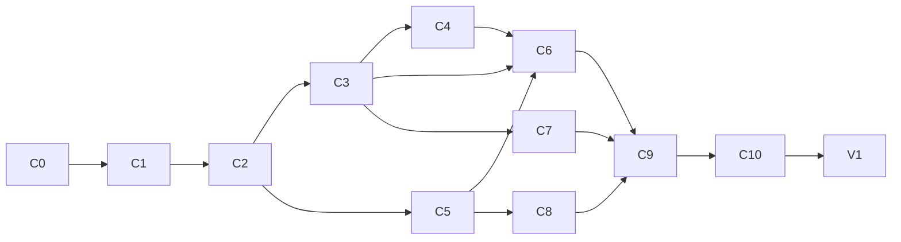

# Canvas Plan

JSON Canvas ([spec 1.0](https://jsoncanvas.org/spec/1.0/)) editing at parity with Obsidian 1.15.1's Canvas, built as the open-source library `@type32/jsoncanvas-editor` ([CTRL-Neo-Studios/jsoncanvas-editor](https://github.com/CTRL-Neo-Studios/jsoncanvas-editor), local `../../jsoncanvas-editor-nuxt`), then used by Vertex for `.canvas` files.

Obsidian's behaviour was mapped by driving the app (Obsidian CLI + CDP) and reading its bundled source. The numbers and rules below are behaviour, reimplemented clean-room; no Obsidian code is copied.

## Decisions

| Topic | Decision |
|---|---|
| Package | One package, three entry points, like `@type32/workflows`: `./core` (plain TS: types, parse/serialize, geometry, snapping, layout, history), `./vue` (components, composables), and the Nuxt module at the root (auto-imports `./vue`). Everything is built by `nuxt-module-build`/mkdist under `dist/runtime/`; `.vue` files ship as SFCs, so plain Vue + Vite apps work too. |
| Peers | `vue`, `@nuxt/ui` (chrome), `@comark/vue` (optional, from C5: default markdown display). |
| Styling | The library's own markup uses plain CSS (`jc-` classes, Nuxt UI's `--ui-*` variables) shipped as `./style.css`, never Tailwind utilities: Tailwind doesn't scan `node_modules`, and Nuxt UI only adds `@source` for layers. Nuxt UI components carry their own classes. The Nuxt module adds `style.css`; Vue apps import it. |
| Renderer | Own DOM + SVG, like Obsidian: one transformed world layer, HTML nodes, two SVG layers for edges (lines, then arrowheads), only what's in the viewport. No Vue Flow: JSON Canvas has 4 side-midpoint anchors, geometric groups and array-order z, which Vue Flow fights. |
| State | `useCanvasEditor()` owns the document, selection, viewport and history; `<JsonCanvas v-model>` syncs the document. Drags change local state per frame and commit once at the end (today every frame emits a whole new canvas). |
| History | Whole-document snapshots, 100 max, pushed 250 ms after the last change (debounce restarted on each change). Selection and viewport aren't recorded. |
| Markdown | Default: display with `@comark/vue`, edit in a `<textarea>`. Hosts replace both through slots (Vertex: `codemirror-rich-obsidian-editor`). |
| Files | The library never touches a filesystem. A `CanvasHost` adapter (all optional) resolves paths, reads text, picks/imports files, lists a note's links and opens files. Without a host, file nodes show a generic card. |
| Chrome | Shipped, built on Nuxt UI: bottom add bar, right controls, floating selection toolbar, context menus, help modal. Each is a slot and can be turned off by prop. Strings come from a `messages` prop with English defaults (no i18n dependency). |
| Data safety | Unknown keys on the document, nodes and edges round-trip. Unlike Obsidian, nodes of unknown `type` and edges to missing nodes are **kept** instead of being dropped on the next save. An unknown node with a box renders as a placeholder card (its type, not editable beyond move/resize/delete); edges to missing nodes aren't drawn. Each case is an entry in `issues`, listed in a small Issues panel (a chrome piece, slot-replaceable) with "zoom to" where there's a box. |
| Format | `stringifyCanvas` writes Obsidian's layout (tabs, one node/edge per line, no space after `:`, no trailing newline), so files edited in both apps diff cleanly. New ids: 16 lowercase hex characters. |
| Z-order | Array order is z-order (spec). Groups go first, larger behind smaller (as Obsidian does); other nodes keep their order, and a dragged node moves to the end (front). `orderNodes` applies it on load (`parseCanvas`/`normalizeCanvas`) and the editor keeps it after edits, so `stringifyCanvas` only formats. |
| Edges | Spec defaults: `fromEnd` `none`, `toEnd` `arrow`; defaults are omitted on save. Missing `fromSide`/`toSide` are computed from the angle between centres and written back. |
| Extensions | Events that let a host add menu items (`canvas-menu`, `node-menu`, `edge-menu`, `selection-menu`, `connection-drop-menu`), file renderers per extension (`fileRenderers` prop), and unknown-field passthrough. Beyond-spec features build on these. |
| Not now | Touch/mobile gestures (pinch, long-press), real-time collaboration, a minimap overlay. Mouse, trackpad and keyboard only. |
| Old code | Rewritten. The repo, package name and the public type names (`JSONCanvas`, `JSONCanvasNode`, …) stay. |

## C0: Repo reset

### Change
- Layout: `src/module.ts`, `src/runtime/core/**`, `src/runtime/vue/**`; `package.json` `exports` for `.`, `./core`, `./vue`, `./style.css`; `@nuxt/ui` and `vue` as peers.
- Remove the demo `plugin.ts` (a `console.log`), the module's Tailwind/Nuxt UI CSS import and the stale `dist/`.
- `eslint.config.mjs` (`@nuxt/eslint-config`) and a `lint` script, so the CI job that runs it passes; CI also runs `test` and `test:types`.
- Commit the pending dependency bumps (Nuxt 4.6, Nuxt UI 4.12, VueUse 15, TS 6.0.3).

### As built
- The prototype moved as is: `core/types.ts` (old `types/jsoncanvas.ts`), `vue/components/**`, `vue/composables/**`; the unused `utils/canvas.ts` and the empty server `tsconfig` went. `UIcon` is imported from `@nuxt/ui/components/Icon.vue`, so the SFCs work without Nuxt's auto-imports.
- The module registers only `<JsonCanvasEditor>` (no longer every component globally, e.g. `TextNode`, which could collide with a host's) and adds `style.css` first.
- `./vue` exports `JsonCanvasEditor`; `./core` the types. The root no longer pretends to export types: import them from `./core`.
- `dependencies`: `@nuxt/kit`, `@vueuse/core`; `@tailwindcss/vite`, `tailwindcss` and `@vueuse/nuxt` dropped.
- CI: one bun job (`install --frozen-lockfile`, `dev:prepare`, `lint`, `test`, `test:types`, `prepack`) on pushes and PRs to `main` and `dev`. Vitest runs `src/**/*.test.ts` and passes with none until C1.
- Playground: deps bumped to match; `@type32/jsoncanvas-editor-nuxt` aliased to `src/runtime`, so it imports `/core` like a consumer; its CSS sources `src` while the prototype still uses utility classes.
- The dependency bumps were already committed upstream (`f828edd`).
- Interim: the prototype components use Tailwind utilities, so hosts must add the package to Tailwind's `@source` until C2 moves them to `style.css` (README says so).

### Acceptance
- [x] `bun run lint`, `test`, `test:types` and `prepack` pass locally (CI on the next push).
- [x] A Nuxt app and a plain Vue + Vite app both import `./core` and `./vue`: packed tarball installed into each, `nuxt generate` + `nuxt typecheck` and `vite build` + `vue-tsc` pass, and both render the editor with a node and no console errors.

## C1: Core model (`./core`)

### Change
- **Types:** spec 1.0 (text, file with `subpath`, link, group with `background`/`backgroundStyle`, edges), each with an index signature for unknown keys.
- **`parseCanvas(text)`:** returns `{canvas, issues}`. Numbers rounded; `"r,g,b"` colours converted to `#rrggbb`; missing edge sides computed (angle between centres against the source node's diagonal `atan2(h, w)`).
- **`stringifyCanvas(canvas)`:** Obsidian layout, z-order rule above.
- **Geometry:** bounding boxes (union, grow, contains); side midpoints; opposite side.
  - **Nearest side:** a node is a candidate when the pointer is within 15 world units of its box. Among candidates, the nearest of the 4 side midpoints wins (checked top, right, bottom, left; within 15 returns at once).
  - **Edge path:** each end is pushed out 7 from its side midpoint; control distance `clamp(dist / 2, 70, 150)` along each side's normal. An arrowhead end uses the polygon `0,0 6.5,10.4 -6.5,10.4`; an end without one gets a straight 7-unit stub to the node.
  - **Curve midpoint** (t = 0.5) for edge labels.
- **Snapping:** each box contributes 5 points (4 corners + centre). Per axis, find the nearest target point within `ceil(15 / scale)`. Grid snapping applies only on an axis with no object snap; the box's top-left corner snaps. Grid spacing is 20 / 40 / 80 / 160 below zoom −0.91 / −2.16 / −3.3. Returns the matches used to draw guides.
- **Layout:** align left/centre/right/top/middle/bottom; distribute (first and last stay, gap = (span − Σ sizes) / (n − 1)); justify; arrange in a row, column or grid (gap = grid spacing).
- **Containment:** a node is inside a group when its box is fully inside, edges included.
- **Colours:** presets `"1"`–`"6"`; label contrast via luminance `(299r + 587g + 114b) / 1000 ≥ 150`.
- **History:** snapshot ring (100).

### As built
- `src/runtime/core/`: `types.ts` (spec types, `JSONCanvasUnsupportedNode`/`Edge`, `CanvasIssue`, `newId`), `parse.ts` (`parseCanvas`, `normalizeCanvas`, `isSupportedNode`/`Edge`, `nodeBox`, `orderNodes`), `stringify.ts`, `geometry.ts` (`Rect`/`BBox`/`Point` helpers, `sidePoint`, `sideTowards`, `nearestSide`, `edgeGeometry`, `bezierPoint`), `snapping.ts` (`gridSpacing`, `snapPoints`, `snap`), `layout.ts` (`alignRects`, `distributeRects`, `justifyRects`, `arrangeRects`), `color.ts`, `history.ts` (`CanvasHistory`). No Vue imports; the built `dist/runtime/core/index.js` runs in plain Bun.
- `JSONCanvas.nodes` is `Array<JSONCanvasNode | JSONCanvasUnsupportedNode>` (same for edges): code narrows with `isSupportedNode` before switching on `type`. A node is supported when it has a string `id`, a spec `type`, numeric box, and its fields of the right type (required ones present; e.g. a group's `backgroundStyle` one of the three); anything else is unsupported (`reason: 'unknown-type' | 'invalid'`), kept verbatim, and still an edge endpoint when it has a box.
- `parseCanvas('')` is an empty canvas; invalid JSON, a non-object top level or non-array `nodes`/`edges` throw, so a broken file is never overwritten. Issues: `unsupported-node`, `unsupported-edge`, `missing-node`, `duplicate-id` (edges attach to the first node with an id).
- `stringifyCanvas` follows Obsidian's printer exactly: an object or array is on one line when none of its values is an object or array (`null` counts as one), so a node with a nested unknown value spans several lines, as in Obsidian.
- Deviations from Obsidian, on purpose: `snap` accepts ±15 px symmetrically (Obsidian's binary search accepts exactly +15 but not −15); `distributeRects` spans the rects' own bounds (Obsidian uses the inset group box for a group's contents, which can move the last item); `CanvasHistory` keeps exactly `limit` entries (Obsidian 99 of 100).
- Tests in `test/` (outside `src`, so not built into `dist`); fixtures: the spec's `sample.canvas` and two files Obsidian wrote in the test vault (`obsidian-demo.canvas` shows dragged nodes moved to the end).
- The prototype components now render supported nodes only (C2 replaces them).

### Acceptance
- [x] Unit tests (59): round trip of the spec's `sample.canvas` and the Obsidian test canvases byte-for-byte; unknown keys/types kept; side computation; nearest side (the drops recorded in Obsidian: centre → `top`, bottom-left corner → `left`, …); edge path for `A.right(350,90) → B.left(550,90)` = `M350 90 L357 90 M357,90 C450,90 450,90 543,90`; snapping deltas; every layout op; containment; history limits.

## C2: Viewport and rendering (`./vue`)

Blocked by C1.

### Change
- **Viewport model:** `x`, `y` = the world point at the viewport centre; `zoom` = log2(scale), clamped to [−4, 1]. World transform `translate(W/2, H/2) scale(s) translate(−x, −y)`; animation eases `1 − 0.984^dt` per frame toward the target.
- **Wheel:** pans by `delta / scale × 0.93`; Shift pans horizontally. Mod+wheel, Space+wheel and trackpad pinch (`ctrlKey` wheel events) zoom by `−deltaY / 300`: zoom in keeps the point under the cursor, zoom out keeps the centre. A `wheelBehavior: 'pan' | 'zoom'` option swaps the two.
- **Drag to pan:** Space+drag, middle button, right-drag (a right click without drag is a context menu).
- **Background:** dot grid following the grid spacing.
- **Culling:** only nodes intersecting the viewport, and edges intersecting it grown by 167.5, are mounted.
  - `ponytail:` a linear scan per frame; add a spatial index (rbush) if a 5k-node canvas drops frames.
- **Level of detail:** at zoom ≤ −1.7 (option offsets it), markdown/base/link cards show a placeholder with their name; images, video and canvas minimaps stay. Labels above cards hide.
- **DOM:** each node is `div.jc-node > .jc-node-container` (radius, 1 px border in its colour, colour at 7 % behind the content). File names show above the card, at a scale of `√(1/scale)` (option: always / hover / never).
- **Edges:** 2 px visible stroke, 24 px transparent hit stroke, 5.5 px when hovered or selected. Labels are HTML at the curve midpoint.
- **Colours:** CSS variables `--jc-color-1…6` defaulting to Nuxt UI's red, orange, yellow, green, cyan, purple; custom hex via `--jc-color`.
- Zoom to fit / to a box: 10 % padding, never past 100 %.

### As built
- `./vue` exports `<JsonCanvas>` (registered by the Nuxt module; the prototype `JsonCanvasEditor` and its composables are gone). `v-model` is the document (copied and normalized, never changed in place; edits come in C3), `v-model:viewport` the view (`{x, y, zoom}`, set when it comes to rest; without one the view fits the canvas, as Obsidian opens a file). Props `wheelBehavior`, `cardLabels`, `zoomBreakpoint`; the ref exposes `canvas`, `issues`, `viewport`, `zoomToFit`, `zoomToBBox`, `zoomBy`, `setViewport`, `screenToWorld`.
- `./core` gained `viewport.ts` (`fitViewport`, `zoomViewport` keeping the point under the cursor, `viewportBBox`, zoom limits, `ZOOM_BREAKPOINT`) and `files.ts` (`fileName`, `fileExtension`, `fileLabel`: notes without `.md`, ` › heading` for a subpath).
- `useViewport` (state, easing, wheel, drags, Space) and `useCanvasEditor` (document, scene, culling) under `vue/composables`; `JsonCanvas` → `CanvasScene` (edges, nodes, labels) → `CanvasNode`.
- Right-drag vs menu: macOS fires `contextmenu` on press. During a right press it's held back (capture phase); a press that ends without a drag re-sends it (untrusted, so no native webview menu), a drag drops it; on Windows/Linux the one after the release is dropped after a drag.
- Performance: `CanvasScene` re-renders only when what's mounted changes; what's mounted is the view plus half its size per side, recomputed when the view leaves it or zooms in past half of it. The world layer gets `will-change: transform` only while the view moves (dropped 200 ms after the last wheel step or drag, so text re-rasterizes sharp at rest).
- Content in C2: text cards as plain text, file and link cards as icon + name (C5 renders them), group labels and tint, the zoomed-out placeholders, and unsupported nodes with a box as a dashed card naming their type. All styling is plain CSS in `style.css`; the Tailwind `@source` workaround is gone.
- Package renamed upstream to `@type32/jsoncanvas-editor` (in `a313531`); README, playground and module now use it.
- `ponytail:` a band of hundreds of nodes mounting at once costs one long frame (up to ~60 ms); Obsidian attaches at most 10 new nodes per frame. Add that if it shows on real canvases.

### Acceptance
- [x] The test canvases render with the same geometry as Obsidian: `obsidian-demo.canvas` in Obsidian 1.15.1 and in the playground, both 1168 × 845: the fitted viewport is identical (`x 345, y 410, zoom −1.5032`), every node's screen rect matches to 0.01 px and every edge path string is identical; screenshots side by side at the fitted view and at 100% match apart from card content (C5).
- [x] Panning and zooming a 1,000-node canvas stays at 60 fps (headless Chromium on an M-series Mac, 240 frames of wheel panning per zoom level): average frame 16.6–17.1 ms at zoom −3.3 (all 1,000 mounted), −2.5, −1.5, −1 and 0; p95 ≤ 17 ms; an animated zoom from −3.5 to 0 averages 17 ms (p95 21 ms).

## C3: Selection, moving, resizing, history

Blocked by C2.

### Change
- **Selection:** click; Shift+click toggles; Mod+A selects all nodes.
- **Marquee:** drag on empty canvas.
  - Groups are picked only when fully enclosed; edges never.
  - Shift makes it toggle against the existing selection; Esc restores the previous one.
  - A click on empty canvas clears the selection.
- **Move:** starts after 5 px; Esc cancels.
  - A dragged group carries every node fully inside it, worked out at drag start.
  - Shift locks to the dominant axis.
  - Clone while dragging: Alt (macOS) / Ctrl (others), toggled live.
  - Disable snapping: Ctrl (macOS) / Alt (others).
  - Groups snap only to groups, cards only to cards.
  - Snap guides: lines and 4 px dots in the accent colour.
  - Auto-pan within 30 px of the edge.
- **Resize:** 8 handles of 20 px, minimum 50 for every node type, with object and grid snapping.
  - Aspect lock: images/video always; Shift toggles it on a multi-selection.
  - Resizing a group doesn't move its contents.
- **Multi-selection box:** padded by 10, with its own 8 resize handles (scales members proportionally) and dragging.
- **Keys:** arrow nudge (grid step, ×5 with Shift); Delete/Backspace removes (a group's contents stay); Shift+1 zoom to fit; Shift+2 zoom to selection.
- **Undo/redo:** Mod+Z, Mod+Shift+Z / Mod+Y; also buttons.
- **Read-only mode:** disables every edit; zoom to selection stays.

### As built
- **Document flow:** `useCanvasEditor` keeps the shown document and the committed one. A drag previews a new document per frame (new objects only for what moved: the scene reuses the `SceneNode`/`SceneEdge` of every unchanged node and edge object, so only those re-render) and commits once at the end; a commit emits `update:modelValue` and schedules an undo snapshot 250 ms later (later commits restart it, so they're one step; undo flushes it first). A model value handed back that is (`toRaw`) the last commit is ignored; any other replaces the document and clears undo and the selection.
- `toRaw` before normalizing: a parent's `ref()` hands over a reactive proxy, which `structuredClone` can't copy. The C2 playground used `shallowRef`, so it didn't show; the component tests (props are proxies) caught it.
- **Selection:** node keys (`selected`, `select()` on the ref). Edges join it in C4. A selected card is drawn above the others (z-index), a selected group takes pointer events over its whole area (unselected, only its label does).
- **Gestures:** one pointerdown router (`useCanvasInteraction`): resize handle → resize, multi-selection box → move, node → click (select / Shift-toggle) or drag (selects it if unselected, then moves), empty canvas → drag-select (cleared at once unless Shift). Drags go through `startDrag` (`vue/utils/drag.ts`): 5 px threshold, Escape / context menu / pointer cancel cancel, modifier presses re-run the move (so the clone and no-snap keys work without moving), auto-pan within 30 px of the edge at 60 Hz (re-running the move each step). Moves measure from the press point.
- **Move:** raises the moved nodes to the end of the z-order at drag start (undone if it ends where it began). Group contents found at drag start. Snap sources: the outermost moved groups, else every moved card; targets: visible unmoved nodes of the same kind. Clone (`cloneNodes`): copies with new ids plus the edges between them, selected afterwards; ghosts show where they'll land.
- **Resize:** handles on the hovered node (hit test with 8 px tolerance, topmost first; none for a node in a multi-selection), 20 px × √(1/scale) strips and corners. `resizeBox`/`resizeSnapSource`/`scaleBoxes` in `core/edit.ts`. Multi-selection: the padded box scales its members; its minimum keeps every member ≥ 50; Shift keeps its proportions.
- **Keys** (canvas focused, nothing being dragged): arrows nudge by the grid step (×5 with Shift), moving group contents too; Delete/Backspace remove the selected nodes and their edges (`removeFromCanvas`); Mod+A, Shift+1, Shift+2, Mod+Z, Mod+Shift+Z / Mod+Y.
- `readonly` prop: no handles, moves, resizes, deletes, nudges or undo; selection and zoom work. `snapToGrid` / `snapToObjects` props (C6 adds the settings menu).
- Not in C3: single-node aspect lock for images and video (needs their natural size, C5); undo/redo buttons (C6, the ref exposes `undo`, `redo`, `canUndo`, `canRedo`).

### Acceptance
- [x] Interaction tests (Vitest + `@vue/test-utils` on happy-dom, pointer and key events on the mounted `<JsonCanvas>`, `test/interaction.test.ts`, 12 tests): click / Shift-click / empty click, drag-select (touching cards, groups only when enclosed, Shift toggles, Esc restores), group carry, axis lock, no-snap key, grid and object snapping with guides, clone with ghosts, Esc cancel, minimum size, Shift-proportional multi-selection scaling, undo coalescing (fake timers), delete keeps group contents and drops their edges, read-only. Plus `test/edit.test.ts` for the pure operations.
- [x] Moving a group snaps to the grid as in Obsidian: the group at (−20, −20) dragged by 100 × 50 lands at (80, 40) with its card at (100, 60), in the tests and in the playground on `obsidian-demo.canvas` (the group at (520, 780) lands at (620, 840), its contents +100/+60; Cmd+Z restores it).

## C4: Edges

Blocked by C3.

### Change
- **Hover handles:** 4 connection points (20 px, at side midpoints) show on the node under the pointer (8 px / scale tolerance, topmost first). None while several nodes are selected.
- **Connecting:** drag from a point; the target and side follow the nearest-side rule.
  - Not allowed: the node itself, a group containing it, or (from a group) nodes inside it.
  - New edges start with `fromEnd: none`, `toEnd: arrow`. Duplicate edges are allowed, as in Obsidian.
- **Dropping on empty canvas:** opens `connection-drop-menu` with:
  - Add card;
  - Add file (`host.pickFile`);
  - up to 20 of the source note's outgoing links not yet connected (`host.listLinks`).
  - The new node's facing side midpoint lands on the pointer. Closing the menu removes the edge.
- **Reconnecting:** dragging an edge moves its nearer end; dropping on empty canvas deletes the edge; it never attaches to the other end's node.
- **Edge clicks:** a click selects; clicking a selected edge edits its label.
- **Edge label:** contenteditable at the midpoint; empty removes it.
- **Edge context menu:** Remove, Edit label, Follow connection (zooms to the far end).
- **Line direction:** none / one-way / both ways.

### As built
- **Selection** holds node and edge keys (an edge's key is its id, unless a node or an earlier edge has that id). Selected edges draw like hovered ones (5.5 px line on a tinted band). Delete removes selected edges too; Mod+A still selects nodes only; zoom to selection includes edges' end points.
- **Connection points** sit in the side resize strips (`.jc-connect[data-connect]` inside `.jc-handle[data-owner]`); the dot shows while the pointer is on that strip, as in Obsidian.
- **Dragged edges** (new or reconnecting) are drawn in the overlay, above the nodes, between the source box and either the target side or a 0 × 0 box at the pointer. Reconnecting previews the document without the edge, so its label hides until the drop. While one is dragged, edges don't react to hover (`.jc-connecting`).
- **Targets:** visible nodes with a string id within 15 world units of the pointer, then `nearestSide`. Connect skips the source, groups containing it, and (from a group) what it holds; reconnect skips only the other end's node.
- **Menus:** one `CanvasMenu` (Nuxt UI `UDropdownMenu`, non-modal, opened at a 0 × 0 anchor in the canvas). A virtual `reference` element never got positioned by Reka, and a modal menu's focus trap took focus back from the label editor, so neither is used. The drop menu waits for `host.listLinks`, then opens; a choice adds the node (`NODE_SIZE` text 250 × 60, file 400 × 400, placed with `boxAtSide`) and the edge in one commit and selects the node; closing without a choice drops the dragged edge.
- **Edge context menu:** Edit label, Line direction (Nondirectional / Unidirectional / Bidirectional as checkbox items; not in Obsidian's edge menu, added because the toolbar that has it is C6), Follow connection, then Remove. Read-only: Follow connection only. An edge in a multi-selection gets no menu until C6's selection menu (`ponytail:` note).
- **Labels:** `CanvasEdgeLabel.vue`; the editor is `contenteditable="plaintext-only"`, filled once on start (never re-rendered while typing), caret at the click point (`caretPositionFromPoint`) or all selected. Blur commits (trimmed; empty removes the label); Escape hands focus back to the canvas. Clicking a label selects the edge, clicking it again edits; labels can't be dragged.
- **Key order:** new edges are `id, fromNode, fromSide, toNode, toSide`; a line direction rewrites ends before `color` and `label`, as Obsidian writes them.
- **`CanvasHost`** starts here with `pickFile()` (no `kinds` yet) and `listLinks(path)` → `{ file, subpath? }[]`; C5 adds the rest.
- **Tests:** a `DropdownMenu` stub (`test/stubs/DropdownMenuStub.vue`) lists items and calls `onSelect` before closing, as Reka does. Vue ignores an event dispatched in the same millisecond its listener was added, which happy-dom's fast frames can hit for the second `contextmenu` listener; the context-menu test moves `Date` on first.

### Acceptance
- [x] Interaction tests (`test/interaction.test.ts`, `edges`, 11 tests): nearest-side target and new-edge keys; exclusions (group around the source, a group's contents); drop menu closed without a choice (no edge, no emit); Add card placement and selection; links not yet connected plus a picked file; reconnect to another node, never onto the fixed node, removed on empty canvas; Esc cancels a reconnect; click selects, second click edits the label, empty label removed; Delete removes edges; line direction and Remove from the context menu; read-only only selects.
- [x] Library → Obsidian: in the playground, an edge connected by drag, labelled on a second click, made bidirectional, and a drop-menu card with a nondirectional edge; written with `stringifyCanvas` into the Misc vault, opened in Obsidian 1.15.1: `canvas.getData()` equals the file (same keys, same order) and `getViewData()` equals the text. Obsidian → library: edges changed and created in Obsidian (label, color, both ends, a new edge) parse and stringify back to the identical file with no issues. Test file deleted.

## C5: Node content

Blocked by C2.

### Change
- **Text cards:** `@comark/vue` display (wiki-links handed to `host.openLink`); a textarea editor.
  - Editing starts on double-click or the Edit button; Esc or a click outside ends it.
  - Slots: `#text-display`, `#text-editor`.
  - Double-click the bottom or right handle to fit height, or narrowest width, to the content.
- **`CanvasHost`** (all optional):
  - `resolveFile(path)` → `{exists, name, ext, url}`;
  - `readText(path)`;
  - `pickFile({kinds})`;
  - `importFiles(files)` → paths;
  - `listLinks(path)`;
  - `openFile(path, subpath, newTab)`;
  - `openLink(target)`.
- **File cards by extension** (any can be overridden via `fileRenderers`):

  | Kind | Rendering |
  |---|---|
  | md | `readText` + markdown display; `subpath` narrows to a heading or block |
  | images, video | aspect-locked; on load the card shrinks to the media's ratio, amending the current undo step instead of adding one |
  | audio | the card's height is set to the player's |
  | pdf | `<iframe>` of the URL, `#page=N` from `subpath` |
  | canvas | SVG minimap from `./core`: groups, then edges, then nodes; rounded rects; colours applied |
  | other | generic card (icon + name) |
  | missing | "could not be found" with Swap file / Remove |

- **Link cards:** sandboxed `<iframe>`, http(s) only; YouTube links become `youtube-nocookie` embeds and X statuses become embeds; the label is the URL. Menu: Change URL, Open in browser, Copy URL, Reload.
- **Groups:** label above the box (1.5 em, tinted, contrast by luminance), double-click to edit (Enter commits).
  - Background image: cover / keep ratio (resizes the group to the image) / repeat.
  - A `cover` style is omitted on save, and an old `backgroundStyle` never resurfaces (a known Obsidian bug).

- **Custom cards** (added at the user's request during C5): `nodeRenderers` (component per node `type`) and `#node-<type>` slots (which win) replace a built-in card or add a new type; `addNode()` on the ref adds one.

### As built
- **Structure:** `CanvasNode` dispatches to `TextCard`, `FileCard`, `LinkCard` (or a custom card); `useCanvasContent` (provided as `CANVAS_CONTENT`) holds the host, renderers, slots, the file cache and media sizing; edit actions (editing, labels, swap, remove, menus, prompt) live in `useCanvasInteraction`.
- **Markdown:** Comark parser (`vue/utils/markdown.ts`) with linkify, frontmatter, alerts, task lists, line breaks and a `[[wiki-link]]` inline rule (`data-wikilink`, shown as the alias or `Note > Heading`); raw HTML and Comark's component syntax are off, so card text can't inject markup. Parses are cached (500). `@comark/vue`'s `MarkdownDocument` has an async setup, so `MarkdownView` wraps it in its own `<Suspense>` (without one, nothing rendered outside Nuxt pages; the component tests caught it). Links: wiki-links → `host.openLink`, others open in a new tab.
- **Content and the pointer:** a card's content takes the pointer only while it's the only thing selected (`jc-focused`) or being edited, as Obsidian's content blocker does; a missing file's buttons always do. The router leaves inputs, buttons, links, contenteditables and media controls alone, and a plain wheel over focused content that can scroll scrolls it.
- **Text editing:** double-click (or Edit in the card's menu) on a text card; the editor is a textarea or the `#text-editor` slot (`update`, `done`). Escape or a press outside saves, one undo step; zooms to the card first if its content is hidden. **Fit:** double-click on the bottom/right handle measures the content in the DOM (height to `scrollHeight`; width by bisection, shrink only), as Obsidian does.
- **Files:** `resolveFile`/`readText` cached per path (`refreshFiles(paths?)` on the ref; a new `host` clears it); a host that throws gets a generic card, never the missing one. Kinds by `fileKind` (Obsidian's extension lists); `fileRenderers[ext]` wins. Notes use `markdownSection` (headings incl. `#A#B`, `#^block`, frontmatter skipped; "couldn't find" otherwise). Images and video report their shape (`setAspect`): the card shrinks inside its box via `editor.amend` (no undo step of its own; skipped while read-only) and keeps the shape when resized alone. Audio sets the card's height to the player's (`|| 42`, Obsidian's fallback). PDFs: `<iframe>` with `#page=N`. Canvases: `canvasMinimap` (core) drawn as SVG. Images, video, audio, canvases and link frames stay mounted when zoomed out.
- **Links:** `embedUrl` (core): http(s) only, YouTube → `youtube-nocookie`, X posts → `platform.twitter.com` embed with the page's light/dark theme; sandboxed `<iframe>`. Menu: Change URL (a Nuxt UI modal, `new URL` validation, loaded lazily so tests and hosts without it never import it), Open in browser, Copy URL, Reload page.
- **Groups:** label edited in place on double-click (Enter or Escape commits, empty removes); background resolved through the host, `cover`/`repeat` via CSS, `ratio` loads the image and locks the group's shape. `setBackground` (core) writes `backgroundStyle` only for `ratio`/`repeat` and drops a stale one; the button that uses it is C6's.
- **Card menus** (right-click, single selection): text Edit; group Edit label; file Swap file (`host.pickFile`), Open in new tab (notes, `host.openFile`); link as above. C6 adds Zoom to selection, Remove and the selection menu.
- **Custom cards:** props `node, selected, focused, editing, contentHidden, readonly, host, update(patch), done()`; double-click edits a custom type; custom types are dropped from `issues`; the card gets class `jc-node-custom` and `data-type`.
- **Playground:** `test/fixtures/vault` (notes, images, video, audio, PDF, canvas, base, zip) served by a Nitro route (`/vault/<path>`, `/vault-index`; `JC_VAULT=…` serves another folder), `createVaultHost()`, a `BaseCard` file renderer, and an "Every kind" canvas with a `#node-sticky` custom card and an Add sticky button.
- **Not done like Obsidian:** a missing file's name above the card has no warning icon; Copy URL shows no notice (no toast in the library); text cards have no "Convert to file"; link frames reload when scrolled back into view (virtualized), not kept like Obsidian's webviews.

### Acceptance
- [x] Each kind renders in the playground from a host adapter over local files (`?canvas=Every kind`, headless Chromium): Markdown text card, note, note narrowed to `#Some heading`, image (shrunk to 3:4), video (to 16:9), PDF at page 2, canvas minimap, base (host renderer), generic zip, YouTube and web frames, ratio group background, custom card; the missing note shows Swap file / Remove. Audio renders a player (its height can't be measured in headless Chromium, so the 42 px fallback applied). Checked by hand there: wiki-link → host toast, edit + Escape + Markdown re-render, fit width, image resize keeps 3:4, scroll inside a focused note, group rename, Change URL with "Invalid URL" then a valid one, custom card edit + undo. Component tests (`card content`, `custom cards`): text editing, missing/narrowed/generic files and a wiki-link, image shape on load without an undo step and when resized, custom cards by component and slot, `addNode`.
- [x] With `JC_VAULT` set to the Misc vault, `obsidian-demo.canvas` shows Welcome, Random Rambling and Rambling 2, both pasted images and the photo at their shapes, `Untitled.canvas` as a minimap and `Untitled.base` through `BaseCard`.

## C6: Chrome and menus

Blocked by C3, C4, C5.

### Change
- **Bottom bar:** card, file, media buttons. A click adds at the centre; a drag adds at the drop point, with snapping. File and media go through `host.pickFile`.
- **Right controls:** settings (snap to grid, snap to objects, read-only), zoom in (+0.5) / reset / fit / out, undo/redo with disabled states, help.
- **Floating selection toolbar** (above the selection; higher for groups and file cards):

  | Selection | Buttons |
  |---|---|
  | text or md file | Remove, Color, Zoom, Edit |
  | link / other file | Remove, Color, Zoom |
  | group | Remove, Color, Zoom, Align (its contents, inset 20), Edit label, Set/Edit background |
  | one edge | Remove, Color, Zoom, Line direction, Remove label (when labelled), Edit label |
  | edges only | Remove, Color, Zoom, Line direction |
  | several nodes | Remove, Color, Zoom, Create group (box + 20, "Untitled group"), Align |

- **Colour picker:** none, presets 1–6, custom (`<input type=color>`, live preview while picking).
- **Align menu:** sections align-h, align-v, arrange, distribute, justify.
- **Context menus** (Nuxt UI `UContextMenu`, extendable through the menu events):
  - empty canvas: Add card / file / media / web page / group, then Undo, Redo, Select all, Zoom to fit;
  - node: Zoom to selection, its type's items, Remove;
  - edge: see C4;
  - selection: the toolbar's actions.
- **Creating by gesture:** double-click on empty canvas creates a 250×60 card at the pointer and edits it. Mod+drag on empty canvas creates at the dragged size; the `modDragBehavior` option picks menu (default), card, file, media, web page or group.
- **Help modal:** Pan, Pan horizontally, Zoom, Zoom to fit, Zoom to selection, Select all, Add/remove from selection, Create with size, Clone, Constrain axis, Disable snapping, Remove, Undo, Redo, with the platform's keys.
- **Empty canvas:** a hint to drag from below or double-click, and how to pan and zoom.

### As built
- **Structure:** `useCanvasActions` holds what the chrome and menus do (`toolbarItems`, `toolbarAnchor`, `setColor`, `removeSelection`, `createGroup`, `layout`, `setLineDirection`, `add`, `creationItems`, `createWithSize`, `menu`); the C4/C5 menu building moved there from `useCanvasInteraction`, which keeps the pointer and keys and asks `actions` (late-bound) for menus and creation. Components: `CanvasToolbar`, `CanvasControls`, `CanvasCardBar`, `CanvasHelp` (lazy, like `CanvasPrompt`). `actions` is on the ref and in the chrome slots.
- **Toolbar:** the table's rows, plus Edit for custom card types; read-only shows Zoom only. The topmost selected item decides (a node over any edge), so a mixed selection gets the several-nodes row. Position as Obsidian's (above the box by 10/scale, 35/√scale with a group, 30/√scale for a file card, above a single edge's label), clamped 10 px inside the canvas. Colors: inline swatches (none, 1–6, a custom `<input type=color>` that previews while dragging and saves on change). Dropdown buttons (Align, Line direction, background) show their name as a native title, since a Nuxt UI tooltip can't wrap a dropdown trigger. The md-file Edit button waits for an md editor (V1).
- **Context menus:** one non-modal `UDropdownMenu` at the pointer (C4), not `UContextMenu`: the target and selection are decided first, then `actions.menu(target)` builds the items and the `menu` event lets the host push more groups. Empty canvas: Add card/file/media/web page/Create group/templates; Undo/Redo when possible; Select all, Zoom to fit; Snap to grid, Snap to objects, Read-only (Obsidian's quick settings). Node: its items, Zoom to selection, Remove. Edge: as C4. Multi-selection: the toolbar's actions as items (Set color → swatch items), Remove last. Right-clicking now selects in read-only too.
- **Creation:** `add(kind, place)` — text 250×60 then edits; file/media through `pickFile({ kinds })` (`markdown, canvas` / `image, video, audio, pdf`); web page through the URL prompt (YouTube 640×360 unless drawn); group 400×400 "Untitled group" then edits its label; templates at their size. Empty-canvas double-click → card centred, editing; Mod+drag → `modDragBehavior` (menu keeps the rectangle until it closes). Bottom bar: click → centred in the view; drag → a ghost centred on the pointer, snapped to cards (and the grid), created where dropped inside the canvas (file/media then pick). Templates (`cardTemplates`) appear in the bar and the add menus.
- **Controls / settings:** `readonly`, `snapToGrid`, `snapToObjects` became models (`v-model:readonly` …), so the settings menu and the lock button change them. Zoom ±0.5, reset to 100 %, fit; undo/redo disabled per history; help modal with the platform's key names (⌘ ⇧ ⌥ ⌃ on macOS, joined by spaces; `Ctrl + …` elsewhere), rows swapped for `wheelBehavior: 'zoom'`.
- **Strings:** `MESSAGES` (all C4–C6 strings, `{name}` placeholders), overridden by the `messages` prop; reached through the content context.
- **Needs `<UApp>`:** the tooltips need its provider. The playground dedupes `vue`, `@nuxt/ui`, `reka-ui`, `@vueuse/core` (it had its own copies, so the canvas didn't find `UApp`'s provider).
- Also: Markdown hides ` ^block-id` markers at line ends, as Obsidian does.

### Acceptance
- [x] Every row of the table, in the component tests (`chrome`: text, link, group with Set background, edge, labelled edge, two edges, two cards, read-only) and in the playground (Obsidian demo, headless Chromium: text card toolbar, swatches and a preset applied, two cards → Create group + Align with all 13 layout items, an edge → Line direction with Unidirectional checked, empty-canvas menu with the add items, Add sticky, Undo, Select all, Zoom to fit and the three settings, help modal's 14 rows, a card dragged from the bar landing on the grid and editing, read-only from the settings menu hiding the bar and leaving Zoom, Disable read-only restoring it). Tests also cover colors on nodes and edges, Create group (+20, label editing), aligning a group's contents, the empty-canvas menu, double-click and Mod+drag creation, the bottom bar's click and drop, the `menu` event, undo's disabled state and the read-only lock.
- [x] Chrome hidden by `toolbar` / `controls` / `cardBar`, replaced by `#controls` (test), and strings from `messages` (test: the card bar's label).

## C7: Clipboard and drops

Blocked by C3.

### Change
- **Copy/cut:** the `copy`/`cut` event writes `application/x-jsoncanvas` (`{nodes, edges, center}`, edges only between copied nodes) plus `text/plain` (the JSON).
- **Paste** tries, in order:
  1. files → `host.importFiles` → file cards laid out in rows of 10, 45 apart, 400×400;
  2. canvas data → new ids, centred on the viewport, selected;
  3. an http(s) URL → link card (YouTube 640×360);
  4. other text → text card.
- **Drops:** host-defined data types → file cards at the drop point (Vertex: its Files rows).

### As built
- **Format:** Obsidian 1.15.1 writes only `obsidian/canvas` (`{nodes, edges, center}`, center = middle of the nodes' box; a selected group copies alone, without its contents; edges alone copy nothing). The editor writes the same type instead of `application/x-jsoncanvas`, so cards copy to and from Obsidian (checked both ways through Obsidian's own copy and paste handlers), plus the JSON as `text/plain`, which it also reads back. That differs from Obsidian, which pastes canvas JSON in plain text as a text card; the text form is what a host can carry where custom types don't survive.
- **Core** (`edit.ts`): `CANVAS_CLIP_TYPE`, `CanvasClip`, `copyClip(canvas, nodes)`, `readClip(text)` (untrusted: nodes without a box are dropped, the rest normalized as a file is), `pasteClip(canvas, clip, at)`; `cloneNodes` takes the edges to copy from.
- **Events:** `copy`/`cut`/`paste` are listened for on the document and taken while the canvas element itself has focus (Chromium sends them to the body when nothing is selected); text being edited keeps them. Copy with no node selected, cut and paste in read-only fall through to the browser.
- **Paste and drop** are one action, `actions.paste(data, at?)`: at the view's centre for a paste, centred on the drop point for a drop. Order: `host.filesIn(data)` (new host member: the app's own formats, read during the event) → files through `host.importFiles` → canvas data (`obsidian/canvas`, else plain text) → a trimmed `http(s)://` URL with no spaces → a link card (400×400; YouTube 640×360) → other text → a 250×60 text card being edited (as Obsidian). File cards: 400×400, rows of 10, 445 apart, the grid centred on the point, selected. Matches Obsidian for text, URLs (`www.…` and `ftp://` stay text), HTML (its plain text) and canvas data; Obsidian keeps a URL's surrounding spaces, the editor trims them.
- **Drops:** `dragover` is taken anywhere but in text being edited (copy effect; `none` in read-only, so a dropped file never replaces the page).
- **Hosts without clipboard events:** WebKit (Tauri) fires none on a non-editable element, so `actions.copy(dataTransfer)` / `actions.cut` / `actions.paste` are public for the host to call from its own shortcuts with `new DataTransfer()` and its clipboard's text (V1).
- Playground: `importFiles` keeps files in memory as blob URLs under `Imported/`.

### Acceptance
- [x] Copy and paste within a canvas, across two canvases and across two windows keeps edges and colours, with new ids: headless Chromium with real Cmd+C / Cmd+V (Obsidian demo → itself, centred on a moved view; → `Every kind` in a second tab), component test (`clipboard and drops`), and with Obsidian both ways.
- [x] URL and plain-text pastes create the right node: example.org → 400×400 link, YouTube → 640×360, text → 250×60 card in edit, centred on the view (headless Chromium, component test). OS files dropped (a PNG and a note) became `Imported/…` cards at the drop point; the note's text showed.

## C8: Export as PNG

Blocked by C5.

### Change
- `exportPng({frame: 'full' | 'viewport', scale, privacy, padding = 100})` → `Blob`; the host saves it.
- Rendering: the world layer drawn with `modern-screenshot`, with level of detail forced off.
  - Size: scale capped at `min(2, 16284 / width, 16284 / height)` (the browser's canvas limit).
  - Link and PDF cards (cross-origin, not capturable) render as their placeholder.
  - Privacy mode scrambles text glyphs with a CSS class.
  - An optional `watermark` slot.
- An export dialog (frame, scale with the resulting pixel size, privacy) in the chrome; shown when the host passes a save handler.

### As built
- **Obsidian 1.15.1, observed:** Export as image (command `canvas:export-as-image`) asks for Viewport (Full canvas / Viewport only), Zoom (a slider of log2 −1…1, shown as 0.50–2.00, with "Estimated image dimensions" = (cards' box + 2 × 100) × zoom × the screen's pixel ratio), Show logo (on) and Privacy mode (off); with Viewport only, Zoom and Show logo go. Its image (saved through a stubbed save dialog) has the canvas background with its dots, labels at 100 %, every word in privacy mode a bar in the text's color, and the Obsidian logo in an 80 px band added below.
- **API:** `exportPng({ frame, scale, privacy, padding, watermark })` on the component ref → PNG `Blob`. `scale` is image px per world unit (default: `devicePixelRatio`, × the view's scale for the viewport), capped by `exportSize` (core) so no side passes `MAX_EXPORT_SIZE` (16284); there's no cap at 2: Obsidian goes to 2 × the pixel ratio. `EXPORT_PADDING` 100, around the nodes' box (edges aren't counted, as in Obsidian).
- **Rendering:** a second scene, inside the canvas at 100 % but invisible (`opacity: 0`), with every node and edge in the frame mounted, content shown (no level of detail, no selection, labels at 100 %), the dotted background and the `#watermark` slot at the bottom left inside the padding (no band added). The export waits for loads in flight (`content.track`: files, group backgrounds, Markdown parsing and Comark's async render), then images to decode and videos to have a frame (10 s at most), then captures it with `modern-screenshot` (loaded on first export). Link and PDF cards draw their placeholder; audio players come out blank.
- **`modern-screenshot` workaround:** its sandbox frame loads a `srcdoc`, and current Chromium throws "Illegal invocation" from `getComputedStyle` on that frame's window (checked in the page: a written `about:blank` frame works). The export hands it its own written frame through `createContext`.
- **Privacy:** a CSS class alone can't draw glyphs as bars without a font, so each word in the export copy is wrapped in `.jc-redacted` (transparent glyphs over a bar of `currentColor`), as Obsidian draws it.
- **Dialog:** `CanvasExport` (lazy), Obsidian's fields with the estimate from `exportSize` (so a capped size shows capped), Show watermark only with a `#watermark` slot; Save → `host.saveImage(png)`. Offered from a controls button (`i-lucide-image-down`) when the host has `saveImage`; `openExport()` on the ref and in the `#controls` slot.
- `.jc-zoomed-out .jc-node-label` now applies to the live world only, so labels show in the export copy at any zoom.
- Playground: `saveImage` downloads `canvas.png`; a "JSON Canvas" watermark.

### Acceptance
- [x] Full and viewport exports match the on-screen layout: headless Chromium, Obsidian demo full at 0.5 (1605 × 1030 = (3010 + 200) × 0.5) and viewport (1749 × 1063 = the 1400 × 851 view × pixel ratio 1.25; same framing as the screen, labels at 100 % instead of the screen's enlarged ones), `Every kind` full (video frame, minimap, base renderer, ratio background; link, YouTube and PDF as placeholders), privacy mode, and the dialog's Save downloading the PNG. A 20,000 px wide canvas came out 16284 × 1656 (also `exportSize` test). Component test (`export`): an off-screen card is drawn, the link is a placeholder with no frame, words and the watermark are redacted in privacy mode, the size and scale passed on, the copy gone afterwards.

## C9: Docs and release

Blocked by C6, C7, C8.

### Change
- README: install (Nuxt / Vue), `<JsonCanvas>` props, events, slots, `CanvasHost`, `./core` API, extension events, keyboard reference.
- Playground: the spec's sample, a local-folder host (File System Access API), every feature.
- `v0.2.0` via `changelogen`.

### As built
- **README** rewritten as the reference: install (Nuxt, Vue + Vite, with Nuxt UI's `tailwindcss`, `<UApp>` and `@iconify-json/lucide`), a quick start over `public/` files, every model, prop, event, slot, method and `CanvasActions`, the host table, custom cards, chrome/menus/strings, clipboard (and the WebKit note), export, theming variables, the `/core` API by group, and the keyboard and mouse reference. Badges point at the package; `package.json` gets a description, keywords and the real repository.
- **Playground:** the spec's sample was already there; **Open folder…** opens a local folder through the File System Access API (`utils/folderHost.ts`): its canvases in a second select, edits saved back (500 ms after the last, in Obsidian's format), file cards from the folder (object URLs), `pickFile` through `showOpenFilePicker` limited to the folder, `importFiles` written into it ("name 1.ext" on a clash), `listLinks` and `openLink` resolved Obsidian-style (shared `utils/links.ts`), canvas cards opening their canvas. Each canvas opens fitted.
- **Fix found by the fresh-app run:** the empty canvas's hint named the platform's key during SSR (`Ctrl` on the server, `⌘` in the browser), a hydration mismatch; it's now shown once mounted.
- **Release:** `changelogen` finds the C2–C8 commits since `v0.1.1` (7 features, 1 chore). `publishConfig.access: public`, since a scoped package's first publish is otherwise private. The user commits, tags and publishes (the package isn't on npm yet; `npm whoami` is `type32`). Held until C10.

### Acceptance
- [x] A fresh Nuxt app followed the README to an editable canvas with file cards: `nuxi init` (minimal), the README's installs (the package from `bun pm pack`'s tarball), config, CSS, `app.vue`, page and three files in `public/vault/`. The note rendered as Markdown, the image as an image, a card added by double-click logged the new document; no console errors or warnings, `nuxi typecheck` clean. About 3 minutes of following the steps, well under 10.
- Publishing moved to C10.

## C10: Scale and hardening

Blocked by C9. Release (`v0.2.0`) after it.

So far only C2 measured speed: panning 1,000 cards at 60 fps, before cards had real content, toolbars or menus. Parsing has unit tests for unsupported data. Nothing measured editing at scale, thousands of edges, huge or hostile files, failing hosts or broken custom cards.

### Baseline (2026-11-12)
Dev build (Vue dev mode, slower than production), headless Chromium, M-series Mac, view 1400 × 851, playground `?canvas=Stress&nodes=N&edges=E` (a grid of text and file cards, each linked to the next, plus E random edges). Times per frame or per action, in ms.

| | 1,000 / 1,000 fitted (zoom −3) | 5,000 / 25,000 fitted (zoom −4) | 5,000 / 25,000 at 100 % |
|---|---|---|---|
| Mounted cards / edges / DOM elements | 1,000 / 999 / 9,289 | 5,000 / 24,999 / 146,089 | 64 / 1,009 / 5,695 |
| Pan (avg / p95) | 16.6 / 16.8 | 66 / 101 | 16.9 / 16.8 |
| One edit: nudge a card (avg) | 18 | 331 | 68 |
| Undo | 18 | 198 | 73 |
| Drag every card (avg / p95 per frame) | 66 / 82 | 1,458 / 2,219 | 185 / 253 |
| Drop after that drag | 28 | 517 | 79 |

Core alone (Bun): a 100,000-card file parses in 29 ms and stringifies in 13 ms; a 10 MB text card is fine.

Hostile input, found by a quick probe:
- A node at `x: 1e308` (or as wide) makes `fitViewport` return `x: NaN`: the view breaks.
- Negative and zero widths/heights count as supported: inverted boxes reach hit tests, culling and snapping.
- Unknown data nested 5,000 levels deep stringifies to 25 MB (one more tab per level) in 640 ms; at 50,000 levels the stack overflows, so a file can be opened and then not saved.

Not yet probed, risks from reading the code:
- A custom card that throws in setup or render. Vue rethrows render errors in dev, so it may take the whole canvas down; production logs and blanks it.
- Host calls that reject: `pickFile`, `importFiles`, `saveImage` and `filesIn` go unhandled, with nothing shown to the user.
- Link cards stay mounted when zoomed out (as in Obsidian), so hundreds in view are hundreds of live frames.
- Export mounts every card in the frame at 100 %, so a 10,000-card export clones a DOM of hundreds of thousands of elements.

### Where the time goes (from the code)
1. **Every commit copies the whole document.** `apply()` re-derives `issues` with `normalizeCanvas`, which `structuredClone`s the document. That's most of a single edit's cost at 5,000 cards, and every undo pays it again.
2. **Drags build a new document every frame.** `preview` rebuilds the scene: every moved card gets a new scene item and every attached edge new geometry, then Vue re-renders each moved card. The plan's own decision ("drags change local state per frame and commit once at the end") was only half done: nothing is emitted per frame, but the document is still rebuilt per frame.
3. **Zoomed out, everything is in the DOM.** Each placeholder card is about 9 elements, each edge a `<g>` with two paths plus an arrowhead group. At 5,000 cards and 25,000 edges that's 146,000 elements, and a pan repaints them all.
4. **Per-frame O(n) passes.** Visibility filters, scene maps and hover hit tests are fine at 5,000; unmeasured at 50,000+.

### Change
- **Harness:**
  - Playground scenarios in `?canvas=Stress`: `nodes`, `edges`, plus `hub` (N edges into one card), `groups` (nested groups, each holding many cards), `text` (long Markdown cards), `images`, `links`, `custom` (cards drawn by a `nodeRenderers` component and a slot), `chaos` (everything below that's deliberately wrong).
  - `bun run bench`: a script that builds the playground for production, drives it in headless Chromium and prints the baseline table for every scenario, as above. Not in CI, since timings are noisy there; results are recorded in this plan.
  - Measured: load (parse to first paint), DOM size, pan and zoom frames, one edit, undo, dragging one card / 1,000 / all, drop, select all, a marquee over everything, copy and paste of 1,000, export, and the JS heap after load, after 100 edits, and after 50 mount/unmount cycles.
- **Budgets.** Production build, M-series Mac, 5,000 cards and 20,000 edges:

  | | Budget |
  |---|---|
  | Pan and zoom, any zoom | p95 ≤ 20 ms |
  | One edit or undo | ≤ 16 ms (one frame) |
  | Drag one card | ≤ 16 ms per frame |
  | Drag 1,000 cards | ≤ 33 ms per frame |
  | Drop | ≤ 100 ms |
  | Load to first paint | ≤ 1 s |
  | DOM elements | ≤ 20,000 at any zoom |

  10,000 cards and 30,000 edges must stay usable (≥ 30 fps, edits ≤ 100 ms). A 100,000-card file must open, edit and save without crashing.
- **Fixes**, in this order. Each is measured before and after, and one that doesn't move a number is dropped:
  1. **Issues without copying.** A `canvasIssues(doc)` check in `/core` that reads without cloning, used by `apply()`. `normalizeCanvas` stays for documents coming in.
  2. **Moves as an offset.**
     - During a drag, keep `{ keys, dx, dy }` instead of a new document. Moved cards get a transform; only the edges attached to them get new geometry.
     - One document is committed on drop. Resizing is one card, so it stays as it is.
     - Snapping and guides already work from boxes, so they carry over.
  3. **A cheap zoomed-out layer.**
     - Below the content breakpoint, draw cards as rectangles with their color and group labels, and edges as one SVG `<path>` per color with all curves joined (or a `<canvas>` 2D layer if the joined paths aren't enough).
     - Only the selection, handles and hover stay as DOM.
     - Edge clicks there use a hit test on the curves we already compute (a spatial index plus a sampled-bezier distance) instead of SVG hit paths.
  4. **Spatial index** (grid buckets kept with the scene). Used for visibility, hit tests, the marquee and snap targets, if the O(n) passes show up at 10,000+.
  5. **Mount in slices:** at most a few dozen newly visible cards per frame. Obsidian mounts 10 per frame; this was noted as a `ponytail:` in C2.
  6. **Frames on demand:** link and PDF cards keep a live frame only when they're large enough on screen, or among the N nearest the view's centre; the rest show their placeholder.
  7. **Export at scale:** when the image's scale makes cards too small to read, the export copy uses the zoomed-out layer. An export over a size limit fails with a message instead of hanging.
  8. **History memory:** check that snapshots share unchanged nodes (100 edits of a 10,000-card canvas should add at most ~20 MB).
- **Hardening** (deliberately wrong, everywhere):
  - **Core fuzz tests**, seeded and without a new dependency. Random JSON trees: wrong types, missing fields, `null`s, huge, tiny and negative numbers, unicode, `__proto__`, duplicate ids, self and dangling edges, groups inside groups, deep nesting. Checks:
    - `parseCanvas` only throws its documented top-level errors;
    - unknown data round-trips through `stringifyCanvas(parseCanvas(x))`;
    - `normalizeCanvas` is idempotent;
    - no NaN or Infinity reaches the scene's geometry or the viewport.
  - **The three bugs found above:**
    - Coordinates and sizes outside a sane range (say ±10⁹) make a node invalid: kept, listed in `issues`, not drawn.
    - Widths and heights ≤ 0: check how Obsidian treats them, then either draw them at the minimum size or mark them invalid.
    - Deep nesting: an iterative `stringifyCanvas`, and a depth limit on input that opens as an issue instead of a crash.
  - **Host failures:** every member throws synchronously, rejects, hangs or returns the wrong type. Cards fall back (generic or missing card), menus still work, the export gives up after its timeout, and nothing is left unhandled. Failures surface through a new `error` event (`{ action, error }`) for the host to show.
  - **Custom cards:** a renderer or slot that throws, or calls `update` with nonsense (not an object, `x: NaN`, a new `id` or `type`). That card shows an error placeholder (an error boundary per card, `onErrorCaptured`), the rest of the canvas keeps working, and `update` refuses patches that would make the node invalid.
  - **Content:** a 1 MB text card, one very long word, RTL text, emoji and zero-width characters, HTML and `<script>` in Markdown (shown as text), `javascript:` and `data:` URLs (Markdown links, link cards, group backgrounds), and huge edge labels.
  - **Interaction under load:** undo/redo spam, drags while files load, unmounting mid-drag and mid-export, two canvases on one page (caches, global listeners, ids), and 100 mount/unmount cycles without leaking listeners, object URLs or memory.

### As built
- **Harness:** `playground/app/pages/bench.vue` runs the scenarios in the page itself (no driver dependency): 1k / 5k + 20k edges / 10k + 30k edges, a card with 5,000 edges, 50 groups × 100 cards, 2,000 long Markdown cards, 500 images, 300 web pages, 2,000 custom cards. Open `/bench?run` (or `?run=hub`) after `bun run bench` (production build + preview); results show in a table and as `window.__bench`. Each row: load, DOM size fitted and at 100 %, pan fitted and at 100 % (avg / p95, with the first 5 frames apart as the pan's start), one edit, undo, drag one card, select all, drag all, drop, heap; and checks that the drags moved the cards. `JC_PROFILE=1` builds without minifying, for profiles. `?canvas=Stress&nodes=&edges=` and `?canvas=Chaos` in the main playground.
- **Issues without copying:** `canvasIssues(doc)` (core) reads a normalized document; `normalizeCanvas` keeps its copy-and-fix for documents coming in. One edit at 5k / 25k: 41 → 21 ms, undo 51 → 27 ms (in the one-frame measure, production).
- **Moves as an offset:** the editor holds `moving` (node keys, and edges with both ends among them) and `moveDelta`. Moved cards, those edges, their labels and the selection box get class `jc-moved` (`translate: var(--jc-move-x) var(--jc-move-y)`, set on the world), so a frame of a drag changes one style. Edges with one moved end are reshaped per frame (`reshaped`); visibility uses the moved boxes, so cards dragged into view mount. Moved cards are raised at the start (one `preview`) and the document is committed once on drop. Snapping caches its targets' points per drag and no longer de-duplicates the sources' (that made strings for every point every frame). Drag all, 5k: 58 → 17 ms per frame; 10k: 49 → 17.
- **Zoomed-out layer** (below the content breakpoint):
  - unselected edges are drawn as one `<path>` per color (lines, arrowheads with the size multiplier baked in) plus one invisible hit band; which edge was hit is worked out from the curves (`curveDistance`, sampled bezier, within half the 24 px band). Selected edges keep their own elements.
  - cards drop containment, clipping and shadow there (each gave the browser paint state to rebuild per frame);
  - every box is placed with `left`/`top` instead of a transform per card (thousands of transform nodes were relayerized on every pan frame);
  - the dot grid is a layer of its own, one step larger than the view, moved by a transform instead of repainted: it was the biggest per-frame cost zoomed out.
  DOM fitted: 146k → 21k elements at 5k, 242k → 42k at 10k. Pan fitted, 5k: p95 110 → 16.8 ms (headed Chromium 25 → 16.8).
- **Frames on demand:** web page and PDF cards narrower than 160 px on screen (at the settled zoom) show their placeholder instead of a live frame. 300 web pages fitted: no frames, pan 25 → 16.7 ms.
- **Export rewritten** (`utils/capture.ts`, `modern-screenshot` removed): the export copy is cloned into an SVG `foreignObject` with the page's stylesheets (their URLs, fonts included, inlined as data URLs), images and group backgrounds inlined, video frames drawn to images, and the canvas's custom properties, font and color carried onto the root. `modern-screenshot` copied every element's computed style (about 1 ms per element): 1k cards took 20 s; now 1.3 s (12,963 × 8,150 px), 5k 7 s, 10k 12 s (16,284 px wide, capped). Privacy redacts the copy, not the page, and clears `alt` text. No export-time placeholder layer was needed. The srcdoc-sandbox workaround from C8 went with the library. The dialog shows when an export or `saveImage` fails.
- **Not needed, measured:** a spatial index (the O(n) passes are fine at 10k) and mounting in slices up to 10k (pan at 100 % stays 16.9 ms). ponytail: at 100k cards a band of hundreds of cards mounting at once costs up to ~1 s; mount in slices if canvases that large matter.
- **History memory:** 100 single-card edits of a 10k-card canvas left the heap where it was (75 MB before and after, after GC): snapshots share unchanged nodes.
- **Hostile documents:**
  - `nodeBox` requires coordinates within `MAX_COORDINATE` (10⁷: browsers clamp layout near 3.3 × 10⁷ px) and sizes ≥ 1; anything else is kept, listed as an unsupported node, and not drawn (Obsidian keeps such values and draws nothing useful). Entries that aren't objects (`null`, numbers) in `nodes` / `edges` are kept and skipped; that crashed the editor before (`buildScene`, `removeFromCanvas`, `cloneNodes`, `copyClip`, `canvasMinimap`).
  - `parseCanvas` and `normalizeCanvas` refuse JSON nested deeper than `MAX_DEPTH` (512) with a `TypeError`, checked without recursion, so such a file is never opened and then unsavable.
  - Rounding no longer produces −0 (a file read back differed from the one written).
  - `test/fuzz.test.ts`: seeded random documents (400 per run in CI; `FUZZ_RUNS` / `FUZZ_SEED` for long runs). Only documented errors, write→read round-trips exactly, no NaN or Infinity in viewport or edge geometry.
- **Host failures:** `guardHost` wraps the host: a member that throws, rejects or answers the wrong type is reported through the new `error` event (`{ action, error }`) and treated as having nothing (an existing file without URL, no picked file, no imports, no links); `readText` and `saveImage` still reject after reporting so their callers can tell. Files aren't asked for during SSR (cards render empty there and load in the browser): a failing host made SSR return 500.
- **Custom cards:** a card whose renderer throws shows "This card couldn't be shown" (an `onErrorCaptured` boundary per card, which also logs the error) and retries when its node changes. `update` ignores patches that aren't objects, change the `id`, or leave the node without a box.
- **Inline props:** `customTypes` keeps the same set while the types are the same. `:node-renderers="{ … }"` written in a template is a new object every render, and a parent showing `issues` re-rendered forever (it froze the playground's chaos canvas).
- **Content:** Markdown shows HTML and `<script>` as text; `javascript:` links aren't made into links; `javascript:` and `data:` link cards are generic cards (only http(s) loads); file names with markup are text. Edge labels show at most 8 lines (all of them while edited).
- **Lifecycle:** a drag in progress stops listening when its canvas unmounts (a later pointer move used to throw); listeners balance over mount/unmount cycles; two canvases on one page keep their keys, selections and clipboards apart.

### Results (production build, headless Chromium, M-series Mac, ms)

| | 1k | 5k cards, 20k edges | 10k cards, 30k edges | 5k with one hub |
|---|---|---|---|---|
| Load (set → painted) | 41 | 109 | 181 | 153 |
| DOM fitted / at 100 % | 4,240 / 955 | 21,040 / 5,373 | 42,040 / 4,452 | 20,042 / 25,506 |
| Pan fitted (avg / p95; start) | 16.7 / 16.8; 17 | 19.4 / 16.8; 131 | 22.6 / 90; 333 | 19.1 / 20.8; 141 |
| Pan at 100 % | 16.7 / 17.3 | 16.9 / 16.9 | 16.9 / 16.9 | 16.7 / 16.8 |
| One edit / undo | 16.6 / 16.7 | 18.7 / 46 | 27 / 65 | 33 / 31 |
| Drag one card (avg / p95) | 16.7 / 16.8 | 16.7 / 16.8 | 16.7 / 16.8 | 44 / 117 |
| Drag every card / drop | 16.7 / 29 | 16.7 / 78 | 16.7 / 63 | 31 / 100 |

100,000 cards: opens in 7.5 s, an edit takes 217 ms, the document serializes in 15 ms (21 MB); panning mostly 25 ms a frame, with hitches up to 1.1 s as bands of cards mount (see the ponytail above).

### Acceptance
- [x] Budgets at 5k / 20k, production: pan p95 16.8 at any zoom; drag one card and drag every card 16.7 per frame; drop 78; load 109. Close but over: one edit 18.7 (one frame plus the measure's granularity), undo 27–46 across runs, DOM fitted 21,040 (4 elements per card). Pan starts with one long frame (131) as the world gets its own layer. 10k / 30k usable: pan 23 avg, edits 27–65, drops 63. 100k opens, edits and saves. Not budgeted and slow: dragging a card with 5,000 edges (44 / 117 per frame).
- [x] Fuzz suite: 400 seeds in CI; 3 × 20,000 local runs passed after fixing −0 rounding.
- [x] Chaos canvas (production playground): no unhandled errors or rejections, no script ran (`window.__pwned` unset), the throwing card shows its failure, host failures arrive as `error` events (toasts), an edit, a nudge, a delete and Export (which reports `saveImage` failing) all work, and the document keeps its `null`/number/array entries and its unknown top-level key. The one console error is the throwing card's own, logged by its boundary. Component tests: `hostile canvases`, `lifecycle`, the inline-props loop, and `fuzz`.
- [ ] Published (`v0.2.0`); Vertex installs it.

## V1: Canvas in Vertex

Blocked by C10.

### Change
- **Viewer:** `{id: 'canvas', loadsText: true, modes: ['workspace']}` in `app/utils/viewers.ts` + `viewerComponents.ts`.
  - The tab's text goes through `parseCanvas`/`stringifyCanvas`; autosave and outside-edit reloads work as for other text viewers.
  - `.canvas` added to the file associations in `tauri.conf.json`.
- **Host adapter:**
  - files: `resolveFile` through the workspace index plus `convertFileSrc`; `readText` reads from the filesystem;
  - pickers: `pickFile` / `importFiles` reuse the attachments flow (`fileConfig.attachmentsFolder`);
  - links: `listLinks` from the link graph;
  - opening: `openFile` opens tabs.
- **Editing:** text cards and md file cards use `codemirror-rich-obsidian-editor` through the editor slots.
- **Drops:** Files rows (`application/x-vertex-files`) and OS files dropped on the canvas become file cards.
- **Index:** `.canvas` files feed the link graph (file cards, plus wiki-links in text cards), so canvases show in backlinks. `relocateFiles`'s link rewrite updates `file` paths in canvases.
- **Commands:** New Canvas (File menu, Files' context menu, command palette); Export as image saves through the Tauri dialog.
- **Settings:** View → Canvas (wheel behaviour, Mod+drag behaviour, card names, snap defaults, zoom threshold), overridable per workspace.

### Acceptance
- [ ] Obsidian's test vault canvases open, edit and save in Vertex and reopen in Obsidian unchanged apart from the edits.
- [ ] Renaming a note updates every canvas that shows it; a canvas card shows in the note's backlinks.
- [ ] SMOKE rows; Concepts doc; en + zh-CN strings.

## Reference values (Obsidian 1.15.1)

| Value | Number |
|---|---|
| Default sizes | text 250×60; file, link, group 400×400; YouTube 640×360 |
| Zoom | log2 scale in [−4, 1]; buttons ±0.5; content hidden at ≤ −1.7 |
| Grid | 20 / 40 / 80 / 160 below zoom −0.91 / −2.16 / −3.3 |
| Snapping | objects within 15 screen px (4 corners + centre); connection target within 15 world units |
| Sizes | min 50; resize handles 20 px; connection points 20 px; group from selection +20; selection box +10 |
| Edges | stub 7; control distance clamp(dist / 2, 70, 150); arrow 13 × 10.4; stroke 2 / hover 5.5 / hit 24 |
| Drag | 5 px threshold; auto-pan 30 px edge, ±40 cap, 60 Hz, × 0.5 / √scale |
| History | 100 snapshots, 250 ms debounce |
| Zoom to fit | 10 % padding, max 100 % |
| Paste grid | 10 per row, gap 45 |
| Export | 100 padding, max 16284 px, scale ≤ 2 |
