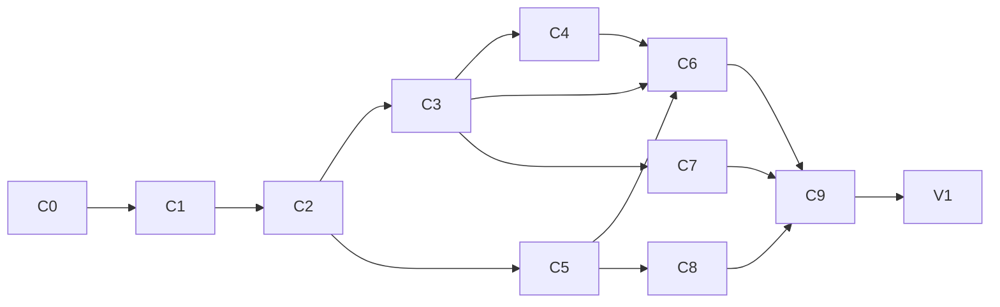

# Canvas Plan

JSON Canvas ([spec 1.0](https://jsoncanvas.org/spec/1.0/)) editing at parity with Obsidian 1.15.1's Canvas, built as the open-source library `@type32/jsoncanvas-editor-nuxt` ([CTRL-Neo-Studios/jsoncanvas-editor](https://github.com/CTRL-Neo-Studios/jsoncanvas-editor), local `../../jsoncanvas-editor-nuxt`), then used by Vertex for `.canvas` files.

Obsidian's behaviour was mapped by driving the app (Obsidian CLI + CDP) and reading its bundled source. The numbers and rules below are behaviour, reimplemented clean-room; no Obsidian code is copied.

## Decisions

| Topic | Decision |
|---|---|
| Package | One package, three entry points, like `@type32/workflows`: `./core` (plain TS: types, parse/serialize, geometry, snapping, layout, history), `./vue` (components, composables), and the Nuxt module at the root (auto-imports `./vue`). Everything is built by `nuxt-module-build`/mkdist under `dist/runtime/`; `.vue` files ship as SFCs, so plain Vue + Vite apps work too. |
| Peers | `vue`, `@nuxt/ui` (chrome), `@comark/vue` (optional, from C5: default markdown display). |
| Styling | The library's own markup uses plain CSS (`jc-` classes, Nuxt UI's `--ui-*` variables) shipped as `./style.css`, never Tailwind utilities: Tailwind doesn't scan `node_modules`, and Nuxt UI only adds `@source` for layers. Nuxt UI components carry their own classes. The Nuxt module adds `style.css`; Vue apps import it. |
| Renderer | Own DOM + SVG, like Obsidian: one transformed world layer, HTML nodes, two SVG layers for edges (lines, then arrowheads), only what's in the viewport. No Vue Flow: JSON Canvas has 4 side-midpoint anchors, geometric groups and array-order z, which Vue Flow fights. |
| State | `useCanvasEditor()` owns the document, selection, viewport and history; `<JsonCanvas v-model>` syncs the document. Drags change local state per frame and commit once at the end (today every frame emits a whole new canvas). |
| History | Whole-document snapshots, 100 max, pushed 250 ms after the last change (debounce restarted on each change). Selection and viewport aren't recorded. |
| Markdown | Default: display with `@comark/vue`, edit in a `<textarea>`. Hosts replace both through slots (Vertex: `codemirror-rich-obsidian-editor`). |
| Files | The library never touches a filesystem. A `CanvasHost` adapter (all optional) resolves paths, reads text, picks/imports files, lists a note's links and opens files. Without a host, file nodes show a generic card. |
| Chrome | Shipped, built on Nuxt UI: bottom add bar, right controls, floating selection toolbar, context menus, help modal. Each is a slot and can be turned off by prop. Strings come from a `messages` prop with English defaults (no i18n dependency). |
| Data safety | Unknown keys on the document, nodes and edges round-trip. Unlike Obsidian, nodes of unknown `type` and edges to missing nodes are **kept** instead of being dropped on the next save. An unknown node with a box renders as a placeholder card (its type, not editable beyond move/resize/delete); edges to missing nodes aren't drawn. Each case is an entry in `issues`, listed in a small Issues panel (a chrome piece, slot-replaceable) with "zoom to" where there's a box. |
| Format | `stringifyCanvas` writes Obsidian's layout (tabs, one node/edge per line, no space after `:`, no trailing newline), so files edited in both apps diff cleanly. New ids: 16 lowercase hex characters. |
| Z-order | Array order is z-order (spec). On save, groups go first, larger behind smaller (as Obsidian does); other nodes keep their order, and a dragged node moves to the end (front). |
| Edges | Spec defaults: `fromEnd` `none`, `toEnd` `arrow`; defaults are omitted on save. Missing `fromSide`/`toSide` are computed from the angle between centres and written back. |
| Extensions | Events that let a host add menu items (`canvas-menu`, `node-menu`, `edge-menu`, `selection-menu`, `connection-drop-menu`), file renderers per extension (`fileRenderers` prop), and unknown-field passthrough. Beyond-spec features build on these. |
| Not now | Touch/mobile gestures (pinch, long-press), real-time collaboration, a minimap overlay. Mouse, trackpad and keyboard only. |
| Old code | Rewritten. The repo, package name and the public type names (`JSONCanvas`, `JSONCanvasNode`, …) stay. |

## C0: Repo reset

### Change
- Layout: `src/module.ts`, `src/runtime/core/**`, `src/runtime/vue/**`; `package.json` `exports` for `.`, `./core`, `./vue`, `./style.css`; `@nuxt/ui` and `vue` as peers.
- Remove the demo `plugin.ts` (a `console.log`), the module's Tailwind/Nuxt UI CSS import and the stale `dist/`.
- `eslint.config.mjs` (`@nuxt/eslint-config`) and a `lint` script, so the CI job that runs it passes; CI also runs `test` and `test:types`.
- Commit the pending dependency bumps (Nuxt 4.6, Nuxt UI 4.12, VueUse 15, TS 6.0.3).

### As built
- The prototype moved as is: `core/types.ts` (old `types/jsoncanvas.ts`), `vue/components/**`, `vue/composables/**`; the unused `utils/canvas.ts` and the empty server `tsconfig` went. `UIcon` is imported from `@nuxt/ui/components/Icon.vue`, so the SFCs work without Nuxt's auto-imports.
- The module registers only `<JsonCanvasEditor>` (no longer every component globally, e.g. `TextNode`, which could collide with a host's) and adds `style.css` first.
- `./vue` exports `JsonCanvasEditor`; `./core` the types. The root no longer pretends to export types: import them from `./core`.
- `dependencies`: `@nuxt/kit`, `@vueuse/core`; `@tailwindcss/vite`, `tailwindcss` and `@vueuse/nuxt` dropped.
- CI: one bun job (`install --frozen-lockfile`, `dev:prepare`, `lint`, `test`, `test:types`, `prepack`) on pushes and PRs to `main` and `dev`. Vitest runs `src/**/*.test.ts` and passes with none until C1.
- Playground: deps bumped to match; `@type32/jsoncanvas-editor-nuxt` aliased to `src/runtime`, so it imports `/core` like a consumer; its CSS sources `src` while the prototype still uses utility classes.
- The dependency bumps were already committed upstream (`f828edd`).
- Interim: the prototype components use Tailwind utilities, so hosts must add the package to Tailwind's `@source` until C2 moves them to `style.css` (README says so).

### Acceptance
- [x] `bun run lint`, `test`, `test:types` and `prepack` pass locally (CI on the next push).
- [x] A Nuxt app and a plain Vue + Vite app both import `./core` and `./vue`: packed tarball installed into each, `nuxt generate` + `nuxt typecheck` and `vite build` + `vue-tsc` pass, and both render the editor with a node and no console errors.

## C1: Core model (`./core`)

### Change
- **Types:** spec 1.0 (text, file with `subpath`, link, group with `background`/`backgroundStyle`, edges), each with an index signature for unknown keys.
- **`parseCanvas(text)`:** returns `{canvas, issues}`. Numbers rounded; `"r,g,b"` colours converted to `#rrggbb`; missing edge sides computed (angle between centres against the source node's diagonal `atan2(h, w)`).
- **`stringifyCanvas(canvas)`:** Obsidian layout, z-order rule above.
- **Geometry:** bounding boxes (union, grow, contains); side midpoints; opposite side.
  - **Nearest side:** a node is a candidate when the pointer is within 15 world units of its box. Among candidates, the nearest of the 4 side midpoints wins (checked top, right, bottom, left; within 15 returns at once).
  - **Edge path:** each end is pushed out 7 from its side midpoint; control distance `clamp(dist / 2, 70, 150)` along each side's normal. An arrowhead end uses the polygon `0,0 6.5,10.4 -6.5,10.4`; an end without one gets a straight 7-unit stub to the node.
  - **Curve midpoint** (t = 0.5) for edge labels.
- **Snapping:** each box contributes 5 points (4 corners + centre). Per axis, find the nearest target point within `ceil(15 / scale)`. Grid snapping applies only on an axis with no object snap; the box's top-left corner snaps. Grid spacing is 20 / 40 / 80 / 160 below zoom −0.91 / −2.16 / −3.3. Returns the matches used to draw guides.
- **Layout:** align left/centre/right/top/middle/bottom; distribute (first and last stay, gap = (span − Σ sizes) / (n − 1)); justify; arrange in a row, column or grid (gap = grid spacing).
- **Containment:** a node is inside a group when its box is fully inside, edges included.
- **Colours:** presets `"1"`–`"6"`; label contrast via luminance `(299r + 587g + 114b) / 1000 ≥ 150`.
- **History:** snapshot ring (100).

### Acceptance
- [ ] Unit tests: round trip of the spec's `sample.canvas` and the Obsidian test canvases byte-for-byte; unknown keys/types kept; side computation; nearest side (the 5 drops recorded in Obsidian: centre → `top`, bottom-left corner → `left`, …); edge path for `A.right(350,90) → B.left(550,90)` = `M350 90 L357 90 M357,90 C450,90 450,90 543,90`; snapping deltas; every layout op; containment; history limits.

## C2: Viewport and rendering (`./vue`)

Blocked by C1.

### Change
- **Viewport model:** `x`, `y` = the world point at the viewport centre; `zoom` = log2(scale), clamped to [−4, 1]. World transform `translate(W/2, H/2) scale(s) translate(−x, −y)`; animation eases `1 − 0.984^dt` per frame toward the target.
- **Wheel:** pans by `delta / scale × 0.93`; Shift pans horizontally. Mod+wheel, Space+wheel and trackpad pinch (`ctrlKey` wheel events) zoom by `−deltaY / 300`: zoom in keeps the point under the cursor, zoom out keeps the centre. A `wheelBehavior: 'pan' | 'zoom'` option swaps the two.
- **Drag to pan:** Space+drag, middle button, right-drag (a right click without drag is a context menu).
- **Background:** dot grid following the grid spacing.
- **Culling:** only nodes intersecting the viewport, and edges intersecting it grown by 167.5, are mounted.
  - `ponytail:` a linear scan per frame; add a spatial index (rbush) if a 5k-node canvas drops frames.
- **Level of detail:** at zoom ≤ −1.7 (option offsets it), markdown/base/link cards show a placeholder with their name; images, video and canvas minimaps stay. Labels above cards hide.
- **DOM:** each node is `div.jc-node > .jc-node-container` (radius, 1 px border in its colour, colour at 7 % behind the content). File names show above the card, at a scale of `√(1/scale)` (option: always / hover / never).
- **Edges:** 2 px visible stroke, 24 px transparent hit stroke, 5.5 px when hovered or selected. Labels are HTML at the curve midpoint.
- **Colours:** CSS variables `--jc-color-1…6` defaulting to Nuxt UI's red, orange, yellow, green, cyan, purple; custom hex via `--jc-color`.
- Zoom to fit / to a box: 10 % padding, never past 100 %.

### Acceptance
- [ ] The test canvases render with the same geometry as Obsidian (screenshot comparison at the same viewport).
- [ ] Panning and zooming a 1,000-node canvas stays at 60 fps on an M-series Mac.

## C3: Selection, moving, resizing, history

Blocked by C2.

### Change
- **Selection:** click; Shift+click toggles; Mod+A selects all nodes.
- **Marquee:** drag on empty canvas.
  - Groups are picked only when fully enclosed; edges never.
  - Shift makes it toggle against the existing selection; Esc restores the previous one.
  - A click on empty canvas clears the selection.
- **Move:** starts after 5 px; Esc cancels.
  - A dragged group carries every node fully inside it, worked out at drag start.
  - Shift locks to the dominant axis.
  - Clone while dragging: Alt (macOS) / Ctrl (others), toggled live.
  - Disable snapping: Ctrl (macOS) / Alt (others).
  - Groups snap only to groups, cards only to cards.
  - Snap guides: lines and 4 px dots in the accent colour.
  - Auto-pan within 30 px of the edge.
- **Resize:** 8 handles of 20 px, minimum 50 for every node type, with object and grid snapping.
  - Aspect lock: images/video always; Shift toggles it on a multi-selection.
  - Resizing a group doesn't move its contents.
- **Multi-selection box:** padded by 10, with its own 8 resize handles (scales members proportionally) and dragging.
- **Keys:** arrow nudge (grid step, ×5 with Shift); Delete/Backspace removes (a group's contents stay); Shift+1 zoom to fit; Shift+2 zoom to selection.
- **Undo/redo:** Mod+Z, Mod+Shift+Z / Mod+Y; also buttons.
- **Read-only mode:** disables every edit; zoom to selection stays.

### Acceptance
- [ ] Interaction tests (Vitest + `@vue/test-utils`, pointer events) for marquee rules, group carry, clone, axis lock, snap toggles, min size, aspect lock, Esc cancel, undo/redo coalescing.
- [ ] Moving a group snaps to the grid as in Obsidian (a 100×50 drag lands at 100×60 at zoom 0).

## C4: Edges

Blocked by C3.

### Change
- **Hover handles:** 4 connection points (20 px, at side midpoints) show on the node under the pointer (8 px / scale tolerance, topmost first). None while several nodes are selected.
- **Connecting:** drag from a point; the target and side follow the nearest-side rule.
  - Not allowed: the node itself, a group containing it, or (from a group) nodes inside it.
  - New edges start with `fromEnd: none`, `toEnd: arrow`. Duplicate edges are allowed, as in Obsidian.
- **Dropping on empty canvas:** opens `connection-drop-menu` with:
  - Add card;
  - Add file (`host.pickFile`);
  - up to 20 of the source note's outgoing links not yet connected (`host.listLinks`).
  - The new node's facing side midpoint lands on the pointer. Closing the menu removes the edge.
- **Reconnecting:** dragging an edge moves its nearer end; dropping on empty canvas deletes the edge; it never attaches to the other end's node.
- **Edge clicks:** a click selects; clicking a selected edge edits its label.
- **Edge label:** contenteditable at the midpoint; empty removes it.
- **Edge context menu:** Remove, Edit label, Follow connection (zooms to the far end).
- **Line direction:** none / one-way / both ways.

### Acceptance
- [ ] Unit + interaction tests for target choice, exclusions, the drop menu's cancel path, reconnect and delete-on-empty.
- [ ] Edges drawn in the library open in Obsidian unchanged, and vice versa.

## C5: Node content

Blocked by C2.

### Change
- **Text cards:** `@comark/vue` display (wiki-links handed to `host.openLink`); a textarea editor.
  - Editing starts on double-click or the Edit button; Esc or a click outside ends it.
  - Slots: `#text-display`, `#text-editor`.
  - Double-click the bottom or right handle to fit height, or narrowest width, to the content.
- **`CanvasHost`** (all optional):
  - `resolveFile(path)` → `{exists, name, ext, url}`;
  - `readText(path)`;
  - `pickFile({kinds})`;
  - `importFiles(files)` → paths;
  - `listLinks(path)`;
  - `openFile(path, subpath, newTab)`;
  - `openLink(target)`.
- **File cards by extension** (any can be overridden via `fileRenderers`):

  | Kind | Rendering |
  |---|---|
  | md | `readText` + markdown display; `subpath` narrows to a heading or block |
  | images, video | aspect-locked; on load the card shrinks to the media's ratio, amending the current undo step instead of adding one |
  | audio | the card's height is set to the player's |
  | pdf | `<iframe>` of the URL, `#page=N` from `subpath` |
  | canvas | SVG minimap from `./core`: groups, then edges, then nodes; rounded rects; colours applied |
  | other | generic card (icon + name) |
  | missing | "could not be found" with Swap file / Remove |

- **Link cards:** sandboxed `<iframe>`, http(s) only; YouTube links become `youtube-nocookie` embeds and X statuses become embeds; the label is the URL. Menu: Change URL, Open in browser, Copy URL, Reload.
- **Groups:** label above the box (1.5 em, tinted, contrast by luminance), double-click to edit (Enter commits).
  - Background image: cover / keep ratio (resizes the group to the image) / repeat.
  - A `cover` style is omitted on save, and an old `backgroundStyle` never resurfaces (a known Obsidian bug).

### Acceptance
- [ ] Each kind renders in the playground from a host adapter over local files; a missing file shows its actions.
- [ ] Notes, images, a `.canvas` and a `.base` from the test vault render (base via a host renderer).

## C6: Chrome and menus

Blocked by C3, C4, C5.

### Change
- **Bottom bar:** card, file, media buttons. A click adds at the centre; a drag adds at the drop point, with snapping. File and media go through `host.pickFile`.
- **Right controls:** settings (snap to grid, snap to objects, read-only), zoom in (+0.5) / reset / fit / out, undo/redo with disabled states, help.
- **Floating selection toolbar** (above the selection; higher for groups and file cards):

  | Selection | Buttons |
  |---|---|
  | text or md file | Remove, Color, Zoom, Edit |
  | link / other file | Remove, Color, Zoom |
  | group | Remove, Color, Zoom, Align (its contents, inset 20), Edit label, Set/Edit background |
  | one edge | Remove, Color, Zoom, Line direction, Remove label (when labelled), Edit label |
  | edges only | Remove, Color, Zoom, Line direction |
  | several nodes | Remove, Color, Zoom, Create group (box + 20, "Untitled group"), Align |

- **Colour picker:** none, presets 1–6, custom (`<input type=color>`, live preview while picking).
- **Align menu:** sections align-h, align-v, arrange, distribute, justify.
- **Context menus** (Nuxt UI `UContextMenu`, extendable through the menu events):
  - empty canvas: Add card / file / media / web page / group, then Undo, Redo, Select all, Zoom to fit;
  - node: Zoom to selection, its type's items, Remove;
  - edge: see C4;
  - selection: the toolbar's actions.
- **Creating by gesture:** double-click on empty canvas creates a 250×60 card at the pointer and edits it. Mod+drag on empty canvas creates at the dragged size; the `modDragBehavior` option picks menu (default), card, file, media, web page or group.
- **Help modal:** Pan, Pan horizontally, Zoom, Zoom to fit, Zoom to selection, Select all, Add/remove from selection, Create with size, Clone, Constrain axis, Disable snapping, Remove, Undo, Redo, with the platform's keys.
- **Empty canvas:** a hint to drag from below or double-click, and how to pan and zoom.

### Acceptance
- [ ] Every row of the table above in the playground; all chrome replaceable by slot and hideable by prop.
- [ ] Strings overridable through `messages`.

## C7: Clipboard and drops

Blocked by C3.

### Change
- **Copy/cut:** the `copy`/`cut` event writes `application/x-jsoncanvas` (`{nodes, edges, center}`, edges only between copied nodes) plus `text/plain` (the JSON).
- **Paste** tries, in order:
  1. files → `host.importFiles` → file cards laid out in rows of 10, 45 apart, 400×400;
  2. canvas data → new ids, centred on the viewport, selected;
  3. an http(s) URL → link card (YouTube 640×360);
  4. other text → text card.
- **Drops:** host-defined data types → file cards at the drop point (Vertex: its Files rows).

### Acceptance
- [ ] Copy and paste within a canvas, across two canvases and across two windows keeps edges and colours, with new ids.
- [ ] URL and plain-text pastes create the right node.

## C8: Export as PNG

Blocked by C5.

### Change
- `exportPng({frame: 'full' | 'viewport', scale, privacy, padding = 100})` → `Blob`; the host saves it.
- Rendering: the world layer drawn with `modern-screenshot`, with level of detail forced off.
  - Size: scale capped at `min(2, 16284 / width, 16284 / height)` (the browser's canvas limit).
  - Link and PDF cards (cross-origin, not capturable) render as their placeholder.
  - Privacy mode scrambles text glyphs with a CSS class.
  - An optional `watermark` slot.
- An export dialog (frame, scale with the resulting pixel size, privacy) in the chrome; shown when the host passes a save handler.

### Acceptance
- [ ] Full and viewport exports of the test canvases match the on-screen layout; a 20,000 px wide canvas is capped, not failed.

## C9: Docs and release

Blocked by C6, C7, C8.

### Change
- README: install (Nuxt / Vue), `<JsonCanvas>` props, events, slots, `CanvasHost`, `./core` API, extension events, keyboard reference.
- Playground: the spec's sample, a local-folder host (File System Access API), every feature.
- `v0.2.0` via `changelogen`.

### Acceptance
- [ ] A fresh Nuxt app follows the README to an editable canvas with file cards in under 10 minutes.
- [ ] Published; Vertex installs it.

## V1: Canvas in Vertex

Blocked by C9.

### Change
- **Viewer:** `{id: 'canvas', loadsText: true, modes: ['workspace']}` in `app/utils/viewers.ts` + `viewerComponents.ts`.
  - The tab's text goes through `parseCanvas`/`stringifyCanvas`; autosave and outside-edit reloads work as for other text viewers.
  - `.canvas` added to the file associations in `tauri.conf.json`.
- **Host adapter:**
  - files: `resolveFile` through the workspace index plus `convertFileSrc`; `readText` reads from the filesystem;
  - pickers: `pickFile` / `importFiles` reuse the attachments flow (`fileConfig.attachmentsFolder`);
  - links: `listLinks` from the link graph;
  - opening: `openFile` opens tabs.
- **Editing:** text cards and md file cards use `codemirror-rich-obsidian-editor` through the editor slots.
- **Drops:** Files rows (`application/x-vertex-files`) and OS files dropped on the canvas become file cards.
- **Index:** `.canvas` files feed the link graph (file cards, plus wiki-links in text cards), so canvases show in backlinks. `relocateFiles`'s link rewrite updates `file` paths in canvases.
- **Commands:** New Canvas (File menu, Files' context menu, command palette); Export as image saves through the Tauri dialog.
- **Settings:** View → Canvas (wheel behaviour, Mod+drag behaviour, card names, snap defaults, zoom threshold), overridable per workspace.

### Acceptance
- [ ] Obsidian's test vault canvases open, edit and save in Vertex and reopen in Obsidian unchanged apart from the edits.
- [ ] Renaming a note updates every canvas that shows it; a canvas card shows in the note's backlinks.
- [ ] SMOKE rows; Concepts doc; en + zh-CN strings.

## Reference values (Obsidian 1.15.1)

| Value | Number |
|---|---|
| Default sizes | text 250×60; file, link, group 400×400; YouTube 640×360 |
| Zoom | log2 scale in [−4, 1]; buttons ±0.5; content hidden at ≤ −1.7 |
| Grid | 20 / 40 / 80 / 160 below zoom −0.91 / −2.16 / −3.3 |
| Snapping | objects within 15 screen px (4 corners + centre); connection target within 15 world units |
| Sizes | min 50; resize handles 20 px; connection points 20 px; group from selection +20; selection box +10 |
| Edges | stub 7; control distance clamp(dist / 2, 70, 150); arrow 13 × 10.4; stroke 2 / hover 5.5 / hit 24 |
| Drag | 5 px threshold; auto-pan 30 px edge, ±40 cap, 60 Hz, × 0.5 / √scale |
| History | 100 snapshots, 250 ms debounce |
| Zoom to fit | 10 % padding, max 100 % |
| Paste grid | 10 per row, gap 45 |
| Export | 100 padding, max 16284 px, scale ≤ 2 |
