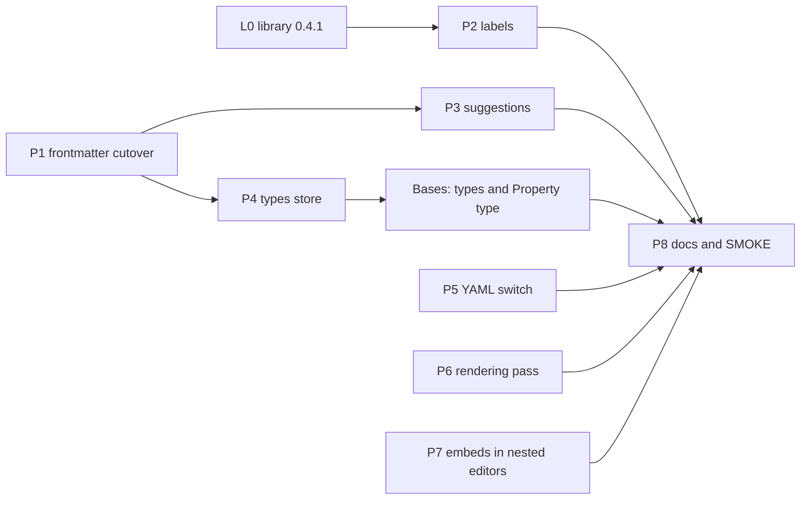

# Editor 0.4 Plan

Adopting `@type32/codemirror-rich-obsidian-editor` 0.4 in Vertex. The library's changes are in its `WHATS-NEW-0.4.md`. The ones that reach Vertex:
- **Properties panel:** the editor shows frontmatter as Obsidian's Properties panel, which replaces Vertex's Frontmatter button and modal.
- **YAML:** `js-yaml` became `yaml` (YAML 1.2), so dates stay text and the writer quotes differently.
- **Rendering:** new markup and CSS variables for code blocks, tasks, lists, callouts and tables.
- **Nested editors:** callouts and table cells are now read-only copies of the editor, so embeds render inside them.

## Baseline (Vertex on 0.4.0 and parser 0.5.1, before any change)

- **`typecheck`:** clean. Every kit and ext symbol Vertex imports still exists (`editorLabels`, `headingAt`, `headingsField`, `builtinActions`, `label`, `markAt`, `blockDragHandle`, `selectionToolbar`, `slashMenu`, `ext/ai`).
- **Tests:** 260 of 261 pass. The failure is `workflows.test.ts` §10: workflows rewrite frontmatter with the editor's `stringifyYaml`, which now writes `tags: "#Draft/idea"` where `js-yaml` wrote `'#Draft/idea'`.
- **CSS:** Vertex's only rules on editor classes are `.cm-heading-1…6` (`main.css`), which 0.4 keeps. Nothing targets a removed class or variable (`ͼ…`, `.cm-task-checked`, the old list variables, `<details>` callouts, the old table classes).
- **Editor hosts:** `<Editor>` appears in `RichText.vue` and `CanvasCardEditor.vue`. `RichText.vue` also shows the Frontmatter button (`FrontmatterEditor.vue`, a modal with `DataEditorForm`) and makes the editor read-only while it's open.
- **Labels:** 0.4 adds `ui.properties.*`. `ui.properties.type` ("Property type") clashes with `ui.properties.type.<type>` (the type names) in Vertex's nested i18n JSON (`app.editor.labels.*`), where a key can't be both a string and an object.
- **Nested editors** (callouts, table cells) inherit the link list, code-block mappings and Vue context, so image, Mermaid and base embeds render inside them, and `BASE_EMBED` injects. They're read-only copies: a ` ```base ` block inside a callout would write its edits into the copy.

## Decisions

| Question | Decision |
|---|---|
| Where property types live | `.vertex/types.json`, in Obsidian's `types.json` format. When it doesn't exist and `.obsidian/types.json` does, it's seeded from that. Vertex never writes `.obsidian/`. |
| The `ui.properties.type` clash | Renamed in the library (0.4.1), so Vertex keeps one i18n key per label. |
| Obsidian's "Properties in document" setting | Not now: the panel is always on (`:properties` default). |



## L0: Library (the user)

### Change
- Rename the type menu's label `ui.properties.type` (e.g. to `ui.properties.typeMenu`), keeping `ui.properties.type.<type>` for the type names. Release `0.4.1`; Vertex bumps to `^0.4.1`.

### As built
- In the library source (uncommitted, for the user to release): `PropertyRow.vue` reads the type menu's title and the type button's aria-label from `ui.properties.typeMenu`; the README's label table lists it, adds the missing `.unknown`, and states that no key is both a label and a prefix. Library tests (147), `vue-tsc` and `prepack` pass.

### Acceptance
- [x] No label key is both a string and a prefix of others (`ui.properties.*`).
- [ ] Released as `0.4.1`, and Vertex on `^0.4.1`. Until then, 0.4.0 still reads `ui.properties.type` for the menu's title, which Vertex doesn't translate, so that one label shows in English.

## P1: Frontmatter cutover

### Change
- **Remove Vertex's frontmatter UI:** `FrontmatterEditor.vue`, the button, and `RichText.vue`'s `frontmatterOpen` state and its read-only coupling. `DataEditorForm` stays: `YamlDataForm` uses it.
- **The panel:** on in `RichText` (the default). In canvas note cards (`CanvasCardEditor`), observe first whether Obsidian shows properties there.
- **`:context-menu-size`:** the size the app's other context menus use.

### As built
- **Observed:** Obsidian shows a note card's properties on a canvas ("Properties in document" at its default, `visible`), so `CanvasCardEditor` keeps the panel too.
- **Removed:** `FrontmatterEditor.vue` (the Frontmatter button and its modal) and `RichText.vue`'s `frontmatterOpen` state. The editor and header tools are read-only only while disabled or renaming. The modal's three strings went with it (`app.generic.frontmatter`, `app.editor.ui.frontmatterError`, `…Description`).
- **Menus:** `RichText` and `CanvasCardEditor` pass `context-menu-size="sm"`, the size of every other context and dropdown menu in the app.

### Acceptance
- [x] A note with frontmatter shows the panel (`status` text, `due` as a date, `tags` as a pill, Add property) and no Frontmatter button. Checked in a browser against the dev server with Tauri stubbed.
- [x] **Edits reach the index:** an edit in the panel saved `A.md` with only that value changed (`due: 2026-02-03` intact), and the base's row showed the new value.
- [x] **`---` on an empty first line** made `---\n\n---` and opened the panel on "Property name".
- [x] `typecheck` clean; 262 tests pass; no lint errors in the changed files (three warnings in `RichText.vue`, on props this phase didn't touch).

## P2: Labels

### Change
- Add the panel's labels to `LABEL_KEYS` (`useActiveEditorExtensions.ts`) with en and zh-CN translations:
  - `ui.properties.add`, `addField`, `deleteFrontmatter`, `empty`, `name`, `remove`;
  - the renamed type-menu label from L0;
  - `ui.properties.type.{text, list, number, checkbox, date, datetime, tags, aliases, object, unknown}`.

### As built
- `LABEL_KEYS` gains the 17 `ui.properties.*` keys (`typeMenu` from L0, and the ten type names including `unknown`); en and zh-CN under `app.editor.labels.ui.properties`, using the app's words (属性, 前置元数据).

### Acceptance
- [x] In 简体中文 the panel's Add property (添加属性), the name placeholder (属性名称), Delete frontmatter (删除前置元数据), the type button and menu title (属性类型), every type name and Remove are translated. Checked in a browser against the dev server with Tauri stubbed, on the library build with L0's rename. `i18n.test.ts` parity, the other 261 tests and `typecheck` pass.

## P3: Suggestions

### Change
- **Observe first:** what Obsidian offers when naming a property (every vault property? in which order?) and in a value's input (existing values of that key? tags with or without `#`?).
- **Source:** one composable over the index: property names across the workspace's notes, and each key's distinct values (tags from the tag index). Recomputed per index change, not per keystroke. Bases' property list (`noteKinds` in `useBaseContext`) reads the same data; reuse it there if the shapes fit.
- **Wiring:** `<Editor :properties="{keySuggestions, valueSuggestions}">`.

### Acceptance
- [ ] Adding a property offers the workspace's names; a list or text value offers that key's existing values, matching what Obsidian offers on the same vault.

## P4: Property types

### Change
- **Observe first:** Obsidian's `types.json`:
  - its shape (`{"types": {"key": "multitext"}}` expected);
  - its type names against the editor's (`multitext` ↔ `list`; `object` and `unknown` exist only in the editor);
  - when Obsidian writes it;
  - whether a type picked in a note changes how Bases shows that property.
- **Store:** `.vertex/types.json` in that format, seeded once from `.obsidian/types.json` when Vertex's doesn't exist yet. It's read on workspace open and again when the watcher reports a change (like `.vertex/settings.json`; nothing in `.vertex/` reaches the index), and written on `onTypeChange`. Before choosing who writes it (Rust, like `settings.json`, or the webview), check whether one workspace can be open in two windows at once.
- **Wiring:** `<Editor :properties="{types, onTypeChange}">` in every editor host.
- **Bases:**
  - property kinds come from the stored types first, then inference, as Obsidian's Bases read `types.json`;
  - the header menu's "Property type", out of scope in V1 for lack of a store, joins as Obsidian has it.

### Acceptance
- [ ] A type picked in one note applies to that key in every note and survives a restart. A workspace with only `.obsidian/types.json` starts with Obsidian's types, and `.obsidian/` is never written.
- [ ] A base's column for that key renders by the stored type; the header menu changes it.

## P5: YAML switch

### Change
- **Index:** frontmatter now parses as YAML 1.2, so dates arrive as text. `baseFile.ts`'s Date branch and its `ponytail:` note become dead; delete them once tests confirm dates reach Bases as written.
- **Workflows:** move their frontmatter writes (`useWorkflowRunner`'s `YamlTools`) to Obsidian's writer, the bases parser's `readYaml`/`writeYaml`, as `useNoteProperties` does. That gives one writer for every frontmatter edit outside the editor. Update §10's expectation to that writer's output. Add a test that `due: 2026-02-03` survives a workflow's property write, the date bug flagged in Bases V2.
- **`.yaml` files** (`YamlDataForm`) keep the editor's `parseYaml`/`stringifyYaml`; its new quoting is accepted.

### As built
- **`obsidianYaml(frontmatterRange)`** (`shared/workflows/vault.ts`) is the one set of `YamlTools` for frontmatter edits outside the editor: the bases parser's `readYaml`/`writeYaml` (YAML 1.2 core, Obsidian's writer), with `frontmatterRange` injected. `useNoteProperties`, `useWorkflowRunner` and `workflows.test.ts` all use it; the editor's `parseYaml`/`stringifyYaml` remain only for `.yaml` files (`YamlDataForm`).
- **`baseFile.ts`:** the Date round-trip (`asWritten`) and its `ponytail:` are gone. The index's reader (the editor's `parseFrontmatter`, now `yaml`) keeps dates as text, and `baseFile.test.ts`'s date cases pass unchanged.
- **§10:** the renamed note keeps `tags: "#Draft/idea"` as written; `js-yaml` used to rewrite it with single quotes.

### Acceptance
- [x] All 262 tests pass, with §10 on the new writer. The new test (`setFrontmatterProperty leaves the other properties as Obsidian wrote them`: `due: 2026-02-03` and `n: 1` survive a write) passes, and fails when run with the old `js-yaml` reader and writer.

## P6: Rendering pass

### Change
- **Visual pass** in light and dark, in a note covering:
  - code blocks (now highlighted, with the `--code-*` palette);
  - tasks with custom statuses;
  - nested lists and quotes;
  - callouts (folding, nested);
  - tables (nested cell editors, handles, `+` buttons);
  - math.
  Map `--code-*` or `--table-*` to Vertex's theme only where the defaults clash with it.
- **Keys:** list editing (Enter, Shift-Enter, Tab, renumbering) against Vertex's own commands (`HeaderTools`, slash menu, selection toolbar), which insert lists and tasks.
- **Dev reloads:** fenced code now loads its language from `@codemirror/language-data` on demand. If Vite discovers those packages at runtime and reloads (as `xss` did in Bases V3), add them to `optimizeDeps.include`.

### Acceptance
- [ ] Each case renders and edits as in `WHATS-NEW-0.4.md`, in both themes. Opening a note with code blocks causes no dev reload.

## P7: Embeds in nested editors

### Change
- **Observe first** what Obsidian does with a ` ```base ` block and `![[x.base]]` inside a callout and a table cell: render only, or edits too.
- **` ```base ` in a callout:** `Embed.vue` finds its block through `closest('.cm-editor')`, which inside a callout is the read-only copy. Route the write to the note's editor, or show such blocks read-only, whichever matches Obsidian.
- **Other embeds:** check image and Mermaid embeds in callouts and cells. `![[x.base]]` writes its file and isn't affected.

### Acceptance
- [ ] Embeds inside callouts and table cells render, and either edit the note as Obsidian does or don't edit at all. Nothing writes into a copy.

## P8: Docs and SMOKE

### Change
- **`Concepts and Structures.md`:** the properties panel, the types store, the single frontmatter writer.
- **SMOKE rows:** the panel (`---` start, rename, types, suggestions, delete frontmatter), types seeding from `.obsidian/`, code highlighting, list keys, tables and callouts.
- **`Package Issues.md`:** anything found in the editor along the way.

### Acceptance
- [ ] `bun run test`, `typecheck` and `lint` clean; the new SMOKE rows pass in `tauri:dev`.
