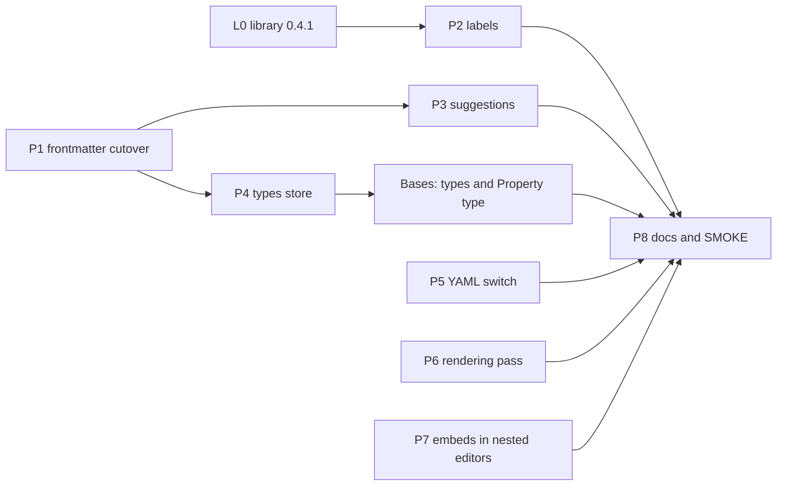

# Editor 0.4 Plan

Adopting `@type32/codemirror-rich-obsidian-editor` 0.4 in Vertex. The library's changes are in its `WHATS-NEW-0.4.md`. The ones that reach Vertex:
- **Properties panel:** the editor shows frontmatter as Obsidian's Properties panel, which replaces Vertex's Frontmatter button and modal.
- **YAML:** `js-yaml` became `yaml` (YAML 1.2), so dates stay text and the writer quotes differently.
- **Rendering:** new markup and CSS variables for code blocks, tasks, lists, callouts and tables.
- **Nested editors:** callouts and table cells are now read-only copies of the editor, so embeds render inside them.

## Baseline (Vertex on 0.4.0 and parser 0.5.1, before any change)

- **`typecheck`:** clean. Every kit and ext symbol Vertex imports still exists (`editorLabels`, `headingAt`, `headingsField`, `builtinActions`, `label`, `markAt`, `blockDragHandle`, `selectionToolbar`, `slashMenu`, `ext/ai`).
- **Tests:** 260 of 261 pass. The failure is `workflows.test.ts` §10: workflows rewrite frontmatter with the editor's `stringifyYaml`, which now writes `tags: "#Draft/idea"` where `js-yaml` wrote `'#Draft/idea'`.
- **CSS:** Vertex's only rules on editor classes are `.cm-heading-1…6` (`main.css`), which 0.4 keeps. Nothing targets a removed class or variable (`ͼ…`, `.cm-task-checked`, the old list variables, `<details>` callouts, the old table classes).
- **Editor hosts:** `<Editor>` appears in `RichText.vue` and `CanvasCardEditor.vue`. `RichText.vue` also shows the Frontmatter button (`FrontmatterEditor.vue`, a modal with `DataEditorForm`) and makes the editor read-only while it's open.
- **Labels:** 0.4 adds `ui.properties.*`. `ui.properties.type` ("Property type") clashes with `ui.properties.type.<type>` (the type names) in Vertex's nested i18n JSON (`app.editor.labels.*`), where a key can't be both a string and an object.
- **Nested editors** (callouts, table cells) inherit the link list, code-block mappings and Vue context, so image, Mermaid and base embeds render inside them, and `BASE_EMBED` injects. They're read-only copies: a ` ```base ` block inside a callout would write its edits into the copy.

## Decisions

| Question | Decision |
|---|---|
| Where property types live | `.vertex/types.json`, in Obsidian's `types.json` format. When it doesn't exist and `.obsidian/types.json` does, it's seeded from that. Vertex never writes `.obsidian/`. |
| The `ui.properties.type` clash | Renamed in the library (0.4.1), so Vertex keeps one i18n key per label. |
| Obsidian's "Properties in document" setting | Not now: the panel is always on (`:properties` default). |



## L0: Library (the user)

### Change
- Rename the type menu's label `ui.properties.type` (e.g. to `ui.properties.typeMenu`), keeping `ui.properties.type.<type>` for the type names. Release `0.4.1`; Vertex bumps to `^0.4.1`.

### As built
- In the library source (uncommitted, for the user to release): `PropertyRow.vue` reads the type menu's title and the type button's aria-label from `ui.properties.typeMenu`; the README's label table lists it, adds the missing `.unknown`, and states that no key is both a label and a prefix. Library tests (147), `vue-tsc` and `prepack` pass.

### Acceptance
- [x] No label key is both a string and a prefix of others (`ui.properties.*`).
- [x] Released as `0.4.1`, and Vertex on `^0.4.1`.
- [x] **`0.4.2`** (found in P3; released as `af95daa`, and Vertex is on `^0.4.3`): in a list's input, Escape twice added the typed text as a pill, because the second Escape moved focus to the row and the input's `focusout` added its draft. Obsidian adds nothing. Escape now drops the draft first; Enter and blur still add it.

## P1: Frontmatter cutover

### Change
- **Remove Vertex's frontmatter UI:** `FrontmatterEditor.vue`, the button, and `RichText.vue`'s `frontmatterOpen` state and its read-only coupling. `DataEditorForm` stays: `YamlDataForm` uses it.
- **The panel:** on in `RichText` (the default). In canvas note cards (`CanvasCardEditor`), observe first whether Obsidian shows properties there.
- **`:context-menu-size`:** the size the app's other context menus use.

### As built
- **Observed:** Obsidian shows a note card's properties on a canvas ("Properties in document" at its default, `visible`), so `CanvasCardEditor` keeps the panel too.
- **Removed:** `FrontmatterEditor.vue` (the Frontmatter button and its modal) and `RichText.vue`'s `frontmatterOpen` state. The editor and header tools are read-only only while disabled or renaming. The modal's three strings went with it (`app.generic.frontmatter`, `app.editor.ui.frontmatterError`, `…Description`).
- **Menus:** `RichText` and `CanvasCardEditor` pass `context-menu-size="sm"`, the size of every other context and dropdown menu in the app.

### Acceptance
- [x] A note with frontmatter shows the panel (`status` text, `due` as a date, `tags` as a pill, Add property) and no Frontmatter button. Checked in a browser against the dev server with Tauri stubbed.
- [x] **Edits reach the index:** an edit in the panel saved `A.md` with only that value changed (`due: 2026-02-03` intact), and the base's row showed the new value.
- [x] **`---` on an empty first line** made `---\n\n---` and opened the panel on "Property name".
- [x] `typecheck` clean; 262 tests pass; no lint errors in the changed files (three warnings in `RichText.vue`, on props this phase didn't touch).

## P2: Labels

### Change
- Add the panel's labels to `LABEL_KEYS` (`useActiveEditorExtensions.ts`) with en and zh-CN translations:
  - `ui.properties.add`, `addField`, `deleteFrontmatter`, `empty`, `name`, `remove`;
  - the renamed type-menu label from L0;
  - `ui.properties.type.{text, list, number, checkbox, date, datetime, tags, aliases, object, unknown}`.

### As built
- `LABEL_KEYS` gains the 17 `ui.properties.*` keys (`typeMenu` from L0, and the ten type names including `unknown`); en and zh-CN under `app.editor.labels.ui.properties`, using the app's words (属性, 前置元数据).

### Acceptance
- [x] In 简体中文 the panel's Add property (添加属性), the name placeholder (属性名称), Delete frontmatter (删除前置元数据), the type button and menu title (属性类型), every type name and Remove are translated. Checked in a browser against the dev server with Tauri stubbed, on the library build with L0's rename. `i18n.test.ts` parity, the other 261 tests and `typecheck` pass.

## P3: Suggestions

### Change
- **Observe first:** what Obsidian offers when naming a property (every vault property? in which order?) and in a value's input (existing values of that key? tags with or without `#`?).
- **Source:** one composable over the index: property names across the workspace's notes, and each key's distinct values (tags from the tag index). Recomputed per index change, not per keystroke. Bases' property list (`noteKinds` in `useBaseContext`) reads the same data; reuse it there if the shapes fit.
- **Wiring:** `<Editor :properties="{keySuggestions, valueSuggestions}">`.

### As built
- **Observed** (Obsidian 1.15.1, probe `zz-e3`: four notes sharing `status`, `author`, `topics`, `tags` and body `#inline`):
  - **Naming a property** offers Obsidian's property registry: the built-ins `aliases`, `cssclasses`, `tags`, then the vault's properties, minus the note's own keys, uncapped. Typing narrows it (fuzzy).
  - **A text value** (`status`) offers that key's other values in the vault (`doing`, `todo`, `X`), alphabetical, case-insensitive.
  - **A list** (`topics`) offers its key's values minus the list's items (`beta`, `gamma`, not `alpha`).
  - **Tags** offer every tag in the vault, frontmatter and body, without `#`, alphabetical.
- **`propertySuggestions`** (`shared/utils/index/propertySuggestions.ts`, tested against those lists): the built-ins, then every property as first seen; each key's distinct text values, list items included; all tags without `#` (frontmatter lists or `"a, b"` text, and body tags).
- **`usePropertiesOptions(session)`** feeds it the index's notes in a lazy `computed` (recomputed after an index change, only when a menu reads it). It returns one object for the editor's life whose fields read that `computed`, so an index change never reconfigures the panel. `RichText` and `CanvasCardEditor` pass it as `:properties`; a singlespace gets `{}`.
- **Left to the library:** dropping the note's own keys and a list's items, and narrowing by what's typed (substring, where Obsidian matches fuzzily).
- **Not reused:** Bases' `noteKinds` infers kinds, not names or values; the shapes didn't fit.
- **`ponytail:`-level difference:** Obsidian lists properties with a stored type (`types.json`) before the ones only seen in notes; P4's types will join the list after the seen ones, the library's order.

### Acceptance
- [x] On the probe's notes in Vertex (browser against the dev server with Tauri stubbed): naming a property offered `aliases`, `cssclasses`, `author`, `zeta` (`tags`, `status`, `topics` being the note's own); `status` offered `doing`, `todo`; `topics` offered `beta`, `gamma`; `tags` offered `draft`, `idea`, `inline`, `work/x`. Typing narrowed each. Picking `gamma` by click or ↓ Enter wrote only `gamma`.
- [x] With the library fix, typing then Escape twice writes nothing, and Enter adds the typed text.
- [x] `typecheck` clean; 265 tests pass (3 new).

## P4: Property types

### Change
- **Observe first:** Obsidian's `types.json`:
  - its shape (`{"types": {"key": "multitext"}}` expected);
  - its type names against the editor's (`multitext` ↔ `list`; `object` and `unknown` exist only in the editor);
  - when Obsidian writes it;
  - whether a type picked in a note changes how Bases shows that property.
- **Store:** `.vertex/types.json` in that format, seeded once from `.obsidian/types.json` when Vertex's doesn't exist yet. It's read on workspace open and again when the watcher reports a change (like `.vertex/settings.json`; nothing in `.vertex/` reaches the index), and written on `onTypeChange`. Before choosing who writes it (Rust, like `settings.json`, or the webview), check whether one workspace can be open in two windows at once.
- **Wiring:** `<Editor :properties="{types, onTypeChange}">` in every editor host.
- **Bases:**
  - property kinds come from the stored types first, then inference, as Obsidian's Bases read `types.json`;
  - the header menu's "Property type", out of scope in V1 for lack of a store, joins as Obsidian has it.

### As built
- **Observed** (Obsidian 1.15.1, probe `zz-e4`; the test vault had no `types.json`, and the probe's file was removed after):
  - **Format:** `{"types": {key: type}}`, two-space JSON, no final newline. The first write also lists `aliases: aliases`, `cssclasses: multitext`, `tags: tags`. A changed key keeps its place; "Automatic" removes it.
  - **Types:** `text`, `multitext` (List), `number`, `checkbox`, `date`, `datetime`, `tags`, `aliases` (plus widgets for `file`, `folder`, `property`). A note's type menu offers Automatic (with the inferred type), Checkbox, Date, Date & time, List, Number, Text.
  - **Notes aren't rewritten:** picking Number for `score: "12"`, or Text for a list, left the note as it was.
  - **Bases:** a stored type decides the cell's editor where the value fits (`when` typed text is plain text; typed date it's a date input, empty cells too); numbers stay value-driven. The column header menu ends with Property type (Checkbox, Date, Date & time, List, Number, Text, the current one checked, no Automatic).
- **`shared/utils/index/propertyTypes.ts`** (tested against Obsidian's written files): `readTypes`/`writeTypes` for the format, `withType` (built-ins first, a changed key keeps its place, `null` removes it), `editorType`/`storedType` (`multitext` ↔ `list`; `file`, `folder` and other Obsidian-only widgets are left to inference) and `baseKind` (stored type → Bases kind; `datetime` is `date`).
- **`usePropertyTypes(session)`:** one store per workspace window.
  - **Load:** `.vertex/types.json`, else `.obsidian/types.json`, so a vault starts with Obsidian's types until Vertex saves its own. It reloads when either file changes on disk (the index broadcasts every watcher event as `changed`).
  - **Write:** `set(key, type)` writes `.vertex/types.json` only. The webview owns it, because opening a workspace that's already open focuses its window, so there's one writer.
  - **Capabilities:** the fs read scope gains exactly `**/.vertex/types.json` and `**/.obsidian/types.json`; `.vertex/**` was already writable.
- **Editor:** `usePropertiesOptions` adds `types` (a getter, mapped to the editor's names) and `onTypeChange` (saves through the store), so every editor host shares the workspace's types.
- **Bases:** a note property's `kind` is `baseKind(stored) ?? inferred ?? 'text'` (`useBaseContext`), which drives cell editors, menus and the header icon. `TableHeader` ends with Property type for note properties, with Obsidian's six choices and the current one checked; its labels reuse the panel's (`app.editor.labels.ui.properties.*`).
- **Library difference, not changed:** the editor's `setType` converts the note's value to the new type (`convertValue`), where Obsidian leaves notes as they are. That's the library's choice; raise it there if Obsidian parity should win.

### Acceptance
- [x] **In a browser** against the dev server with Tauri stubbed:
  - a vault with only `.obsidian/types.json` (`when: text`) showed `when` as text, though its value is a date;
  - picking Date in the panel wrote `.vertex/types.json` in Obsidian's format and left the note and `.obsidian/` untouched;
  - reloading with both files (Vertex's `when: text`, Obsidian's `when: date`) showed text: Vertex's file wins and the type survives a restart.
  - `.obsidian/` was never written.
- [x] **Bases:** the `when` column's icon follows the stored type (calendar, then text). The header's Property type showed Date checked, and picking Text rewrote `.vertex/types.json`.
- [x] `typecheck` clean; no lint findings in the changed files; 268 tests pass (3 new).

## P5: YAML switch

### Change
- **Index:** frontmatter now parses as YAML 1.2, so dates arrive as text. `baseFile.ts`'s Date branch and its `ponytail:` note become dead; delete them once tests confirm dates reach Bases as written.
- **Workflows:** move their frontmatter writes (`useWorkflowRunner`'s `YamlTools`) to Obsidian's writer, the bases parser's `readYaml`/`writeYaml`, as `useNoteProperties` does. That gives one writer for every frontmatter edit outside the editor. Update §10's expectation to that writer's output. Add a test that `due: 2026-02-03` survives a workflow's property write, the date bug flagged in Bases V2.
- **`.yaml` files** (`YamlDataForm`) keep the editor's `parseYaml`/`stringifyYaml`; its new quoting is accepted.

### As built
- **`obsidianYaml(frontmatterRange)`** (`shared/workflows/vault.ts`) is the one set of `YamlTools` for frontmatter edits outside the editor: the bases parser's `readYaml`/`writeYaml` (YAML 1.2 core, Obsidian's writer), with `frontmatterRange` injected. `useNoteProperties`, `useWorkflowRunner` and `workflows.test.ts` all use it; the editor's `parseYaml`/`stringifyYaml` remain only for `.yaml` files (`YamlDataForm`).
- **`baseFile.ts`:** the Date round-trip (`asWritten`) and its `ponytail:` are gone. The index's reader (the editor's `parseFrontmatter`, now `yaml`) keeps dates as text, and `baseFile.test.ts`'s date cases pass unchanged.
- **§10:** the renamed note keeps `tags: "#Draft/idea"` as written; `js-yaml` used to rewrite it with single quotes.

### Acceptance
- [x] All 262 tests pass, with §10 on the new writer. The new test (`setFrontmatterProperty leaves the other properties as Obsidian wrote them`: `due: 2026-02-03` and `n: 1` survive a write) passes, and fails when run with the old `js-yaml` reader and writer.

## P6: Rendering pass

### Change
- **Visual pass** in light and dark, in a note covering:
  - code blocks (now highlighted, with the `--code-*` palette);
  - tasks with custom statuses;
  - nested lists and quotes;
  - callouts (folding, nested);
  - tables (nested cell editors, handles, `+` buttons);
  - math.
  Map `--code-*` or `--table-*` to Vertex's theme only where the defaults clash with it.
- **Keys:** list editing (Enter, Shift-Enter, Tab, renumbering) against Vertex's own commands (`HeaderTools`, slash menu, selection toolbar), which insert lists and tasks.
- **Dev reloads:** fenced code now loads its language from `@codemirror/language-data` on demand. If Vite discovers those packages at runtime and reloads (as `xss` did in Bases V3), add them to `optimizeDeps.include`.

### As built
- **No Vertex changes were needed.** The pass ran on editor 0.4.3, in a browser against the dev server with Tauri stubbed, on a note with every case. Vertex's only editor CSS (`.cm-heading-*` sizes) still applies.
- **Rendering, light and dark:**
  - code blocks are highlighted with the `--code-*` palette and labelled by language name (JavaScript, Python, CSS), with a copy icon when there's no language;
  - tasks: every status but a space is checked, and only `x` is struck through;
  - lists: wrapped text hangs at the item's text, with one guide per level under the parent's bullet, and ordered numbers kept;
  - nested quotes have one bar per level;
  - callouts: plain, folded (chevron), `[!tip|wide]`, and a nested callout inside;
  - the table, with bold and math in cells, a right-aligned column, and hover handles and `+` bars;
  - inline and block math.
  The library's defaults fit Vertex's theme in both modes, so no `--code-*` or `--table-*` overrides.
- **Dev reloads:** none. Languages load on demand: Rust, Go, YAML and SQL blocks added to an open note highlighted without a reload, and the dev log had no dependency optimization. Nothing added to `optimizeDeps`.
- **Keys:** Vertex binds no editor keys of its own, and its list and task insertion goes through the library's actions (header tools' `builtinActions`, the slash menu). By real key presses:
  - Enter continues `1.`, `2.`, `3.`;
  - Tab nests the third item as `1.`, and Shift-Tab returns it to `3.`;
  - Enter on an empty item ends the list;
  - inserting after item 1 renumbers the rest;
  - the slash menu's Task list starts `- [ ]`, and Enter continues it.

### Acceptance
- [x] Each case renders and edits as in `WHATS-NEW-0.4.md`, in both themes. Opening a note with code blocks, and adding blocks in new languages, causes no dev reload.

## P7: Embeds in nested editors

### Change
- **Observe first** what Obsidian does with a ` ```base ` block and `![[x.base]]` inside a callout and a table cell: render only, or edits too.
- **` ```base ` in a callout:** `Embed.vue` finds its block through `closest('.cm-editor')`, which inside a callout is the read-only copy. Route the write to the note's editor, or show such blocks read-only, whichever matches Obsidian.
- **Other embeds:** check image and Mermaid embeds in callouts and cells. `![[x.base]]` writes its file and isn't affected.

### As built
- **Observed** (Obsidian 1.15.1, probe `zz-e7`: a callout holding a ` ```base ` block, a callout holding `![[P.base]]`, a table cell holding `![[P.base]]`):
  - all three render with the full toolbar;
  - a header click in the callout's block does nothing (no sort, no write; the cursor stays where it was);
  - in the callout's or the cell's `![[P.base]]` it writes `P.base`;
  - `![[pic.png]]` resolves, `![[pic]]` doesn't.
- **Library** (`codemirror-rich-obsidian`, uncommitted, for 0.4.4):
  - **Duplicate embeds:** `![[x]]` inside a rendered callout or table rendered twice, once in the nested editor and again below the widget, because the parent's link plugin also placed its block widget at the source line. `inRenderedCallout` (moved next to `renderedCallout`, shared with the math plugin) and a new `inRenderedTable` make the link plugin leave those embeds to the nested editors. `test/prose-plugin.test.ts` covers top level, a rendered callout, a revealed callout and a table, and fails without the fix.
  - **Clicks:** a mousedown inside an embed in a callout selected the callout's whole source, replacing the rendered callout. Embeds now handle their own clicks, as links already did (`proseCalloutWidget.ts`).
- **Vertex:**
  - **Read-only blocks:** a ` ```base ` block in a nested editor (callout, table cell; its `.cm-editor` sits inside another) is read-only. `Embed.vue` passes `readonly` to `Base.vue`, whose `commit` then ignores edits, so nothing changes in memory or in the copy, as in Obsidian.
  - **Image links:** images are listed by their full file name (`pic.png`), as Obsidian resolves them, instead of the name without extension, which never matched `![[pic.png]]`. A `![[pic]]` written earlier no longer embeds; it doesn't in Obsidian either.
  - **Mermaid** in a callout renders through the nested editor's code-block mapping; nothing to change.

### Acceptance
- [x] **On the probe's note in Vertex** (browser against the dev server with Tauri stubbed, on the library build):
  - each embed renders once, in place: the callout's block, the callout's link, the Mermaid graph, the image, and the cell's link;
  - a header click in the callout's block leaves the callout rendered, sorts nothing and writes nothing;
  - header clicks in the callout's and the cell's `![[P.base]]` wrote `P.base` (ASC, then DESC), never `Host.md`.
- [x] Library: 150 tests, `vue-tsc` and `prepack` pass. Vertex: `typecheck` clean, 268 tests pass, no lint findings in the changed files.
- [x] Released as 0.4.4 (`24aea3d`), and Vertex is on `^0.4.4`.

## P8: Docs and SMOKE

### Change
- **`Concepts and Structures.md`:** the properties panel, the types store, the single frontmatter writer.
- **SMOKE rows:** the panel (`---` start, rename, types, suggestions, delete frontmatter), types seeding from `.obsidian/`, code highlighting, list keys, tables and callouts.
- **`Package Issues.md`:** anything found in the editor along the way.

### As built
- **`Concepts and Structures.md`:** a `### Note properties` section (the options object and why it never changes, suggestions, the types store and its files, the one frontmatter writer, the index's YAML 1.2, strings). The Bases section now covers writes through `obsidianYaml`, kinds from stored types, and read-only blocks inside callouts and cells.
- **SMOKE rows 119–123:** the properties panel; suggestions and types (seeding, restart, a base's Property type); rendering and list keys in both themes; embeds in callouts and table cells; a workflow's frontmatter write. Each row says what the browser runs already covered.
- **`Package Issues.md`:** the editor issues found here, four of them fixed (0.3.9 parse progress, 0.4.1 label clash, 0.4.2 Escape draft, 0.4.4 nested embeds), and two open: `setType` rewrites values where Obsidian doesn't, and the six block plugins rebuild the whole note per keystroke.

### Acceptance
- [x] On editor 0.4.4: `bun run test` (268), `typecheck` clean, and lint clean for every file this plan touched (three warnings in `RichText.vue`, on props it didn't change).
- [ ] SMOKE rows 119–123 pass in `tauri:dev` (the user's run).
