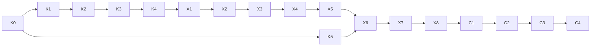

# Plugin Architecture Plan

Branch: `t32/refactor/plugins`.

Vertex becomes a small kernel plus plugins. Every feature that isn't the kernel is a plugin with one contract, whether
it ships with Vertex (a core plugin, compiled in) or is installed by the user (a community plugin, loaded at runtime).
Plugins are global first: installed and enabled once for every workspace, with per-workspace enablement, per-workspace
config and workspace-installed plugins on top, through the settings scopes Vertex already has.

The foundations (K) are built whole before anything moves, so the extractions (X) and the community loader (C) only
use what is there. Each phase ends with `typecheck`, the tests and lint clean, and the app working.

## Baseline (measured on `5f4a91b`; K0's numbers on `7b450db`)

- **Size:** 14,814 lines of Vue, 14,378 of TypeScript, 4,249 of Rust; 36 test files, 268 tests passing; 36 Rust tests passing.
- **Build:** `nuxt generate` takes 8 s; the entry chunk is 632,427 bytes (185,005 gzipped), of 331 JavaScript chunks totalling 11.3 MB. The entry alone moves with how the bundler splits chunks, so from K2 on each phase records the startup closure too (the entry and every chunk it imports statically): 1,255,212 bytes (406,895 gzipped) at the end of K1.
- **Startup** (release build, macOS, K0's harness): process start to the main window's last plugin 1.16 s on a first run and 0.40 s on a second; from navigation start, 168–175 ms.
- **Index build** (`buildIndex`, 5,000 notes in 50 folders, 3 links each, 20 MB): 247–260 ms the first time and 170–175 ms again in a release build; 453 and 375 ms in `tauri dev`.
- **Undeclared packages:** the app imports `tailwindcss` (CSS), `@codemirror/state` and `view`, and `@tauri-apps/api` without listing them in `package.json`; they resolve only because Bun hoists everything to the root.
- **Feature coupling** (files / lines / files outside the feature that import it):
  - Canvas 4 / 371 / 3; Bases 45 / 3,905 / 3; Git 17 / 1,976 / 6; Workflows 19 / 2,482 / 14; AI and Chat 45 / 5,835 / 13.
  - Workflows' importers mostly want `shared/workflows/trust.ts` and `shared/workflows/vault.ts`, which are kernel services.
- **Where the kernel names a feature today:**
  - `app/layouts/session.vue`: chats sync, `watchGitPresence`, `useGitAutoSync`.
  - `app/pages/sessions/[sessionId]/workspace/tabs/[tabId].vue`: an if-chain over `kind` (`chat`, `diff`, `view`).
  - `app/composables/active/useTabLabel.ts`, `useAppSessionPersistence.ts`, `useAppSessionRecovery.ts`: chat, diff and view tabs; `openedChatIds`, `openedViewIds` in `AppSessionContext`.
  - `app/utils/panelViews.ts`: the ten built-in views, importing `aiFeatureOn`, `isGitRepo`, `isBasesFile`; Search's action knows the chats' search.
  - `app/utils/viewers.ts`, `viewerComponents.ts`: `ViewerId` is a closed union with a static component map.
  - `app/utils/commands.ts`: `MENU_LAYOUT` lists `file.newCanvas`, `newBase`, `newWorkflow`, `newChat`; `useSessionCommands.ts` handles them.
  - `app/components/WorkspaceCommandPalette.vue`: New Canvas/Base/Workflow, the workflows group, `useBaseCommandItems`.
  - `app/components/FileTreeComponent.vue`: file icons by extension, New items, Run workflow.
  - `app/components/SessionTab.vue`: image and base embeds; `useActiveEditorCodeblockMappings.ts`: `mermaid` and `base`.
  - `app/composables/active/editor/useActiveEditorExtensions.ts`: `useAiEditorExtension`; `RichText.vue`: Ask in chat, the word counter.
  - `shared/utils/index/parse.ts` and `useActiveWorkspaceTools.ts`: canvas links; `useActiveWorkspaceIndex.ts`: `.vertex/chats/`.
  - `app/composables/app/useAppSessionActions.ts`: `GitCloneModal`; `app/layouts/settings.vue`: the Workflows, Git and AI pages.
  - `shared/types/app/settings.d.ts`, `shared/utils/defaults/apps.ts`: `aiConfig`, `gitConfig`, `workflowConfig`, `viewConfig.canvas`; `shared/constants/ai.ts`: `AI_FEATURES`; `shared/constants/app.ts`: the chat state keys.
- **Rust:** one crate, one `generate_handler!` with every command, `build.rs` is `tauri_build::build()`, and the capabilities give the same 169 permissions to every window kind (`main`, `session-*`, `settings`).
  - The app's own commands (everything in `generate_handler!`) aren't covered by capabilities at all: any window can call any of them. K0's harness called `scan_directory_recursive` with no capability naming it.
  - `git.rs`, `chats.rs` and `notes.rs` take `blocking` and `KEYRING_SERVICE` from `ai.rs`; `notes.rs` takes `snippet` from `chats.rs`; `web.rs` takes `install_crypto` from `ai.rs`.
  - `state.rs` knows features: `ai_provider_base_url`, `git_path`, and `settings_set` deleting AI keys (`ai::delete_key`).
- **Checked in the docs:** Nuxt registers `layers/*` by itself, with `#layers/<name>` aliases; a layer holds `nuxt.config.ts`, `app/` and `shared/`; `~` inside a layer means the project's `app/`. `@nuxtjs/i18n` merges the locales of layers. A Tauri plugin is a crate named `tauri-plugin-<name>` whose commands are called as `plugin:<name>|<command>` and are denied until a capability allows them; `tauri_plugin::Builder::new(COMMANDS)` in its `build.rs` generates `allow-<command>`.

## Decisions

| Topic | Decision |
|---|---|
| Tiers | Kernel (always on), core plugins (compiled in, can be turned off, can't be uninstalled), community plugins (loaded at runtime). One contract for both kinds of plugin. |
| Kernel | Windows, sessions, settings and scopes, trust, updater, theme, i18n host, native menu; the workspace index, link graph, watcher, file operations and their undo history; tabs and the tab switcher; the panel layout; the command registry; the markdown editor host and the plain code viewer; text diff; the plugin host. |
| Core plugins | `files`, `palette`, `outline`, `backlinks`, `outgoing-links`, `writers-tools`, `mermaid`, `image`, `yaml-form`, `latex`, `canvas`, `bases`, `bases-map`, `workflows`, `ai`, `git`, `chat`, `ai-assistant`. |
| Frontend of a plugin | A Nuxt layer, `layers/<id>/`, in this repository. |
| A plugin's npm dependencies | In its own `layers/<id>/package.json`; the root `package.json` lists `layers/*` as workspaces, so there's one install and one lockfile, and a dependency leaves with its plugin. The root keeps what the kernel uses, all of it declared. Bun's hoisted linker is pinned in `bunfig.toml`: with workspaces Bun otherwise switches to isolated installs. A community plugin bundles its dependencies into `main.js`, except the shared modules (C1). |
| Rust of a plugin | A Cargo workspace under `src-tauri/`: a kernel crate and one crate per plugin that needs Rust, each a Tauri plugin. The app crate only composes them. |
| Community plugins and Rust | They never ship native code. They use the kernel's host services (files, HTTP, secrets, data, search) and may ship WASM that runs in the webview. |
| Realm | Plugins run in the window's own JavaScript realm, as Obsidian's do, so they can add editor extensions and draw anywhere. It follows that a plugin can call any command: installing or trusting one is trusting it completely, and the prompts say so. |
| Permissions | A manifest lists what the plugin uses (`network`, `secrets`, `files-outside-workspace`). It's shown at install, and a window where the plugin is on is granted what they stand for (Window Permissions Plan); within a window it is disclosure, not a sandbox. |
| Where plugins live | Global: `<app_data>/plugins/<id>/`. Workspace: `<root>/.vertex/plugins/<id>/`. |
| Enablement | `plugins.enabled.<id>` in the settings, global and per workspace (`.vertex/settings.json`, so it follows the vault to other devices and collaborators). Any workspace may turn a plugin off; only a trusted one may turn on what's off globally. |
| Config | `plugins.config.<id>` in the same settings, with the same scopes: every plugin gets "Changed in this workspace" and Use global. The manifest says which keys a workspace may override (`workspace` or `trustedWorkspace`); the rest are global only. |
| Workspace-installed plugins | Run only in a trusted workspace, and only the code that was accepted: pinned by content hash, so changed code asks again. With the same id as a global plugin, the workspace's copy wins there. |
| Turning off | Turning a plugin on takes effect at once. Turning one off asks to restart the app (Window Permissions Plan: Tauri can't take a window's grant back); until then it runs on, so no plugin has to undo itself. Registrations are still tied to a scope that removes them. |
| UI contract | A mount function (`mount(el, props)` returning a disposer) is the stable contract. Vue components are accepted everywhere too: core plugins use them, and community plugins may, through the host's Vue and a published set of UI components, knowing a Nuxt UI major can break those. |
| A plugin's settings | On its own page, drawn from the manifest's schema or by the plugin. Settings → View keeps only the kernel's options. |
| Core plugins and kernel internals | Core plugins import the public API. What they still take from the kernel's internals is listed per plugin in the boundary test; that list is the API backlog and each X phase shrinks it. |
| Names | i18n keys `plugins.<id>.*`; state keys `plugin.<id>.*`; commands `<id>:<name>`; Rust plugins `vertex` (kernel) and `vertex-<id>`. |
| Old settings | Read forever through one table of old path → new path, for the global file and every workspace's; written at the new paths. A workspace file is rewritten only when it is next changed. |
| Not in this plan | A plugin directory and automatic updates; a sandboxed plugin tier; native community code (WASM host, sidecars); a process-spawning API; a hotkey editor. None is blocked by what's built here. |



## The contract

A manifest (`plugin.json`: static, readable without running the plugin) and an entry that default-exports
`definePlugin({setup(ctx)})`. `setup` runs once in each window whose kind the manifest lists and where the plugin is
enabled. The shape, which K1–K4 settle and C1 publishes:

```ts
interface PluginManifest {
    id: string, name: string, version: string, description?: string, icon?: string, author?: string
    apiVersion: 1, minAppVersion?: string
    /** Default `['session']`. */
    windows?: ('main' | 'session' | 'settings')[]
    /** Plugin ids; a trailing `?` marks an optional one. */
    requires?: string[]
    permissions?: string[]
    /** Core plugins: on unless turned off. */
    enabledByDefault?: boolean
    config?: {
        /** Dotted path inside the plugin's config → who may override it. Unlisted = global only. */
        overridable?: Record<string, 'workspace' | 'trustedWorkspace'>
        /** Fields the Settings window draws by itself. */
        schema?: ConfigField[]
    }
}

interface PluginContext<Config = unknown> {
    plugin: { id: string, version: string, source: 'core' | 'global' | 'workspace' }
    window: { kind: 'main' | 'session' | 'settings', label: string }
    /** `value` is a reactive getter (`ctx.config.value.depth`); `set` takes paths inside the config, `null` removes one. */
    config: { readonly value: Config, set(patch, scope?: 'global' | 'workspace'): Promise<void>, overridden(path): boolean }
    data: { global: Store, workspace?: Store }
    secrets: { get(name), set(name, value), delete(name) }
    http: { fetch(url, init?) }
    i18n: { t(key, params?), add(locale, messages) }
    /** `theme`: the mode and the resolved colors, reactive, for what's drawn on a canvas. */
    ui: { toast, confirm, modal, theme }
    commands: { register(command) }
    views: { panel(def), tabKind(def), fileViewer(def), statusItem(def) }
    /** Register, and read what's registered: another file browser draws the same icons, New items and menus. */
    files: { type(def), types: Readonly<Ref<FileType[]>>, menuItem(def), menuFor(target): MenuItem[][] }
    /** `extension(ext, {nested})`: `nested` also installs it in callouts, table cells and canvas cards. */
    editor: { extension(ext, options?), codeBlock(def), embed(def), markdown(config), slashItem(def), toolbarItem(def), noteMenuItem(def) }
    index: { linkExtractor(def) }
    settings: { page(def) }
    home: { action(def) }
    /** Runs for the window's session once its index is built; what it starts stops with the session. */
    onSession(fn: (s: SessionContext) => void): void
    /** Another plugin's API: `undefined` when it's off. `whenPlugin` runs when it's on, now or later. */
    provide(api: object): void
    use<K extends keyof PluginApis>(id: K): PluginApis[K] | undefined
    whenPlugin<K extends keyof PluginApis>(id: K, fn: (api: PluginApis[K]) => void): void
}

interface SessionContext {
    session: ActiveSession
    index: {
        files, byPath, byUuid, resolveLink, backlinks, forelinks, on(listener)
        /** Every resolved link as a pair of uuids, and a file's link targets that resolve to nothing. */
        links(): { from: string, to: string }[]
        unresolved(uuid: string): string[]
    }
    /** The kernel's file operations: its prompts, link updates, the trash setting and Files' undo history apply. */
    files: {
        read, readMany, write, create, rename, move, remove, importItems, undo, redo
        assetUrl(path): string
        drag: { start(event, uuids), rows(transfer) }
    }
    tabs: { open, close, active, list }
    views: { show(id), openInTab(id) }
    editor: { viewOf(tabId) }
    /** Raw watcher events under a path the index ignores (a dot-folder). */
    watch(prefix: string, fn: (paths: string[]) => void): void
}
```

Every register call belongs to the plugin's effect scope and is removed when that scope stops. Every UI slot takes
`component` (Vue) or `mount`.

## K0: Baseline and spikes

Three assumptions carry the plan. Each gets a throwaway spike, and its result is written here before K1 starts.

### Change
- **Layers:** one trial layer with a component, a locale file, a dependency in its own `package.json` (a workspace of the root's), an `optimizeDeps` entry for it and a test. Check `bun i`, `nuxt dev`, `nuxt generate` (SPA), `tauri dev`, component names with a layer prefix, the merged locale, the `#layers/<id>` alias in Vitest, and that a lazily imported layer entry becomes its own chunk with its dependency in it.
- **Crates:** `src-tauri/Cargo.toml` as a workspace with one trial plugin crate. Check `tauri dev` and `tauri build`, the `plugin:<name>|<command>` call, the capability needed, how the identifier comes from the crate name, and the release workflow (`release.yml` calls a shared one).
- **Runtime loading:** a built ES module read from disk and imported from a blob URL in a production build on macOS, Windows and Linux. Check that it can take `vue` and `@codemirror/state` from the host (one registry on `globalThis`), that a CodeMirror extension it builds works in the editor, and that a Vue component it defines renders with the host's Vue.
- Record: startup and index-build times, the size of the entry chunk, and the count of permissions per window.

### Acceptance
- [x] Each spike's result and any change it forces to the Decisions are written in this plan.
- [x] The spikes are deleted; the branch is back at the baseline.

### Results

All three hold on macOS, in `tauri dev` and in a release build, under a separate app identifier (`--config '{"identifier": …}'`), so no real sessions, settings or keychain entries were touched. The numbers are in the Baseline.

**Layers**
- `layers/spike/` with `nuxt.config.ts`, `app/components/Hello.vue`, `app/plugin.ts`, `i18n/locales/{en,zh-CN}.json`, `shared/` with a test, and `package.json` depending on `d3-force`. `bun install`, `nuxt dev`, `nuxt generate`, `tauri dev` and `tauri build` all work.
- **Workspaces switch Bun's linker.** With `"workspaces"` in the root `package.json`, Bun 1.4 installed in isolated mode: the build failed (`Can't resolve 'tailwindcss'`) and three test files couldn't load (`@tauri-apps/api/core`). With `bunfig.toml` setting `linker = "hoisted"`, everything resolves as before, the layer's `d3-force` is hoisted to the root, and `bun install --frozen-lockfile` (what CI runs) passes.
- **Components:** `components: [{path: 'components', prefix: 'Spike'}]` in the layer's config is resolved against the layer's `app/`, and registers `SpikeHello` and `LazySpikeHello` only, with no unprefixed copy.
- **Alias:** `#layers/spike` is the layer's root, so the entry is `#layers/<id>/app/plugin` as planned. Vitest needs the alias itself; one `'#layers': './layers'` alias covers every layer.
- **Locales:** the layer's `i18n.locales` (files in `layers/<id>/i18n/locales/`) merge with the app's: the layer's key and the app's keys both resolve in the same render. Each locale of the layer gets its own chunk.
- **Chunks:** a lazy `import('#layers/spike/app/plugin')` puts the entry and `d3-force` in a 4.5 KB chunk of their own; nothing of the layer is in the entry chunk. The layer's `optimizeDeps` entry kept `tauri dev` from re-optimizing on the first lazy import.

**Crates**
- `src-tauri/Cargo.toml` with `[workspace] members = ["crates/*"]`, and `crates/tauri-plugin-vertex-spike/` (`links = "tauri-plugin-vertex-spike"`, `tauri-plugin` with `build` in `build-dependencies`, `Builder::new("vertex-spike")`). `cargo build`, `tauri dev` and `tauri build` work; the incremental build took 10 s and the release build 77 s.
- **Permissions:** the crate's `build.rs` writes `permissions/autogenerated/` (one `allow-`/`deny-` pair per command, kebab-case: `read_module` → `allow-read-module`) and `permissions/schemas/` into the crate's own folder; they're committed with it. A capability naming a permission that doesn't exist fails `cargo build` and lists the valid ones.
- **Calls:** `plugin:vertex-spike|report` from the webview runs; a command no capability allows is refused (`Command plugin:vertex-spike|denied not allowed by ACL`).
- **One `target/`:** the workspace keeps it at `src-tauri/target`, where the release workflow's `rust-cache` and bundle paths look. The shared release workflow (`tauri-updater-backend`'s `tauri-release.yml`) has nothing that depends on a single crate.

**Runtime loading**
- An SDK-style build: Vite 8 in library mode with one ~20-line plugin that turns `import … from 'vue'` (and `@codemirror/state`, `@codemirror/view`) into reads from `globalThis.__vertexModules[…]`, taking the export names from the real package at build time. Output: one 4.2 KB `main.js` with no bare imports.
- Read from disk by a Rust command and imported from a blob URL, in dev and in the release build (`tauri://`, `csp: null`):
  - its `ref`, `EditorState` and `EditorView` are the host's (`===`);
  - a component it defines, rendered with the host's app context, gets a value the host app provides and re-renders when its own `ref` changes;
  - a `StateField` it defines sits beside the editor library's `headingsField` in one `EditorState`, in a mounted `EditorView`, without the duplicate-instance error.
- **Not checked:** Windows (WebView2) and Linux (WebKitGTK). Moved to C2's acceptance.

**What this changes**
- Decisions: Bun's hoisted linker and declared kernel dependencies (the npm row).
- K1: `bunfig.toml`, the workspaces, the declared dependencies, the layer component config and the `#layers` alias (below).
- K5: moving the app's commands into `tauri-plugin-vertex` is what first puts them under capabilities (below).
- C1: the shared modules' export names come from the versions the SDK pins (below).
- C2: Windows and Linux runtime loading (below).

## K1: Plugin host

Blocked by K0.

### Change
- **Contract:** `shared/plugin/`: `api.ts` (the types above), `manifest.ts` (the type and its validation), `resolve.ts` (which plugins are on in a window, in dependency order; a missing or cyclic `requires` turns the plugin off with a reason). `definePlugin` is an identity function.
- **Discovery of core plugins:** a local Nuxt module (`modules/core-plugins.ts`) reads `layers/*/plugin.json` and generates `#build/core-plugins`: each manifest, and `load: () => import('#layers/<id>/app/plugin')`. A plugin that's off is never fetched.
- **Activation** (`app/utils/plugins/`): `initialize.client.ts` activates after the settings and the scope load. Each plugin's `setup` runs in its own `effectScope` with its own `ctx`; a `setup` that throws marks that plugin failed (toast, Settings → Plugins says why) and the rest go on.
- **Session scope:** the session layout runs every `onSession` callback after the index is built, inside the layout's scope.
- **On and off:** a watch on the effective `plugins.enabled`. Newly on: activate. Newly off: flush the session's pending write, then reload the window.
- **`PluginMount.vue`:** moved to K3, where the first UI slot uses it (see As built).
- **Plugin APIs:** `provide`, `use`, `whenPlugin`; `PluginApis` is extended by each plugin's `app/api.ts` (module augmentation).
- **Boundaries** (`shared/plugin/boundaries.test.ts`, in `bun run test`): reads the sources and fails when
  - `app/` or `shared/` imports from `layers/`, or uses a layer's component tag;
  - a layer imports another layer, except its `app/api.ts` when its manifest requires it;
  - a layer imports a kernel module that's neither public (`shared/plugin/`, the published UI components) nor in that layer's list of exceptions in the test.
- **Install:** the root `package.json` lists `layers/*` as workspaces; `bunfig.toml` sets `linker = "hoisted"`; the root `package.json` declares every package `app/` and `shared/` import directly (`tailwindcss`, `@codemirror/state`, `@codemirror/view`, `@tauri-apps/api` and any others a check finds).
- **Layer conventions:** `plugin.json`, `package.json` (its dependencies), `nuxt.config.ts` (its `optimizeDeps`, CSS, `i18n.locales`, and `components: [{path: 'components', prefix: '<Prefix>'}]`), `app/plugin.ts`, `app/api.ts`, `app/components/`, `app/lib/` (composables and utilities, imported explicitly: never auto-imported, so the boundary test sees every use), `i18n/locales/`, `shared/` (pure logic and its tests).
- Vitest includes `layers/*/{app,shared}/**/*.test.ts` and maps `#layers` to `./layers`; the i18n parity test covers every layer's locales.

### Acceptance
- [x] Tests: dependency order, a missing and a cyclic requirement, a failing `setup`, a scope stop removing registrations.
- [x] A trial core plugin registers a command, shows when on, is not fetched when off, and turning it off reloads the window with its tabs back.
- [x] The boundary test fails on a planted violation of each rule.
- [x] Concepts doc: the plugin host.

### As built

- **Contract** (`shared/plugin/`): `manifest.ts` (`PluginManifest`, `validateManifest` listing every problem, `API_VERSION = 1`, `WINDOW_KINDS`, `PLUGIN_PERMISSIONS`; ids at most 50 characters so `vertex-<id>` fits Tauri's 64; unknown keys are errors), `resolve.ts` (`resolvePlugins`, `pluginEnabled`; reasons `disabled`, `missing`, `requirementOff` (turned off, off itself, or made for other windows), `cycle`, and the host's `requirementFailed`), `api.ts`.
  - `api.ts` holds only what's implemented, not the whole contract above: `plugin`, `window`, `commands.register`, `onSession`, `provide`, `use`, `whenPlugin`; `SessionContext` is `{session}`. Each phase adds its part, so the types never promise what the host doesn't do. It re-exports `ActiveSession`, `PluginManifest` and `WindowKind`, so a plugin needs no kernel-internal import for them.
  - `setup` is synchronous: an `await` would leave the plugin's effect scope. A returned promise fails the plugin.
- **Discovery** (`modules/core-plugins.ts`, auto-registered from `modules/`): validates every `layers/*/plugin.json` at startup (also: id equals the folder, `app/plugin.ts` exists) and generates `#build/core-plugins.mjs` with a type template. A manifest change restarts Nuxt (`nuxt.options.watch`). It uses `nuxt/kit`, which `nuxt` exports, so no new dependency.
- **Host** (`app/utils/plugins/host.ts`, Vue only, 11 tests; `runtime.ts` wires it to Nuxt and Tauri): `startPlugins` runs in `initialize.client.ts` after the settings, the scope and the language, in `main`, `session-*` and `settings` (not About). The Settings window follows the global `plugins.enabled`, other windows their effective settings.
  - **Registrations** belong to the scope current when they're made (the plugin's in `setup`, the session's in an `onSession` callback, a component's in its setup), else to the plugin's.
  - **Sessions:** `onSession` callbacks run in a child scope of the plugin's (not the layout's, as planned): a failing plugin then stops its session work too, and `pluginSessions.end()` on the layout's unmount stops all of them. The layout calls `pluginSessions.start` after `useAppSessionPersistence.start()`.
  - **Failures** (a load, `setup`, a callback's throw or rejection) stop the plugin's scope, toast "{name} couldn't start" (`app.plugins.failed`), and aren't retried until it's turned off and on. `apply` calls are serialized.
  - **Reload:** `onBeforePluginReload` hooks run first; the session layout's flushes `useAppSessionPersistence` (`flush`, new).
- **Command registry** (here rather than in K3, as the trial plugin needed one): `registerCommand` and `registeredCommands` in `app/utils/commands.ts`; `resolveMenu` appends commands with `menu` after the kernel's items of their section (groups from 100); the palette has a Commands group (`app.editor.ui.palette.commands`) for those with `palette` (a boolean for now). `app.vue` rebuilds the menu when the registry changes. K3 moves the kernel's own items onto it.
- **Settings:** `AppSettings.plugins = {enabled}` (`defaultAppPluginsConfig` keeps every id's boolean). K2 adds `config`, `sources` and the scopes.
- **Install:** `workspaces: ["layers/*"]`, `bunfig.toml` (hoisted). Declared what the app imported without declaring it: `@codemirror/{autocomplete,commands,state,view}`, `@tauri-apps/api`, `@vueuse/core`, `comark`, `tailwindcss`, and `untyped` (dev); each at the version already installed, so nothing changed in `node_modules` but hoisting order.
- **Boundaries:** the four rules of the Change list, plus what keeps them sound: a layer may not have `app/composables`, `app/utils`, `shared/utils` or `shared/types` (Nuxt auto-imports them app-wide), and may not use a kernel auto-import without importing it; an exception a layer no longer uses fails. The source check asserts its globs found the app, so it can't pass on nothing.
- **Layer convention addition:** a layer's `package.json` needs `"type": "module"`, or Node warns while loading its `nuxt.config.ts`.
- **i18n test:** every catalog (the app, and each layer) has a file per app locale with en's keys and parameters; a layer's keys are under `plugins.<id>`.
- **Checked in `tauri dev`** (a separate app identifier; three throwaway trial plugins and a harness, deleted after):
  - start: `trial-a` and `trial-b` (requires `trial-a`) active, `trial-c` failed with its own error; `trial-b` got `trial-a`'s API; commands in the menu and the palette, in the main and the session window;
  - session: `trial-a`'s `onSession` callback registered a session command; 3 tabs open;
  - `trial-b` off: both windows reloaded; the same 3 tabs came back; `trial-b`'s chunk was never fetched; its command gone;
  - `trial-b` on: started without a reload, fetched, command back;
  - `trial-a` off: reload; `trial-b` off for `requirementOff: trial-a`; nothing fetched; all on: both started live, `trial-a`'s session callback ran at once.
  - Not seen: the failure toast itself (its state was; the main window is hidden once a session window opens).
- **Numbers:** 301 tests (36 files before, 40 now); typecheck unchanged (the 7 errors inside `@type32/latex2vue`); the entry chunk 637,484 bytes (186,966 gzipped), 5 KB more.

## K2: Enablement and plugin config

Blocked by K1.

### Change
- **Settings:** `AppSettings.plugins` gains `config: Record<string, unknown>` and `sources: Record<string, string>` beside K1's `enabled`. `defaultAppSettings` keeps the config of plugins it doesn't know (a vault's, or one not installed on this device). The Settings window's own plugins follow the global settings (K1); this phase's scope rules apply to the windows of a workspace.
- **Types:** `PluginConfigs` (module augmentation) types `plugins.config.<id>` paths, so `SettingsRow`'s `setting` and `useSettingsScope` stay typed for core plugins.
- **Scopes** (`shared/utils/settings/scopes.ts`): the allowlist becomes the kernel's list plus what the installed manifests declare. `plugins.enabled.<id>` is value-aware: `false` from any workspace, `true` only from a trusted one. `applicableOverrides` takes the manifests.
- **Reading old settings:** `LEGACY_PATHS` (old path → new path), applied when the global or a workspace's settings are read. Empty until the X phases add their rows.
- **`ctx.config`:** the plugin's effective config with its defaults and sanitizer applied when it activates; writes go through `useSettingsScope.set`.
- **Settings → Plugins** (`app/pages/settings/plugins/`): the list (core, installed, this workspace's), each with its switch, version, what it needs and why it's off or failed; rows follow the scope like any setting. A page per plugin (`plugins/[id]/[...path].vue`) draws the manifest's schema with `SettingsSection` and `SettingsRow`, or the plugin's own page (K3).
- **Schema fields:** switch, text, number, select, list of text, color, file or folder path, each with label, description and the key it sets.
- **Settings nav:** the kernel's pages, then the pages of enabled core plugins, then community plugins'.

### Acceptance
- [x] Tests: a workspace can turn a plugin off but not on unless trusted; an undeclared config key is global only; unknown plugins' config survives a save; `LEGACY_PATHS` maps both files.
- [x] The trial plugin's schema page edits its config in User and in a workspace scope, with Changed in this workspace and Use global.
- [x] Concepts doc; en + zh-CN strings.

### As built

- **Manifest** gains `icon` and `config: {overridable, schema}` (`OVERRIDE_LEVELS`, `ConfigField`). Schema fields: `switch`, `text`, `color`, `number` (`min`, `max`, `step`), `select` (`options`), `list`, `path` (`kind`; a path inside the workspace), each with `key`, `label` and `description` (i18n keys), `default`. Validation checks each field's keys, its default against its type, range or options, and duplicate keys; it lists every problem.
- **Config** (`shared/plugin/config.ts`): `pluginConfig(manifest, stored)` is what `ctx.config.value` returns: the stored config with each schema field checked and defaulted (`sanitizeField`: wrong types back to the default, numbers clamped, paths without leading or trailing slashes); keys outside the schema pass as stored. Defaults live in the manifest so the Settings window can show them without running the plugin.
- **`ctx.config`** (`api.ts`; built by `runtime.ts`, the host only passes it on): `value` is a reactive getter rather than the planned `Ref`, so a plugin writes `ctx.config.value.depth`. `set(patch, scope = 'global')`; `'workspace'` writes the session window's workspace and throws for a key the manifest doesn't let it override. `definePlugin<Config>` types it; `PluginConfigs` (augmentation) types `plugins.config.<id>` setting paths, and `AppSettingPath` also accepts any `plugins.config.${string}` for plugins that don't declare it. `SettingPath`/`SettingAt` see through optional keys (`NonNullable`).
- **Settings:** `AppSettings.plugins = {enabled, config, sources}`; `defaultAppPluginsConfig` keeps every id's values of the right kind.
- **Scopes:** `settingsAllowlist(manifests)`; `overridableAs`, `applicableOverrides` and `effectiveSettings` take the allowlist explicitly (a caller can't forget the plugins' part). `plugins.enabled` is in `WORKSPACE_OVERRIDABLE`, value-aware in `applicableOverrides`. `useSettingsScope` builds the allowlist once from `pluginManifests()` (`app/utils/plugins/catalog.ts`, now the single list of plugins for the host, the scopes and Settings), and gains `levelOf(path)`. In User scope `set(path, null)` now removes the key, as it already did in a workspace.
- **Moved settings** (`shared/utils/settings/legacy.ts`, empty table): `defaultAppSettings` reads the global file through `withMovedPaths`; `useSettingsScope` keeps a workspace's raw file beside its moved view, and its next write stores each moved value at the new path before removing the old (removing alone would lose it). `getAt`/`withAt`/`withoutAt` moved to `shared/utils/settings/paths.ts` to keep `defaults/apps.ts` free of an import cycle.
- **Settings → Plugins** (`pages/settings/plugins/index.vue`, `[id].vue`; no `[...path]` yet, that comes with a plugin's own page in K3): as the Change list says, plus "Waits for trust" on a plugin an untrusted workspace turns on, and on a plugin's page an alert with Trust workspace while a trusted-only override waits. Off reasons come from `resolvePlugins` over the scope's effective settings; a failure at runtime still shows only as its window's toast (C2 shows failed loads here).
- **i18n test:** a layer's schema labels, descriptions and option labels must exist in its `en.json`.
- **Focus:** the reload a plugin's switch-off causes no longer brings the window to the front (`isPluginReload`, `useAppSessionRecovery`); before, turning a plugin off from Settings put every session window over it.
- **Discovery:** the type template is gone: Nuxt declares every template as an untyped module, which won over it. `catalog.ts` types the list once.
- **Checked in `tauri dev`** (separate app identifier; a throwaway plugin with one field of each type and every override level, and a harness clicking the real page; both deleted after):
  - User scope: every field drawn with its default; a switch, a text field and the number stepper changed and saved globally, and the plugin's `ctx.config.value` followed each change at once;
  - workspace scope: keys the manifest doesn't list show Global only; the stepper's override shows Changed in this workspace and Use global, `.vertex/settings.json` holds it, and the plugin sees it with `overridden('depth')`; a trusted-only override is stored but doesn't reach the plugin, with the alert; Use global removes it from the file and the plugin is back to the global value;
  - Settings → Plugins: off in User reloads the session window (plugin off, Settings stays in front); on from the untrusted workspace is stored, the plugin stays off, the row says Waits for trust and the alert shows; the plugin's settings page leaves the nav where it isn't on.
- **Numbers:** 312 tests (42 files); typecheck unchanged (the 7 errors in `@type32/latex2vue`); startup closure 1,263,641 bytes (414,279 gzipped), 8 KB more than K1. The entry chunk alone fell to 239,795 bytes, but only because the bundler split it differently.

## K3: Workbench contribution points

Blocked by K2. Each registry replaces a closed list; what's built in today registers through it from where it is. No file moves yet.

### Change
- **Commands** (`app/utils/commands.ts`): the registry exists since K1 (`registerCommand`, the menu after the kernel's items, the palette's Commands group). This phase moves the kernel's own items onto it (`MENU_LAYOUT`'s and the palette's Quick actions, with `palette` groups), and adds shortcuts beyond menu accelerators. `useCommands` stays as the component-lifetime form.
- **`PluginMount.vue`** (from K1): draws a `component` or runs a `mount` (`mount(el, props)` returning a disposer), inside an error boundary that shows the plugin's name and the error instead of taking the window down. Every UI slot in K3 and K4 uses it.
- **Tab kinds:** `ActiveTab.kind` becomes a string. A kind is `{kind, label(tab), icon(tab), component | mount, persist?, exists?(id)}`. The tab page draws the registered kind; `useTabLabel` asks it.
- **Tab persistence:** `AppSessionContext.openedTabs: {kind, id}[]` and `lastFocusedTab`, replacing `openedChatIds`, `lastFocusedChatId`, `openedViewIds`, `lastFocusedViewId` (read by `defaultAppSessionContext`). A tab whose kind isn't registered is skipped.
- **File viewers:** `ViewerId` becomes a string; the definition carries its component or mount and replaces `viewerComponents.ts`. A viewer gets a documented prop set: the text model for `loadsText`, the path and asset URL otherwise, and the session. `extras` goes; the markdown viewer's extras become its own props.
- **File types:** `{extensions, icon, label, new?: {label, template?}}`. Feeds the tree's icons, File → New, the tree's New menus and the palette's New items, replacing the hardcoded Canvas, Base and Workflow entries.
- **Panel views:** `definePanelView` stays; the built-in definitions leave `panelViews.ts` for a registration file per feature. `PanelViewContext` gains `activeViewer`, and a view may declare `search`, which the Search action runs for the shown view.
  - A view gets props instead of reading the route: `session` (the `SessionContext`), `placement` (`'panel'` or `'tab'`), and `actions(list)` for its header buttons (what `usePanelActions` does for a component), so a `mount` view has what a component has.
  - `tab: true` is unchanged: Open in tab, Move to panel, restored after a relaunch, and the view may be mounted in its pane and in a tab at once. State the two must share goes in `pluginStateKey` state; the rest is per mount.
  - `SessionContext.views`: `show(id)` (`usePanels.showView`) and `openInTab(id)`, so a command can bring a view up.
- **Tree menu items, status items, home actions:** `{when(target), items(target)}` for Files' row menus (Run workflow); items for the editor's status bar (the word counter); buttons on the start page (Clone Workspace…).
- **Files for any file browser:** what `FileTreeComponent` builds for itself today becomes the kernel's, so a plugin's browser behaves like Files:
  - `SessionContext.files` is `useActiveWorkspaceTools` (clash and link dialogs, `fileConfig`, one undo step per action), plus `readMany` (Rust's batch read) and `assetUrl` (for thumbnails);
  - `files.menuFor(target)`: the standard items for a file, a folder, several, or empty space (open, New from the file types, rename, duplicate, copy paths, reveal, delete, undo and redo), then what plugins registered with `menuItem`;
  - `files.drag.start`: the `FILES_DRAG` data, the drag image and the native drag-out; `files.drag.rows`: what a drop carries. The editor and chat keep taking those drops.
- **Settings pages:** `{id, label, icon, children?, component | mount}`; the page gets the rest of the route as `path`, so list and detail pages (AI's providers) work.
- **State keys:** `pluginStateKey(id, name, session?)`; the chat keys leave `StateKey`.
- **Session hooks:** `session.vue`'s chat sync, git presence and auto-sync become `onSession` callbacks.

### Acceptance
- [x] No behaviour change: the SMOKE rows for tabs, recovery, panels, menus, the palette and Files pass (checked in `tauri dev`, below; two small differences listed there).
- [x] Tests: old session contexts load as `openedTabs`; the menu resolves kernel and registered commands in order.
- [x] The kernel files named in the Baseline no longer import a feature for these points (the boundary test's rule 1 passes for them).
- [x] Concepts doc.

### As built

- **Contract** (`shared/plugin/contributions.ts`, re-exported by `api.ts`): one type per point; every UI slot is a `UiSlot` (`component` loader, or `mount(el, props)` returning its disposer). `ctx` gains `commands.paletteGroup`, `views.{panel, tabKind, fileViewer, statusItem}`, `files.{type, menuItem}`, `settings.page`, `home.action`; `SessionContext` is `{session, views: {show, openInTab}}`. Ids are global and unprefixed (panel and tab ids are saved), except commands'.
- **Registries** (`app/utils/registry.ts`, `app/utils/contributions.ts`): by id, reactive, a duplicate id throws. The host takes one `contribute(point, owner, def)`; `runtime.ts` maps each point to its registry and remembers the owner for `PluginMount`'s message. The kernel registers its own (`markdown` and `code` viewers, the `view` tab kind) straight into the registries.
- **Built-in plugins** (`app/builtins/`, source `builtin`): K3 didn't move files, so the features register through a real `ctx` from where their code is: one `definePlugin` per future layer, always on, hidden from Settings. Each X phase moves one into `layers/<id>/` and deletes it from `builtinPlugins`; the `builtin` source goes when the list is empty. Their `onSession` code runs outside a component, so what it reaches had to stop calling `useI18n` (`usePanels`, `useChatActions`, `useActiveWorkspaceTools`, `useFilesHistory`, `useBaseCommands`, `useAppSessionActions`, `useGitAutoSync`: `useNuxtApp().$i18n`) and `onBeforeUnmount` (`onScopeDispose`).
- **`PluginMount.vue`**: as planned; the error reads "{name} couldn't draw this" (the kernel's own say Vertex). `pluginSession()` is reactive, and tabs and views draw once the session is handed to plugins, so they always get a `session`.
- **Commands:** the kernel's `MENU_LAYOUT` stays the kernel's; what K3 removed from it are the feature items (`file.newCanvas`, `newBase`, `newWorkflow`, `newChat`). Registered commands sort into the kernel's groups (`menu.group`, default 100) after the kernel's items, replacing K1's +100 offset, so New Canvas/Base/Workflow (`file.new.<type>`, from the file types) and `chat:new` sit in File's group 0 in the old order. Shortcuts beyond menu accelerators: not added; menu accelerators cover every command today (add with the first plugin that needs one).
- **Tab kinds:** `{kind, describe(id) → {label, icon}, persist?, exists?(id), component | mount}`, props `{session, id}`. The old `diff` kind split into `git-diff` (git) and `chat-change` (chat). Recovery now also marks the focused tab active itself: after a reload the window is on that tab's route already, so navigating didn't, and the last restored tab stayed active (a bug from before K3, seen with a chat tab after a focused view).
- **File viewers:** as planned; `ViewerProps` gains `fileId`, the `onUpdate:*` handlers and `onRename` (every viewer emits `rename`). What only notes need moved into `RichText`; the link list into `useInternalLinkList`. `BasesViewer`'s unused `internalLinkList` prop went.
- **File types:** `new` is `{label, command?, description?}` (`command`: File → New's label with its ellipsis; `description`: the palette's). `template` left out (no file type needs one yet).
- **Panel views:** `definePanelView` went (nothing needed a kernel-side helper once the definitions moved). The note views' `when` is `activeViewer !== 'bases'`. Builtins owning views also run in Settings (View → Panels lists them).
- **Status items:** `{id, viewers?, component | mount}`, props `{text, filePath}`; writers-tools registers the word counter twice (words, lines and paragraphs for markdown and YAML; lines for code and LaTeX), as before.
- **Settings pages:** `pages/settings/[...path].vue` draws a registered page; kernel ids are refused. The moved pages are components under `app/components/Settings/` (Git, Workflows, Ai); `/settings/ai` sends on to its providers as before.
- **Home actions:** drawn after New Workspace (Clone stays where it was), each with `data-home-action="<id>"`.
- **Files for any file browser** moved to X4, so `FileTreeComponent` is reworked once.
- **Checked in `tauri dev`** (separate app identifier; a temporary harness logging from the main, session and Settings windows, with screenshots; deleted after), on a vault with a note, canvas, base, workflow, image, YAML, LaTeX and JS file in a git repository:
  - every registry populated as expected; File → New in the old order; Files' icons and Run workflow item from the registries;
  - each file opened in its old viewer with no draw error, the image through its asset URL, word and line counts in the status bar;
  - New Chat opened a chat tab; History opened in a tab; a git diff tab drew the change;
  - after a reload: files, chat and History tabs back (the diff tab, not persisted, not), the focused one active;
  - Settings: `/settings/git`, `/workflows`, `/ai` (→ providers), a provider's page, `/ai/models`, `/ai/features`, then the kernel's pages; the nav as before; the start page's buttons in the old order with Clone.
  - Differences: in a single-file window a `.base` file (opened as YAML there) now shows the note views, since the viewer decides; in dev, hot-reloading `viewers.ts` itself throws on the second registration of the kernel's viewers (a full reload fixes it).
- **Numbers:** 314 tests (42 files); typecheck unchanged (the 7 errors in `@type32/latex2vue`); startup closure 1,214,592 bytes (405,907 gzipped), 49 KB smaller than K2, as feature components left static kernel imports.

## K4: Editor and index contribution points; shared services

Blocked by K3. Built on editor 0.5 (`@type32/codemirror-rich-obsidian-editor`), whose `mount` functions, `nestedExtensions` and `markdown` option these points hand plugins directly.

### Change
- **Code blocks:** `{language, component | mount}`, replacing `useActiveEditorCodeblockMappings`' list; passed through as the editor's `SpecialCodeBlockMapping` (`mount` is its `EmbedMount`, `(el, props) => teardown`).
- **Embeds:** `{match(extension), linkName: 'name' | 'fileName', component | mount, props?(file)}`, replacing the image and base branches of the link list; passed through as `InternalLink.embedComponent` / `embedMount`. The editor remounts an embed when its function or component is a different one, so each registration resolves to one function, never a closure per rebuild of the link list.
- **Extensions and menus:** CodeMirror extensions per editor (`(editorContext) => Extension`), slash items, toolbar items (the library's `slashItems`, `toolbarItems`), and items for the note's right-click menu (Ask in chat). Editor labels a plugin adds go through the same i18n mapping as `LABEL_KEYS`.
- **Markdown syntax:** `ctx.editor.markdown(config)`, a Lezer `MarkdownConfig` added to the editor's parser (`<Editor :markdown>`, one stable `MarkdownOptions` object rebuilt only when the registrations change). Drawing what it parses is an extension's job.
- **Nested editors:** callouts and table cells inherit the note's code blocks, embeds, labels and syntax from the editor itself. An extension reaches them, and canvas cards, only when registered with `{nested: true}` (through the editor's `nestedExtensions`); menus, toolbars and the AI assistant stay in the note's own editor.
- **The kernel's boundary:** feature code that still lives in `app/` and `shared/` (until its X phase moves it) is listed in the boundary test by its future plugin; rule 1 then also forbids the rest of the kernel to import it, outside `app/builtins/` (the bridge) and listed exceptions, each with the X phase that ends it.
- **Index:** link extractors `{match(extension), targets(text), rewrite?(text, changes)}`, replacing the canvas branches in `parse.ts` and `useActiveWorkspaceTools`; `SessionContext.watch` replaces the `.vertex/chats/` case in the watcher.
  - `index.links()` and `index.unresolved(uuid)` read the `LinkGraph` directly (it keeps each file's raw targets), so a view of the whole vault doesn't walk every file's reactive lists.
- **Kernel services that lived in a feature:** `shared/workflows/trust.ts` → `shared/utils/trust.ts` and `useWorkflowTrust` → `useTrust`; `shared/workflows/vault.ts`'s frontmatter writer and path helpers, and `useWorkspaceVault`, → the kernel's file services. `TextDiff.vue` and `shared/utils/textDiff.ts` are confirmed kernel.
- **Published UI components:** the list community plugins may import (the Settings rows and sections, and the Nuxt UI components the app uses most), exported from one module.

### Acceptance
- [x] No behaviour change: the SMOKE rows for the editor, embeds, Mermaid, canvas links and link rewriting pass (in `tauri dev`, below; rename rewriting through its unit tests, the app's rename not run; three small differences listed there).
- [x] The boundary test's rule 1 passes for the whole kernel: `app/` and `shared/` import no feature, beyond four exceptions each ended by a later phase.
- [x] A registered extension (with `nested`), code block, embed and Markdown syntax work in a tab, a callout, a table cell and a canvas card.
- [x] Concepts doc.

### As built

- **Editor 0.5 first** (`0fd26c9` bumped it; the migration landed with K4): the Nuxt module at `…/nuxt`, types and frontmatter helpers from the package root (the `#codemirror-rich-obsidian-editor` alias is gone), `.cm-embed-widget`, and Vertex's `alfaaz` hook removed (0.5's module no longer transpiles it). External links in notes and canvas cards open in the browser now that the editor emits `external-link-click` (it never fired in 0.4); `openUrlInBrowser` opens only `http(s):` and `mailto:` links, which Mermaid diagrams and bases' URL values used to pass unchecked.
- **The kernel's boundary** (`boundaries.test.ts`): `RESIDENTS` lists the feature code still in `app/` and `shared/` by its future plugin (16 plugins); rule 1 holds the kernel to it by import, component tag and auto-import, except `app/builtins/` and `KERNEL_EXCEPTIONS`: the session layout drawing the palette (X4), `AppSettings.aiConfig`'s type and the AI and chat settings defaults (X6, X8). The test never checked `shared/`: Vite keys its globbed files relative to the test, and `load` stripped them to `utils/…`; it now resolves them and asserts it found them. `withoutExt` strips `.d.ts`.
- **Editor host** (`useNoteEditor`): one per note editor (a tab's `RichText`, a canvas card's `CanvasCardEditor`), drawn once the session is handed to plugins. Code blocks and embeds draw through `PluginMount`, one `mount` per registration per editor (a `WeakMap`), with the host component's app context and provides (Bases' tooltips need `<UApp>`'s), and `host: EditorHost` added to the editor's props; `BASE_EMBED` is gone. `useActiveEditorCodeblockMappings` is deleted; `useActiveEditorExtensions` keeps the kernel's own.
- **Builtins:** `mermaid` and `ai-assistant` are new; bases registers its code block and embed, image its embed, chat Ask in chat (a note menu item), outline the line outline as a `side` status item (`StatusItemDef.placement`, drawn by `LayoutWrapper`). Plugin note menu items run after the menu closes, as Ask in chat did.
- **Contract** (`contributions.ts`): `EditorHost {session, notePath}`, `CodeBlockDef`, `EmbedDef`/`EmbedProps`, `EditorExtensionDef {extension, nested}`, `MarkdownSyntaxDef`, `EditorActionDef`, `NoteMenuItemDef`, `LinkExtractorDef {id, match, targets(text, getInternalLinks), rewrite?}`. The note menu target is `{host, selection}` (the planned `contextMenuItem` is `noteMenuItem`). `SessionContext.editor` is `viewOf(tabId)` only: the planned `dispatcher` isn't needed (the outline uses the kernel's, Bases inserts through the view).
- **Index:** `parseLinkTargets` asks `ContentParsers.linkExtractorFor(ext)` for anything but markdown; `isIndexedText` counts a format an extractor matches; rename rewrites call its `rewrite` (none: skipped). An extractor registered after the index is built relinks the files it matches (`relink`, without touching their modified time). `watch(prefix, fn)` replaces the index's `chats` event (deleted), and passes every changed path, not the first.
- **Kernel services:** `shared/utils/trust.ts`, `useTrust` (state keys unchanged), `shared/utils/vault.ts` (all of it: chats, bases and workflows use it), `active/useWorkspaceVault`. Trusting a folder pinned workflow programs inside `useTrust`; that's now `registerTrustedFormat` (the workflows builtin registers its programs), and X5 makes it `ctx.trust`.
- **Published UI** (`app/plugin/ui.ts`, on the boundary test's public list): Settings rows, sections and scroll layout, `PluginMount`, and the 21 Nuxt UI components used in at least 5 files, imported by path.
- **Checked in `tauri dev`** (separate identifier; a temporary core plugin in `layers/` registering `{{name}}` syntax, a `nested` extension marking it, a ` ```trial ` code block and a `.trial` embed, and a harness; all deleted after):
  - the syntax and extension in the note, a callout's title and body, and a table cell; the code block in the note and a callout; the embed in the note, a callout and a table cell; all three in an edited canvas card; blocks and embeds got their `host.notePath`;
  - Mermaid, a base code block and embed, an image, the line outline, and the note menu's Ask in chat, with no draw errors or console errors;
  - the index through `SessionContext`: a canvas card's link counted in a note's backlinks (the canvas extractor), `links()` and `unresolved()`.
  - Not run in the app: rename rewriting (unit tests) and chats synced from another device (`watch`).
  - Differences: canvas text cards now draw code blocks (they had no code-block map); the Bases New popover's editor gets the workspace's links (it had none); an embed or diagram may draw a tick later (its component loads through `PluginMount`).
- **Numbers:** 317 tests (42 files); typecheck unchanged (the 7 errors in `@type32/latex2vue`); startup closure 690,469 bytes (243,839 gzipped), with the editor 0.5 migration in the same measurement (K3: 1,214,592 on 0.4.4).

## K5: Rust kernel

Blocked by K0. Independent of K1–K4.

### Change
- **Workspace:** `src-tauri/Cargo.toml` gains `[workspace]`; crates in `src-tauri/crates/`. Each plugin crate sets `links = "tauri-plugin-<name>"`, builds its permissions with `tauri_plugin::Builder::new(COMMANDS)`, and commits its generated `permissions/`.
- **`tauri-plugin-vertex`** (the kernel, plugin `vertex`), from `state.rs`, `lib.rs`, `trash.rs`, `fonts.rs`, `updater.rs`, `web.rs`, `notes.rs`:
  - commands: sessions, settings, trust, workspace settings, the open queue, quit; directory scan and batch read; trash; clipboard files; fonts; update channels;
  - host services for every plugin: `http_fetch` (from `web_fetch`), `search_notes`, `secret_get` / `secret_set` / `secret_delete` (keychain, named `plugin:<id>:<name>`), `data_get` / `data_set` (a JSON store per plugin, global in app data or per workspace in `.vertex/plugins-data/`, atomic writes, a change event);
  - a Rust API for plugin crates: `workspace_root`, `write_atomic`, `blocking`, the keychain, `install_crypto`, `snippet`, `plugin_config(app, id)`, and `on_settings_change(|old, new| …)`.
- **Feature crates now:** "no command in the app crate" means `ai.rs`, `chats.rs` and `git.rs` move too, as they are, into `crates/tauri-plugin-vertex-ai`, `-chats` and `-git` (plugins `vertex-ai`, `vertex-chats`, `vertex-git`) on the kernel crate's Rust API. Their X phases keep the settings work: `plugin_config` and `on_settings_change` once their settings live in `plugins.config.<id>`.
- **Feature knowledge leaves the kernel:** `ai_provider_base_url`, `git_path` and the AI key cleanup in `settings_set` move into the AI and git crates, reading the settings through the kernel's API and registering the cleanup with `on_settings_change`.
- **The app crate** (`src-tauri/src/lib.rs`) only builds: the plugins, window lifecycle, file-open handling.
- **Calls:** `stateClient.ts` and the other clients call `plugin:vertex|…`; the feature clients their crate's (`plugin:vertex-git|…`). `web_fetch` becomes `http_fetch`, `notes_search` `search_notes`.
- **Host services in the contract:** `ctx.http.fetch`, `ctx.secrets.{get, set, delete}` (names kept per plugin) and `ctx.data.global` / `ctx.data.workspace` (a JSON document per plugin: `get`, `set`, `onChange`), over the kernel crate's commands.
- **Capabilities** by window kind, replacing one grant for all: `main`, `session-*`, `settings` and `about`, each with what it uses. The app's commands aren't checked against capabilities today; as `plugin:vertex|…` commands they are, so every window's capability must name what it calls, and K5 is the first time a window can be refused one.

### Acceptance
- [ ] The Rust tests pass in their new crates; `tauri dev` and a release build work on the three systems. (macOS: all three hold. Windows and Linux not run.)
- [x] No command is defined in the app crate; a command outside a window's capability is refused.
- [ ] SMOKE rows 1–8 and 15 (windows, recovery, quit, settings broadcast) pass. (1, 2, 8 and 15 in `tauri dev`; 3 to 7 not run: 5 and 6 need the installed app's file associations; closing one of two workspaces before a relaunch, a single-file window and the menu weren't exercised.)
- [x] Concepts doc: state ownership and the host services.

### As built

- **Crates** (`src-tauri/crates/`, a Cargo workspace; `target/` stays at `src-tauri/target`): `tauri-plugin-vertex` (`state.rs`, `trash.rs`, `fonts.rs`, `updater.rs`, `web.rs`, `notes.rs`, the old `lib.rs` commands, `api.rs`, `host.rs`), `tauri-plugin-vertex-ai`, `-chats`, `-git` (moved as they were). Each has `links`, a `build.rs` over its `COMMANDS`, and its generated `permissions/`. The app crate builds the plugins (the kernel first: the feature plugins call its API from their setup, and Tauri sets plugins up in registration order), window lifecycle, file opening and `ExitRequested` through `tauri_plugin_vertex::api`. It has no command and no `invoke_handler`.
- **Rust API** (`api.rs`): `workspace_root`, `write_atomic`, `write_bytes_atomic`, `blocking`, `KEYRING_SERVICE` and `keychain_get/set/delete`, `install_crypto`, `snippet`, `settings(app)`, `plugin_config(app, id)`, `on_settings_change(app, …)` (run after `settings_set` saves, before it returns, so key cleanup ends before the call does), and what the app crate needs (`ensure_trust`, `push_open_request`, `session_window`, `set_quitting`, `SESSION_WINDOW_PREFIX`).
- **Feature knowledge:** the AI crate registers the removed providers' key cleanup with `on_settings_change` and reads its base URLs from `settings(app)`; the git crate reads `git_path` there. The commands in feature crates aren't `pub` (Tauri can't build `pub` commands in a crate's `lib.rs`); git's own `init` helper became `init_repo`. `http_fetch` sends `Vertex/<app version>` as its user agent (it was the crate's version).
- **Host services:** `secret_*` (keychain account `plugin:<id>:<name>`), `data_get`/`data_set` (`null` only when the file is missing; an unreadable one is an error, so nothing is overwritten silently), both checking the id against `PLUGIN_ID`. In the contract, `ctx.http`, `ctx.secrets`, `ctx.data` (`app/utils/plugins/services.ts`); a store's `set` waits for its `onChange` listeners to register, so a window hears its own write (the first run missed it).
- **Calls:** `vertexInvoke` / `pluginInvoke('vertex-git')` (`app/utils/vertexInvoke.ts`) prefix every call; `httpFetch` (`app/utils/httpFetch.ts`) is the kernel fetch the chat's web tool and `ctx.http.fetch` share.
- **Capabilities:** `main.json`, `session.json`, `settings.json`, `about.json` (the tracing is in each file's commands). The app's commands are split by what each window kind calls. Core and third-party permissions (`fs:` and its scopes, `dialog:`, `opener:`…) are the same in all four, as `default.json` gave every window: what each window may do becomes the kernel's to assemble when it opens, from the window's kind and the plugins on for it, in `Window Permissions Plan.md` (a draft), instead of trimming four files by hand.
- **Checked in `tauri dev`** (separate identifier; a temporary harness and a core plugin in `layers/`, both deleted after), in three runs:
  - start window: `git_status` refused (the error names `session` as the capability that allows it); sessions listed;
  - two workspaces, three tabs each; `git_status` (git's own `not-repo`) and `search_notes` allowed; a settings change reached both;
  - `ctx.data` wrote, read back and heard its change; `ctx.secrets` wrote, read and deleted; `ctx.http.fetch` got 200;
  - `quit_app`, then a relaunch with recovery on: both workspaces back with their tabs; closing both brought the start window back;
  - the About and Settings windows: every Settings page with no refusal, `system_fonts` allowed, `git_status` refused.
  - A release build (`tauri build --no-bundle`, 1 m 10 s) starts.
- **Numbers:** 319 tests (43 files); 37 Rust tests; typecheck unchanged (the 7 errors in `@type32/latex2vue`).

## X phases: what each one does

Every extraction:
- moves the feature's files into `layers/<id>/` (and its Rust into `crates/tauri-plugin-vertex-<id>/`), with its manifest, `nuxt.config.ts` (taking its `optimizeDeps` entries out of the root config) and component prefix;
- registers everything in `app/plugin.ts`; nothing registers it from the kernel any more;
- moves its strings to `plugins.<id>.*` in its own locale files, en and zh-CN;
- moves its settings to `plugins.config.<id>`, with rows in `LEGACY_PATHS`, its `overridable` map, and its settings page;
- moves its tests; lists its remaining kernel-internal imports in the boundary test, each with a reason.

Every extraction is accepted when:
- its SMOKE rows pass with the plugin on;
- with it off, its views, commands, file types and settings page are gone, the app works, and its chunk isn't fetched;
- settings written before the move still apply, global and workspace;
- the Concepts doc describes it as a plugin.

## X1: Small plugins

Blocked by K4 and the Window Permissions Plan (W0–W4, both done), so each extraction declares its plugin's permissions
once. A built-in moving to its layer keeps its manifest from `app/builtins/plugins.json`, permissions included.

- `mermaid` (code block, preview modal), `image` (viewer, embed), `yaml-form` (viewer), `latex` (viewer), `outline` (the TOC view and the line TOC), `backlinks`, `outgoing-links`, `writers-tools` (its view and the word counter).
- They prove panel views, viewers, code blocks, embeds and status items, with almost no logic to move.

### Decisions

What the eight reach in the kernel today, and what replaces it:
- **Viewer chrome** (image, yaml-form, latex): `LayoutWrapper` is published as `ViewerLayout` in `app/plugin/ui`. It draws the header, rename and status bar, with the registered status items, so writers-tools' counters keep showing in YAML and LaTeX files.
- **Status items** get `fileId` (the tab's id) and `session` besides `text` and `filePath` (`StatusItemProps`): the line outline finds its note's editor through `session.editor.viewOf(fileId)`.
- **Outline**: the plugin tracks headings itself, with its own editor extension (a view plugin keeping each view's headings and active heading, throttled as before) and jumps through `viewOf`. The kernel's outline state goes: `useTabOutline`, the outline `useState`, `StateKey.tabOutline`/`tabActiveHeading`, the dispatcher's `emitToTocEntry` and RichText's handler for it.
- **Panels** (outline, backlinks, outgoing links, writer's tools) use `PanelViewProps.session` (`tabs.active()`, `tabs.open`, `index.byUuid`/`backlinks`/`forelinks`) in place of the route and the kernel's composables.
- **Embeds** get `assetUrl` from the kernel, as viewers do; `EmbedDef.props`, which only image used, goes.
- **Small helpers** are inlined: extension checks (`png`… / `yml`, `yaml` / `tex`), toasts through Nuxt UI's `useToast`, mermaid's links through the opener plugin with the kernel's `http(s)`/`mailto` filter (the window's opener scope allows only those anyway).
- **Chat's mermaid replies**: mermaid provides `{Diagram}` (`layers/mermaid/app/api.ts`); chat, still a built-in, draws ```` ```mermaid ```` with `ctx.use('mermaid')` and falls back to plain code when it's off.
- **LaTeX**: `latex2vue.client.ts` is deleted, not moved. It registered a global `<Latex>` nobody used (the viewer imports it), and a Nuxt plugin in a layer would load in every window.
- **Strings** move to `plugins.<id>.*`; panel ids (`toc`, `backlinks`, `forelinks`, `writersTools`) and viewer ids stay, so saved layouts and settings still apply. None of the eight has settings.

### Acceptance
- [ ] The shared acceptance, for each of the eight. (On: SMOKE 38 with one flowchart (the link, syntax errors and Appearance not run), 39's TOC and line TOC (cursor tracking and jumps; the editor toggles not run), 98's image and LaTeX, 122's mermaid and image in a callout; chat's ```` ```mermaid ```` drawn through mermaid's API, without a model (44 not run). Off: views, viewers, code block, embed and status items gone, no layer code fetched. No settings moved; the panel ids are unchanged. Concepts updated.)
- [x] None needs a kernel-internal import (`EXCEPTIONS` is empty).

### As built

- **Layers** (`layers/<id>/`, each with `plugin.json` (the manifest it had in `app/builtins/plugins.json`), `package.json`, `nuxt.config.ts` with its component prefix, `app/plugin.ts`, `app/components/`, and its strings in `i18n/locales/` unless it has none):
  - `mermaid`: `Graph` (the code block), `PreviewModal`, `Diagram` (pele, with its theme variables, out of `main.css`); `app/api.ts` provides `{Diagram}`; `pele` and its `optimizeDeps` entry.
  - `image`: `Viewer`, `Embed` (`assetUrl`; captioned with the link's name).
  - `yaml-form`: `Viewer`, `Fields` (the form with the color type; `useFrontmatterTypes` folded in).
  - `latex`: `Viewer` (no `@reference` to the kernel's CSS: the two `@apply`s are plain CSS); `@type32/latex2vue` and its `optimizeDeps` entry.
  - `outline`: `app/lib/outline.ts` (the `tracker` extension with `headingsField`, `outlineOf(view)`, `jumpTo`), `Panel`, `Lines`.
  - `backlinks`, `outgoing-links`: `Panel` each, through `session.index` and `session.tabs`.
  - `writers-tools`: `Panel`, `Counter`; the `alfaaz` `optimizeDeps` entry.
- **Contract:** `ViewerLayout` in `app/plugin/ui`; `StatusItemProps {text, filePath, fileId, session}` (status items draw once the session is handed to plugins, as panels do); `EmbedProps.assetUrl` (the link list adds it to every embed); `EmbedDef.props` removed.
- **Kernel:** the outline's state, `useTabOutline`, `emitToTocEntry` and its event, RichText's handler and `StateKey.tabOutline`/`tabActiveHeading` are gone (the tracker behind `editorViewOf` stays); `isLatexFile` is gone; `viewers.test.ts` registers its own matchers. Chat, still a built-in, keeps `ctx.use` (`chatUses`) for `ChatCodeBlock`.
- **Strings:** a layer's locale files load with the locale (`@nuxtjs/i18n` merges every layer's), whether the plugin is on or off; its code doesn't.
- **Moved as they were:** the writer's tools view is one Analyze Text button with no handler; the image viewer's size reads "0 KB"; the LaTeX viewer's unscoped styles (`.cm-code-editor`, `.cm-scroller`, `svg`, `pre`…) reach the whole window once it has loaded.
- **Checked in `tauri dev`** (separate identifier, a temporary harness and a fixture folder, deleted after): with all on, the diagram, the image embed, the line outline (3 lines, active heading, a click jumps), the word counter; the TOC lists headings and jumps; Backlinks and Outgoing links list the linked note and open it; the YAML form, the LaTeX viewer with the line counter, the image viewer with its size; mermaid and an image inside a callout; chat's code block draws the diagram. Then all eight off and the window reloaded: no layer code fetched, no code block, embed, panel views or status items; YAML and LaTeX open in the code editor, a PNG has no viewer; the note shows the mermaid source.
- **Numbers:** 349 tests (43 files; the i18n test checks six more catalogs); 49 Rust tests; typecheck unchanged (the 7 errors in `@type32/latex2vue`).

## X2: Canvas

Blocked by X1.

- Viewer, file type, link extractor with rewrite, `useCanvasHost`, `CanvasCardEditor`; `viewConfig.canvas` → `plugins.config.canvas`.
- A canvas card showing a `.base` file goes through the embed registry, so Canvas doesn't know Bases.

### Decisions

What canvas reaches in the kernel and other features today, and what replaces it (the user chose to build the file operations now rather than keep exceptions until X4, and the schema page for settings):
- **Viewers get `session`** (`ViewerProps.session`); `SessionTab` draws a viewer once the session is handed to plugins (a file tab needs the built index anyway).
- **`SessionContext.files`, the part canvas needs**, under the names X4 plans: `assetUrl(path)`, `write(uuid, text)` (`saveContent`), `importAttachments(files)` (the workspace's own as they are, the rest copied into the attachments folder, as a note's file drops do: one kernel function for both), `pick(options)` (the vault picker), `drag.rows(transfer)` (rows dragged from Files). X4 adds the rest.
- **`ctx.dialogs.{open, save}`**: the kernel's Open and Save dialogs (Rust grants the pick to the window), for Export as image.
- **The vault picker** (`WorkflowPickModal`, `WorkflowVaultPicker`, workflows' today) becomes the kernel's `VaultPickModal` and `VaultPicker`; workflows and `session.files.pick` use them.
- **`NoteEditor`** (today `CanvasCardEditor`): the kernel's inline note editor, published in `app/plugin/ui`; canvas's cards and Bases' New item use it. The boundary test reads a tag a file imports by name as that import, not as the kernel component of the same name.
- **`.base` cards**: canvas asks `session.editor.embedFor(ext)` for a card whose file kind it doesn't draw itself (`fileKind` `other`) and draws that embed with `EmbedProps` plus `card: true`; Bases' embed reads `filePath`/`subpath` for it instead of the canvas `node`.
- **Wiki links**: `getInternalLinks` and `rewriteLinks` are public (`shared/plugin/links.ts`), for the link extractor's rewrite and the host's link list.
- **Settings**: `viewConfig.canvas.*` → `plugins.config.canvas.*` (six `LEGACY_PATHS` rows), declared as the manifest's schema (each key `workspace`-overridable, as `viewConfig` is) and drawn by the generic plugin page, listed as Canvas in the nav; the zoom threshold is a number field. The page passes `{mod}` (⌘ or Ctrl) to its strings. The canvas's snap switches write through `ctx.config.set(…, 'workspace')`. `AppCanvasConfig`, `defaultAppCanvasConfig` and Settings → View → Canvas go.
- **Small helpers** inlined: `ext === 'canvas'`, the file name for the export, toasts through `useToast`, links through the opener with the `http(s)`/`mailto` filter.

### Acceptance
- [ ] The shared acceptance; a canvas is still a backlink of the notes it shows, and a rename rewrites it. (In `tauri dev`: the backlink, a rename rewriting the file card and the text card's link, the text, note and `.base` cards, imports into Attachments, a pre-X2 settings file migrated and shown on the Canvas page; with canvas off, no canvas code fetched, `.canvas` in the code editor, no file type, link extractor or settings page. SMOKE 108–110 by hand (editing cards, export, the web page card, Mod+drag) not run.)

### As built

- **Layer** `layers/canvas/`: `plugin.json` (the manifest with its `config`: six schema fields, each `workspace`-overridable), `nuxt.config.ts` (installs `@type32/jsoncanvas-editor`'s Nuxt module, out of the root config), `app/plugin.ts` (file type, viewer, link extractor; `CanvasConfig`; `canvasContext()` for its components), `app/components/Viewer.vue`, `app/lib/host.ts` (`useCanvasHost` over `SessionContext`), `shared/canvasLinks.ts` and its test (with the kernel's index), strings under `plugins.canvas.*`.
- **Contract:** `ViewerProps.session`; `SessionContext.files` (`assetUrl`, `write`, `importAttachments`, `pick`, `drag.rows`) and `editor.embedFor`; `ctx.dialogs` (`DialogOptions` moved into the contract); `EmbedProps.card` and `filePath` documented as workspace-relative; `VaultPickOptions`; `shared/plugin/links.ts`; `NoteEditor` in `app/plugin/ui`.
- **Kernel:** `importAttachments` in `useActiveWorkspaceTools` (the note editor's drops use it); `VaultPicker` and `VaultPickModal` (moved from workflows; its Cancel is `app.generic.cancel`); `NoteEditor` (was `CanvasCardEditor`; Bases' New item uses it); Bases' embed reads `filePath`/`subpath`/`card` instead of the canvas `node` (two cards of one base and view share the shown view, as two links do); the schema page passes `{mod}`; the boundary test reads a tag named after a by-name import as that import (with a case). Gone: `AppCanvasConfig`, `defaultAppCanvasConfig`, Settings → View → Canvas, `isCanvasFile`, the canvas builtin and its `RESIDENTS` entry.
- **Settings:** `LEGACY_PATHS` holds the six canvas rows. A pre-X2 file loaded at startup is written back at `plugins.config.canvas` (checked on disk). Found on the way, not changed: `useAppSettings.set` merges one level deep, so `save({gitConfig: {path}})` (`GitChangesView`) drops git's other settings back to their defaults.
- **Numbers:** 354 tests (43 files); 49 Rust tests; typecheck unchanged (the 7 errors in `@type32/latex2vue`).

## X3: Bases

Blocked by X2.

- `bases`, 45 files less the map's: viewer, file type, the `![[x.base]]` embed and the ` ```base ` code block, palette commands (`registerBaseCommands` becomes registered commands with `enabled`), `useNoteProperties` over the kernel's frontmatter writer.
- `usePropertyTypes` and `usePropertiesOptions` stay kernel: the editor's properties panel uses them without Bases.
- `bases-map`, a second layer (`requires: ["bases"]`, on by default, so vaults with map views open as they do now): the map layout. In Obsidian the map is a plugin of its own (Maps), which registers a Bases view; here it's the same, and the first plugin built on another plugin's API beyond one component (mermaid's `Diagram`).
  - It takes `Map.vue`, `basesMap.ts` and its test, the map's strings (the layout's name, its options, its right-click menu) and `maplibre-gl` with its `optimizeDeps` entry.
  - It declares `network`: the map loads tiles from OpenFreeMap, or from the URLs a view names. This is disclosure only: the webview fetches tiles itself (the app has no CSP), not through `http_fetch`.
- **Bases' API** (`layers/bases/app/api.ts`, provided with `ctx.provide`): `registerView({type, label, icon, component | mount, options?, embedStyle?(view)})`, removed like any registration.
  - Bases' own layouts (table, cards, list, kanban) register through it too. The three hand-kept lists (`LAYOUTS` in `Base.vue`, `LAYOUT_ICONS` in the views menu, `LAYOUT_FIELDS` in `ViewOptions.vue`), `Base.vue`'s chain of layout components and its per-layout embed heights become one registry.
  - A view is drawn through `PluginMount` with what the map reads from `BaseContext` today: the base, the view and its options, the query result, `property(id)`, `commit`, the New item preset and opening New, `thisPath`, `embed`, and the `SessionContext`. The API also gives `Value` (a cell's value drawn as Bases draws it), which the map's popup shows. The types are over the parser's own (`@type32/obsidian-bases-parser`), which a view imports itself.
  - `options` are the Configure view fields, with the kinds `ViewOptions.vue` has (`slider`, `select`, `switch`, `text`, `property`, `formula`; the map's `tiles` becomes a general list-of-lines kind). Their labels are the registering plugin's keys.
  - A view whose type nothing registered shows "unknown view type", as now. That is what a map view shows with `bases-map` off, as in Obsidian without Maps; the file is left as it is.

### Decisions

What Bases reaches in the kernel today, and what replaces it:
- **`SessionContext.files` grows** by what Bases writes with, under X4's names: `create(folder, name)` (folder workspace-relative, created when missing), `edit(edits, label)` (new text for notes, one undo step), `move(uuids, folder)`, `undo()`, `redo()`. X4 adds the rest.
- **`SessionContext.properties`**: `types()` and `setType(key, type)`, the vault's `types.json` (`usePropertyTypes` stays the kernel's, as the editor's panel uses it).
- **The frontmatter writer** is public: `shared/plugin/frontmatter.ts` (`obsidianYaml`, `setFrontmatterProperty`). `ActiveWorkspaceFileIndex` (what `index` returns) is exported from the contract.
- **`openExternal(url)`** (a web or mail link in the default app, anything else refused) is published in `app/plugin/ui`, hoisted out of `useAppOpener`; mermaid's diagram and canvas's host, which inlined it, use it too.
- **A base's context holds the `SessionContext`**, not the `ActiveSession`: cards, cells and the map open notes with `tabs.open` and load images with `files.assetUrl`.
- **Insert new base** inserts into the note's editor through `session.editor.viewOf`. The editor dispatcher had only that event left: `useActiveEditorDispatcher`, `EditorDispatcherEvents`, RichText's handler and the `@type32/dispatcher` module go.
- **Commands stay a palette group** (`ctx.commands.paletteGroup`, already the contract); the plan's "registered commands with `enabled`" predates palette groups.
- **Move with Bases:** `afterOverlaysClose` (only Bases uses it; views get it as `context.newItem`), `baseKind`, `baseFile` and its test, `isBasesFile`, the `bases*` utilities and their tests (`app/lib/`). Strings: `plugins.bases.*`, with copies of the kernel strings it showed (save and create failures, the property type names); the map's under `plugins.bases-map.*`.
- **Dependencies:** `xss` and `@codemirror/autocomplete` (and their `optimizeDeps` entries) go to `bases`, `maplibre-gl` to `bases-map`; the parser stays in the root too (the index and the frontmatter writer use it).
- **Every view is keyed by its name** (only the map was), so switching views draws a fresh layout.

### Acceptance
- [ ] The shared acceptance, for both; embeds in notes, callouts and canvas cards still work; the Bases tests pass in their layers. (In `tauri dev`: a base's tab; all five layouts embedded in a note by view (`![[all.base#K]]`…), a ` ```base ` block, a canvas `.base` card; the map 400 px high in a note, with markers; Insert new base from the palette; the new `files` and `properties` operations. Off: see below. Not run: SMOKE 111–122 by hand (cell editing, kanban drags, the views menu and Configure view, filters, the map's popup and right click), callouts.)
- [x] With `bases-map` off, a map view says its type is unknown, the other views work, and `maplibre-gl` isn't fetched. With `bases` off, `bases-map` is off (`requirementOff`), a `.base` opens as YAML, and no Bases code is fetched. (Settings → Plugins' reason text not looked at; it's the K2 row that names a requirement that's off.)
- [x] `bases-map` imports nothing of Bases but its `app/api.ts` (the boundary test passes with `EXCEPTIONS` empty).

### As built

- **Layers:**
  - `layers/bases/`: `plugin.json`; `package.json` (`xss`, `@codemirror/autocomplete`, the parser); `nuxt.config.ts` (prefix `Bases`, their `optimizeDeps`); `app/plugin.ts` (file type, viewer, code block, embed, palette group, the four layouts, `ctx.provide`; `basesContext()`); `app/api.ts`; 31 components; `app/lib/` (`useBaseContext`, `useBaseHost`, `useNoteProperties`, `useBaseCommands`, `useGroupFolds`, `useListDrag`, `views.ts` (the registry), `overlays.ts`, `baseFile.ts`, the `bases*` utilities, and their six tests).
  - `layers/bases-map/`: `plugin.json` (`requires: ["bases"]`, `network`); `package.json` (`maplibre-gl`, the parser); `app/plugin.ts` (registers `map` with its ten options and `embedStyle`; `basesApi()`); `app/components/View.vue` (props, not the injected context; `Value` from the API); `app/lib/basesMap.ts` and its test.
- **Contract:** `SessionContext.files.{create, edit, move, undo, redo}`, `SessionContext.properties`, `ActiveWorkspaceFileIndex` exported, `shared/plugin/frontmatter.ts`, `openExternal` in `app/plugin/ui` (mermaid and canvas moved onto it).
- **Kernel:** the editor dispatcher is gone (`useActiveEditorDispatcher`, `events.d.ts`, RichText's handler, the `@type32/dispatcher` module and dependency); `baseKind` and `isBasesFile` are gone; `xss`, `@codemirror/autocomplete` and `maplibre-gl` left the root `package.json` and `optimizeDeps`. The boundary test's auto-import check counts a destructured binding as the file's own (`bindsLocally`, with a case): `baseFile.ts`'s `const {embeds} = node.meta` read as the kernel's `embeds`.
- **Rust:** the test that turns chat off and expects `http_fetch` gone also turns `bases-map` off, which now asks for `network` too.
- **On the way:** the image property's label on Configure view was the missing key `options.image` (shown raw); its field is labelled `options.imageProperty` now.
- **Numbers:** 364 tests (43 files); 49 Rust tests; typecheck unchanged (the 7 errors in `@type32/latex2vue`).

## X4: Files and the palette

Blocked by X3.

- `files`: `FileTreeComponent`, `PanelFilesView`, selection, drag select and its modals; `viewConfig.fileTree` → `plugins.config.files`. File operations, their history, the file menu, the drag image and `outsideItems` become the kernel's here, moved from K3 so `FileTreeComponent` is refactored once (the editor and chat import files too, and another file browser needs them):
  - `SessionContext.files` is `useActiveWorkspaceTools` (clash and link dialogs, `fileConfig`, one undo step per action), plus `readMany` (Rust's batch read) and `assetUrl` (for thumbnails);
  - `files.menuFor(target)`: the standard items for a file, a folder, several, or empty space (open, New from the file types, rename, duplicate, copy paths, reveal, delete, undo and redo), then what plugins registered with `menuItem`;
  - `files.drag.start`: the `FILES_DRAG` data, the drag image and the native drag-out; `files.drag.rows`: what a drop carries. The editor and chat keep taking those drops.
- `palette`: `WorkspaceCommandPalette` over the command and file-type registries (quick switcher, commands, New items), and the Search panel action.

### Acceptance
- [ ] The shared acceptance; with `files` off, another panel view can take its place and file operations still work from the palette.
- [ ] The File Explorer plan's SMOKE rows pass.

## X5: Workflows

Blocked by X4.

- Viewer, file type, runner, manifest, trust prompts, the tree's Run items and the palette's Run commands; `workflowConfig` → `plugins.config.workflows`. The trust store stays kernel.
- `ctx.trust`: what the plugin needs from the kernel's `useTrust` (K4) becomes the contract: the records, file and folder trust, and `registerTrustedFormat` (the programs a folder's trust pins, which the workflows builtin registers from K4), so any plugin that runs a vault's code asks the same way.
- API (`app/api.ts`): `run(path, options)`, `dryRun`, and `registerNodes` for other plugins' nodes.

### Acceptance
- [ ] The shared acceptance; SMOKE rows 25–36 pass.
- [ ] A trial plugin adds a node through `registerNodes` and it runs.

## X6: AI

Blocked by X5 and K5.

- `ai`: providers, model profiles, parameters, keys, `aiFetch`, the model catalog, its settings pages; `aiConfig` → `plugins.config.ai`.
- `crates/tauri-plugin-vertex-ai` (moved there in K5): reads its providers with `plugin_config`, and deletes stale keys from `on_settings_change`.
- API: `registerFeature({id, label, description})` (replacing `AI_FEATURES`), `resolveFeature(id)`, `generate`, `registerTool` (for X8's chat).

### Acceptance
- [ ] The shared acceptance; SMOKE row 40 passes; changing a provider's base URL still deletes its key.
- [ ] With `ai` off, no AI request can be made and no feature offers one.

## X7: Git

Blocked by X6.

- The Changes and History views, the `git-diff` tab kind, setup, sign-in, clone (a home action), auto-sync (`onSession`), its settings page; `gitConfig` → `plugins.config.git`, `aiConfig.commitMessages` → `plugins.config.git.commitMessages`.
- `crates/tauri-plugin-vertex-git` (moved there in K5): `git_path` from `plugin_config`.
- Commit messages use `ai` when it's on (`whenPlugin('ai', …)` registers the feature and shows the button).

### Acceptance
- [ ] The shared acceptance; the Git plan's SMOKE rows pass; the real-repository round trip passes in its crate.
- [ ] With `ai` off, Git works and offers no commit-message button.

## X8: Chat and the editor assistant

Blocked by X7.

- `chat` (requires `ai`): the Chats and Chat views, the `chat` and `chat-change` tab kinds, tools, transport, staging and changes, attachments, the note menu's Ask in chat; `aiConfig.chatStorage`, `chatMode`, `chatTitles` → `plugins.config.chat`.
- `crates/tauri-plugin-vertex-chats` (moved there in K5). `fetchUrl` and `searchNotes` use the kernel's `http_fetch` and `search_notes`.
- Chat's tools are registered through `ai.registerTool`; `runWorkflow` only when `workflows` is on.
- Check whether the editor's `/comark` plugin (`ofm()`, 0.5) can replace `app/utils/comarkPlugins.ts`'s wikilinks, so replies render callouts, tags and highlights as notes do; adopt it if the chat's streaming and quoted frontmatter still work.
- `ai-assistant` (requires `ai`): `useAiEditorExtension` as an editor extension; `aiConfig.editorAssistant` → `plugins.config.ai-assistant`.

### Acceptance
- [ ] The shared acceptance, for both; SMOKE row 43 and the chat rows pass.
- [ ] With `workflows` off, chat has no `runWorkflow` tool; with `chat` off, chats stay on disk.
- [ ] Every list of kernel-internal imports in the boundary test is empty or each entry has a written reason to stay.

## C1: Package format and SDK

Blocked by X8.

### Change
- **Package:** a folder with `plugin.json`, `main.js` (one ES module, no relative imports), optional `styles.css` and assets.
- **Shared modules:** the host puts `vue`, the `@codemirror/*` and `@lezer/*` packages it uses, the editor's root, `/kit` and `/ext` (the facets plugins register through, `nestedExtensions`, `slashItems`, `toolbarItems`, only work as the host's copy), the published UI components and the plugin API on one registry. The preset (K0's spike shows its shape) takes each one's export names from the version the SDK pins, which is the host's for that `apiVersion`; a plugin built against a newer one than the host's would read `undefined`, so a shared module's major version is part of `apiVersion`.
- **Editor surface:** the editor's plugin surface is unstable until its 1.0, which waits for this plan's use of it. C1 settles the order: editor 1.0 before the SDK is published, so `apiVersion` 1 pins a frozen editor surface.
- **SDK** (`@type32/vertex-plugin`, built from `shared/plugin/`): the types, `definePlugin`, and a Vite preset that points those imports at the registry and builds `main.js`. It also ships the types of the core plugins' APIs (each `layers/<id>/app/api.ts`, which so imports only the contract and packages), so `ctx.use('bases')` is typed for a community plugin as for a core one: a Bases view from a community plugin is what Obsidian's Maps is.
- **Styles:** the host's CSS holds only the classes the host uses, so a plugin's own Tailwind classes wouldn't exist. The SDK's preset compiles a plugin's utilities into its `styles.css` against the host's theme variables, without the base styles. Plain CSS on the `--ui-*` variables works without it.
- **One file:** a blob module can't import a sibling file, so `main.js` isn't split; a plugin loads a heavy part later by asking for an asset by path.
- **Versioning:** `apiVersion` rises only for a breaking change; a plugin whose `apiVersion` or `minAppVersion` the app doesn't meet stays off and says why.

### Acceptance
- [ ] A plugin built with the SDK imports `vue` and `@codemirror/state` and gets the host's.
- [ ] The types the SDK ships are the ones the kernel implements (one source).

## C2: Loader and install

Blocked by C1.

### Change
- **Rust** (`tauri-plugin-vertex`): `plugins_list` (manifests in the global folder and a workspace's), `plugin_read` (the code and its hash), `plugin_install` (from a folder or a `.zip`, or a URL to one; validates the manifest and id), `plugin_remove`.
- **Loading:** `main.js` is imported from a blob URL of what `plugin_read` returned, so what was hashed is what runs; `styles.css` goes in a `<style data-plugin>`; assets are read by path.
- **Settings → Plugins:** Install…, Remove, the permissions it lists, its version; a failed load says why.
- **Development:** Load a plugin from a folder; a change to its files reloads the windows using it.
- `plugins.sources.<id>` records where a plugin came from.

### Acceptance
- [ ] Install, turn on, turn off (the window reloads), remove; a plugin with a bad manifest or a newer `apiVersion` is refused with the reason.
- [ ] A plugin loads and runs on Windows (WebView2) and Linux (WebKitGTK) as on macOS: imported from a blob URL, sharing the host's Vue and CodeMirror (K0 checked macOS only).
- [ ] A plugin that throws in `setup` or while drawing doesn't break the window.
- [ ] Concepts doc; en + zh-CN strings.

## C3: Workspace plugins

Blocked by C2.

### Change
- **Trust:** a workspace's plugins load only when its folder is trusted. Trusting a folder that has plugins lists them, what each needs, and says that they run as Vertex does.
- **Pins:** trust records each plugin's hash (`TrustRecords`, a third kind beside folders and files). A plugin whose code no longer matches is off until accepted again; `plugin_read` returns the hash of exactly what it hands over.
- **Same id as a global plugin:** the workspace's copy runs there.
- **Plugins the workspace uses but this device lacks:** listed in Settings → Plugins and once in a toast, with Install when `plugins.sources` has where it came from (the URL is shown and asked about).

### Acceptance
- [ ] An untrusted workspace runs none of its plugins and can't turn on a global one that's off.
- [ ] Changing a pinned plugin's `main.js` outside Vertex turns it off and asks.
- [ ] A vault opened on a second device lists what's missing.
- [ ] Tests: the pin check, the id rule, the enablement rules.

## C4: Sample plugins and author docs

Blocked by C3.

### Change
- Six sample plugins, each built with the SDK only, in `examples/plugins/`:
  - a relation graph like Obsidian's, the first one built (`d3-force`, `d3-zoom` and `d3-drag`, bundled into its `main.js`; drawn on a canvas):
    - notes are nodes and links are edges, from `index.links()`; tags, attachments, unresolved links and orphans can be shown or hidden;
    - a global view and a local one that follows the active tab to a set depth, both `tab: true`, opened by commands;
    - hovering a node highlights its neighbours, a click opens the note, nodes drag, the view pans and zooms;
    - it follows the index (`index.on`) and the theme (`ui.theme`);
    - filters, color groups and forces are its config: global, with per-workspace overrides;
  - a file browser that can replace Files (a navigator: the kernel's file menu, New items and icons, drags to the editor, chat and Finder, file operations with undo, thumbnails, per-folder data in `ctx.data.workspace`);
  - a code block widget with a slash item and a piece of Markdown syntax drawn in notes, callouts and table cells (a stat block);
  - a new file format (viewer, file type, link extractor);
  - one with schema settings, a custom settings widget, a workspace-overridable key and a secret;
  - a Bases view registered through Bases' API (a month calendar by a date property; `requires: ["bases"]`): a community plugin on a core plugin's API.
- Author docs: the manifest, the contract, each contribution point with an example, the two UI tiers and what each promises, config scopes, data and secrets, what trust means, versioning.

### Acceptance
- [ ] Each sample installs globally and in a workspace, works in en and zh-CN, and survives a relaunch.
- [ ] The graph: a vault of 5,000 notes lays out and stays responsive while panning; an edit that adds a link shows without reopening the view; open in a pane and in a tab at once, each keeps its own layout.
- [ ] Each sample was written without reading the kernel's source: whatever it needed and lacked was added to the contract first.
- [ ] SMOKE rows for the samples; the Concepts doc links the author docs.
