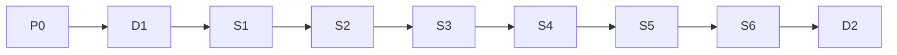

# Sample Plugins Plan

Was C4 of the Plugin Architecture Plan (`plans/Plugin Architecture Plan.md`), planned apart on 17 Nov: it is six
plugins, the author docs and whatever the contract turns out to lack, too much for one phase. Blocked by C3.

Six community plugins, each written as an outside author would write one, and the docs that author reads. They prove
the contract: a sample that needs the kernel's source to get written has found a gap, and the gap is closed in the
contract before the sample goes on. Each sample is a repository of its own beside Vertex, installed the way a user
installs any plugin (C2b), so Vertex's repository holds none of their code.

Each phase ends reviewable on its own: Vertex with `typecheck`, the tests and lint clean, the sample's repository
building and released.

## Baseline (17 Nov, after C3)

- **Vertex:** 423 tests (50 files); 62 Rust tests; typecheck with the 7 errors in `@type32/latex2vue`.
- **SDK:** `packages/vertex-plugin`, `@type32/vertex-plugin` `1.0.0-alpha.0`, `private`, not published. Its only user
  outside Vertex is the test plugin (`../text-vertex-plugin`, `Type-32/test-vertex-plugin`), which takes it as
  `file:../vertex/packages/vertex-plugin` and builds its releases on this machine.
- **The contract** (`shared/plugin/api.ts`, `contributions.ts`): every contribution point the six samples name exists
  (`views.panel` with `tab`, `views.fileViewer`, `files.type`, `index.linkExtractor`, `editor.codeBlock`, `markdown`
  and `slashItem`, `settings.page`, `config` with scopes, `secrets`, `data`, `session.index` and `session.files`, and
  Bases' `registerView`). What a community plugin lacks is listed under Gaps.

## Decisions

| Question | Decision |
| --- | --- |
| Where a sample lives | Its own folder beside Vertex and its own public repository under `Type-32`, as the test plugin (the user's choice, 17 Nov). Vertex's repository, tests and build know none of them. |
| How Vertex gets one | As a user does: Settings → Plugins → Install…, from the repository's release (`plugin.zip`). Checked globally and in a workspace. |
| What a sample may import | The SDK's modules and what it bundles itself. The SDK's build already fails on any other import of the app's. |
| What a sample's author may read | The author docs and the SDK's published types. Not Vertex's source (Open questions, 3). |
| A gap | The sample stops. The gap gets a row under Gaps, is closed in Vertex (contract, a test, the docs), and Vertex is committed before the sample goes on. Nothing reaches into the kernel's internals to get by. |
| Contract changes | Additions only, within `apiVersion` 1 while the SDK is an alpha. A sample sets `minAppVersion` to the Vertex that has what it uses. |
| Author docs | In the SDK's package (`packages/vertex-plugin/docs/`, shipped with it), since they version with the contract and reach an author with the types. `Concepts and Structures.md` links them. |
| Each repository's checks | `bun run build`, `bun run typecheck`, and one `bun test` file for logic that isn't drawing (the graph's data, the board's parser, the calendar's grid). |
| Order | The graph first, alone: it is the plan's first user of the docs and finds the gaps the others share. Then the small ones, each on a different part of the contract. The file browser last: the widest surface. |
| The test plugin | Stays the fixture for install and update tests. It isn't a sample. |

Proposed, to confirm (Open questions): how a plugin ships its strings, publishing the SDK, who writes the samples, a
template repository, the new file format.



## Repositories

| Phase | Folder beside Vertex | Repository | Plugin `id` | Exercises |
| --- | --- | --- | --- | --- |
| S1 | `vertex-plugin-graph` | `Type-32/vertex-plugin-graph` | `graph` | panel views in a pane and a tab, commands, the index and its events, the theme, config with workspace overrides, bundled dependencies |
| S2 | `vertex-plugin-settings-sample` | `Type-32/vertex-plugin-settings-sample` | `settings-sample` | schema settings, a settings page of its own, an overridable key, a secret, a permission |
| S3 | `vertex-plugin-stat-block` | `Type-32/vertex-plugin-stat-block` | `stat-block` | a code block widget, a slash item, Markdown syntax, the editor's nested contexts |
| S4 | `vertex-plugin-board` | `Type-32/vertex-plugin-board` | `board` | a file type with New, a viewer that loads text, a link extractor |
| S5 | `vertex-plugin-bases-calendar` | `Type-32/vertex-plugin-bases-calendar` | `bases-calendar` | `requires`, a core plugin's API (`ctx.use('bases')`) |
| S6 | `vertex-plugin-navigator` | `Type-32/vertex-plugin-navigator` | `navigator` | `session.files` whole (menus, New, drags, undo), `data.workspace`, assets |

None of the ids is a core plugin's (`ai`, `ai-assistant`, `backlinks`, `bases`, `bases-map`, `canvas`, `chat`,
`files`, `git`, `image`, `latex`, `mermaid`, `outgoing-links`, `outline`, `palette`, `workflows`, `writers-tools`,
`yaml-form`).

## Gaps

Found by reading the contract, before any sample is written. P0 closes the first five; each sample adds its own rows.

| What's missing | Who needs it | Today |
| --- | --- | --- |
| A plugin's own strings | all | Labels are i18n keys (`PanelViewDef.label`, `PluginCommand.label`, `FileTypeDef.label`, the config schema's `label` and `description`), and only a core plugin's layer adds keys. A plugin has no `t()` either: `vue-i18n` isn't a shared module. The test plugin's plain-text label logs `[intlify] Not found 'Test plugin' key` on every draw. |
| The theme | the graph (it draws on a canvas) | The plan named `ui.theme`; the contract has nothing. A plugin can read the app's CSS variables but isn't told when they change (light and dark, the primary colour, a workspace's theme). |
| Icons | all | The app's icon bundle lists what its own code uses. Whether a Lucide icon no core plugin uses draws in the packaged app, which has no server, isn't checked. |
| `/ui`'s components' props | S2, S6 | `SettingsRow`, `SettingsSection`, `ViewerLayout` and the rest are typed as `Component` (C1's Not done), so `vue-tsc` checks nothing an author passes them. |
| The SDK outside this machine | all | `private`; a repository's CI can't install it, so a release can only be built here (Open questions, 2). |
| A worker | the graph, maybe | A plugin is one `main.js` imported from a blob URL. Whether a `Worker` can start from a plugin's asset isn't known; only needed if 5,000 notes don't lay out on the main thread (S1 measures first). |

## P0: What every sample needs

In Vertex. Nothing here is a sample's.

### Change
- **Strings** (as decided under Open questions, 1): a plugin's messages for `en` and `zh-CN`, merged under
  `plugins.<id>.` before its `setup`; `ctx.t(key, params)` and the locale for what it draws itself. The manifest
  validator and the install dialog say which keys the manifest names that the plugin doesn't define.
- **The theme:** `ctx.ui.theme`, reactive: light or dark and the resolved colours a canvas needs (text, muted, border,
  background, primary), following the window's effective settings.
- **Icons:** check a Lucide icon outside the app's bundle in a release build. If it doesn't draw, the fix is the
  kernel's (the whole Lucide set available offline), not a list per plugin.
- **`/ui` types:** each published component with its props, from the build that writes `ui.d.ts`.
- **The SDK** (as decided, 2): published, or a documented local path.
- **A template** (as decided, 4): the files every sample starts from.
- The test plugin moves to its own strings, so the dev log's `intlify` warnings stop.

### Acceptance
- [ ] A plugin outside Vertex shows its view label, a command and a schema field in en and zh-CN, and follows a language change without a reload.
- [ ] A canvas a plugin draws follows a switch between light and dark and a change of the primary colour.
- [ ] A Lucide icon no core plugin uses draws in a release build with the network off.
- [ ] `vue-tsc` in a plugin's project refuses a wrong prop on `SettingsRow`.
- [ ] Tests for the messages' merge and the manifest's key check; the SDK's build and `versions.test.ts` pass.

## D1: Author docs, first draft

In `packages/vertex-plugin/docs/`. Written before the samples so they can be written from it; D2 finishes it.

### Change
- **Start:** a new plugin from the template to a panel view running in Vertex; the development loop (install from a
  folder, which is watched and reloads the window).
- **The package:** `plugin.json` key by key; one `main.js`, `styles.css`, assets; what the preset does; bundling a
  dependency; what can't be done (no native code; one file, so no imports at run time besides its assets).
- **The contract:** `PluginContext` and `SessionContext` member by member, each contribution point with a short
  example; strings; the theme.
- **UI:** the two tiers (`mount(el, props)`, the stable one; Vue components and `/ui`, which follow the app) and what
  each promises; Nuxt UI's components in a template; Tailwind through the SDK's stylesheet.
- **Config, data, secrets:** the schema's field types, scopes and `overridable`, `ctx.data`, `ctx.secrets`,
  permissions and what each grants.
- **Trust:** what a user is told at install, that a plugin runs as Vertex does, a workspace's plugins and their pins.
- **Publishing:** a release with `plugin.zip`, or a branch with the built files, each with a CI example; `repository`;
  how updates are found; pinning.
- **Versioning:** `apiVersion`, `minAppVersion`, what an alpha SDK means.
- **Carried from earlier phases:** Tailwind skips a project under a parent `.gitignore` that ignores it until it's a
  Git repository (C2b); how a view is named (C3); C1's Not done list.

### Acceptance
- [ ] Every member of `PluginContext` and `SessionContext` and every contribution point is in the docs (a test compares the docs' headings with the contract's names).
- [ ] The Start page, followed from an empty folder, ends with a plugin running in Vertex.

## The samples' shared acceptance

Each of S1 to S6, besides its own:

- [ ] Its repository builds and type-checks from a fresh clone; its `bun test` passes.
- [ ] A release with `plugin.zip`; installed from the repository for every workspace, and into a workspace.
- [ ] Works in en and zh-CN.
- [ ] Survives a relaunch: on, with its config, its data and what it had open.
- [ ] Written from the docs and the SDK's types only. Its gaps are rows under Gaps, each closed in Vertex first.
- [ ] Its README: what it shows of the contract, with links into the docs.

## S1: Graph

A relation graph like Obsidian's (`d3-force`, `d3-zoom` and `d3-drag`, bundled into its `main.js`; drawn on a canvas).

### Change
- Notes are nodes and links are edges, from `index.links()`; tags, attachments, unresolved links and orphans can be shown or hidden.
- A global view and a local one that follows the active tab to a set depth, both `tab: true`, opened by commands.
- Hovering a node highlights its neighbours, a click opens the note, nodes drag, the view pans and zooms.
- It follows the index (`index.on`) and the theme.
- Filters, colour groups and forces are its config: global, with per-workspace overrides.

### Acceptance
- [ ] A vault of 5,000 notes lays out and stays responsive while panning (frame times measured and written here).
- [ ] An edit that adds a link shows without reopening the view.
- [ ] Open in a pane and in a tab at once, each keeps its own layout.
- [ ] A workspace's override of a filter applies there only.

## S2: Settings sample

### Change
- Schema fields of every type, on the page Vertex draws from the manifest.
- A page of its own beside it, with a custom widget, drawn with `/ui`'s settings components.
- One key a workspace may override, one only a trusted workspace may.
- A secret (set, shown as set, deleted) and the `secrets` permission; a status item that shows the config it reads.

### Acceptance
- [ ] Each field type edits, resets and validates; the overridable key shows Changed in this workspace and Use global.
- [ ] The secret is in the OS keychain under the plugin's name and gone after Delete.
- [ ] Without the `secrets` permission in its manifest, the same call is refused.

## S3: Stat block

### Change
- A ` ```statblock ` code block drawn as a widget (a tabletop creature's stats, from YAML), editable in place.
- A slash item that inserts one.
- A piece of inline Markdown syntax (a dice roll, `{2d6+3}`), drawn and clickable.
- Both draw in notes, callouts, table cells and canvas cards.

### Acceptance
- [ ] The block and the inline syntax draw in each of the four places; a click in the widget edits the right block.
- [ ] Invalid YAML shows what's wrong in the block, and the note still edits.

## S4: Board

A new file format: `.board`, a kanban board as JSON whose cards hold Markdown.

### Change
- A file type with New Board (File → New, Files' menus, the palette) and an icon.
- A viewer that loads the file's text: columns and cards, dragged between columns, edited in place; saved through the viewer's text, so autosave and undo are the app's.
- A link extractor: `[[links]]` in cards count as the board's links (backlinks, the graph).

### Acceptance
- [ ] New Board creates and opens one; edits autosave; an invalid file shows what's wrong instead of a blank view.
- [ ] A note linked from a card lists the board under Backlinks; renaming the note updates the card.

## S5: Bases calendar

A community plugin on a core plugin's API.

### Change
- `requires: ["bases"]`; a Bases view registered with `ctx.use('bases').registerView`: a month calendar by a date property, with the view's options (which property, week start).
- A click on a day's entry opens the note; a click on an empty day makes a new item with that date.

### Acceptance
- [ ] The view is offered in a `.base` file and in a ` ```base ` block; with Bases off, the plugin is off and says why.
- [ ] Changing a note's date moves it on the calendar without reopening the base.

## S6: Navigator

A file browser that can replace Files.

### Change
- A panel view of the workspace's tree, with the kernel's file menu, New items and icons.
- Rows drag to the editor, to chat and to Finder; drops from outside import; file operations go through Files' undo.
- Thumbnails for images; per-folder data (a colour, a sort order) in `ctx.data.workspace`.

### Acceptance
- [ ] With Files off and the navigator in its place: create, rename, move, duplicate, delete and undo each; every row of SMOKE's Files section that isn't about Files' own look passes.
- [ ] A folder's colour survives a relaunch and travels with the vault.

## D2: Close

### Change
- The docs revised with every gap closed along the way; each sample linked where it shows a point.
- `SMOKE.md`: a Sample plugins section, a row per sample, installed from its repository.
- `Concepts and Structures.md` links the author docs and names the samples.
- The Plugin Architecture Plan's C4 ticked, with what this plan built.

### Acceptance
- [ ] The docs' contract test passes against the final contract.
- [ ] The six SMOKE rows pass on a release build.

## Not in this plan

- A plugin directory or catalog (the Plugin Architecture Plan leaves it a place).
- Windows and Linux runs of the samples: no machine here, as for C2.
- Native code in a plugin, or a sandbox.
- Publishing the samples anywhere but their repositories.

## Open questions

Each has a recommendation; the plan above assumes it. Answers change P0 only, except 3.

1. **How a plugin ships its strings.** Recommended: in its bundle,
   `definePlugin({messages: {en: {…}, 'zh-CN': {…}}, setup})`, merged by the host under `plugins.<id>.` before
   `setup`. Nothing new for Rust to read. The other way: `locales/<code>.json` in the package, copied by the preset
   and handed over with the code, editable without a rebuild, at the cost of another file to read and validate.
2. **Publishing the SDK.** Six repositories with CI releases need `@type32/vertex-plugin` on npm. Recommended:
   publish the alpha (`1.0.0-alpha.N`, the `next` tag), which makes the contract public before the editor's 1.0, the
   point `private` was waiting for. The other way: keep `file:../vertex/packages/vertex-plugin` and build every
   release on this machine, as the test plugin does; the docs' CI examples then can't run until it is published.
3. **Who writes the samples.** Recommended: the docs first, then each sample by an agent that may read only the docs
   and the SDK's built types, listing what it lacked; the graph alone first, then one at a time in the order above.
   The other way: written here with the kernel's source in reach, keeping to the SDK's imports, which proves less
   about the docs.
4. **A template repository.** Recommended: `Type-32/vertex-plugin-template` (a GitHub template: `plugin.json`,
   `vite.config.ts`, `tsconfig.json`, `.gitignore`, the release workflow, a panel view), which the six start from and
   the docs' Start page uses. The other way: each repository copies those files from the test plugin.
5. **The new file format.** Recommended: `.board` (above), because its cards give the link extractor real work.
   Any small text format with links in it would do.
