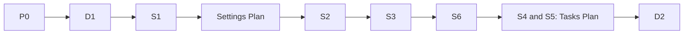

# Sample Plugins Plan

Was C4 of the Plugin Architecture Plan (`plans/Plugin Architecture Plan.md`), planned apart on 17 Nov: it is six
plugins, the author docs and whatever the contract turns out to lack, too much for one phase. Blocked by C3.

Five community plugins (six as first planned: S4 and S5 became one on 18 Nov), each written as an outside author would write one, and the docs that author reads. They prove
the contract: a sample that needs the kernel's source to get written has found a gap, and the gap is closed in the
contract before the sample goes on. Each sample is a repository of its own beside Vertex, installed the way a user
installs any plugin (C2b), so Vertex's repository holds none of their code.

Each phase ends reviewable on its own: Vertex with `typecheck`, the tests and lint clean, the sample's repository
building and released.

## Baseline (17 Nov, after C3)

- **Vertex:** 423 tests (50 files); 62 Rust tests; typecheck with the 7 errors in `@type32/latex2vue`.
- **SDK:** `packages/vertex-plugin`, `@type32/vertex-plugin` `1.0.0-alpha.0`, `private`, not published. Its only user
  outside Vertex is the test plugin (`../text-vertex-plugin`, `Type-32/test-vertex-plugin`), which takes it as
  `file:../vertex/packages/vertex-plugin` and builds its releases on this machine.
- **The contract** (`shared/plugin/api.ts`, `contributions.ts`): every contribution point the six samples name exists
  (`views.panel` with `tab`, `views.fileViewer`, `files.type`, `index.linkExtractor`, `editor.codeBlock`, `markdown`
  and `slashItem`, `settings.page`, `config` with scopes, `secrets`, `data`, `session.index` and `session.files`, and
  Bases' `registerView`). What a community plugin lacks is listed under Gaps.

## Decisions

| Question | Decision |
| --- | --- |
| Where a sample lives | Its own folder beside Vertex and its own public repository under the `CTRL-Neo-Studios` organisation (the user's choice, 17 Nov). Vertex's repository, tests and build know none of them. |
| How Vertex gets one | As a user does: Settings → Plugins → Install…, from the repository's release (`plugin.zip`). Checked globally and in a workspace. |
| What a sample may import | The SDK's modules and what it bundles itself. The SDK's build already fails on any other import of the app's. |
| Who writes a sample | Written here, with Vertex's source in reach, keeping to the SDK's imports (the user's choice, 17 Nov; Open questions, 3). The user checks each sample's use of the plugin API afterwards. |
| A gap | The sample stops. The gap gets a row under Gaps, is closed in Vertex (contract, a test, the docs), and Vertex is committed before the sample goes on. Nothing reaches into the kernel's internals to get by. |
| Contract changes | Additions only, within `apiVersion` 1 (the docs' Versions page). A sample sets `minAppVersion` to the Vertex that has what it uses. |
| Author docs | In the SDK's package (`packages/vertex-plugin/docs/`, shipped with it), since they version with the contract and reach an author with the types. `Concepts and Structures.md` links them. |
| Each repository's checks | `bun run build`, `bun run typecheck`, and one `bun test` file for logic that isn't drawing (the graph's data, the board's parser, the calendar's grid). |
| Order | The graph first, alone: it finds the gaps the others share. Then the small ones, each on a different part of the contract; the file browser after them, the widest surface. The board (S4) last: the user has a clearer plan for it, which replaces S4 below when it comes (17 Nov). S2 waits for the Settings Plan (`plans/Settings Plan.md`, 17 Nov): its settings sample is written with what that plan builds. S5 deferred like S4, after S6 (the user, 18 Nov). S4 and S5 became one plugin, Tasks, with a plan of its own (`plans/Tasks Plan.md`, the user, 18 Nov). |
| The test plugin | Stays the fixture for install and update tests. It isn't a sample. |
| A plugin's strings (P0) | Files, `locales/<locale>.json` in the package, each `{"plugins": {"<id>": {…}}}` as a core layer's are. Not in the bundle, as first proposed: the Settings window shows a plugin's schema labels without running it (it runs the global plugins made for `settings` only), so the strings must be readable without its code. The host merges only `plugins.<id>`; a workspace copy's strings are pinned with it. |
| The SDK (P0) | Published by the user on 17 Nov: `@type32/vertex-plugin` `1.0.0` on `latest`, released with `bun run release` in the package. P0's additions to the contract are a minor version. |
| The template (P0) | `Type-32/vertex-plugin-template`, a GitHub template repository beside Vertex (`../vertex-plugin-template`), the samples' and the docs' starting point. |

S4's plan came on 18 Nov, with S5 in it: `plans/Tasks Plan.md`.



## Repositories

| Phase | Folder beside Vertex | Repository | Plugin `id` | Exercises |
| --- | --- | --- | --- | --- |
| S1 | `vertex-plugin-graph` | `CTRL-Neo-Studios/vertex-plugin-graph` | `graph` | panel views in a pane and a tab, commands, the index and its events, the theme, config with workspace overrides, bundled dependencies |
| S2 | `vertex-plugin-settings-sample` | `CTRL-Neo-Studios/vertex-plugin-settings-sample` | `settings-sample` | schema settings, a settings page of its own, an overridable key, a secret, a permission |
| S3 | `vertex-plugin-stat-block` | `CTRL-Neo-Studios/vertex-plugin-stat-block` | `stat-block` | a code block widget, a slash item, Markdown syntax, the editor's nested contexts |
| S4, S5 | `vertex-plugin-tasks` (and the library `tasks-ui-components`) | `CTRL-Neo-Studios/vertex-plugin-tasks` | `tasks` | a file type with New, a viewer that loads text, an embed, a link extractor, a panel view, `requires` and a core plugin's API (`ctx.use('bases')`), a component library on Nuxt UI inside a plugin, dialogs' files, notifications |
| S6 | `vertex-plugin-navigator` | `CTRL-Neo-Studios/vertex-plugin-navigator` | `navigator` | the index (tree, tags, properties, dates), `session.files` whole (menus, New, clipboard, drags, drops, `edit`, undo), `files.menuItem`, `data.workspace` and `data.global`, a dialog (`useOverlay`), a view in a pane and a tab |

None of the ids is a core plugin's (`ai`, `ai-assistant`, `backlinks`, `bases`, `bases-map`, `canvas`, `chat`,
`files`, `git`, `image`, `latex`, `mermaid`, `outgoing-links`, `outline`, `palette`, `workflows`, `writers-tools`,
`yaml-form`).

## Gaps

Found by reading the contract, before any sample is written. P0 closes the first five; each sample adds its own rows.

| What's missing | Who needs it | Today |
| --- | --- | --- |
| A plugin's own strings | all | Closed in P0: `locales/`, `ctx.i18n`. |
| The theme | the graph (it draws on a canvas) | Closed in P0: `ctx.ui.theme`. |
| Icons | all | Closed in P0: the installed icon sets load offline. |
| `/ui`'s components' props | S2, S6 | Closed in P0: `shared/plugin/components.ts`. |
| The SDK outside this machine | all | Closed: published (Decisions). |
| A worker | the graph, maybe | A plugin is one `main.js` imported from a blob URL. Whether a `Worker` can start from a plugin's asset isn't known; only needed if 5,000 notes don't lay out on the main thread (S1 measures first). |
| A community plugin's API, typed | a community plugin another uses (none of the samples) | Found in D1. `ctx.provide` works for any plugin, but `PluginApis` is augmented through `#shared/plugin/api`, which only the SDK's own files resolve, so `ctx.use('<community id>')` doesn't type-check. The docs say so (the package, what can't be done). |
| The index's reactivity, as documented | the graph | Found in S1; the docs were wrong, the contract is fine. The session page said all of the index was reactive: its entries are (an entry's `forelinks`, `backlinks`, `modifiedTime`), but `links()` and `unresolved()` read the link graph as it is, and the editor's own saves aren't `index.on` events. Closed: the session page says so. |
| A plugin's Tailwind classes reach Vertex | every plugin that uses Tailwind | Found in S1, by the stray words Tailwind makes classes of (the graph's `resize`, `container`, `hidden`). The real fault was wider: a plugin's stylesheet loads after the app's, and two sheets that both define a class can't be ordered against each other. Nuxt UI's card body is `p-4 sm:p-6`; a plugin's `.p-4`, later, beats `sm:p-6` on every card and modal in the window (measured: 24 px became 16 px). Closed in the SDK with a prefix (the user's choice, 17 Nov, over scoping a plugin's rules to its own UI, which keeps the clash inside it): a plugin writes `tw:flex`, its stylesheet holds only those names. Checked in `tauri dev` with a scratch plugin: its own classes applied (`tw:p-4`, `tw:hidden tw:sm:block`, `tw:text-muted`), `tw:w-full` on a `UButton` filled its row, and a `UCard` beside them kept its 24 px. |
| A Nuxt UI component inside another's trigger; a plugin's dialog in dev; the frontmatter tools | the navigator (the first sample with a tooltip around a button, and a modal) | Found in S6, closed in Vertex: the Navigator Plan's Gaps. |
| `session.index.on` for what Vertex does itself; a moved file's `modifiedTime` | the navigator (data kept by path; lists by date) | Found in S6, closed in Vertex on 18 Nov: the Navigator Plan's Gaps. Every create, remove and rename is an event now, and a rename keeps the file's time. |

## P0: What every sample needs

In Vertex. Nothing here is a sample's.

### Change
- **Strings:** a plugin's `locales/<locale>.json`, checked when it's built and merged where it's listed; `ctx.i18n`
  (`t`, `locale`) for what it draws itself. The manifest's keys are checked against `en` when the plugin is built.
- **The theme:** `ctx.ui.theme`, reactive: `dark`, and `value(property)` for any of the page's CSS custom properties
  as resolved now (the colours a canvas needs and anything else), following whatever sets them.
- **Icons:** check a Lucide icon outside the app's bundle. If it doesn't draw offline, the fix is the kernel's (the
  whole Lucide set available offline), not a list per plugin.
- **`/ui` types:** each published component with its props, from the build that writes `ui.d.ts`.
- **The SDK:** published.
- **A template:** the files every sample starts from.
- The test plugin moves to its own strings, so the dev log's `intlify` warnings stop.

### Acceptance
- [x] A plugin outside Vertex shows its view label, a command and a schema field in en and zh-CN, and follows a language change without a reload. (In `tauri dev`, separate app identifier, a temporary harness and a scratch plugin built with the SDK's preset, all deleted after. Its panel's tab read "P0 check" and, after the language setting changed to zh-CN, "P0 检查", the test plugin's "Test plugin" and "测试插件", its text "Hello V" and "你好 V", with no reload; its schema page in the Settings window, where the plugin doesn't run, read "Depth · How far to look". A command wasn't tried: its label goes through the same `t`.)
- [x] A canvas a plugin draws follows a switch between light and dark and a change of the primary colour. (A computed in the scratch plugin's render read `dark` and `value('--ui-primary')`: light with the default `oklch(58.5% 0.233 277.117)`, then dark with red `oklch(70.4% 0.191 22.216)`, then light with blue `oklch(62.3% 0.214 259.815)`, redrawn each time. Read through the page's computed style, not drawn on a `<canvas>`; S1 draws one.)
- [ ] A Lucide icon no core plugin uses draws in a release build with the network off. (Checked in `tauri dev` with the network on: `i-lucide-squirrel` drew from the installed set, with no request to the Iconify API among the page's resources and no `[Icon] failed to load` warning. The release build, which has the same `ssr: false` provider, wasn't built.)
- [x] `vue-tsc` in a plugin's project refuses a wrong prop on `SettingsRow`. (In the test plugin: `<SettingsRow labl="wrong"/>` → TS2345, `<ViewerLayout scroll-mode="sideways"/>` → TS2322; the right ones passed.)
- [x] Tests for the messages' merge and the manifest's key check; the SDK's build and `versions.test.ts` pass. (`shared/plugin/messages.test.ts`; the core layers through the same rule in `i18n.test.ts`; the preset refused a scratch plugin whose `zh-CN.json` lacked two keys.)

### As built

- **Contract:** `HostServices.i18n` (`t`, `locale`) and `HostServices.ui.theme` (`dark`, `value`); `shared/plugin/messages.ts` (`checkPluginMessages`, `messagesFor`, `messageLeaves`, `manifestKeys`); `shared/plugin/components.ts` (`<Name>Props`, `<Name>Emits` for each `/ui` component, re-exported from the SDK's main module), each component declaring its props with them (`SettingsRow`'s `setting` is a `string` now; it casts to `AppSettingPath` inside).
- **Rust** (`plugins.rs`): `read_locales` / `parse_locales`; `plugins_list` returns each plugin's `locales`; `bundle_hash` takes any number of parts, and a workspace copy's pin covers its locale files (name and bytes). The pin test covers them.
- **Frontend:** `loadInstalledPlugins(app, i18n, root, runs)` merges each loadable plugin's strings (the installed one's, then an accepted workspace copy's over them); `app/utils/plugins/theme.ts` (`pageTheme`, a `MutationObserver` on `<html>`'s class and style and on `<head>`); `app/plugins/icons.client.ts` (every `@iconify-json/*` set as its prefix's `setCustomIconLoader`, by an `import.meta.glob` of the installed sets: no list); `@iconify/vue` and `@iconify/utils` declared and pre-bundled (found at runtime otherwise: "head.hooks").
- **SDK:** the preset checks `locales/*.json` with `checkPluginMessages` and the manifest, and copies them; the build types `/ui`'s components from the contract (`new () => {$props: <Name>Props & EmitsToProps<<Name>Emits>}`) and fails on a component without its props there.
- **Tests:** the i18n test now checks each core layer with `checkPluginMessages` in one case instead of one per check and locale, so the count fell from 423 to 361 (51 files) with the same checks; `messages.test.ts` is new. 62 Rust tests; typecheck unchanged (the 7 errors in `@type32/latex2vue`).
- **Test plugin** (`../text-vertex-plugin`, `cb15cd2` on `dev`): `locales/en.json` and `zh-CN.json`, its view's label a key, its text through `ctx.i18n.t`; on the published SDK (`^1.1.0`) instead of `file:`. No new release: its releases are the update tests' fixture.
- **Template** (`Type-32/vertex-plugin-template`, public, a GitHub template, `main`): `plugin.json`, `package.json` (the SDK at `^1.1.0`), `vite.config.ts` (`vertex({pack: true})`), `tsconfig.json`, `locales/`, `src/` (a panel view with a string, an asset and a Nuxt UI button), `README.md` (making it yours, the dev loop, releasing), `.github/workflows/release.yml` (a `v*` tag: install, type-check, build, `gh release create … plugin.zip`). Its workflow ran green on a trial tag `v0.1.0` (the release had `plugin.zip`); tag and release deleted after, so the template carries none.
- **The SDK** `1.1.0` (the user, `5d973ca`), with all of the above.

## D1: Author docs, first draft

In `packages/vertex-plugin/docs/`. Written before the samples so they can be written from it; D2 finishes it.

### Change
- **Start:** a new plugin from the template to a panel view running in Vertex; the development loop (install from a
  folder, which is watched and reloads the window).
- **The package:** `plugin.json` key by key; one `main.js`, `styles.css`, assets; what the preset does; bundling a
  dependency; what can't be done (no native code; one file, so no imports at run time besides its assets).
- **The contract:** `PluginContext` and `SessionContext` member by member, each contribution point with a short
  example; strings; the theme.
- **UI:** the two tiers (`mount(el, props)`, the stable one; Vue components and `/ui`, which follow the app) and what
  each promises; Nuxt UI's components in a template; Tailwind through the SDK's stylesheet.
- **Config, data, secrets:** the schema's field types, scopes and `overridable`, `ctx.data`, `ctx.secrets`,
  permissions and what each grants.
- **Trust:** what a user is told at install, that a plugin runs as Vertex does, a workspace's plugins and their pins.
- **Publishing:** a release with `plugin.zip`, or a branch with the built files, each with a CI example; `repository`;
  how updates are found; pinning.
- **Versioning:** `apiVersion`, `minAppVersion`, what an alpha SDK means.
- **Carried from earlier phases:** Tailwind skips a project under a parent `.gitignore` that ignores it until it's a
  Git repository (C2b); how a view is named (C3); C1's Not done list.

### Acceptance
- [x] Every member of `PluginContext` and `SessionContext` and every contribution point is in the docs (a test compares the docs' headings with the contract's names). (`src/docs.test.ts`: the contract's names are read from `api.ts`'s syntax; every contribution point is a member, `ctx.views.panel` and the rest, so it's covered with them.)
- [x] The Start page, followed from an empty folder, ends with a plugin running in Vertex. (Each file of the page written as it shows it into an empty `/tmp` folder, built and type-checked against the published SDK `1.1.0`; in `tauri dev`, with a temporary harness standing in for the Settings window's picker, installed from `dist/` and turned on: the right sidebar had its icon, and the view drew "Hello, Vertex". Then the development loop, with this tree's preset over the published one (below): a watching build and an edit of a string and of a class reloaded the window, which drew "Hi there, Vertex". All deleted after.)

### As built

- **Docs** (`packages/vertex-plugin/docs/`, shipped: `files` has `docs`): `README.md` (the index), `start.md`, `package.md` (what's installed, `plugin.json` key by key, the build, the shared modules and helpers, dependencies, strings and how labels are keys, what can't be done), `context.md` (each `ctx` member, a contribution point each with an example), `session.md`, `ui.md` (the two tiers, Vue, Nuxt UI, icons, `/ui`'s components with a settings page, styles), `config.md` (config and its schema, overrides, data, secrets, the network, permissions), `trust.md`, `publishing.md` (a release's workflow, a branch, what users can install, updates), `versions.md`. The carried notes: the parent `.gitignore` (Start, UI), how a view is named (the package's strings), C1's bundled `@vue/*` (dependencies).
- **Checked:** `src/docs.test.ts` (above); every TypeScript and Vue example compiled with `vue-tsc` against the SDK built from this tree (each fragment in a function given `ctx` and `session`); every link between the pages resolves. Both throwaway.
- **Found while following the Start page:** `vite build --watch` built forever: Tailwind watches the files it scans, `dist/` among them when nothing ignores it (the template's `.gitignore` does, the page's files had none), and in Vertex the watched folder reloaded the window as often. The preset now excludes `dist/` and `plugin.zip` from a watching build (one build per change, checked). It also writes `codeSplitting: false` for the deprecated `inlineDynamicImports` (Vite 8 warned on every build; still one `main.js` with a dynamic import, checked). The template's README said to install the project folder; a folder install copies and watches the whole folder, `node_modules` too, so it says `dist/` now.
- **Not done:** the web inspector line (Safari's Develop menu) wasn't tried. These changes, with K6's (`SettingsPageDef.icon` optional, `SettingsRowProps.icon`) and the prefix (Gaps), are in no published SDK yet: `1.2.0` carries them, which the Start page asks for. After it: the template and the test plugin move to `^1.2.0` and `tw:` classes (their sources are changed and waiting, uncommitted: with `1.1.0` those classes write nothing).
- **Numbers:** 368 tests (53 files); typecheck unchanged (the 7 errors in `@type32/latex2vue`); the SDK's `tsc` clean.

## The samples' shared acceptance

Each of S1 to S6, besides its own:

- [ ] Its repository builds and type-checks from a fresh clone; its `bun test` passes.
- [ ] A release with `plugin.zip`; installed from the repository for every workspace, and into a workspace.
- [ ] Works in en and zh-CN.
- [ ] Survives a relaunch: on, with its config, its data and what it had open.
- [ ] Keeps to the SDK's imports. Its gaps are rows under Gaps, each closed in Vertex first.
- [ ] Its README: what it shows of the contract, with links into the docs.

## S1: Graph

A relation graph like Obsidian's (`d3-force`, `d3-zoom` and `d3-drag`, bundled into its `main.js`; drawn on a canvas).

### Change
- Notes are nodes and links are edges, from `index.links()`; tags, attachments, unresolved links and orphans can be shown or hidden.
- A global view and a local one that follows the active tab to a set depth, both `tab: true`, opened by commands.
- Hovering a node highlights its neighbours, a click opens the note, nodes drag, the view pans and zooms.
- It follows the index (`index.on`) and the theme.
- Filters, colour groups and forces are its config: global, with per-workspace overrides.

### Acceptance
- [x] A vault of 5,000 notes lays out and stays responsive while panning (frame times measured and written here). (5,000 notes in 50 folders, 1 to 3 random links each, a tenth with a tag; the global graph opened in a tab in `tauri dev` on this Mac. Frame intervals: the first 2 s of the layout p50 17 ms, p95 22 ms, one frame of 137 ms (the graph built); the next 10 s of layout p50 17 ms, p95 18 ms, max 27 ms; a 3 s pan (synthetic mouse events, one a frame; that the view moved wasn't checked) p50 17 ms, p95 19 ms, max 32 ms. No worker needed: the Gaps row stays open.)
- [x] An edit that adds a link shows without reopening the view. (A `session.files.write` adding `[[F]]` to A: F joined the local graph of A, refitted.)
- [x] Open in a pane and in a tab at once, each keeps its own layout. (The local graph in the right pane and in a tab, each laid out on its own; after a relaunch both reopened.)
- [x] A workspace's override of a filter applies there only. (The vault's `.vertex/settings.json` with `showTags: true`, the user's default off: its tags drew. The "only" half wasn't looked at in another vault; it's the kernel's scope rule, tested there.)

### As built

- **Repository:** [`CTRL-Neo-Studios/vertex-plugin-graph`](https://github.com/CTRL-Neo-Studios/vertex-plugin-graph) (`../vertex-plugin-graph`), release `v0.1.0` from its workflow (install, type-check, build, release with `plugin.zip`; `bun test` added to it after). A fresh clone installs, tests, type-checks and builds. Installed from the repository in `tauri dev` for every workspace (the release resolved as `v0.1.0`, origin `github.com/ctrl-neo-studios/vertex-plugin-graph`) and into a trusted workspace (pinned, accepted).
- **Plugin:** `graph` and `graph-local` panel views (`tab: true`; the global one starts Hidden, the local one on the right), Open graph view and Open local graph in the View menu and the palette (registered per session). One `GraphView.vue` for both: `d3-force` on a canvas, `d3-zoom` to pan and zoom, `d3-drag` for nodes; hover lights a node's neighbours, a click opens a note or an attachment; names show around the focus, or all from 1.5×; Fit to view in the header; the layout fits itself once settled and after a change until the user moves it; the local graph's note is pinned in the middle (the shown tab's file, else the note shown last, else the first open file, which is what a relaunch has). Colours from `ctx.ui.theme` (`--ui-text-muted`, `--ui-primary`, `--ui-success` for tags, `--ui-warning` for attachments), colour groups over them.
- **Data** (`src/graph.ts`, `bun test`: 7 tests): `buildGraph` (notes, attachments, tags, unresolved targets, orphans), `neighbourhood` (within a depth, either way), `parseGroups` and `groupColor` (`path:`, `tag:` with nested tags, a name). The view feeds it the index's entries (reactive) and `unresolved()` again on each save (an entry's `modifiedTime`).
- **Config:** the schema's ten fields (four filters, the local depth, colour groups as a `list` of `<query> <colour>` lines, four forces), each overridable by any workspace.
- **Checked in the app:** both views, the link added, the pane and the tab together, zh-CN, the workspace's override, a relaunch (on, its tabs, its config, the language), 5,000 notes (above). Each with a temporary harness and scratch vaults, deleted after.
- **Found:** the two Gaps rows above, both closed since (the docs and the contract's comments; the `tw` prefix). The graph draws a canvas and one line of text, with scoped CSS: it has nothing to move to Tailwind.

## S2: Settings sample

### Change
Written with what the Settings Plan built (`plans/Settings Plan.md`): rows and sections (`stacked`, `info`, one-line descriptions), `SettingsList`, one page per plugin, search.
- Schema fields of every type (with `info`), which Settings draws at the top of the plugin's one page.
- The page it registers below them, drawn with `/ui`'s settings components: a custom widget in a `stacked` row, and a `SettingsList` (search, a filter, an action on a selection with a question), its `SettingsScrollLayout` drawing inside Vertex's (its title and a header button in the page's header).
- One key a workspace may override, one only a trusted workspace may.
- A secret (set, shown as set, deleted) and the `secrets` permission; a status item that shows the config it reads.
- A `README.md` that reads well in its details on Settings → Plugins, and a `description` under 160 characters.

### Acceptance
- [x] Each field type edits, resets and validates; the overridable key shows Changed in this workspace and Use global. (In `tauri dev`, built against the local SDK: all seven fields written (750, Characters, off, "Today", `#ff0000`, "Drafts", two tags) showed in their controls; the section's reset put back 500, Words, on, "Goal", `#22c55e`, empty, none; bad values (99999, "nope", 123, "x", "yes") showed 10,000 (clamped) and the defaults; a click on the switch stored `false`. Editing a workspace: the goal showed Changed in this workspace and Use global (1,200), Use global took it back to 500; the folder showed Changed with the "applies once you trust it" alert; Count said Global only.)
- [x] The schema and the page are one page, from the nav, from its gear and from Settings search (its fields and the page found by name; its own rows aren't indexed). (`/settings/settings-sample`: Settings (the seven fields), Preview, Milestones, Token; the header "Writing goal" with Reset all; the nav's one entry and the gear on Plugins both `/settings/settings-sample`; "ignored tags" found the field, "writing goal" the page, the seven fields and the row on Plugins.)
- [x] The secret is in the OS keychain under the plugin's name and gone after Delete. (Saved: `security find-generic-password -s dev.ctrl-neo.vertex -a plugin:settings-sample:token` found it, and the row said Saved; after Delete it wasn't found.)
- [x] Without the `secrets` permission in its manifest, the same call is refused. (The installed `plugin.json` without `permissions`: opening the page said "Couldn't use the keychain: vertex.secret_get not allowed…" on the token's row, Save "…secret_set not allowed…", and nothing was written.)

### As built

- **Repository:** [`CTRL-Neo-Studios/vertex-plugin-settings-sample`](https://github.com/CTRL-Neo-Studios/vertex-plugin-settings-sample) (`../vertex-plugin-settings-sample`), release `v0.1.0` from its workflow (`plugin.zip` with `README.md`), after the SDK's 1.2.0 (18 Nov): built and checked first with the local SDK linked (`bun link`), then installed, tested, type-checked and built from npm. The graph moved to `^1.2.0` with it (`v0.1.1`, so its README ships to Settings); the template's waiting edits (`tw:`, `^1.2.0`, its README) type-check and build with 1.2.0, uncommitted in `Type-32/vertex-plugin-template`.
- **The plugin:** "Writing goal" (`settings-sample`): a status item (in the note's status bar, after the word count) with the open note's words or characters against the goal, the last milestone passed, the goal's colour once reached; notes outside the folder or with an ignored tag (or one under it) don't show it. Its schema has every field type (`number`, `select`, `switch`, `text`, `color`, `path`, `list`), with descriptions and two `info`s; `goal` is `workspace`-overridable, `folder` `trustedWorkspace`. Its page (`src/SettingsPage.vue`): Preview (a slider, a bar and the status text in a stacked row), Milestones (a `SettingsList` over `ctx.data.global`: search, All / Before the goal / At or past it, Remove (n) after the native question; Add milestone in the section's header), Token (`ctx.secrets`: Save, Saved, Delete; an error on the row when the keychain refuses), Reset all in the page's header (`ScopedConfig.reset` with the manifest's defaults, imported from `plugin.json`). Strings in `en` and `zh-CN`; `bun test` covers counting, which notes count and milestones (4 tests).
- **Found, in the SDK:** `ui.d.ts` declared every component as `new () => {$props: XProps}`, so `SettingsList`'s items were `{id: string}` in a plugin (`:text="m => m.note"` didn't type-check). `scripts/build.ts` now declares a component with generic props as a generic function, as `vue-tsc` declares a generic SFC: `T` is inferred from `items` (`m.nope` fails, `m.note` passes). In 1.2.0 with the rest.
- **Found, on this computer:** Tailwind wrote no utilities (an empty `styles.css`) until the sample was a Git repository: `~/.gitignore` holds `*` (left by virtualenv), and Tailwind's scanner applies it to a folder that isn't in a repository. Nothing to change in the SDK; a plugin project is a repository.
- **The status bar:** items sit side by side without a gap, so the status item has its own `ms-3` (seen in the app).
- **Also checked in the app:** the status bar at 104 / 50 words in the goal's green, 12 px; a search for "nearly" left one milestone, At or past it none (both under the goal); select all, "Remove (2)", the question answered: "No milestones yet."; the README in the plugin's details (its four headings, the table's ten rows).

## S3: Stat block

### Change
- A ` ```statblock ` code block drawn as a widget (a tabletop creature's stats, from YAML), editable in place.
- A slash item that inserts one.
- A piece of inline Markdown syntax (a dice roll, `{2d6+3}`), drawn and clickable.
- Both draw in notes, callouts, table cells and canvas cards.

### Acceptance
- [x] The block and the inline syntax draw in each of the four places; a click in the widget edits the right block. (In `tauri dev`, a workspace note with two blocks, a callout holding a roll and a block, a table with a roll in a cell, and a canvas with a text card holding a roll and a block. Note: both blocks and the text's rolls; callout: its block and roll; cell: its roll (a block can't be in a cell: Markdown tables are one line a row); canvas card shown: its block and roll (after the fix below), and a real double-click opened it for editing with the block still drawn. A roll clicked in the text, in a block, in a callout and in a cell showed its total ("10 (8 + 2)"). A click on the second block's heading (Orc) put the cursor on that block's `name: Orc` line, its YAML shown.)
- [x] Invalid YAML shows what's wrong in the block, and the note still edits. (`ac: [15` drew "Line 2: Flow sequence in block collection must be sufficiently indented and end with a ]"; text typed after it went in, and its `{d20}` drew as a roll.)

### As built

- **Repository:** [`CTRL-Neo-Studios/vertex-plugin-stat-block`](https://github.com/CTRL-Neo-Studios/vertex-plugin-stat-block) (`../vertex-plugin-stat-block`), release `v0.1.0` from its workflow (`plugin.zip` with `README.md`), on SDK 1.2.0.
- **The plugin:** "Stat block" (`stat-block`). ` ```statblock ` (`ctx.editor.codeBlock`, `src/StatBlock.vue`): name, size, type and alignment, Armor Class / Hit Points / Speed, the six scores (keys or `stats:`) with modifiers that roll a check, the details (saves … challenge), and traits, actions, bonus actions, reactions, legendary actions, whose `{1d6+2}` and `{+4}` roll; a click elsewhere finds the widget's editor (`EditorView.findFromDOM`, `posAtDOM`) and puts the cursor on the block's first YAML line; in a nested editor (a callout's copy of the text) it leaves the click to the note's editor. `{2d6+3}` (`ctx.editor.markdown`, a `DiceRoll` node; `ctx.editor.extension(…, {nested: true})`, a view plugin replacing each node with a button) rolls on click and shows the total for 4 s, its dice in the tooltip; the cursor on it shows the text. `/` → Stat block inserts a goblin (`ctx.editor.slashItem`). `yaml` is bundled (`main.js` 139 kB, 39 kB gzipped). Strings in `en` and `zh-CN`; `bun test` covers the dice, the YAML and each problem (6 tests).
- **Found, in the sample:** a roll at the start of a table cell stayed text: a nested editor keeps its selection at 0, which "touched" the roll and unveiled it. Only a focused editor's selection unveils a roll now (and focus changes rebuild).
- **Found, in Vertex:** a canvas text card that wasn't being edited was drawn by the canvas package's own Markdown (Comark), so no plugin's code block, syntax or extension drew there (nor Mermaid's, nor a base's), only while editing. The user chose to draw it with the note editor (18 Nov): `NoteEditor` has `readonly` now (the contract's `NoteEditorProps.readonly`: no cursor, no `update`, only links, buttons and widgets take the pointer, so a drag and a double-click go to the card), and the canvas gives it to the `text-display` slot. One CodeMirror per text card drawn. A note card shown is still Comark. SDK: 1.3.0's (`docs/versions.md`).

## S4 and S5: Tasks

One plugin with a plan of its own (`plans/Tasks Plan.md`, T0 to T10; the user, 18 Nov): `.task` files in the user's
Tasks format (`@type32/tasks`) shown as a list, a board, a calendar and a timeline, the workspace's notes that are
tasks, iCalendar, alerts. It takes S4's place (first planned as a `.board` file: a file type with New, a viewer that
loads text, a link extractor) and S5's (first planned as a Bases calendar: `requires`, `ctx.use('bases')`), whose
point it keeps: its calendar and timeline are Bases layouts.

### Change
- The Tasks Plan's phases.

### Acceptance
- [ ] The Tasks Plan's T0 to T10 accepted.

## S6: Navigator

A file browser that can replace Files. Planned apart on 18 Nov (`plans/Navigator Plan.md`, N1 to N5): two panes after
Obsidian's Notebook Navigator (folders, tags, properties, shortcuts and recent files; the chosen one's notes as rows
with previews), not the tree first written here. The Change and Acceptance below are that plan's.

### Change
- The Navigator Plan's phases.

### Acceptance
- [ ] The Navigator Plan's N1 to N5 accepted. (18 Nov: built and released, `v0.1.0`; N1, N2, N4 and N5 accepted, N3 but for the SMOKE rows not run: the Update links prompt on a move, a name clash on a drop, drops from Finder, drags onto a chat and out to Finder.)

## D2: Close

### Change
- The docs revised with every gap closed along the way; each sample linked where it shows a point.
- `SMOKE.md`: a Sample plugins section, a row per sample, installed from its repository.
- `Concepts and Structures.md` links the author docs and names the samples.
- The Plugin Architecture Plan's C4 ticked, with what this plan built.

### Acceptance
- [ ] The docs' contract test passes against the final contract.
- [ ] The samples' SMOKE rows pass on a release build.

## Not in this plan

- A plugin directory or catalog (the Plugin Architecture Plan leaves it a place).
- Windows and Linux runs of the samples: no machine here, as for C2.
- Native code in a plugin, or a sandbox.
- Publishing the samples anywhere but their repositories.

## Open questions

Each had a recommendation; the plan above follows what was decided.

1. **How a plugin ships its strings.** Decided in P0: files (Decisions).
2. **Publishing the SDK.** Decided: published (Decisions).
3. **Who writes the samples.** Decided: written here, keeping to the SDK's imports; the user checks the API use
   afterwards (Decisions). Recommended was an agent reading only the docs and the SDK's types.
4. **A template repository.** Decided: `Type-32/vertex-plugin-template` (Decisions).
5. **The new file format.** Deferred: the user's plan for S4.
