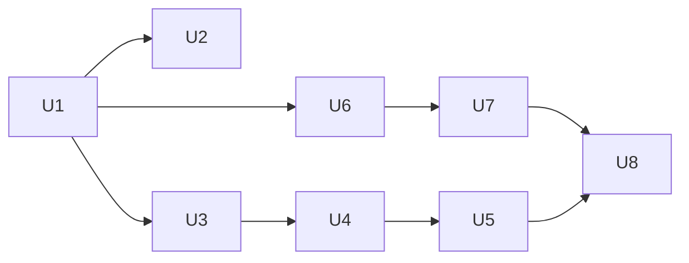

# Settings Plan

A rethink of the Settings window, asked for on 17 Nov after K6 (the nav's groups) and the layout polish: those moved
things around without settling how a settings page is built, how a list is searched and acted on, or what a plugin
looks like in Settings. Before S2 of the Sample Plugins Plan (`plans/Sample Plugins Plan.md`), whose settings sample
is written with what this plan builds.

Each phase ends reviewable on its own: `typecheck`, the tests and lint clean, checked in `tauri dev`.

## What was reported (17 Nov)

| # | Report | What's behind it | Phase |
| --- | --- | --- | --- |
| 1 | "Version 0" on every core plugin | A plugin row's description is one joined line: description · version · author · needs · uses (`describe` in `pages/settings/plugins/index.vue`). Core manifests all say `"version": "0"`; a core plugin's version is Vertex's. | U4 |
| 2 | A long description under "Check for updates automatically" | 222 characters under a label that already says it. Not the only one: of the 88 descriptions Settings shows (rows, sections, schema fields), 27 run past 90 characters. (First counted as 64, which took in descriptions outside Settings: workflow nodes, Git's dialogs and tour.) | U1 |
| 3 | A community plugin's row is a paragraph | The same joined line, plus where it came from and what it claims. A plugin has no place for more than its manifest's `description`: nothing reads a README. | U4, U5 |
| 4 | No search, no batch selection and actions on Plugins | Plugins never had them. They exist for AI's lists (providers, model profiles: `layers/ai/app/components/List.vue`, search and Remove selected) and, as a bare search field, on Trust. The pattern is one plugin's, so no other page has it. | U3, U4 |
| 5 | Chat's settings page links to another settings page | A plugin with both a schema (drawn by Settings at `/settings/plugins/<id>`) and a page of its own (`ctx.settings.page`, at `/settings/<id>`) has two pages. K6 lists only the second in the nav, so Chat's page carries a row "Options → Open" to reach the first. Chat is the only one today; the contract allows it for any plugin. | U6 |
| 6 | No settings search | There never was a working one: the sidebar had a `UDashboardSearchButton` wired to nothing, removed on 31 Oct (`f50f005`, "the settings sidebar's dead search button"). Nothing replaced it. | U7 |
| 7 | View → Arrangement's padding | `SettingsSection` pads nothing: only `SettingsRow` has padding. Anything that isn't a row (the arrangement's grid, a list, an empty state) pads itself by hand, each differently. | U1 |
| 8 | Custom CSS: the same padding, and a plain textarea | As 7; and it's a `UTextarea`. The editor package's `CodeEditor` (what the code viewer draws with) takes a `language`. | U1, U2 |

## Baseline (17 Nov)

- 368 tests (53 files); 62 Rust tests; typecheck with the 7 errors in `@type32/latex2vue`.
- **Pages:** About, General (3 sections), Theme (5), View (3), Trust (2), Plugins (`plugins/index.vue`,
  463 lines), a schema page per plugin (`plugins/[id].vue`), and the plugins' own (`[...path].vue`: AI with three
  sub-entries and item pages, Chat, Git).
- **Building blocks** (`app/components/Settings/`, published in `/ui`): `SettingsScrollLayout`, `SettingsSection`,
  `SettingsRow`.
- **Plugins with settings:** a schema only: AI assistant (3 fields), Canvas (6), Files (7), Workflows (4), and any
  community plugin (the graph: 10). A page only: AI, Git. Both: Chat (4 fields and a page).

## Principles

What the phases hold every page to.

1. **A label says what a control does; a description adds one line or isn't there.** Anything longer (why, what's
   sent, what trust means) is behind an info button beside the label, or in the dialog where the decision is made.
2. **A section's content is rows.** A control that needs the full width is a row too (stacked: label over control).
   No page pads by hand.
3. **A list of things is one component:** search, selection, actions on the selection, an empty state. Wherever
   Settings lists things (plugins, trusted folders, providers, profiles), it's that one.
4. **A plugin has one settings page.** What Settings draws from its manifest and what the plugin draws itself are on
   it together.
5. **A row is short; details are a click away.** A plugin's row is its name, one line and its state. Its version,
   author, source, permissions and README are its details.
6. **Everything in Settings can be found by typing.**

## Decisions

| Question | Decision |
| --- | --- |
| A full-width control | `SettingsRow` gets `stacked`: label and description on top, the default slot below at full width, the same padding. The arrangement grid, the CSS editor and lists are stacked rows. |
| Long explanations | `SettingsRow` and `SettingsSection` get `info` (text): an info button beside the label opens it in a popover. The description stays one line (clamped, with the full text as its tooltip, so a plugin's long one can't break a page). |
| The list component | AI's `List.vue` moves to the kernel as `SettingsList` (published in `/ui`, `SettingsListProps`), with actions on the selection as data (`{id, label, icon, color?, confirm?, applies?(item)}`) instead of Remove alone, and groups (headings inside one list). AI's lists and Trust move onto it. |
| The Plugins page | One `SettingsList`: search, a filter (All, On, Off, Updates), groups Core / Community / This workspace. Actions on a selection: Turn on, Turn off, Update, Remove (each only for the rows it applies to). Install… and Check for updates stay in the header; Check automatically becomes a row with one line and its `info`. |
| A plugin's row | Icon, name, one line (the manifest's `description`), state badges (Update, Waits for restart, Waits for trust, an error), the gear when it has settings, the switch. A community plugin's version beside its name; a core plugin's nowhere. A click opens its details. |
| A plugin's details | A dialog from its row (the user's choice, 17 Nov): name, version, author, where it came from and what it claims, what it needs and may use, its state, and its README. Update and Remove are there too. |
| The README | A file: `README.md` beside `plugin.json` in the installed folder. The SDK's preset copies the project's into `dist/`. Read by Rust on request (`plugin_readme`), not listed with every plugin; the install dialog shows the staged one. Not pinned for a workspace copy (it runs nothing, as assets). |
| Drawing a README | Markdown through `@comark/vue` (what Chat's replies use), in the kernel as `Markdown`, published in `/ui`. A README is a stranger's text: no raw HTML; links open in the browser (`openExternal`); images from the plugin's own folder draw, remote ones don't load until the user clicks "Load images" (confirmed, 17 Nov). |
| The AI plugin's page | Named "AI", after its plugin, so it no longer sits beside "AI assistant" as "Assistive AI" (confirmed, 17 Nov). With U1's copy pass. |
| `description`'s length | The SDK's preset refuses one over 160 characters or with a line break ("a README is for the rest"). The host only clamps, so an installed plugin never breaks. |
| One settings page per plugin | A plugin's page is the host's: its header, then the manifest's schema, then what the plugin registered (`ctx.settings.page`), in one scroll. `SettingsScrollLayout` inside a page the host already laid out draws only its content, so a plugin's page component doesn't change. `/settings/plugins/<id>` and `/settings/<page id>` are one page; the nav has one entry per plugin. A page with `children` (AI) keeps its sub-entries; its schema, if it ever has one, is its first. |
| Settings search | A field at the sidebar's top; typing replaces the nav with results (pages, sections, rows, plugins), grouped by page. A result opens its page and scrolls to its row. `⌘F` focuses it. |
| What search knows | Generated, not listed by hand: a Nuxt module reads the kernel's settings pages and the core plugins' page components for their `SettingsSection` and `SettingsRow` labels and descriptions (`#build/settings-index.mjs`, as `core-plugins.mjs` is generated) and fails the build on a row it can't read unless the row opts out. With them: every schema field of every listed plugin (manifest and strings, no code run), every registered page and sub-entry, every plugin by name. A community plugin's own rows aren't indexed (Open questions, 3). |
| Custom CSS | `CodeEditor` with `language="css"` in a stacked row: highlighting, completion, the app's theme. Saved on blur as now, and on `⌘S`. |
| Core plugins' versions | Not shown. `version` stays required in the manifest (one rule for every plugin). |
| The contract | Additions only: `SettingsRowProps.stacked`, `.info`; `SettingsSectionProps.info`; `SettingsListProps`; `MarkdownProps`. A minor of the SDK after U6. |
| Strings | Every string added or cut in en and zh-CN together; the i18n test already holds the layers to that. |

## U1: Page anatomy and copy

Reports 2, 7 and the padding of 8.

### Change
- `SettingsRow`: `stacked`, `info`; the description clamped to one line with its full text as a tooltip.
- `SettingsSection`: `info`; `empty`, the text for "nothing here yet".
- Every page onto them: View's Arrangement, Theme's Custom CSS, Trust's lists, Plugins' empty states, the schema page's
  path and list fields, Chat's feedback list, Git's and AI's pages. No `px-4` beside a row.
- The copy pass: each description that doesn't fit its row on one line at the default window size cut to a line, its
  remainder moved to `info` or dropped where the label says it. Section descriptions too (Core plugins, Community
  plugins, This workspace).
- A test over the sources, as `boundaries.test.ts` reads them: a `SettingsSection`'s children in a template are
  `SettingsRow`, `SettingsList` or its slots.

### Acceptance
- [x] View → Arrangement and Theme → Custom CSS line up with the rows above them, at the window's smallest width and its widest. (In `tauri dev`, the Settings window sized to 720, 900 and 1400 px: the arrangement's and the CSS field's left and right edges are their row's, to the pixel, at each. No section runs past the window at any of the three.)
- [x] No settings description wraps past one line at the default window size, in en and zh-CN; each `info` opens with the text that was cut. (A sweep of 16 pages, About to Git, in both languages at 900 px: nothing is cut but one row on Plugins, "Bases map", whose joined line is U4's to replace. At 1400 nothing; at 720, 24 are cut, each with its whole text as its tooltip. An info button on Trust opened the text that was under the label before. Not swept: a model profile's page and a provider's, which need a provider set up; their rows changed the same way.)
- [x] The sources test fails on a hand-padded `div` in a section. (`app/components/Settings/anatomy.test.ts`: a `div` and a `<template v-if>
` in a section are named; every template of the app and the layers passes.)

### As built

- **Contract:** `SettingsRowProps.stacked`, `.info`, and `label` now optional (a stacked row without one is its content alone: a notice, a preview, a list's heading); `SettingsSectionProps.info`, `.empty`; a schema field's `info` (`shared/plugin/manifest.ts`, an i18n key the strings check covers); AI's `AiFeatureDef.info`.
- **Components:** `Settings/Row.vue` (one head, beside the control or over it), `Section.vue`, `Info.vue` (the info button: a popover). Descriptions are `truncate` with the whole text as `title`. `ScrollLayout.vue`'s `fieldset` got `min-w-0`: a fieldset is at least as wide as its content, so with one-line descriptions every page ran past the window (found by the sweep; Plugins' switches were off the edge).
- **Pages:** 17 hand-padded spots became rows or `empty`: View's arrangement, Theme's preview and CSS field and its trust notice, Trust's search and group headings, the schema page, Plugins' three sections, Git's notice and tokens, AI's notice, system prompt and extra fields, Chat's feedback entries. The arrangement is two lists by two, four across from 48 rem of row (a container query): at the default size four across cut "Writer's Tools" and "Table of Contents".
- **Copy:** of the 88 descriptions, 35 were cut to a line (en and zh-CN), 31 with their remainder as a new `…Info` string: the kernel's 14 (General's two, View's seven, Trust's two, Plugins' three), Git's 6, AI's 5, Chat's 6, Canvas's 3, the editor assistant's 1. AI's model parameters lost their descriptions for `info` alone (their rows hold a slider, a number and a switch). Chat's empty-state description went.
- **"AI":** the AI plugin's page, its switch's section and its "is off" notice (`plugins.ai.nav.ai`, `features.masterSection`, `off`), and the layer's comments. `SMOKE.md` (9 rows) and `Concepts and Structures.md` (2 lines) still say "Settings → Assistive AI": U8 rewrites those documents' Settings parts and takes them.
- **Docs:** the author docs' UI page (the two components, a stacked row in the example) and Config page (`info`); `Concepts and Structures.md` (a settings page's anatomy).
- **Numbers:** 370 tests (54 files); 62 Rust tests; typecheck unchanged (the 7 errors in `@type32/latex2vue`); the SDK builds with the new props.

## U2: The CSS editor

Report 8.

### Change
- Theme → Custom CSS is a CSS code editor (planned as the editor package's `CodeEditor`; As built says why not), in a stacked row, 8 lines tall and growing to 24.
- `@codemirror/lang-css` declared and pre-bundled if the editor package doesn't already bring it to the window.
- The untrusted-workspace alert stays above it; the editor is read-only while it shows.

### Acceptance
- [x] Properties and values highlight and complete; the editor follows light and dark and the editor's code font. (In `tauri dev`: a typed rule drew in the code viewer's colours, its selector, punctuation, property and number each in their own; completion inside a declaration offered `color`, `color-adjust`, `color-interpolation`…; switching to light changed a token from `rgb(249, 226, 175)` to `rgb(223, 142, 29)`, and the editor with it; the scroller's font was the editor's code font, Geist Mono.)
- [x] A rule typed and blurred applies to the window and survives a relaunch; a workspace's override still waits for trust. (Leaving the editor saved the rule and the window's computed style had its variable; ⌘S saved a second one without leaving; after a relaunch the main window had the variable before Settings opened. An untrusted workspace with its own CSS: the alert above, the editor read-only (`contenteditable` false) showing the workspace's text, its variable not applied.)

### As built

- **`Settings/CssEditor.vue`**, the kernel's, not the editor package's `CodeEditor`: that one focuses itself when it mounts (`autofocus`), which would happen on every visit to Theme. CodeMirror with `@codemirror/lang-css` (highlighting, completion), the code viewer's Catppuccin themes swapped with the colour mode, line numbers, history, brackets, the editor's code font; 12 em tall, growing to 36 em (8 to 24 lines). `v-model` follows each keystroke; `save` on blur and on ⌘S, so the setting is written once per edit. `readonly` while the workspace's CSS waits for trust, or the scope can't override it.
- **Packages:** `@codemirror/lang-css`, `@codemirror/language` and `@codemirror/autocomplete` declared (the last two were only there through other packages); `@codemirror/lang-css` and `@catppuccin/codemirror` pre-bundled.
- **Found:** a placeholder written `.cm-heading-1 { … }` left every string of the app's English showing as its key: vue-i18n reads `{` as a placeholder, and a string it can't compile breaks its locale. The i18n test now compiles every string of the app and the layers with vue-i18n's compiler (`@intlify/message-compiler`, declared for it), and failed on that one before it was fixed. The placeholder names `.cm-heading-1` (the editor's class; `.tiptap`, the old editor's, was stale).
- **Numbers:** 371 tests (54 files); typecheck unchanged.

## U3: Lists

Report 4's groundwork.

### Change
- `SettingsList` in the kernel, from AI's `List.vue`: search, a checkbox per row and one for all shown, actions on the
  selection as data, groups, the `empty` state, "no matches". Published (`SettingsListProps`, the SDK's `/ui`).
- AI's providers, model profiles and a provider's models move onto it (the layer's `List.vue` is deleted).
- Trust's folders and files move onto it: Revoke for a selection, in place of Revoke all alone.

### Acceptance
- [x] AI's three lists behave as before (search kept in the URL, the default profile not selectable, Remove selected asks). (In `tauri dev`, four profiles and three providers seeded: the default's checkbox disabled; Select all shown checked the other three and offered "Remove (3)"; a search went into the URL as `q`, and a profile opened and Back came back with it in the field and the URL; a provider's three models listed with their own search. Not run: AI's Remove itself; it's the list's action path that Trust's revoke ran, with AI's question.)
- [x] Trust: a search narrows both groups; Revoke on three selected rows revokes those three. (Four folders and two files in `trust.json`: headings Folders and Files; `/tmp/u3/d` left the four folders; two folders and a file selected, "Revoke (3)", the native question ("Revoke trust for 3 item(s)?…") answered with Return: those three gone from the list and from `trust.json`, the other three kept. It first failed: see As built.)
- [x] Keyboard: the search field, then rows by Tab; Space toggles a row's checkbox. (Real key presses: from the focused search, Tab reached the first row's checkbox and Space checked it.)

### As built

- **`Settings/List.vue`** (`SettingsList`, generic over its items), published in `/ui`; its props and actions are the contract's (`SettingsListProps`, `SettingsListAction` in `shared/plugin/components.ts`; methods, so a plugin's own item type fits). Every part is a `SettingsRow`, so the anatomy test lets it into a section. Its strings are the kernel's (`app.settings.list.*`); an action's label and question are the caller's.
- **AI:** `layers/ai/app/components/List.vue` deleted; the three lists are each a `SettingsList` in a `SettingsSection` (Providers and Model profiles titled by their nav labels, a provider's Models with Add models as the section's action), their descriptions in the section (Providers' cut to a line, the rest in `info`). `plugins.ai.list.*` down to `removeSelected` ("Remove ({count})").
- **Trust:** one `SettingsList` of folders and files (groups, search by path, Revoke for a selection with a question); Revoke all stays in the section's header. `trust.noMatches` went (the list's own).
- **Found:** revoking a folder Settings → Trust can't reach failed ("… is outside what this window may reach"): `trust_set` revoked with `record: null`, and the reach gate checks its `path`, though removing a record grants nothing. The Settings window reaches open workspaces and its dialogs' picks, so a folder trusted from a workspace long closed couldn't be revoked one at a time (Revoke all, `trust_clear`, has no path). Now `trust_revoke(kind, path)`, granted where `trust_set` is and not in the gate's list; `trust_set` refuses `null`; `useTrust` revokes through it (its own revoke and a changed file's).
- **Numbers:** 371 tests (54 files); 62 Rust tests; typecheck unchanged; the SDK builds with `SettingsList` typed.

## U4: The Plugins page

Reports 1, 3 (the row) and 4.

### Change
- The page is one `SettingsList` (Decisions): search over name, description and id; the filter; the three groups.
- Rows as decided. `describe` goes: what it joined moves to the details (U5).
- Actions on a selection: Turn on, Turn off (in the scope being edited, with its restart prompt once for all),
  Update (those with one), Remove (community and workspace copies; one question naming them).
- Check automatically: a row, one line, its `info`.
- The page's script (463 lines: installing, updating, removing, the workspace's copies) splits into a composable per
  concern, so the page is its template.

### Acceptance
- [x] No row says "Version"; a community plugin's version is beside its name. (In `tauri dev` with the graph installed: the list's text has no "Version" (nor "版本"); the graph's row says "0.1.0" beside its name; no core row has a version.)
- [x] Typing "gra" leaves the graph; the Updates filter leaves the plugins with one. (The graph installed with an older release in its record: Check for updates found v0.1.0; "gra" left `community:graph` alone, and so did Updates.)
- [x] Four selected core plugins turned off: four switches off, one restart prompt. (AI, AI assistant, Backlinks and Bases selected, "Turn off (4)": four switches off, one dialog, "Restart Vertex to turn off AI, AI assistant, and Backlinks?": Bases ran in no window, so it doesn't wait. Later: three rows say Waits for a restart.)
- [x] Every row is one line of text at the default window size, with the graph installed. (No name or description line is taller than a line; the graph's description, beside Update and Use its repository, is cut with its whole text as its tooltip.)

### As built

- **`SettingsList`'s filters:** `filters` (`SettingsListFilter`: `{id, label, test?}`, the first the default) in a select beside the search, `v-model:filter`. A contract addition, as the plan's lists are; the SDK types it.
- **The page** is one section, All plugins (its `info` what Community plugins' and This workspace's said: what a community plugin may do, where a workspace's live), with Install… and Review in its header; a second, Updates, has Check for updates in its header and Check automatically as its row (the plan had Check for updates beside Install…; beside its switch it reads as one thing). The list's groups are the three headings; a group's description and its "none" went (Core plugins never was empty; an empty Community or This workspace group has no heading).
- **A row:** icon, name, a community or workspace plugin's version, one line (the description, or the error), badges (Changed in this workspace, Waits for trust, Waits for a restart), then Update (its target release in the tooltip), Use its repository (when it names one it wasn't fetched from), Install… (a workspace's missing one), Use global, the gear, the switch. What `describe` joined (version, author, needs, uses) and the origin are the lines of an info button beside the name until U5's dialog; the origin's link went with them (U5 has it). Remove is the selection's action only.
- **Actions:** Turn on, Turn off (one `scope.set` for all; `offerRestart` names, with `Intl.ListFormat`, those still running), Update (each through the install dialog, in turn; a workspace's only while it's trusted), Remove (`PluginRemoveModal` once with the names; one settings write each for the global and the workspace's; then one restart question).
- **The script:** `app/composables/plugins/usePluginSwitches.ts` (`isOn`, `setOn(manifests, on)`, `blocked`, `reasonText`, `waiting`, `offerRestart`, `sourceOf`, and `enabledPath`/`sourcePath`), `usePluginUpdates.ts` (`updates`, `checkUpdates`, `checkAutomatically`), `usePluginInstalls.ts` (`stageAndInstall`, `install`, `otherWays`, `remove`). The page's script builds the rows, filters and actions (the page went from 463 lines to 282, its template included).
- **Strings:** added `all`, `allDescription`, `allInfo`, `search`, `filter.*`, `turnOn`, `turnOff`, `updateSelected`, `removeSelected`, `updates`, and the list's `filter`; removed `coreDescription`, `communityDescription`, `communityInfo`, `workspaceDescription`, `workspaceInfo`, `noneInstalled`, `noneInWorkspace`, `openOrigin`.
- **Not run in the app:** the This workspace group (a trusted workspace with its own plugins): its rows are built from the same data as before.
- **Numbers:** 371 tests (54 files); typecheck unchanged; the SDK builds with `SettingsListFilter`.

## U5: A plugin's details and README

Report 3.

### Change
- **The package:** the SDK's preset copies `README.md` into `dist/` (so into `plugin.zip`), and refuses a
  `description` over 160 characters or with a line break.
- **Rust:** `plugin_readme({id, root})` (the installed copy's, or a workspace's); `plugin_stage` returns the staged one.
- **`Markdown`** in the kernel (`@comark/vue`), with the rules decided for a stranger's text; published in `/ui`.
- **The details dialog** (Decisions), opened from a row; the install dialog shows the same body for what's staged.
- **Core plugins:** a one-line `description` in each manifest (of 18, only Bases map has one today), so every row has its line.
- **Docs:** the author docs' package page (the README, the description's limit) and the template's README as its example.

### Acceptance
- [ ] The graph's README draws in its details: headings, its table, links (opened in the browser), no remote request until asked.
- [ ] A README with `<script>` and an `` draws them as text or not at all.
- [ ] The preset fails a build whose `description` is 200 characters, saying where the rest belongs.
- [ ] A plugin without a README shows its details without an empty box.

## U6: One settings page per plugin

Report 5.

### Change
- `[...path].vue` and `plugins/[id].vue` become one page component: header (icon, name, the switch's state), the
  schema's section, then the plugin's registered page (through `PluginMount`), in one `SettingsScrollLayout`.
- `SettingsScrollLayout` nested in it draws its slot only; its `title` and header slots are the host's to place.
- The nav: one entry per plugin (`pluginNavGroups` loses the "never both" rule: there is no "both").
- Chat's page loses its "Options → Open" row; `plugins.chat.settings.options.*` go.
- Docs: the author docs' `ctx.settings.page` and Config pages; the SDK's minor.

### Acceptance
- [ ] Settings → Chat shows its four options and its feedback list on one page; no link to another settings page.
- [ ] A community plugin with a schema and a page (a scratch one) shows both on one page, from the nav and from its gear.
- [ ] AI's sub-entries and item pages, and `ctx.settings.open('ai/models/<id>')`, work as before.

## U7: Settings search

Report 6.

### Change
- `modules/settings-index.ts`: the generated index (Decisions), each entry `{page, section?, label, description?, anchor}` as i18n keys.
- `SettingsRow` and `SettingsSection` carry their anchor; a page opened at one scrolls to it and marks it for a moment.
- The sidebar: the search field above the scope select (sticky with it); results replace the nav while there's a
  query (`UCommandPalette`'s list and matching, drawn inline); Enter opens the first, Esc clears. `⌘F` focuses it.
- Matching is over the UI language's strings and English, so a setting is found by either name.

### Acceptance
- [ ] "font" finds Theme's font rows; "trash" finds Files' deleted-files row; "graph" finds the plugin and its fields; "字体" finds the fonts in zh-CN.
- [ ] A result opens its page scrolled to its row, in the scope being edited.
- [ ] The build fails on a `SettingsRow` whose label the module can't read and that doesn't opt out.
- [ ] A plugin that's off isn't found by its settings, only by its row on Plugins.

## U8: Close

### Change
- `Concepts and Structures.md`: the Settings section rewritten (anatomy, lists, a plugin's page, search, the index).
- The Plugin Architecture Plan's K6: a pointer here for what replaced its nav rule.
- `SMOKE.md`: Settings rows for search, a batch action, a plugin's details, the CSS editor; its 9 rows that say "Settings → Assistive AI" say "Settings → AI" (as `Concepts and Structures.md`'s 2 lines).
- The SDK's minor (the contract's additions, the preset's README and description rule); the template and the graph
  get a README that reads well in the details dialog.
- The Sample Plugins Plan's S2 reworded for what exists now (stacked rows, `SettingsList`, one page).

### Acceptance
- [ ] The eight reports, each checked against its phase's acceptance on a release build.
- [ ] The SDK's docs test and build pass with the additions.

## Not in this plan

- A plugin directory to browse and install from (the Plugin Architecture Plan leaves it a place): the details dialog is
  what its entries would open.
- Reordering or renaming the kernel's pages (General, Theme, View, Trust). Search makes where a setting lives matter
  less; a regrouping can follow once it's in use.
- Translating a plugin's `name` and `description` (they're the manifest's text today, in every language).
- Indexing the rows a community plugin draws itself (Open questions, 3).
- A settings editor for `settings.json` as text.

## Open questions

Answered on 17 Nov, except 3.

1. **A plugin's details: a dialog or a page.** A dialog (Decisions).
2. **Remote images in a README.** Not loaded until asked (Decisions).
3. **Search inside a community plugin's own page.** Not answered as asked: the user restated what search is for (finding
   one plugin among many on Plugins; finding one setting among many), which U4 and U7 do. The recommendation stands:
   a community plugin's page, sub-entries and schema fields are found; the rows it draws itself aren't. If wanted
   later, `SettingsPageDef` takes a list of entries the plugin names.
4. **"AI assistant" and "Assistive AI".** The AI plugin's page becomes "AI" (Decisions).
