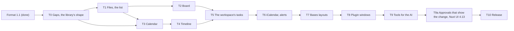

# Tasks Plan

S4 and S5 of the Sample Plugins Plan (`plans/Sample Plugins Plan.md`), given by the user on 18 Nov as one plugin: Tasks.
It opens `.task` files, written in the user's Tasks format (`@type32/tasks`, `../tasks`: one format for todos, calendar
events and timelines), and shows them as a list of reminders, a board, a calendar and a timeline. It replaces the
board first planned as S4 (a file type, a viewer that loads text, a link extractor) and the Bases calendar of S5
(`requires`, a core plugin's API): its calendar and timeline are also Bases layouts.

Four things are written, in four places:

| What | Where | Whose |
| --- | --- | --- |
| The plugin, `tasks` | `../vertex-plugin-tasks`, `CTRL-Neo-Studios/vertex-plugin-tasks` | A community plugin, written and released as the other samples are. |
| The views' components: list, board, calendar, timeline, and the task editor | `../tasks-ui-components` (the user's folder, empty on 18 Nov) | A library of its own, subsidiary to `@type32/tasks`: Vue components drawn with Nuxt UI, for Nuxt and for Vue (the user, 18 Nov). Written here; the user publishes it, as the SDK. |
| Format 1.1: views and `starred` | `../tasks` (`@type32/tasks`) | The user's library. Written here on 18 Nov (Format 1.1, below); the user publishes it. |
| What the contract lacks | Vertex | The Sample Plugins Plan's rule: a gap is closed in Vertex before the sample goes on. |

Each phase ends reviewable on its own: the plugin and the library building, type-checking and their tests passing;
Vertex's `typecheck`, tests, lint and Rust tests clean when Vertex changed; checked in `tauri dev`.

## What was read first (18 Nov)

- **The format** (`../tasks/SPEC.md`, `README.md`, 0.1.2 on npm): a document of `lists`, `fields` and `tasks`, as
  JSON, YAML or TOML. A task's kind comes from its times (`start` with `end` or `duration`: a span; `start` alone: a
  moment; no `start`: a todo, maybe with `due`). Everything that describes a task is in `values` by field id
  (`status`, `priority`, `tags`, `progress`, `location` built in; custom fields with options that map to fixed
  categories). Records are synced by `id` and `updatedAt`, deleted by `deletedAt`; every object keeps keys it doesn't
  define. A Markdown note can hold one task under `task:` in its frontmatter, its body the notes. The library gives
  `parse`, `stringify`, `validate`, `resolveFields`, `occurrences` (recurrence in a range), `completeTask`, `merge`,
  `toICS` and `fromICS`, `parseMarkdown` and `stringifyMarkdown`.
- **Its cost** (`../tasks/bench/baseline.json`, Node, 1,000 tasks): parse 2 ms (JSON) to 6 ms (YAML), validate 2 ms, a
  month of occurrences 9 ms, write 2 ms (JSON), 3 ms (TOML), 26 ms (YAML; 8.5 ms since Format 1.1). Nothing there asks for Rust, and a community
  plugin can't run any. The one thing that would be slow, finding the notes that are tasks among thousands, the index
  has done already: every note's frontmatter is in `properties`, so `properties.task` is read, not parsed.
- **The Nuxt UI calendar template** (`nuxt-ui-templates/calendar`, MIT): 13 components (month, week and day views,
  event blocks and chips, a draft, a form, a popover; 2,150 lines), composables for dragging, drafting and moving
  (1,700 lines) and layout maths. Its data is `useFetch` against a server, routes and `useState`: that part isn't
  taken. It uses `date-fns` and `@internationalized/date`, and `UPopover`, `UCalendar`, `UInputDate`, `UInputTime`,
  `UContextMenu`.
- **The contract**, against what the plugin needs. What's there: a file type with New, a viewer that loads and saves
  text, an embed, a link extractor, a panel view, commands, config, `ctx.data`, the index and its events, notes
  written as one undo step, `NoteEditor`, dialogs through `useOverlay`, Bases' `registerView`. What isn't: Gaps.

## Decisions

The user's, 18 Nov (the questions asked before this plan, and the answers to its first open questions), unless marked mine.

| Question | Decision |
| --- | --- |
| What holds tasks | `.task` files, and notes that are tasks (`task:` in frontmatter) across the workspace, in a workspace Tasks panel. |
| Views of a `.task` file | List (reminders, as the user's first screenshot), Board, Calendar, Timeline. No Table. |
| Timeline | A Gantt, as the third screenshot: an outline on the left (subtasks under their parent, duration, progress), bars on a day axis, dependency lines, today's line. |
| The text of a `.task` file | New files are YAML. JSON and TOML are read too, and a file is written back in the format it was found in. |
| A file's view settings | In the file, so they travel and sync with it. The format defines them (the user: if the library providing it is better, do it): `views`, records like lists, each with a `type` (`list`, `board`, `calendar`, `timeline`, `table`), `groupBy`, `sortBy`, `sortDescending`, `listIds`, `openOnly`, `scale`; `viewTasks()` filters and sorts. What only Vertex draws (a column's width) is an extra key on the view. Done in Format 1.1. |
| Bases | A last phase offers the Calendar and the Timeline as Bases layouts, a base's rows placed by date properties (S5's point: `requires`, `ctx.use('bases')`). |
| Extras | iCalendar import and export, and alerts when a task is due. Each needs an SDK addition (Gaps). |
| The components' home | All four views and the task editor are a standalone library in `../tasks-ui-components`, using Nuxt UI, for Nuxt and Vue (the user named the calendar and the timeline, then the list and the board). The plugin holds the file, the store, the panel, Vertex's menus and the Bases layouts. |
| The library's name (mine) | `@type32/tasks-ui-components`, as its folder. |
| How the library is built (mine) | Compiled ES modules with types; `vue`, `@nuxt/ui`, `@internationalized/date` and `@type32/tasks` are peers. Its templates import Nuxt UI's components by file (`@nuxt/ui/components/Button.vue`), so no consumer needs auto-imports or global registration. A `/nuxt` module only adds the package to `build.transpile` (a server render can't import `.vue` from `node_modules`) and its stylesheet. |
| How the library is styled (mine) | Tailwind utilities under its own prefix (`tk:`), compiled into one stylesheet the consumer imports. Colours, radii and fonts are Nuxt UI's CSS variables, so it follows the consumer's theme. No consumer Tailwind setup, and no clash with the consumer's own utilities: the reason Vertex's plugins carry `tw:`. |
| What the components take (mine) | The format's own objects: the document, the view, a time zone, a locale, a first day of the week, labels. They draw and report (`change` with a patch, `create`; the same for lists); they write nothing. The consumer applies a patch with the library's `applyPatch` (stamps `updatedAt`, removes keys set to `undefined`); a Bases layout turns the same patch into a property write. Completing is a patch too (`toggleDone`, the format's `completeTask`). |
| Dates in the components (mine) | `@internationalized/date` (what Nuxt UI's date inputs take) and `Intl`. No `date-fns`. Recurrence and what a task's times mean come from `@type32/tasks`. |
| What's taken from the template (mine) | Its views, layout maths and drag behaviour, ported to the format's tasks and the library's prefix; its licence notice kept. Not its data layer, routes or sidebar. |
| Editing a task (mine) | One editor, the library's: title, notes, Do (`start`), Due, repeat, list, status, priority, tags, star, the document's custom fields. Inline in the list (the screenshot's card), a popover elsewhere. Notes are a slot, a textarea by default; the plugin draws them with a read-only `NoteEditor`, editable once clicked (as a canvas card), so the title keeps the focus (an editable `NoteEditor` takes it when drawn). |
| The screenshot's flags | The flame is priority (mine). The star is a task key, `starred` (the user: a task property), in Format 1.1. |
| Saving (mine) | The document is parsed once and kept; an edit changes it in memory and the file is written after a pause (`stringify`, which validates). A file that doesn't validate shows its problems by path, and isn't written over. |
| A file changed outside while open (mine, changed in T1) | The tab's rule, as for every text viewer: it reloads the text only while nothing is unsaved, and the viewer reads it again. The `merge` first planned had nothing to do: the tab never hands over outside text while edits wait. |
| Deleting (mine) | `deletedAt`, as the format says. Deleted records are hidden. |
| Alerts (mine) | While Vertex is open on the workspace: a system notification at a task's due time. Vertex can't schedule one for when it's closed. |
| Size (mine) | Measured in T0, not assumed. The plugin bundles `@type32/tasks` (with zod, a Temporal polyfill, `js-yaml`, `smol-toml`: 259 KB minified, 82 KB gzipped, measured 18 Nov) and the components; one `main.js`, as every plugin. |
| A plugin's window (the user, after T6) | It reaches the plugin and nothing else: no workspace, no index, no files. What it wants done to the workspace it asks its plugin, which does it through the SDK's API in the session window. (Was Open question 4.) |
| Where plugins' AI tools show (the user, after T6) | In chats only for now. The inline assistant's and workflows' tools, and plugins' own workflow widgets, are for later. (Was Open question 5.) |



## Format 1.1

Done before T0 (18 Nov), in `../tasks`; the user published it as `@type32/tasks` 0.2.0. The answers to the plan's
first open questions, 2 to 4.

### As built
- **Views** (`views`, SPEC "View"): synced records, merged like lists. `groupBy` is `listId`, `starred` or
  `values.<field id>` of a select, multiSelect or boolean field; `sortBy` a time, `title`, `starred` or
  `values.<field id>` of anything but a multiSelect; both checked by `validate` (`viewKeyError`), and `merge` drops one
  that a field's change of type broke (a repair, as values have). `type` and `scale` are open strings: a view an app
  can't draw is skipped and kept, never an error that makes the document unreadable. Sorting is the spec's, so apps
  agree: times as written (a date before the times on its day), selects by option order, missing values last, ties
  in document order. `viewTasks(doc, view, fields)` does it; grouping is the drawing's.
- **`starred`**, a task key, not a built-in field: a 1.0 reader rejects a `values` key it has no field for, and keeps
  a task key it doesn't know. Both additions read in 1.0 readers as unknown keys.
- **The YAML writer is `js-yaml`'s** (the user preferred it; `yaml` was there for 1.1-safe quoting). Its `dump` with
  double quotes writes the same text: every test passed unchanged, including the ones reading the output with a
  YAML 1.1 parser, and 54 strings a reader could take for another type or for syntax (`yes`, `0o17`, `12:30`,
  `2026-11-12`, `- a`, `#c`…) read back the same in YAML 1.1, 1.2 core and `js-yaml`. Writing 1,000 tasks: 22.1 ms
  to 8.3 ms. `yaml` is a dev dependency now (the tests); the bundle went from 294 to 259 KB minified (94 to 82 KB
  gzipped), measured twice.
- Tests: 304 (were 283): view rules, the merge repair, `viewTasks`, conformance cases for views and `starred`.
  `bun run check` passes. `bench/baseline.json` rerun.

## Gaps

Found by reading, before anything is written. T0 closed the first two (checked: a `CalendarDateTime` of another copy
of the package is not one to Reka's `isCalendarDateTime`, of Vertex's copy it is); T6 closed the next two. The last
two were asked for by the user after T6 and read then; T8 and T9 close them.

| What's missing | Who needs it | Today |
| --- | --- | --- |
| `@internationalized/date` as a shared module | Any plugin with a date or time input | Closed in T0. Nuxt UI's inputs (Reka's `isCalendarDateTime`, `isZonedDateTime`) test values with `instanceof`; a plugin that bundled its own copy handed them objects of another class, and `UInputDate` took a date-time for a date. |
| Nuxt UI's components by import | A plugin that uses a component library built on Nuxt UI | Closed in T0. The preset refused every `@nuxt/ui` import but `/composables`: components were the host's, by name only. |
| Reading and writing a file picked in a dialog | Import and export (iCalendar) | `ctx.dialogs.open` and `save` return a path that "is this window's to read or write", and a community plugin has nothing to do either with: the core plugins that export (Canvas, Bases) import Tauri's fs. |
| Notifications | Alerts | Nothing in the contract. The kernel has the permission and the Tauri plugin. |
| A window of a plugin's own | A plugin with something to keep in view beside the workspace (Tasks' list, a timer, a preview) | Nothing in the contract: `ctx.window` says the kind and the label of the window the plugin runs in, `ctx.settings.open` opens Settings, and that's all. Only the kernel makes windows (`window_open` in `windows.rs`: a session's, Settings, About), and since the Window Permissions Plan no webview may create one (a label carries its grant). A manifest's `windows` says which of Vertex's kinds the plugin runs in, not windows of its own. |
| Tools for the AI | A plugin whose data a chat should read or change (tasks, a base, a board) | `ctx.use('ai')` gives models and Features (`resolveFeature`, `registerFeature`); a plugin can call a model, not be called by one. Chat's tools are a fixed set (`layers/chat/app/lib/tools.ts`, `chatTools`), and `ctx.use('chat')` has one member, `chatsInWorkspace`. |

Not gaps, checked: `ctx.use('bases')` is typed for a community plugin (Bases is core); a viewer gets its file's text
and saves it; `session.files.edit` writes notes as one undo step; a plugin's dialog draws since the Navigator Plan.

## T0: Gaps and the library's shape

The risky part first: a component library on Nuxt UI inside a plugin. Nothing of the plugin's features yet.

### Change
- **Vertex:** `@internationalized/date` in `SHARED_PACKAGES`. The preset maps an import of a Nuxt UI component's file
  to the host's component of that name, and still refuses the rest of `@nuxt/ui`; a test in the SDK.
- **The library:** its repository, build (ES modules, types, the prefixed stylesheet), the `/nuxt` module, and one
  component that exercises what the real ones will: a button in a tooltip, a popover holding `UInputDate` and
  `UInputTime`, a class of each kind (a colour, a spacing, a variant).
- **Three consumers of that component:** a Vue app with `@nuxt/ui/vite`, a Nuxt app rendered on the server, and a
  Vertex plugin (`vertex-plugin-tasks`' first commit), each drawing it styled, light and dark.
- **Measured:** the plugin's `main.js` with `@type32/tasks` and the library in it, and what loading it costs a window.

### Acceptance
- [x] The component draws and works in the three consumers: the tooltip, the popover, a date and a time picked, the
  theme's primary colour followed.
- [x] In the plugin, a `CalendarDateTime` made by the plugin is taken as one by `UInputDate` (it shows its time).
- [x] The sizes and the load time, in this plan; a decision on splitting if they ask for one.

### As built
- **Vertex** (uncommitted, for the user): `@internationalized/date` in `SHARED_PACKAGES` (`shared/plugin/modules.ts`),
  the host's copy in `MODULES` (`app/utils/plugins/community.ts`), a dependency of the app and of the SDK (its
  versions test pins it). An import of a Nuxt UI component's file becomes the host's component: the SDK's build writes
  `nuxt-ui-components.json` (public path → name, from the list it already types components by), the preset maps each
  such import to `__vertexModules['@nuxt/ui/components']('UButton')` (`NUXT_UI_COMPONENT`: the host puts
  `app.component` there). A call with the name as a string, because a minified plugin turns `["UButton"]` into
  `.UButton` and the host preloads the components it finds named in quotes (`namedIn`). SDK tests: 8 (one new: the
  import gives the host's component and its name survives minifying, built minified). Docs: `package.md`, `ui.md`
  (a component library inside a plugin, `shallowRef` for dates), `versions.md` (1.4.0), Concepts and Structures,
  SMOKE 134. Vertex's typecheck at the 7 baseline errors, 391 tests, lint clean.
- **The library** (`../tasks-ui-components`, uncommitted, `git init` only, for the user to publish): `TaskProbe`.
  Code by Vite's library mode (`dist/index.js`, `dist/nuxt.js`; `vue`, `@nuxt/ui`, `@internationalized/date`,
  `@type32/tasks`, `@nuxt/kit` external), types by `vue-tsc`, the stylesheet by Tailwind's CLI (Vite's library mode
  won't take a CSS entry, and a CSS import in the code would reach the declarations). `style.css` declares Tailwind's
  layer order first, so loaded before the consumer's sheet it can't move `utilities` ahead of `base`; it sources
  `./components` explicitly, so a `.gitignore` changes nothing. The Nuxt module adds the sheet and transpiles the
  package; checked that it must: without it the production server answers 500 (`Unknown file extension ".vue"` for
  Nuxt UI's `Button.vue`). `README.md`, MIT `LICENSE` (holder "Type32", for the user to correct).
- **Consumers**, each from the packed library (`bun pm pack`, as npm would ship it): a Vue app (`@nuxt/ui/vite`),
  dev and production build; a Nuxt app, dev and production server (the probe's value in the server's HTML, no
  hydration warning); Vertex (`tauri dev`, the plugin installed from its `dist/`, by a temporary script). In all
  three: the tooltip, the popover, the date input with hour and minute segments, the value following the inputs, the
  library's `tk:px-6` beating Nuxt UI's own padding on `UButton` (24 px: its sheet loads after the app's), dark mode,
  and in Vertex an emerald theme followed.
- **The plugin** (`../vertex-plugin-tasks`, first commit, local): a `.task` viewer that parses the file
  (`@type32/tasks` 0.2.0 from npm, the user's release of Format 1.1) and draws the probe. The SDK and the library are
  `file:` dependencies until their releases. Found: `ref(new CalendarDateTime(…))` doesn't type-check (Vue's
  `UnwrapRef` drops the class's private fields); `shallowRef`, which a date (immutable) wants anyway.
- **Measured:** `main.js` 290 KB minified, 77 KB gzipped, almost all `@type32/tasks` (259 KB alone: zod, the
  Temporal polyfill, `js-yaml`, `smol-toml`); the library adds a few KB. Parsing and running it again in a window:
  15 to 25 ms (eight runs, dev build, light and dark runs alike). No split: a few frames, once per window that loads
  the plugin.

## T1: Files and the list

### Change
- `plugin.json` (`tasks`, "Tasks"); the `.task` file type with New (a YAML document with one list); a viewer that
  loads text.
- The store: the format sniffed (JSON, TOML, else YAML) and kept; `parse`, problems shown by path with the file left
  alone; edits in memory with `updatedAt`, `deletedAt` for deletes, unknown keys kept; the write after a pause; a
  file changed outside (Decisions).
- The view switcher over the file's `views` (a new file has a List and a Board), and the List, in the library:
  sections (Today, Upcoming, Anytime, Done; or `groupBy`), a row as the screenshot (the checkbox, the title, the
  list's dot, the star, the priority, Do and Due), the inline editor, a new task typed at the top, `completeTask` on
  the checkbox (a repeating task moves on), subtasks under their parent, lists in a side column.
- The task editor, in the library (Decisions). Settings: the first day of the week, the time zone shown (the
  system's by default).

### Acceptance
- [x] A new `.task` file opens, takes tasks and reopens with them; the file on disk validates against the library.
- [x] A JSON and a TOML document open and are written back as they were, an unknown key still there.
- [x] A file with an error says where, and isn't written over; fixed outside, it opens.
- [x] Completing a weekly task moves it to next week; completing its last occurrence marks it done.
- [x] 5,000 tasks: opening, typing in one and scrolling the list without a pause over 200 ms.

### As built
- **The library** (`../tasks-ui-components`, uncommitted): `TaskList` (a new task typed at the top, the rows of
  `taskRows`, one open for editing, the lists column, which hides itself under 42rem), `TaskRow`, `TaskEditor`,
  `DatePicker` (a calendar, a time for Due), `FieldInput` (a field's value by its type). The rows are pure
  (`rows.ts`): the format's `viewTasks`, then sections (Today with overdue, Upcoming, Anytime, Done with cancelled;
  Today and Upcoming by day unless the view sorts; a zoned time on the viewer's day), or groups by `listId`,
  `starred`, a select's options in order then values outside them, a multiSelect's values (a task in each), a
  boolean; subtasks under a shown parent. Only the rows on screen are drawn (`@tanstack/vue-virtual`, measured
  heights). The edits are pure too (`changes.ts`): `toggleDone`, `withStart` (a span keeps its time and length),
  `withDue`, `withRepeat`, `withValue`; a change of the anchor's form drops what had the old form (`until`,
  `excludedDates`). Built-in fields' and options' titles are labels (translated), a document's own title for one wins.
  Labels: every string a component shows, English by default, a consumer's over them. 8 tests (vitest). `@tanstack/
  vue-virtual` a dependency, `@type32/tasks` a peer. T0's probe is gone.
- **The plugin** (`../vertex-plugin-tasks`, committed locally): the `.task` file type with New; `TaskViewer` (the
  document kept, each edit checked whole by `validate` and refused with the format's message when it would break the
  file, written 300 ms after the last one in the file's own format; the tab autosaves); `document.ts` (the format
  sniffed, a new file's document, `withRecord`); `ViewBar` (the file's views, Add view, a view's name, grouping,
  sorting, Hide done tasks, Delete view; a file without views shows a List, written once its options change; a view
  of a type not drawn yet says so); `TaskNotes`; settings: the first day of the week (`auto`: the language's, from
  `Intl.Locale`'s week info) and the time zone (empty or invalid: the system's). Strings in `en` and `zh-CN` (the
  components' under `ui.*`). 7 tests (`bun test`): the sniffing, a new file valid, JSON and TOML kept, a broken
  file's issue paths, `withRecord`, and `en.json` having every component string.
- **Checked** in `tauri dev`, by script (a temporary page script running code sent from the shell), devtools off: a
  new file written at once and reopened with its tasks; tasks typed; an editor opened (the title focused), a Due
  picked on the calendar, notes written in the `NoteEditor` with a `[[link]]`, a list added and a task filed there,
  the view grouped by status (written to the file); JSON and TOML files completed and still JSON and TOML with `x-app`;
  the broken file's `tasks.0.title` shown, the file untouched, fixed outside and shown; the weekly task to Nov 25,
  then done with `count` used up. Every file written validates: `stringify` validates before it writes.
- **Measured** (5,000 tasks, 740 KB of YAML, dev build): a first open 79 and 89 ms (two copies of the file), the
  longest frame after it 19 to 27 ms; a keystroke in a title 33 to 38 ms to the second frame after it (two frames);
  the write after the pause one 55 to 57 ms frame (twice); scrolling the whole list 600 px a frame, median 17 ms,
  worst 101 and 90 ms (two runs), 34 rows drawn. `main.js` 406 KB minified, 107 KB gzipped (T0's 290 KB used
  `parse` alone: the writer, `validate` and the rest of the format arrived with the edits).
- **Found, in Vertex:**
  - The SDK's `modules.json` listed Vue's exports from its types, which leave out what Vue's compiler imports:
    `mergeModels` (a component with `defineModel` beside `defineProps`) failed the plugin's build ("not exported by
    vertex-shared:vue"). Closed: the build adds the runtime's own names for `vue` (174, were 164). `versions.md`
    (1.4.0), Concepts and Structures.
  - A workspace opened by a path through a symlink (`/tmp/tk-ws`, which is `/private/tmp/tk-ws`) gets every outside
    change wrong: the watcher reports the real path, which the index doesn't have, so a changed file is added again
    (a second `new.task` in Files), a reload never reaches its tab, and the session stores paths cut at the wrong
    place (`mp/tk-ws/new2.task`). Not closed: Watcher Plan territory. Whether the Open dialog ever hands over such a
    path (a folder reached through a link) isn't checked. Open questions, 2.

## T2: Board

### Change
- The library's `TaskBoard`: columns by the view's `groupBy` (status, any select or boolean field, list); a column
  an option, its colour; cards dragged between columns (the value written) and within one; a card as the list's row;
  new task in a column.
- Statuses added and renamed from the board (options on the built-in field, each with its category).

### Acceptance
- [x] A card dragged to Done has `status: done` in the file, and shows done in the List.
- [x] A custom status added on the board is an option under `fields` with its category, and another reader of the
  format (the library's `statusOf`) reads the task's meaning.

### As built
- **The library** (uncommitted): `TaskBoard`, `BoardColumn` (header, cards drawn only while on screen, New task at the
  foot, the drop's place), `TaskCard` (the row's checkbox and description, `TaskCheck` and `TaskMeta`, now shared
  with `TaskRow`; its editor in a popover). Columns are `taskGroups`, the list's grouping made public: every group,
  empty or not, a deleted list or option only while a task has it; `NONE` hidden while empty. A board without
  `groupBy` is by status (`boardGroupBy`). `board.ts`, pure: `moveToGroup` (into a done status, `completeTask` with
  the dropped option kept, a repeating task moved on as the checkbox does; out of done, `completedAt` removed; a
  multiSelect swaps the column's value; None clears), `moveTask` (order within a column: the document's, which the
  format doesn't sync, so no `updatedAt`), `withOption` (a built-in field gets an entry for a renamed option),
  `optionId` (from the title: `waiting-on-client`, `进行中`). Dragging is HTML's (Vertex's windows have
  `dragDropEnabled: false`, as Bases' kanban relies on). While the view sorts, cards keep its order and only change
  column. 15 tests (7 new). The palette is shared with the list (`PALETTE`).
- **The plugin** (committed locally): the viewer draws a view by its type (`list`, `board`), applying `move`,
  `changeOption` and `createOption` too; a board's Group by offers no Date. Strings for Add column, its name, Means,
  Cancel.
- **Checked** in `tauri dev` by script (drags as `DragEvent`s with a `DataTransfer`): a card to Done (`status: done`,
  `completedAt`; in the List's Done); a column Shipped added as done (`fields: [{id: status, options: [{id: shipped,
  category: done, …}]}]`), a card dropped there (`statusOf` of the file read by Node: `done`); a card dropped above
  another in a column (written before it); To do renamed Backlog (an option `todo` with a title; no Delete offered
  for a built-in status). Not checked: a card's editor in its popover.
- **Measured** (5,000 tasks, three statuses, dev build): opening the board 110 ms, the longest frame after it 20 ms,
  16 cards drawn a column; a drag between columns 46 ms to the frame after it; scrolling a column of 1,667 cards
  median 17 ms, worst 25 ms. `main.js` 424 KB minified, 111 KB gzipped.

## T3: Calendar

In the library, then in the plugin.

### Change
- **Library:** `TaskCalendar`: month, week and day, after the template. Spans as blocks and chips, moments and dues as
  markers, all-day and multi-day rows, repeating tasks through `occurrences`, time zones (the viewer's zone decides
  the day), a line for now, a mini month. A drag on empty time drafts a task; a drag on a task moves it, on its edge
  resizes it. It reports; it writes nothing.
- **Plugin:** the Calendar view: lists shown and hidden by their colour, the report applied to the document, the
  editor on open, a move of one occurrence of a repeating task asking "this one or all" (this one: `excludedDates`
  and a new task).

### Acceptance
- [x] A weekly meeting in `Europe/Berlin` shows at the right hour in another zone, across a change of clocks.
- [x] A task dragged to another day, and one stretched, have the new times in the file, in the form they had (a date
  stays a date).
- [x] The library's tests: laying out overlapping spans, a month's weeks, an all-day span over a week's end.
- [x] A month of 1,000 tasks draws and drags without a pause over 200 ms.

### As built
- **The library** (uncommitted): `calendar.ts`, pure: `calendarItems` (each occurrence of the view's tasks in the
  viewer's days: a span, a moment at its start, a todo at its due; a time in a task's zone moved to the viewer's, a
  date as it is; a timed span past midnight drawn across days), `layoutDay` and `layoutLanes` (the template's cluster
  and lane packing, rewritten on the format's items, minutes and days rather than `Date`s), `monthWeeks`,
  `weekStart`, `shiftTask` (moves start, end, due and the series' exclusions; stretches an end, or a duration as a
  duration, never before the start; a date by days alone), `detachOccurrence`, `draftTask`. `drag.ts`: the pointer
  gestures (a click opens, a drag past 5 px moves or stretches, by the day under the pointer and, in hours, minutes
  snapped to 15; a drag on empty hours draws). `TaskCalendar` (the toolbar, the small month and the lists beside it,
  one editor in a popover anchored to what was clicked, a drawn task opened at once), `CalendarMonth` (six weeks,
  lanes as many as a row has room for, "+N" opening the day), `CalendarWeek` (week and day: dates, a row of what's
  all day, hours with packed blocks, a line at now, opening at 7). Nothing from the template's data layer or
  `date-fns`; its licence named where its packing is. 23 tests (8 new: the Berlin meeting in New York across both
  changes of clocks, the kinds, overlapping spans, a month's weeks, a span over a week's end, the drags' edits, an
  occurrence detached, a drawn task).
- **The plugin** (committed locally): the Calendar view type (Add view offers it), `OccurrenceModal` (Only this one,
  All of them, Cancel; this one: `excludedDates` on the series and a task of its own, in one write), the calendar's
  scale and lists written to its view. Strings in `en` and `zh-CN`.
- **Checked** in `tauri dev` by script (pointer events at the elements' places), the time zone set to
  `America/New_York`: the Berlin standup at 4:00, 5:00 and 4:00 in the weeks of Oct 19, Oct 26 and Nov 2; a date span
  dragged two days in the month (`2026-11-22` to `2026-11-24`, still dates); a timed span stretched half an hour and
  dragged a day and an hour on (`15:00` to `16:30` the next day); one occurrence of the standup dragged a day, Only
  this one (`excludedDates: [2026-11-16T10:00]`, a new task on the 17th in Berlin's zone); a click opening the
  editor, its title focused; Work switched off (`listIds: [home]`) and on again (no `listIds`). Not checked: a task
  drawn on empty hours or by a double click (`draftTask` has its test), the day view, a moment or a due dragged.
- **Measured** (1,000 tasks in a month, dev build): opening it 81 ms, the longest frame after it 18 ms, 90 items
  drawn (the rest counted); a drag across two days, its worst frame 29 ms. `main.js` 456 KB minified, 119 KB gzipped.
- **Noticed:** a list switched off hides the tasks without a list too, the format's rule for `listIds`. A "No list"
  switch would need the format to say how a view shows tasks without one (Open questions, 3).
- **Fixed after the user's report** (a screenshot: the dates over the week stood wider than the hours' columns under
  them, and "10:00 AM" wrapped in the hours' margin): the dates and the all-day row were rows of their own above the
  hours' scroller, so a shown scrollbar (macOS's "always") narrowed only the hours. They're now stuck to the top
  inside the one scroller (`sticky`), as wide as the hours whatever the scrollbar; the margin is 4.5rem and its
  labels don't wrap. Measured with a 17 px scrollbar: each date's left and right edges at the same pixel as its
  column's, the labels one line (17 px) high.

## T4: Timeline

### Change
- **Library:** `TaskTimeline`: the outline (title, duration, progress; subtasks under their parent, folding), bars for
  spans, a diamond for a moment, a due as a mark, dependency lines from `dependsOn`, today's line, a day, week and
  month scale, both sides scrolling together. A bar dragged or stretched reports its new times; a line drawn from one
  bar to another reports a dependency.
- **Plugin:** the Timeline view: the reports applied; a dependency that would make a loop refused with the format's
  own message; the bar's menu (Edit, Duplicate, Delete, its list as colour).

### Acceptance
- [x] The third screenshot's structure from a document: groups, their subtasks, durations, progress, bars.
- [x] A dependency drawn is in `dependsOn`; one that would loop isn't written.
- [x] 2,000 bars scroll both ways without a pause over 200 ms (rows drawn as they're scrolled to).

### As built
- **The library** (uncommitted): `timeline.ts`, pure: `timelineAxis` (a month before the earliest time and today, to
  two months after the latest), `timelineRows` (the view's tasks depth first, subtasks under their parent, a folded
  one's left out; each occurrence in the axis from `calendarItems`, in days from the axis' start: a span's start and
  end, a moment and a todo's due as points, a date's at its middle; a span's own due as a mark; a parent without times
  of its own covers its subtasks', its progress theirs weighted by length; `progress` is `values.progress`, 100 for a
  completed task), `timelineTicks` (days or weeks under months, months under years), `linkPath` (finish to start,
  around through the gap between rows when the next starts first), `DAY_WIDTH` (day 40, week 16, month 4 px).
  `TaskTimeline.vue`: one scroller, the outline `sticky` at the left and the header at the top (as the week's fix in
  T3), so both sides scroll together with no syncing; rows virtual (`@tanstack/vue-virtual`), lines only for rows
  drawn. A drag moves a bar by days (`shiftTask`, so a repeating task's series moves whole, its exclusions with it), its
  end stretches it; a click opens the editor; a drag from the dot after a bar to a row adds the bar's task to that
  row's `dependsOn` (`change`). Scale in the view's `scale`; Today, and each new scale, scroll to today.
  `followPointer` taken out of the calendar's drag, for both. Labels edit, duplicate, list, duration,
  removeDependency; lengths are `Intl` units (`5d`, `2.5h`), so not labels. 6 tests (29 in all).
- **The menu is the library's, not the plugin's** (the Change said the plugin's): Edit, Duplicate, List (each with its
  colour), Remove dependency on (each it waits for), Delete; on a right click on a bar or an outline row
  (`UContextMenu`). Nothing in it is Vertex's, so other apps get it too.
- **The plugin:** `timeline` in the views drawn and in Add view (`i-lucide-chart-gantt`); its strings (en, zh-CN). A
  loop needs nothing of its own: every edit is validated whole (`commit`), so it's refused with the format's message
  (`tasks.1.dependsOn: "interviews" is part of a dependsOn cycle`).
- **Checked** in `tauri dev` by script on a plan of three parents, their subtasks, progress and four dependencies: the
  outline (Research 12d 74%, Design 19d 14% from 30% of 9 days, Build 15.6d), bars, a moment, a due mark, a todo's
  flag, the lines (one around); Wireframes dragged two days (`2026-11-18`–`2026-11-26`); Visual design stretched three
  (`end: 2026-12-07`); Survey's dot dragged to Wireframes (`dependsOn: [interviews, survey]`); Launch's dot to
  Interviews refused, the file's bytes the same; Duplicate, List → Home, Edit (its title focused) from the menu;
  Research folded. Not checked: Remove dependency on, Delete from the menu, a drag at the month scale.
- **Measured** (2,100 rows, 2,000 bars, 1,300 lines; dev build): opening it 97–143 ms; scrolling 80 frames down, right,
  up, left and diagonally, the worst frame 18–82 ms; the day scale 75 ms to switch, 43 ms at worst scrolled; 32–46
  rows drawn. `main.js` 479 KB minified, 124 KB gzipped (23 KB more).
- **Fixed on the way:** a closed task's row faded its outline too, so lines showed through its background (the fade
  is the bars' now); the month's name in the header was clipped by its cell (a `sticky` label needs no clipping
  ancestor); a time on the axis' first day would have come out `NaN` (`CalendarDateTime.compare` with a
  `CalendarDate`; found by the type check, the day is taken first now).
- **Not done:** a new task from the timeline (the other views make them); the order of rows (the file's, as
  `viewTasks` sorts); a column's width.

## T5: The workspace's tasks

### Change
- **Notes that are tasks:** read from the index (`properties.task`), validated together with the `.task` files'
  documents where they refer to each other; an edit writes the note's frontmatter (`stringifyMarkdown`, one step of
  Files' undo), its body untouched.
- **The Tasks panel:** Today, Upcoming and Overdue across every `.task` file and task note of the workspace; a task
  opens its file at that task, or its note.
- **In notes:** `![[x.task]]` draws the file's first view (an embed); the links in tasks' notes are the index's (a link
  extractor, so backlinks and renames see them); a note's menu: Make this note a task.

### Acceptance
- [x] A note with `task:` shows in the panel and on a `.task` file's calendar set to show the workspace's; checked
  off there, its frontmatter has the new status, its body the same bytes.
- [x] Renaming a note a task's notes link to updates the link in the `.task` file.
- [x] A workspace of 12,000 notes, 500 of them tasks: the panel opens without a pause over 200 ms.

### As built
- **No Vertex change.** Everything is the plugin's (local commit), and one addition to the library: `TaskList`
  exposes `open(id)` (the task's editor open, its row scrolled to, the lists column back to All tasks).
- **The workspace's tasks** (`workspace.ts`, one store per session, living as long as it): notes from
  `index.files()` whose `properties.task` is an object, each checked once per version of the note (the index makes a
  new object when it reads a note again, so a `WeakMap` keys the check); `.task` files read with `vault().read` when
  their `modifiedTime` changes, parsed, a broken one with no tasks. An edit is written to the file holding the task as
  one step of Files' undo (`session.files.edit`, which reloads open tabs): a `.task` file parsed, `withRecord`,
  `stringify` (so validated whole); a note's `task:` with `applyPatch`, checked, then `setFrontmatterProperty`
  (Vertex's Obsidian writer, Bases' and workflows'), the body sliced off untouched.
- **"Validated together with the `.task` files' documents" didn't hold up:** a note can't name the document its
  `listId`, `parentId` or `dependsOn` would point into (the format has no key for it). A note's task is checked as
  the format checks a task file alone (`checkNoteTask`: shape, times, values against the built-in fields) with those
  three kept and not checked; one that fails isn't listed.
- **The panel** (`TasksPanel.vue`, right sidebar by default, workspaces only): open tasks with a Do or Due, Overdue
  (`isOverdue`), Today (by today) and Upcoming, by day; a native checkbox (`toggleDone`, written to the task's file);
  the title opens the note, or the `.task` file at that task (`focusRequest`: the file's viewer switches to its first
  List and calls `open`).
- **A calendar showing the workspace's tasks:** a view key of Vertex's, `workspaceTasks: true` (a switch in a
  calendar's options). The other files' tasks are drawn under keys of their own (the file's uuid and the task's id,
  so ids can't clash), their edits routed to their files; the editor's notes are a link to the file instead (a note's
  body isn't written from there). Another file's repeating task moves whole, without asking (one time of it would
  have to become a task in that file).
- **The file's document and its views** moved out of `TaskViewer` into `TaskFile.vue`, drawn by the viewer (with the
  views' bar) and by the embed (the first view alone).
- **The embed** (`![[x.task]]`, 24rem high, a canvas card's box): the text read with `vault().read` when the file
  changes, each edit written with `files.edit`.
- **Links:** a link extractor for `.task` (`links.ts`): the targets in live tasks' notes; a rename rewrites them,
  stamps the tasks it changed, and writes the file back in its own format. A note task's notes are its body, the
  index's already.
- **Make this note a task** in Files' menu for one `.md` without a `task:`: `{id, title: the note's name,
  updatedAt}`.
- **Checked** in `tauri dev` by script: the panel (Overdue Call the printer, Today Ship invoice from `Invoice.md`,
  Upcoming two); `Invoice.md` on the plan's calendar, its editor showing Open in Invoice.md; More → Status → Done there
  wrote `status: done` and a new `updatedAt`, the body's bytes the same (trailing spaces included), and the panel
  dropped it; the panel's checkbox completed a `.task` task (`completedAt`, `done`); a panel title opened the file's
  List with that task's editor, its title focused; Forelinks of `plan.task` listed `Brief.md`; renaming `Brief.md`
  to `Brief 2.md` asked Update links naming `plan.task`, and the notes read `[[Brief 2]]`; `![[plan.task]]` drew its
  List in the note and its checkbox wrote the file; Make this note a task wrote `task:` (a blank line put between the
  new frontmatter and the body: `setFrontmatterProperty`'s layout) and left the menu item off after. Not checked:
  typing in the embed (keys inside a note's editor), undo of these edits, the panel's checkbox since it became a
  native one (below).
- **Measured** (12,000 notes, 500 of them tasks, dev build): the main thread blocked 87 ms the first time the panel
  opened (the store made: 500 notes checked, 500 rows drawn), 45–53 ms after; how long until painted wasn't measured
  (the window was behind another app and animation frames stopped coming, [INFERENCE] WebKit throttling a hidden
  window). It was 113–151 ms with Nuxt UI's checkbox on each row; a native one took it to the numbers above.
- **Noticed:** Vertex's frontmatter writer turns flow lists into block lists (`aliases: [invoice]` became a list of
  lines), as for Bases' writes; the values are the same. A workspace by a symlinked path is still Open question 2.

## T6: iCalendar, alerts and commands

### Change
- **Vertex:** the text of a file picked with `ctx.dialogs.open` read, and text written to one picked with `save`
  (`ctx.dialogs.readText`, `writeText`: only what this plugin picked). `ctx.notifications.send({title, body})`,
  behind a new permission, `notifications`, which the install dialog names: the kernel grants the notification
  plugin to a window only while a plugin asking for it is on there (it's every window's today, though Vertex sends
  none). Docs, tests, the SDK's next minor.
- **Plugin:** Import… (`fromICS`, what was dropped listed) and Export… (`toICS`) on a `.task` file. Alerts: at a
  task's due time while a window has the workspace open; each once (remembered in `ctx.data.global`); a setting.
- **Commands** (the user, after T5: "Go in T6"), in the palette, Import and Export also in the menu bar's File:
  Show Tasks panel; New task… (a title, into the `.task` file a setting names, `Inbox.task` by default, made when
  missing); the workspace's open tasks as a palette group (overdue and due first; one picked opens as the panel
  opens it); Import from iCalendar… and Export to iCalendar… while a `.task` file is shown; Make this note a task
  for the shown note.

### Acceptance
- [x] A calendar exported from another app imports, with what couldn't be listed; exported again, another app opens it.
- [x] A plugin without the permission can't notify; with it, a task due in a minute notifies once, not again after a
  relaunch.
- [x] Each command does what it says from the palette; a task found by its title in the palette opens.

### As built
- **Vertex** (uncommitted): `ctx.dialogs.readText` and `writeText` (`pluginDialogs`, `app/utils/plugins/services.ts`):
  each plugin's services remember the files its Open dialogs picked (not folders) and the paths its Save dialogs did,
  and refuse any other path, before Rust's scope would refuse one outside the window's reach. `ctx.notifications.send`
  (`pluginNotifications`): refused without the permission; the OS's permission asked the first time, `false` if denied.
  The services now take the manifest (`HostOptions.services(manifest, own)`). The permission `notifications`
  (`permissions.json`: `notification:default`), so a window holds the notification plugin only while a plugin asking
  for it is on there; `notification:default` left `SHARED` (`grants.rs`). The main window's launch-time
  `requestPermission` went with it: Vertex sends no notification of its own, and that window can't call the plugin
  now. Install and trust dialogs name it ("notifications", "通知"). Docs: `context.md` (Dialogs, Notifications),
  `config.md` and `package.md` (the permission), `versions.md` (1.4.0, moved to 1.5.0 in T7: the user had published
  1.4.0 before these), Concepts and Structures. Tests: services 4
  (2 new: picks only, the permission), the grant table's names; Vertex's 393, typecheck at its 7, lint clean, the
  SDK's 8.
- **Plugin:** `permissions: ["notifications"]`; settings `inbox` (a path, `Inbox.task`, a workspace's to change) and
  `alerts` (on). `commands.ts`: Show Tasks panel; New task… (`TasksOverlay.vue`: a modal for the title, `addTask`
  into the inbox's first list, the file made with `files.create` when missing, a toast with Open); Make this note a
  task (the shown note); Import from iCalendar… (`fromICS`, then `merge` into the shown file: a calendar imported again
  updates its events by UID) and Export to iCalendar… (`toICS`), both also in the menu bar's File, enabled while a
  `.task` file is shown; the workspace's open tasks as a palette group (dated first, by day; Overdue said). The
  overlay (`ctx.views.overlay`) draws what commands ask for (`prompts.ts`): they run outside any component. Alerts
  (`alerts.ts`, `due.ts`): every 30 s while a session window has the workspace, open tasks with a due time (a date
  has none to alert at; a repeating task's occurrence around now), up to 10 minutes late, in the task's zone (a
  floating one the viewer's); what's sent is written to the plugin's global data before it's sent (two days kept), so
  another window or a relaunch doesn't send it again. The timers stop with the session's scope (`onScopeDispose`
  inside `onSession`). 2 tests (12 in all).
- **Checked** in `tauri dev`: with Tasks off, the session window's `plugin:notification|is_permission_granted` and
  `notify` were refused ("not allowed", the permission named); with it on, allowed. A task due two minutes after
  launch, and one added outside due a minute later: each sent once, by the notification plugin's `Notification`
  (seen by a wrapper around it: "Send the invoice", "Due Nov 18 at 5:39 PM · plan.task"), both in the plugin's data;
  relaunched two minutes after the second was due, nothing sent in 45 s. Import from the palette, a Google-style
  calendar picked in the real Open panel (a `VTIMEZONE`, a weekly event in Berlin with an alarm, an all-day trip with
  an attendee, an event without a UID, a to-do): three tasks into `plan.task`, the modal listing `VEVENT #3: VEVENT
  without UID`. Export saved through the real Save panel; Mozilla's `ical.js` (Thunderbird's parser) read every
  component back, the weekly event recurring on the 16th and the 23rd. Show Tasks panel, New task… (`Inbox.task`
  made, the task in its Inbox list, the toast), the palette finding "Book hotel" by "Book hot" and opening it in its
  file's List with the editor, Make this note a task (off while a `.task` file is shown, on for the note). Not
  checked: the notification on screen (macOS's records are closed to scripts; the plugin's `Notification` was
  called, whether it reached the screen wasn't seen), the install dialog's new name, the settings' rows.
- **Noticed, in `@type32/tasks`:** `toICS` writes `TZID=Europe/Berlin` without a `VTIMEZONE`, which RFC 5545
  requires (apps that know IANA names read it, as `ical.js` did); and `fromICS` drops an event's `VALARM` and
  `ATTENDEE` without listing them. Yours to decide (the format's).

## T7: Bases layouts

### Change
- `requires: ["bases?"]`; with Bases on, two layouts registered (`ctx.whenPlugin('bases', …)`): Calendar and Timeline,
  the library's components over a base's rows. The layout's options: which property is the start, the end, the due.
- A row dragged writes its note's property (as Bases' own edits do); a click opens the note; an empty day makes a new
  item with that date.

### Acceptance
- [x] The layouts are offered in a `.base` file and in a ` ```base ` block; with Bases off, the plugin runs without them.
- [x] Changing a note's date moves it on the calendar without reopening the base; dragging it changes the note.

### As built
- **Vertex** (uncommitted): the SDK's types export the core plugins' API types by name (`scripts/build.ts`:
  `export type *` for each `app/api.ts`, which only augmented `PluginApis` before), so a layout's component can take
  `BaseViewProps`; nothing at run time. `context.md` (a layout's component and its `context`), `versions.md`. Found:
  the user published SDK 1.4.0 before T6, so T6's additions and this one are 1.5.0's (`versions.md` says so now);
  the plugin's release (T10) needs 1.5.0 and a `minAppVersion` to match. SDK checks: types, its 8 tests, lint.
- **The library** (uncommitted): `TaskCalendar` and `TaskTimeline` take `editor` (default on). Off, a click reports
  `open(id)` instead of opening the editor, a new task isn't opened, and the timeline has no menu and no dependency
  drawing: what a base's rows (notes, not tasks) can take.
- **The plugin:** `requires: ["bases?"]`; with Bases running (`ctx.whenPlugin`), two layouts, `tasks-calendar` and
  `tasks-timeline` ("Calendar (Tasks)", "Timeline (Tasks)": Bases may get a calendar of its own, and a base names
  its layout by type), each with three property options, Start, End and Due (unset: the notes' own `start`, `end`,
  `due`), 600 and 480 px high in a note. `BaseLayout.vue`: the shown rows as tasks (`baseRows.ts`, 3 tests: a
  note's property read as written in the index's frontmatter, a date or a date-time; a file's or a formula's date as
  Bases reads it; an end the format won't take with its start dropped; a row without a time left out), titled by the
  file. A drag writes the moved times to the note's properties (`setNoteProperties`: Vertex's frontmatter writer, one
  step of Files' undo, as Bases' own edits); a file's or a formula's time isn't written. A click opens the note; a
  task drawn on the calendar (or a double click) is Bases' New with Start set to that day. The scale is the base
  view's own option (`scale`, written with `commit`).
- **Checked** in `tauri dev` by script, on a base of three notes in `Projects/` (a two-day trip, a timed review, a
  report due): the calendar drew all three (the review in the 20th's overflow); Launch dragged from the 19th to the
  21st wrote `start: 2026-11-21`, `end: 2026-11-23` to its note; Review's note rewritten from outside moved it to
  the 26th with the base still open; a click on Report opened `Report.md`; a double click on the 27th opened Bases'
  New with `2026-11-27` (it made `Untitled.md`, as Bases' New does); Add view's Layout listed Calendar (Tasks) and
  Timeline (Tasks) after Bases' five; a ` ```base ` block in a note drew the timeline (four rows, no dependency
  dots); with Bases off, Tasks ran (its commands in the palette, no failure) and the block showed as code. Not
  checked: a drag in the week's hours, the timeline's drags in a base, Configure view's property pickers.
- **Fixed on the way:** the timeline's outline header wrapped "Progress" in a narrow embed (now one line).
- **Noticed:** Vertex's frontmatter writer turned the note's `tags: [work]` into a block list, as in T5.

## T8: Plugin windows

The design is mine, from the Window Permissions Plan's rules (Rust opens every window, a label carries its grant,
nothing is taken from what a webview says), with the user's rule on what the window reaches (Decisions).

### Change
- **Vertex, the manifest:** `ownWindows`, the windows a plugin may open: `[{id, width, height, minWidth?,
  minHeight?, resizable?}]`. Rust reads them from the manifest, so it can refuse an id the plugin never declared, and
  the install dialog can say "opens windows of its own".
- **Vertex, the kernel:** a fifth kind of window, `plugin`. `WindowRequest::Plugin {plugin, id}` from a session
  window where that plugin is on: label `plugin-<plugin>-<id>-<session>` (one per id and session; asked again, it
  comes forward), route `/plugin-window/<plugin>/<id>`. Its grant: the windows' shared base, the owning plugin's
  `permissions`, and nothing of a session's (no files, no kernel commands but the ones below). It closes with the
  session window that opened it.
- **Vertex, the contract:** `ctx.windows.define({id, title, component | mount})` (drawn in the window, in the
  plugin's error boundary, with the theme, the language and Vertex's title bar); `ctx.windows.open(id, {params?})` →
  a handle: `focus()`, `close()`, `closed` (a promise), `post(message)`, `on(fn)`; `ctx.windows.isOpen(id)`. The
  component gets `WindowProps`: `params`, `channel` (`post`, `on`: JSON to and from the plugin's instance in the
  opening window, and no other plugin's), and `window` (`setTitle`, `setSize`, `setAlwaysOnTop`, `close`).
- **No session in it.** Only the owning plugin runs there (kind `plugin`), `onSession` doesn't run, and there is no
  index: a webview can't share another's, and building one per window is a second scan of the workspace. What the
  window shows comes over its channel from the session window, which also does the work (writes, opening a tab).
- Docs (`context.md`, `package.md`, `ui.md`), the SDK's types, `versions.md`; tests: the request's plan (an unknown
  plugin, an undeclared id, a plugin that's off: refused), the kind's grant.
- **Plugin:** Open Tasks in a window (palette): the panel's Overdue, Today and Upcoming in a small window that can
  stay on top. The session window sends it the list as it changes; a tick or a click goes back, and is done there.

### Acceptance
- [x] The window opens from the command, drawn themed; asked again it comes forward; it closes with its session
  window.
- [x] From inside it, each refused: a file read, a session's kernel command, a window for an id the manifest lacks.
- [x] A task ticked in the window is done in its file; one added in the session window shows in the window.

### As built
- **The kernel** (uncommitted): `WindowKind::Plugin`; labels `plugin:{plugin}:{id}:{session uuid}` (`:` can't be in a
  plugin id, a window id or a uuid, so the label parses back: `plugin_window_parts`). `WindowRequest::Plugin {plugin,
  id, params}`; `window_open` now knows its caller (`Webview`), and `plan` refuses a caller that isn't a session
  window, a plugin that isn't on there, an id its manifest doesn't declare (`grants::own_window`), params that aren't
  an object or are over 16 KB. Route `/plugin-window/{plugin}/{id}?params=…&root=…` (the session's workspace, so the
  window loads that workspace's copy of the plugin; `workspace_of` reads a plugin window's session), the declared
  size and minimum, the manifest's `name` as its first title. Its grant: `SHARED`, then `window-message`,
  `settings-get`, `plugins-list`, `plugin-read` (no `exists`/`stat`); its plugin alone is on there, while on in the
  session window (`on_for`). `window_message`: a plugin window's message goes to its session window with the sender
  named from its label; a session window's to the window it names, its own only. `destroyed`: a session window's
  plugin windows go with it; a plugin window's going is told to its session window. The manifest's `ownWindows` and
  `name` read in Rust. Tests: the plan's rules (one new test, 8 cases); 43 kernel tests, every crate's pass; clippy as
  before (two old warnings).
- **The contract:** `ownWindows` in the manifest (validated: ids, sizes 100–4000, no unknown keys; one test);
  `ctx.windows.define/open/isOpen`; `WindowProps` (`params`, `channel`, `window`: `setTitle`, `setSize`,
  `setAlwaysOnTop`, `close`); `PluginWindowHandle` (`post`, `on`, `focus`, `close`, `closed`); `ctx.window.kind`
  may be `plugin`. The install dialog says a plugin opens windows of its own. Docs: `context.md` (Windows of its
  own), `package.md`, `versions.md` (1.5.0), Concepts and Structures.
- **The frontend:** `utils/plugins/windows.ts` (the session side's handles, the window side's props);
  `pages/plugin-window/[plugin]/[id].vue` (a bar to drag by with its title, the plugin's UI through `PluginMount`);
  `startPlugins` with kind `plugin` (the global settings, the owner alone, its requirements ignored, no following of
  on/off: the window goes with its session window); `initialize` skips sessions there; `app.vue` leaves the app menu to
  the other windows. Vertex's typecheck at its 7, 394 tests, lint clean; the SDK's 8.
- **The plugin:** `ownWindows: [{id: list, 360×560, at least 280×300}]`; Open Tasks in a window (palette, workspace
  windows): `TasksWindow.vue` draws the agenda the session window sends (`tasksWindow.ts`: on `ready` and on each
  change), a tick or a click goes back and is done there (`completeEntry`, `openTask`); a pin keeps it on top. The
  panel and the window draw the same list (`agenda.ts`, `AgendaList.vue`, taken out of the panel).
- **Checked** in `tauri dev` by script (a harness in each window, the plugin window's answering over events): the
  command opened `plugin:tasks:list:<session>`, drawn in the dark theme with its title bar and the agenda; asked again,
  still one window; from inside it `fs read_text_file` on a workspace note, `scan_directory_recursive`,
  `search_notes`, `data_get`, `sessions_list` and `window_open` were refused by the ACL ("not allowed on window
  plugin:tasks:list:…"), `settings_get` allowed; from the session window, a window for `board` (undeclared) and one
  for another plugin were refused (`"tasks" has no window "board" it may open here`). Ticking Draft the brief in the
  window wrote `done` and `completedAt` to `plan.task` and the window dropped it; a task given a Due in the session
  window's editor showed in the window's Today; a click in the window opened the task's editor in the session
  window; the pin set it always on top; closing the session window closed both (System Events listed only Vertex's
  start window after). Not checked: a workspace's own copy of a plugin in its window, `setSize`, a plugin with
  `network` calling out from its window.
- **Found:** the session windows weren't granted `window-message` at first (the session's post was refused): added
  to the session kind. **Noticed, not mine:** Vue's "inject() can only be used inside setup()" (twice) in a session
  window's console with Tasks off too.

## T9: Tools for the AI

### Change
- **Vertex:** `registerTool(def)` on the chat plugin's API (`ctx.use('chat')`, typed in the SDK as Bases' is):
  `{name, label, description, inputSchema, writes?, execute(input, {session, signal})}`. `inputSchema` is JSON
  Schema; `execute` returns JSON. The model sees it as `<plugin id>_<name>`; its card in the chat names the plugin.
  - Found through chat's tool search (`FIND_TOOLS`), as chat's own lesser tools are, so plugins' tools don't grow
    every prompt.
  - A tool with `writes` follows the chat's mode as chat's own do: refused in Read (`modeError`), and asked for
    approval in Suggest and Write (`needsApproval`; the user's call, after T9 was built Write-only). One without runs
    in every mode.
  - What it returns is cut at the size a note read is (`NOTE_READ_CHARS`); what it throws goes to the model as
    `{error}`. It's gone when its plugin stops.
- Docs (`context.md`, Other plugins), `versions.md`; tests: a registered tool in the set and in the search, the mode
  rule, the cut, removal.
- **Plugin:** `requires` gains `"chat?"`. Three tools over what T5 and T6 built (`workspaceTasks`, `addTask`):
  `tasks_list` (the workspace's open tasks; by text, by due range, by file), `tasks_add` (a title, Do, Due, notes;
  into the inbox file; `writes`), `tasks_update` (complete, reopen, retitle, move its dates; `writes`).

### Acceptance
- [x] In a chat, "what's due this week?" is answered from `.task` files and task notes by the plugin's tool, its
  card naming Tasks.
- [x] In Write mode, "add Call Ann tomorrow at 9" asks first, then the task is in the inbox file; in Read mode the
  tool refuses and nothing is written.
- [x] With Chat off the plugin runs without its tools; turned off, its tools are gone from the next reply after the
  restart Vertex offers (changed: see As built).

### As built
- **Vertex** (uncommitted): `ChatApi.registerTool(plugin, def)`, `plugin` being the caller's `ctx.plugin`: the API
  is one object for every plugin, so chat can't tell who calls it, and the card needs the plugin's name, so
  `ctx.plugin` gained `name` (the contract; docs, `versions.md` 1.5.0). `ChatToolDef` `{name, label, description,
  inputSchema, writes?, execute(input, {session, signal})}`, `input` typed `unknown` (the AI SDK doesn't check a JSON
  Schema). In `tools.ts`: `pluginTools` (by `<plugin id>_<name>`, a second of one name refused, a name outside
  `\w+` or past 64 characters refused), removed with the registering scope; `modesOf` (chat's `MODE_OF`, else Suggest
  and Write for a `writes` tool) behind `modeError`, `gated` and `rankTools`; `pluginTool` (description "Suggest and
  Write mode: …" and `needsApproval` in both for one that writes: its change is made at once, so each approved call
  is an accepted suggestion, never staged; the result through `JSON.stringify`, over `NOTE_READ_CHARS` as
  `{truncated, json}`; a throw as `{error}`; no session, a refusal); the system prompt names the plugins' tools by
  plugin. `NoteToolDeps.session` (the chat's). The card: "Tasks: List tasks" (`plugins.chat.tools.pluginTool`, en
  and zh-CN). Docs: `context.md` Other plugins (with an example), `versions.md`, Concepts and Structures. Tests: two
  in `tools.test.ts` (in the set, deferred, found first by the search, named in the prompt, the result as JSON and
  cut, gone when removed and when its scope stops; refused in Read naming Suggest or Write, asked and run in Suggest
  and in Write, a throw as the error, no session). Typecheck at its 7, 396 tests, lint clean (MessageBody's template
  warnings are older), the SDK's 8.
- **Found:** the chat's system prompt didn't say the date, so "this week" and "tomorrow" had nothing to go by:
  `todayText` adds the day and the time zone (not the time, so the prompt stays the same all day).
- **Decided after:** the writing tools were Write-only at first; at the user's ask they run in Suggest too, asked
  first in both (unit-tested; the app run above was before, in Read and Write).
- **Changed:** "turned off, its tools are gone from the next reply" can't hold as written: a plugin turned off runs
  on until Vertex restarts (its grants can't be taken back), and chat, written against the SDK, can't see the
  switch. Its tools go with it, as its panels and commands do: after the restart Vertex offers on turning it off.
- **Plugin:** `requires: ["bases?", "chat?"]`; `chatTools.ts` registers `tasks_list`, `tasks_add`, `tasks_update`
  through `ctx.whenPlugin('chat')`; `taskQuery.ts` (pure, 3 tests): `listTasks` (open, or all with `closed`; text in
  the title or notes; a file by path or name; a day range on Due, else Do, in the viewer's days; by day, undated last;
  100 at most with `more`), `updatePatch` (title, Do to a day keeping its time or to a time, Due, done/reopen only
  when it changes). `addTask` takes Do, Due and notes, and makes a missing inbox file only once the task validates
  (it used to make the file first). `inboxPath` shared with New task…. Labels `tools.*` (en, zh-CN). 18 tests,
  typecheck, build (main.js 531.80 KB / 139.98 KB gz).
- **Checked** in `tauri dev` with Ollama's `gemma4:12b` (a script driving the chat through `useChats`, the Run
  click by hand-coded mouse event): in Read mode "What's due this week?" → `findTools` found `tasks_list` first,
  which it called with `from`/`to` for the week and answered with Send the slides (Do tomorrow), Draft the brief
  (`Work/Plan.task`) and File the taxes (`Taxes.md`, a task note); the row read "Tasks: List tasks". "Add a task:
  Call Ann tomorrow at 9" in Read mode: `tasks_add` answered "only works in Write mode", no `Inbox.task` made. In
  Write mode the row read "Tasks: Add a task asks to run" with Run / Don't run; after Run, `Inbox.task` was made with
  Call Ann, `start: 2026-11-19T09:00`. "Mark Draft the brief as done, and move the venue booking's due date to next
  Monday": two `tasks_list` calls, then two approved `tasks_update`s wrote `status: done` with `completedAt` and the
  new Due (the model's Monday was a Tuesday: its sum, not the tool's). Tasks and Chat turned off while running: both
  still ran, the tools stayed (as designed). After a restart with Chat off: Tasks active, no tools. After one with
  Tasks off and Chat on: no `tasks_*` tools, and the model answered from the note tools alone.

## T9a: Approvals that show the change, Nuxt UI 4.13

Asked for by the user after T9: an approval says what a tool is ("Tasks: Add a task asks to run") but not what it
will do to the files; and Nuxt UI 4.13 is out, with `ChatAttachment`, `Toggle` and `ToggleGroup`.

### Change
- **Vertex, the contract:** `ChatToolDef.preview?`, a `UiSlot` (`component` or `mount`, as every other plugin UI)
  with `{input, session}`: what the call will change, drawn by the plugin under the tool's row while its approval is
  asked, through `PluginMount` (so a preview that throws names its plugin and the buttons stay). The plugin draws
  it, not chat from data: a task looks like a task only where tasks are drawn.
  - A plugin's tool without a `preview` shows its input, field by field (today: nothing).
  - The preview is live (it reads `session`), so a file changed while the approval waits changes it too; it's drawn
    only while the approval is asked, the result after as now.
- **Vertex, chat's own approvals:** a real `runWorkflow` shows what its dry run would change (`workflows.dryRun`,
  the lines `opText` already writes for the model), or that it would change nothing. `moveFiles`, `copyFiles`
  (each `from → to`) and `fetchUrl` (the URL) already show theirs.
  - To settle in the phase: an untrusted workflow must say it needs trust in place of a preview, not ask for it from
    a card nobody clicked.
- **Plugin:** previews for its writing tools, computed by the function the run uses (`updatePatch`, `addTask`'s
  task), so what's shown is what's written:
  - `tasks_add`: the task as the list draws it (title, Do, Due, notes) and the file it goes to.
  - `tasks_update`: the task as it is and as it will be (a completed one ticked, a moved date at its new day).
  - `tasks_delete`, new (`writes`; the user's example names a removed task, and T9 had no way to remove one): a
    `.task` file's task gets its `deletedAt` (the format's tombstone, as the list's delete does), a note's `task:`
    is taken out of its frontmatter, the note kept. Its preview: the task that goes, and where from.
  - Drawn with the library's `TaskRow`/`TaskCard` if they draw without their handlers; else the library gets a
    read-only way to draw one task, and the plugin uses that.
- **Nuxt UI 4.13** (from 4.12.0): Vertex, the SDK (its shared version, `nuxt-ui-components.json` with the three new
  components for plugins), the library (peer and dev), the plugin through the SDK. It also brings 4.12.1 and
  4.12.2, which close GHSA-x9jw-j844-v24h (a stored XSS for apps drawing untrusted Markdown, which chat's replies
  are; whether Vertex was reachable isn't checked). `versions.md`: a plugin importing the new components sets
  `minAppVersion`.
  - **`ChatAttachment`:** the prompt's attached notes, folders and images (today `UBadge`s with a hand-made ✕) and
    a sent message's (today a badge or a bare ``): an image as its thumbnail (`session.files.assetUrl`), a
    note or folder as a card with its icon, `removable` in the prompt, still a `ChatLink` in a message.
    `ChatPrompt`'s new `v-model:files` isn't taken: chat attaches workspace paths, and copies a file from outside
    into the workspace first (`useChatAttach`); the phase checks 4.13's prompt doesn't take paste and drop from it.
  - **`Toggle`** where a button is pressed or not: the editor header's format tools (`HeaderTools.vue`, today a
    `UButton` with `color`/`variant` ternaries and `aria-pressed`; its `mousedown.prevent` stays, so the selection
    does), the start page's pin, the Tasks window's pin.
  - **`ToggleGroup`** where one of a few is picked: the calendar's and the timeline's scale in the library (today
    buttons with a `variant` ternary), chat's question options (`Questions.vue`, `type="multiple"` where several
    may be picked), the theme's radius picker. A single group lets its pressed item be unpressed: where one must
    stay (a scale), an empty pick is ignored.
  - Not changed: tabs, the Files tree's rows, panel buttons and menus (they select or open, they aren't toggles).
- Docs (`context.md`: the preview with an example; `versions.md`; Concepts and Structures), SMOKE row; tests: a
  preview's slot reaching the card's data, the input fallback, `tasks_delete` on a file's task and on a note's, each
  preview's task equal to what the run writes.

### Acceptance
- [x] Before Run, `tasks_add` shows the task that will be added and its file, `tasks_update` the task before and
  after, `tasks_delete` the task that goes; after Run the file holds exactly what was shown.
- [x] A plugin's tool without a preview shows its input; a real `runWorkflow` shows what it would change.
- [x] On Nuxt UI 4.13, Vertex, the SDK, the library and the plugin pass their checks; the prompt's and a message's
  attachments are `ChatAttachment`s (an image its thumbnail), removing one and opening one work, paste and drop
  attach as before (by reading 4.13's `ChatPrompt`, not by pasting).
- [x] The editor's format tools are `Toggle`s that follow the selection and keep it on click; the calendar's and
  the timeline's scale is a `ToggleGroup` that can't be left empty (the calendar's checked in the app; the
  timeline's is the same code).

### As built
- **Vertex, chat** (uncommitted): `ChatToolDef.preview?: UiSlot<ChatToolPreviewProps>` (`{input, session}`);
  `ToolPreview.vue` (`ChatToolPreview`) above an approval's buttons: a plugin's `preview` through `PluginMount`
  (`owner`, new on `PluginMountProps`: the plugin a non-contribution slot's error names), else its input as a
  list; a real `runWorkflow`'s quiet dry run, drawn by the workflows plugin's own `Ops` (now on its API, as Bases
  gives `Value`). Settled: a dry run of a program that talks to the user (`ui`) isn't run for a preview
  (`dryRun(path, {quiet: true})` → `undefined`, the runner checking the compiled capabilities, as the trust prompt
  does for its plan); the row says it can't be shown. No trust is asked by a preview: a dry run never needed it.
  `previewWorkflow` shares `workflowAt` with `runWorkflow`. Strings `tools.preview.*` (en, zh-CN).
- **Vertex, attachments:** `RefAttachment.vue` (`ChatRefAttachment`) for the prompt's and a message's notes,
  images and folders: an image a thumbnail from disk (`lg` in a message), a note or folder a card, its path as
  the description only when it's in a folder; removable in the prompt (the hand-made ✕ and `removeNote` gone).
  4.13's `ChatPrompt` handles paste and drop only with `v-model:files` bound (`canAttach`), which chat doesn't bind.
- **Vertex, toggles** (done by a subagent, reviewed): `HeaderTools.vue` (format tools `UToggle`, the others stay
  buttons), the start page's pin (`active-variant="ghost"`, as it was), `RadiusPicker.vue` (`UToggleGroup`,
  outline/subtle as before; each tooltip now sits on the corner icon inside the button), `Questions.vue`
  (`UToggleGroup`, `multiple` where several may be picked; `pick` gone).
- **Vertex, shared:** `removeFrontmatterProperty` in `shared/utils/vault.ts` (the key out, the block with it when
  it was the last; unchanged without it; refuses an unclosed block), one test beside `setFrontmatterProperty`'s.
- **Nuxt UI 4.13.0** in Vertex and the SDK (`^4.13.0`), the library (peer and dev); the SDK's
  `nuxt-ui-components.json` lists `UToggle`, `UToggleGroup`, `UChatAttachment`. Docs: `context.md` (the preview
  with an example, `Ops`), `session.md`/`package.md` (`removeFrontmatterProperty`), `ui.md` (`owner`),
  `versions.md` (1.5.0), Concepts and Structures. Checks: typecheck at its 7, 397 tests, the SDK's 8, lint
  warnings only (the files' own `first-attribute-linebreak` style).
- **Library** (uncommitted): `TaskSummary` (one task as a row, nothing in it acts: a disabled `TaskCheck`, title,
  `TaskMeta`, the start of its notes), `TaskCheck`'s `disabled`; the scale `UToggleGroup`s, imported by file as the
  others are; README. Typecheck, 29 tests, build.
- **Plugin:** `ToolPreview.vue` (one component, `kind` add/update/delete, wrapped per tool in `chatTools.ts`):
  add from `withNewTask` on the inbox's current text (moved to `document.ts`, so the run and the preview share it;
  a new file's names from `newNames()`, now in `context.ts` and used by the commands and `TaskFile` too), update
  from `findEntry` + `updatePatch` + `applyPatch`, delete from `findEntry`; drawn with `TaskSummary`.
  `tasks_delete` (`writes`): `store.remove` gives a file's task `deletedAt`, takes a note's `task:` out with
  `removeFrontmatterProperty` (one undo step, "Delete “…”"). `addedFields` and `findEntry` in `taskQuery.ts`. Tests:
  20 (`withNewTask`: what it writes is the task it returns, in the first list, a bad date throws; `findEntry`,
  `addedFields`). Typecheck, build (main.js 538.88 KB / 141.55 KB gz).
- **Checked** in `tauri dev` with Ollama's `gemma4:12b`, a script driving the chat and real clicks on Run: in Suggest
  mode `tasks_add` showed "Adds to Inbox.task:" with Call Ann, Inbox, Do Nov 19 at 9:00 AM; after Run
  `Inbox.task` held that task (`start: 2026-11-19T09:00`, the Inbox list). `tasks_update` (done) showed Draft the
  brief open, an arrow, then ticked and struck; after Run, `status: done` and `completedAt`. `tasks_delete` on
  `Taxes.md` showed "Takes the task out of Taxes.md; the note stays:"; after Run the note kept `tags` and its body,
  `task:` gone; on `Work/Plan.task` the task got `deletedAt`. A tool registered without a preview listed `count 3`,
  `message hello there`. A real run of a workflow setting `status: archived` on draft notes showed "Set properties
  Idea.md" with its lines, no trust prompt, and declined, `Idea.md` unchanged. A message with a note, an image and a
  folder, and the prompt with three: cards, the image a thumbnail; ✕ on one in the prompt removed it; a click on the
  note in the message opened it. Bold's `UToggle` pressed on "bold", not on plain text; clicking it bolded the
  selection and kept it. The calendar's scale: Month, then Week (written to the view), Week again stayed Week. Not
  checked in the app: the radius picker, the questions' groups, the two pins, the timeline's scale.
- **Noticed:** right after a hot update of a chat component, a note opened from the chat drew an empty editor until
  the window reloaded (not seen after); and a chat's generated title shows "Untitled" after a reload (seen in T9
  too), not looked into.

## T10: Release

### Change
- The library published by the user; the plugin on the published library and SDK, released from its workflow.
- Strings in `en` and `zh-CN`; `README.md` for both; the author docs for what T0, T6, T8, T9 and T9a added to the
  contract; `Concepts and Structures.md`; SMOKE rows.
- The Sample Plugins Plan's S4 and S5 ticked with what this plan built.

### Acceptance
- [x] Installed from its release (`plugin.zip`), the plugin runs with every view on a document of the user's own.
  Resolved by the user (19 Nov); the in-app install from the release was theirs, not run by me.

### As built
- **Published by the user:** `@type32/tasks-ui-components` 0.1.0; `@type32/vertex-plugin` 1.6.0 (T8 to T9a, which
  1.5.0 was published without) and 1.6.1.
- **The plugin:** 0.1.0, `minAppVersion` `1.0.0-beta.1` (the user's), on the published packages
  (`@type32/tasks-ui-components ^0.1.0`, `@type32/vertex-plugin ^1.6.1`). Tag `v0.1.0` pushed; the workflow made the
  release with `plugin.zip` (https://github.com/CTRL-Neo-Studios/vertex-plugin-tasks/releases/tag/v0.1.0).
- **Checked:** the workflow's steps on a fresh clone before the tag (install with the lockfile, typecheck, 20 tests,
  build); the release's `main.js` and `styles.css` are byte for byte the build run in `tauri dev` through T9a; its
  `plugin.json` passes this Vertex's `validateManifest` at app version `1.0.0-beta.1` and is refused at
  `1.0.0-alpha.3`. **Not run:** an install from the repository's URL in the app, and the acceptance above, which is
  the user's document.
- **Found:** the SDK refused a `minAppVersion` with a pre-release in it, so the release build failed
  (`"minAppVersion" must be a version like 0.9.2`), and the preset's packing step hid that error behind `ENOENT …
  scandir dist` by running after a build that wrote nothing. Both fixed in SDK 1.6.1 (`shared/plugin/manifest.ts`:
  a minimum may name a pre-release, and then earlier pre-releases of that version don't meet it; `vite.ts`: no
  packing unless the build wrote its bundle). A Vertex from before that change refuses this plugin's manifest.
- **The small window users asked for** (always on top, by a pin) is T8's. The desktop pet that came of it is a
  plugin of its own (`plans/Furball Plan.md`).

## Not in this plan

- A Table view; a year view; printing.
- Sync between devices beyond what a synced folder does (the format's `merge` is used for a file changed outside, no
  more).
- Alerts while Vertex is closed.
- Attendees, alarms and what else iCalendar has that the format doesn't.
- A Rust implementation of the format. The numbers don't ask for one, and a plugin couldn't use it. If the format
  becomes the kernel's, its conformance suite (`../tasks/conformance`) is what a second implementation is held to.
- Windows and Linux runs: no machine here.

## Open questions

1. **Order within a board column.** Dragging a card up or down reorders the document's tasks, and the format doesn't
   sync order (a merge keeps the first copy's). Enough for a file one person edits; a `rank` key would be the
   format's next minor if two devices reorder the same column.
2. **A workspace by a symlinked path** (T1, Found). The fix is the watcher's: compare event paths with the root's
   real path (resolved once when it starts), or open workspaces by their real path. Yours to schedule, in the Watcher
   Plan or here before T5 (which reads the index the most).
3. **Tasks without a list in a filtered view** (T3, Noticed). The format's `listIds` shows only tasks in those lists,
   so a calendar with one list switched off hides every task without a list. A view key for them (say
   `withoutList: true`) would be the format's to add, in a minor.
4. Decided by the user after T6: a plugin's window reaches only its plugin (Decisions).
5. Decided by the user after T6: plugins' AI tools in chats only for now (Decisions).
