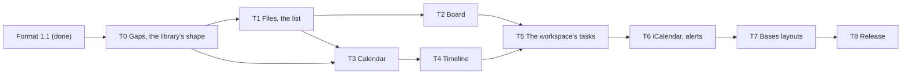

# Tasks Plan

S4 and S5 of the Sample Plugins Plan (`plans/Sample Plugins Plan.md`), given by the user on 18 Nov as one plugin: Tasks.
It opens `.task` files, written in the user's Tasks format (`@type32/tasks`, `../tasks`: one format for todos, calendar
events and timelines), and shows them as a list of reminders, a board, a calendar and a timeline. It replaces the
board first planned as S4 (a file type, a viewer that loads text, a link extractor) and the Bases calendar of S5
(`requires`, a core plugin's API): its calendar and timeline are also Bases layouts.

Four things are written, in four places:

| What | Where | Whose |
| --- | --- | --- |
| The plugin, `tasks` | `../vertex-plugin-tasks`, `CTRL-Neo-Studios/vertex-plugin-tasks` | A community plugin, written and released as the other samples are. |
| The views' components: list, board, calendar, timeline, and the task editor | `../tasks-ui-components` (the user's folder, empty on 18 Nov) | A library of its own, subsidiary to `@type32/tasks`: Vue components drawn with Nuxt UI, for Nuxt and for Vue (the user, 18 Nov). Written here; the user publishes it, as the SDK. |
| Format 1.1: views and `starred` | `../tasks` (`@type32/tasks`) | The user's library. Written here on 18 Nov (Format 1.1, below); the user publishes it. |
| What the contract lacks | Vertex | The Sample Plugins Plan's rule: a gap is closed in Vertex before the sample goes on. |

Each phase ends reviewable on its own: the plugin and the library building, type-checking and their tests passing;
Vertex's `typecheck`, tests, lint and Rust tests clean when Vertex changed; checked in `tauri dev`.

## What was read first (18 Nov)

- **The format** (`../tasks/SPEC.md`, `README.md`, 0.1.2 on npm): a document of `lists`, `fields` and `tasks`, as
  JSON, YAML or TOML. A task's kind comes from its times (`start` with `end` or `duration`: a span; `start` alone: a
  moment; no `start`: a todo, maybe with `due`). Everything that describes a task is in `values` by field id
  (`status`, `priority`, `tags`, `progress`, `location` built in; custom fields with options that map to fixed
  categories). Records are synced by `id` and `updatedAt`, deleted by `deletedAt`; every object keeps keys it doesn't
  define. A Markdown note can hold one task under `task:` in its frontmatter, its body the notes. The library gives
  `parse`, `stringify`, `validate`, `resolveFields`, `occurrences` (recurrence in a range), `completeTask`, `merge`,
  `toICS` and `fromICS`, `parseMarkdown` and `stringifyMarkdown`.
- **Its cost** (`../tasks/bench/baseline.json`, Node, 1,000 tasks): parse 2 ms (JSON) to 6 ms (YAML), validate 2 ms, a
  month of occurrences 9 ms, write 2 ms (JSON), 3 ms (TOML), 26 ms (YAML; 8.5 ms since Format 1.1). Nothing there asks for Rust, and a community
  plugin can't run any. The one thing that would be slow, finding the notes that are tasks among thousands, the index
  has done already: every note's frontmatter is in `properties`, so `properties.task` is read, not parsed.
- **The Nuxt UI calendar template** (`nuxt-ui-templates/calendar`, MIT): 13 components (month, week and day views,
  event blocks and chips, a draft, a form, a popover; 2,150 lines), composables for dragging, drafting and moving
  (1,700 lines) and layout maths. Its data is `useFetch` against a server, routes and `useState`: that part isn't
  taken. It uses `date-fns` and `@internationalized/date`, and `UPopover`, `UCalendar`, `UInputDate`, `UInputTime`,
  `UContextMenu`.
- **The contract**, against what the plugin needs. What's there: a file type with New, a viewer that loads and saves
  text, an embed, a link extractor, a panel view, commands, config, `ctx.data`, the index and its events, notes
  written as one undo step, `NoteEditor`, dialogs through `useOverlay`, Bases' `registerView`. What isn't: Gaps.

## Decisions

The user's, 18 Nov (the questions asked before this plan, and the answers to its first open questions), unless marked mine.

| Question | Decision |
| --- | --- |
| What holds tasks | `.task` files, and notes that are tasks (`task:` in frontmatter) across the workspace, in a workspace Tasks panel. |
| Views of a `.task` file | List (reminders, as the user's first screenshot), Board, Calendar, Timeline. No Table. |
| Timeline | A Gantt, as the third screenshot: an outline on the left (subtasks under their parent, duration, progress), bars on a day axis, dependency lines, today's line. |
| The text of a `.task` file | New files are YAML. JSON and TOML are read too, and a file is written back in the format it was found in. |
| A file's view settings | In the file, so they travel and sync with it. The format defines them (the user: if the library providing it is better, do it): `views`, records like lists, each with a `type` (`list`, `board`, `calendar`, `timeline`, `table`), `groupBy`, `sortBy`, `sortDescending`, `listIds`, `openOnly`, `scale`; `viewTasks()` filters and sorts. What only Vertex draws (a column's width) is an extra key on the view. Done in Format 1.1. |
| Bases | A last phase offers the Calendar and the Timeline as Bases layouts, a base's rows placed by date properties (S5's point: `requires`, `ctx.use('bases')`). |
| Extras | iCalendar import and export, and alerts when a task is due. Each needs an SDK addition (Gaps). |
| The components' home | All four views and the task editor are a standalone library in `../tasks-ui-components`, using Nuxt UI, for Nuxt and Vue (the user named the calendar and the timeline, then the list and the board). The plugin holds the file, the store, the panel, Vertex's menus and the Bases layouts. |
| The library's name (mine) | `@type32/tasks-ui-components`, as its folder. |
| How the library is built (mine) | Compiled ES modules with types; `vue`, `@nuxt/ui`, `@internationalized/date` and `@type32/tasks` are peers. Its templates import Nuxt UI's components by file (`@nuxt/ui/components/Button.vue`), so no consumer needs auto-imports or global registration. A `/nuxt` module only adds the package to `build.transpile` (a server render can't import `.vue` from `node_modules`) and its stylesheet. |
| How the library is styled (mine) | Tailwind utilities under its own prefix (`tk:`), compiled into one stylesheet the consumer imports. Colours, radii and fonts are Nuxt UI's CSS variables, so it follows the consumer's theme. No consumer Tailwind setup, and no clash with the consumer's own utilities: the reason Vertex's plugins carry `tw:`. |
| What the components take (mine) | The format's own objects: the document, the view, a time zone, a locale, a first day of the week, labels. They draw and report (`change` with a patch, `create`; the same for lists); they write nothing. The consumer applies a patch with the library's `applyPatch` (stamps `updatedAt`, removes keys set to `undefined`); a Bases layout turns the same patch into a property write. Completing is a patch too (`toggleDone`, the format's `completeTask`). |
| Dates in the components (mine) | `@internationalized/date` (what Nuxt UI's date inputs take) and `Intl`. No `date-fns`. Recurrence and what a task's times mean come from `@type32/tasks`. |
| What's taken from the template (mine) | Its views, layout maths and drag behaviour, ported to the format's tasks and the library's prefix; its licence notice kept. Not its data layer, routes or sidebar. |
| Editing a task (mine) | One editor, the library's: title, notes, Do (`start`), Due, repeat, list, status, priority, tags, star, the document's custom fields. Inline in the list (the screenshot's card), a popover elsewhere. Notes are a slot, a textarea by default; the plugin draws them with a read-only `NoteEditor`, editable once clicked (as a canvas card), so the title keeps the focus (an editable `NoteEditor` takes it when drawn). |
| The screenshot's flags | The flame is priority (mine). The star is a task key, `starred` (the user: a task property), in Format 1.1. |
| Saving (mine) | The document is parsed once and kept; an edit changes it in memory and the file is written after a pause (`stringify`, which validates). A file that doesn't validate shows its problems by path, and isn't written over. |
| A file changed outside while open (mine, changed in T1) | The tab's rule, as for every text viewer: it reloads the text only while nothing is unsaved, and the viewer reads it again. The `merge` first planned had nothing to do: the tab never hands over outside text while edits wait. |
| Deleting (mine) | `deletedAt`, as the format says. Deleted records are hidden. |
| Alerts (mine) | While Vertex is open on the workspace: a system notification at a task's due time. Vertex can't schedule one for when it's closed. |
| Size (mine) | Measured in T0, not assumed. The plugin bundles `@type32/tasks` (with zod, a Temporal polyfill, `js-yaml`, `smol-toml`: 259 KB minified, 82 KB gzipped, measured 18 Nov) and the components; one `main.js`, as every plugin. |



## Format 1.1

Done before T0 (18 Nov), in `../tasks`; the user published it as `@type32/tasks` 0.2.0. The answers to the plan's
first open questions, 2 to 4.

### As built
- **Views** (`views`, SPEC "View"): synced records, merged like lists. `groupBy` is `listId`, `starred` or
  `values.<field id>` of a select, multiSelect or boolean field; `sortBy` a time, `title`, `starred` or
  `values.<field id>` of anything but a multiSelect; both checked by `validate` (`viewKeyError`), and `merge` drops one
  that a field's change of type broke (a repair, as values have). `type` and `scale` are open strings: a view an app
  can't draw is skipped and kept, never an error that makes the document unreadable. Sorting is the spec's, so apps
  agree: times as written (a date before the times on its day), selects by option order, missing values last, ties
  in document order. `viewTasks(doc, view, fields)` does it; grouping is the drawing's.
- **`starred`**, a task key, not a built-in field: a 1.0 reader rejects a `values` key it has no field for, and keeps
  a task key it doesn't know. Both additions read in 1.0 readers as unknown keys.
- **The YAML writer is `js-yaml`'s** (the user preferred it; `yaml` was there for 1.1-safe quoting). Its `dump` with
  double quotes writes the same text: every test passed unchanged, including the ones reading the output with a
  YAML 1.1 parser, and 54 strings a reader could take for another type or for syntax (`yes`, `0o17`, `12:30`,
  `2026-11-12`, `- a`, `#c`…) read back the same in YAML 1.1, 1.2 core and `js-yaml`. Writing 1,000 tasks: 22.1 ms
  to 8.3 ms. `yaml` is a dev dependency now (the tests); the bundle went from 294 to 259 KB minified (94 to 82 KB
  gzipped), measured twice.
- Tests: 304 (were 283): view rules, the merge repair, `viewTasks`, conformance cases for views and `starred`.
  `bun run check` passes. `bench/baseline.json` rerun.

## Gaps

Found by reading, before anything is written. T0 closed the first two (checked: a `CalendarDateTime` of another copy
of the package is not one to Reka's `isCalendarDateTime`, of Vertex's copy it is); T6 closes the others.

| What's missing | Who needs it | Today |
| --- | --- | --- |
| `@internationalized/date` as a shared module | Any plugin with a date or time input | Closed in T0. Nuxt UI's inputs (Reka's `isCalendarDateTime`, `isZonedDateTime`) test values with `instanceof`; a plugin that bundled its own copy handed them objects of another class, and `UInputDate` took a date-time for a date. |
| Nuxt UI's components by import | A plugin that uses a component library built on Nuxt UI | Closed in T0. The preset refused every `@nuxt/ui` import but `/composables`: components were the host's, by name only. |
| Reading and writing a file picked in a dialog | Import and export (iCalendar) | `ctx.dialogs.open` and `save` return a path that "is this window's to read or write", and a community plugin has nothing to do either with: the core plugins that export (Canvas, Bases) import Tauri's fs. |
| Notifications | Alerts | Nothing in the contract. The kernel has the permission and the Tauri plugin. |

Not gaps, checked: `ctx.use('bases')` is typed for a community plugin (Bases is core); a viewer gets its file's text
and saves it; `session.files.edit` writes notes as one undo step; a plugin's dialog draws since the Navigator Plan.

## T0: Gaps and the library's shape

The risky part first: a component library on Nuxt UI inside a plugin. Nothing of the plugin's features yet.

### Change
- **Vertex:** `@internationalized/date` in `SHARED_PACKAGES`. The preset maps an import of a Nuxt UI component's file
  to the host's component of that name, and still refuses the rest of `@nuxt/ui`; a test in the SDK.
- **The library:** its repository, build (ES modules, types, the prefixed stylesheet), the `/nuxt` module, and one
  component that exercises what the real ones will: a button in a tooltip, a popover holding `UInputDate` and
  `UInputTime`, a class of each kind (a colour, a spacing, a variant).
- **Three consumers of that component:** a Vue app with `@nuxt/ui/vite`, a Nuxt app rendered on the server, and a
  Vertex plugin (`vertex-plugin-tasks`' first commit), each drawing it styled, light and dark.
- **Measured:** the plugin's `main.js` with `@type32/tasks` and the library in it, and what loading it costs a window.

### Acceptance
- [x] The component draws and works in the three consumers: the tooltip, the popover, a date and a time picked, the
  theme's primary colour followed.
- [x] In the plugin, a `CalendarDateTime` made by the plugin is taken as one by `UInputDate` (it shows its time).
- [x] The sizes and the load time, in this plan; a decision on splitting if they ask for one.

### As built
- **Vertex** (uncommitted, for the user): `@internationalized/date` in `SHARED_PACKAGES` (`shared/plugin/modules.ts`),
  the host's copy in `MODULES` (`app/utils/plugins/community.ts`), a dependency of the app and of the SDK (its
  versions test pins it). An import of a Nuxt UI component's file becomes the host's component: the SDK's build writes
  `nuxt-ui-components.json` (public path → name, from the list it already types components by), the preset maps each
  such import to `__vertexModules['@nuxt/ui/components']('UButton')` (`NUXT_UI_COMPONENT`: the host puts
  `app.component` there). A call with the name as a string, because a minified plugin turns `["UButton"]` into
  `.UButton` and the host preloads the components it finds named in quotes (`namedIn`). SDK tests: 8 (one new: the
  import gives the host's component and its name survives minifying, built minified). Docs: `package.md`, `ui.md`
  (a component library inside a plugin, `shallowRef` for dates), `versions.md` (1.4.0), Concepts and Structures,
  SMOKE 134. Vertex's typecheck at the 7 baseline errors, 391 tests, lint clean.
- **The library** (`../tasks-ui-components`, uncommitted, `git init` only, for the user to publish): `TaskProbe`.
  Code by Vite's library mode (`dist/index.js`, `dist/nuxt.js`; `vue`, `@nuxt/ui`, `@internationalized/date`,
  `@type32/tasks`, `@nuxt/kit` external), types by `vue-tsc`, the stylesheet by Tailwind's CLI (Vite's library mode
  won't take a CSS entry, and a CSS import in the code would reach the declarations). `style.css` declares Tailwind's
  layer order first, so loaded before the consumer's sheet it can't move `utilities` ahead of `base`; it sources
  `./components` explicitly, so a `.gitignore` changes nothing. The Nuxt module adds the sheet and transpiles the
  package; checked that it must: without it the production server answers 500 (`Unknown file extension ".vue"` for
  Nuxt UI's `Button.vue`). `README.md`, MIT `LICENSE` (holder "Type32", for the user to correct).
- **Consumers**, each from the packed library (`bun pm pack`, as npm would ship it): a Vue app (`@nuxt/ui/vite`),
  dev and production build; a Nuxt app, dev and production server (the probe's value in the server's HTML, no
  hydration warning); Vertex (`tauri dev`, the plugin installed from its `dist/`, by a temporary script). In all
  three: the tooltip, the popover, the date input with hour and minute segments, the value following the inputs, the
  library's `tk:px-6` beating Nuxt UI's own padding on `UButton` (24 px: its sheet loads after the app's), dark mode,
  and in Vertex an emerald theme followed.
- **The plugin** (`../vertex-plugin-tasks`, first commit, local): a `.task` viewer that parses the file
  (`@type32/tasks` 0.2.0 from npm, the user's release of Format 1.1) and draws the probe. The SDK and the library are
  `file:` dependencies until their releases. Found: `ref(new CalendarDateTime(…))` doesn't type-check (Vue's
  `UnwrapRef` drops the class's private fields); `shallowRef`, which a date (immutable) wants anyway.
- **Measured:** `main.js` 290 KB minified, 77 KB gzipped, almost all `@type32/tasks` (259 KB alone: zod, the
  Temporal polyfill, `js-yaml`, `smol-toml`); the library adds a few KB. Parsing and running it again in a window:
  15 to 25 ms (eight runs, dev build, light and dark runs alike). No split: a few frames, once per window that loads
  the plugin.

## T1: Files and the list

### Change
- `plugin.json` (`tasks`, "Tasks"); the `.task` file type with New (a YAML document with one list); a viewer that
  loads text.
- The store: the format sniffed (JSON, TOML, else YAML) and kept; `parse`, problems shown by path with the file left
  alone; edits in memory with `updatedAt`, `deletedAt` for deletes, unknown keys kept; the write after a pause; a
  file changed outside (Decisions).
- The view switcher over the file's `views` (a new file has a List and a Board), and the List, in the library:
  sections (Today, Upcoming, Anytime, Done; or `groupBy`), a row as the screenshot (the checkbox, the title, the
  list's dot, the star, the priority, Do and Due), the inline editor, a new task typed at the top, `completeTask` on
  the checkbox (a repeating task moves on), subtasks under their parent, lists in a side column.
- The task editor, in the library (Decisions). Settings: the first day of the week, the time zone shown (the
  system's by default).

### Acceptance
- [x] A new `.task` file opens, takes tasks and reopens with them; the file on disk validates against the library.
- [x] A JSON and a TOML document open and are written back as they were, an unknown key still there.
- [x] A file with an error says where, and isn't written over; fixed outside, it opens.
- [x] Completing a weekly task moves it to next week; completing its last occurrence marks it done.
- [x] 5,000 tasks: opening, typing in one and scrolling the list without a pause over 200 ms.

### As built
- **The library** (`../tasks-ui-components`, uncommitted): `TaskList` (a new task typed at the top, the rows of
  `taskRows`, one open for editing, the lists column, which hides itself under 42rem), `TaskRow`, `TaskEditor`,
  `DatePicker` (a calendar, a time for Due), `FieldInput` (a field's value by its type). The rows are pure
  (`rows.ts`): the format's `viewTasks`, then sections (Today with overdue, Upcoming, Anytime, Done with cancelled;
  Today and Upcoming by day unless the view sorts; a zoned time on the viewer's day), or groups by `listId`,
  `starred`, a select's options in order then values outside them, a multiSelect's values (a task in each), a
  boolean; subtasks under a shown parent. Only the rows on screen are drawn (`@tanstack/vue-virtual`, measured
  heights). The edits are pure too (`changes.ts`): `toggleDone`, `withStart` (a span keeps its time and length),
  `withDue`, `withRepeat`, `withValue`; a change of the anchor's form drops what had the old form (`until`,
  `excludedDates`). Built-in fields' and options' titles are labels (translated), a document's own title for one wins.
  Labels: every string a component shows, English by default, a consumer's over them. 8 tests (vitest). `@tanstack/
  vue-virtual` a dependency, `@type32/tasks` a peer. T0's probe is gone.
- **The plugin** (`../vertex-plugin-tasks`, committed locally): the `.task` file type with New; `TaskViewer` (the
  document kept, each edit checked whole by `validate` and refused with the format's message when it would break the
  file, written 300 ms after the last one in the file's own format; the tab autosaves); `document.ts` (the format
  sniffed, a new file's document, `withRecord`); `ViewBar` (the file's views, Add view, a view's name, grouping,
  sorting, Hide done tasks, Delete view; a file without views shows a List, written once its options change; a view
  of a type not drawn yet says so); `TaskNotes`; settings: the first day of the week (`auto`: the language's, from
  `Intl.Locale`'s week info) and the time zone (empty or invalid: the system's). Strings in `en` and `zh-CN` (the
  components' under `ui.*`). 7 tests (`bun test`): the sniffing, a new file valid, JSON and TOML kept, a broken
  file's issue paths, `withRecord`, and `en.json` having every component string.
- **Checked** in `tauri dev`, by script (a temporary page script running code sent from the shell), devtools off: a
  new file written at once and reopened with its tasks; tasks typed; an editor opened (the title focused), a Due
  picked on the calendar, notes written in the `NoteEditor` with a `[[link]]`, a list added and a task filed there,
  the view grouped by status (written to the file); JSON and TOML files completed and still JSON and TOML with `x-app`;
  the broken file's `tasks.0.title` shown, the file untouched, fixed outside and shown; the weekly task to Nov 25,
  then done with `count` used up. Every file written validates: `stringify` validates before it writes.
- **Measured** (5,000 tasks, 740 KB of YAML, dev build): a first open 79 and 89 ms (two copies of the file), the
  longest frame after it 19 to 27 ms; a keystroke in a title 33 to 38 ms to the second frame after it (two frames);
  the write after the pause one 55 to 57 ms frame (twice); scrolling the whole list 600 px a frame, median 17 ms,
  worst 101 and 90 ms (two runs), 34 rows drawn. `main.js` 406 KB minified, 107 KB gzipped (T0's 290 KB used
  `parse` alone: the writer, `validate` and the rest of the format arrived with the edits).
- **Found, in Vertex:**
  - The SDK's `modules.json` listed Vue's exports from its types, which leave out what Vue's compiler imports:
    `mergeModels` (a component with `defineModel` beside `defineProps`) failed the plugin's build ("not exported by
    vertex-shared:vue"). Closed: the build adds the runtime's own names for `vue` (174, were 164). `versions.md`
    (1.4.0), Concepts and Structures.
  - A workspace opened by a path through a symlink (`/tmp/tk-ws`, which is `/private/tmp/tk-ws`) gets every outside
    change wrong: the watcher reports the real path, which the index doesn't have, so a changed file is added again
    (a second `new.task` in Files), a reload never reaches its tab, and the session stores paths cut at the wrong
    place (`mp/tk-ws/new2.task`). Not closed: Watcher Plan territory. Whether the Open dialog ever hands over such a
    path (a folder reached through a link) isn't checked. Open questions, 2.

## T2: Board

### Change
- The library's `TaskBoard`: columns by the view's `groupBy` (status, any select or boolean field, list); a column
  an option, its colour; cards dragged between columns (the value written) and within one; a card as the list's row;
  new task in a column.
- Statuses added and renamed from the board (options on the built-in field, each with its category).

### Acceptance
- [x] A card dragged to Done has `status: done` in the file, and shows done in the List.
- [x] A custom status added on the board is an option under `fields` with its category, and another reader of the
  format (the library's `statusOf`) reads the task's meaning.

### As built
- **The library** (uncommitted): `TaskBoard`, `BoardColumn` (header, cards drawn only while on screen, New task at the
  foot, the drop's place), `TaskCard` (the row's checkbox and description, `TaskCheck` and `TaskMeta`, now shared
  with `TaskRow`; its editor in a popover). Columns are `taskGroups`, the list's grouping made public: every group,
  empty or not, a deleted list or option only while a task has it; `NONE` hidden while empty. A board without
  `groupBy` is by status (`boardGroupBy`). `board.ts`, pure: `moveToGroup` (into a done status, `completeTask` with
  the dropped option kept, a repeating task moved on as the checkbox does; out of done, `completedAt` removed; a
  multiSelect swaps the column's value; None clears), `moveTask` (order within a column: the document's, which the
  format doesn't sync, so no `updatedAt`), `withOption` (a built-in field gets an entry for a renamed option),
  `optionId` (from the title: `waiting-on-client`, `进行中`). Dragging is HTML's (Vertex's windows have
  `dragDropEnabled: false`, as Bases' kanban relies on). While the view sorts, cards keep its order and only change
  column. 15 tests (7 new). The palette is shared with the list (`PALETTE`).
- **The plugin** (committed locally): the viewer draws a view by its type (`list`, `board`), applying `move`,
  `changeOption` and `createOption` too; a board's Group by offers no Date. Strings for Add column, its name, Means,
  Cancel.
- **Checked** in `tauri dev` by script (drags as `DragEvent`s with a `DataTransfer`): a card to Done (`status: done`,
  `completedAt`; in the List's Done); a column Shipped added as done (`fields: [{id: status, options: [{id: shipped,
  category: done, …}]}]`), a card dropped there (`statusOf` of the file read by Node: `done`); a card dropped above
  another in a column (written before it); To do renamed Backlog (an option `todo` with a title; no Delete offered
  for a built-in status). Not checked: a card's editor in its popover.
- **Measured** (5,000 tasks, three statuses, dev build): opening the board 110 ms, the longest frame after it 20 ms,
  16 cards drawn a column; a drag between columns 46 ms to the frame after it; scrolling a column of 1,667 cards
  median 17 ms, worst 25 ms. `main.js` 424 KB minified, 111 KB gzipped.

## T3: Calendar

In the library, then in the plugin.

### Change
- **Library:** `TaskCalendar`: month, week and day, after the template. Spans as blocks and chips, moments and dues as
  markers, all-day and multi-day rows, repeating tasks through `occurrences`, time zones (the viewer's zone decides
  the day), a line for now, a mini month. A drag on empty time drafts a task; a drag on a task moves it, on its edge
  resizes it. It reports; it writes nothing.
- **Plugin:** the Calendar view: lists shown and hidden by their colour, the report applied to the document, the
  editor on open, a move of one occurrence of a repeating task asking "this one or all" (this one: `excludedDates`
  and a new task).

### Acceptance
- [ ] A weekly meeting in `Europe/Berlin` shows at the right hour in another zone, across a change of clocks.
- [ ] A task dragged to another day, and one stretched, have the new times in the file, in the form they had (a date
  stays a date).
- [ ] The library's tests: laying out overlapping spans, a month's weeks, an all-day span over a week's end.
- [ ] A month of 1,000 tasks draws and drags without a pause over 200 ms.

## T4: Timeline

### Change
- **Library:** `TaskTimeline`: the outline (title, duration, progress; subtasks under their parent, folding), bars for
  spans, a diamond for a moment, a due as a mark, dependency lines from `dependsOn`, today's line, a day, week and
  month scale, both sides scrolling together. A bar dragged or stretched reports its new times; a line drawn from one
  bar to another reports a dependency.
- **Plugin:** the Timeline view: the reports applied; a dependency that would make a loop refused with the format's
  own message; the bar's menu (Edit, Duplicate, Delete, its list as colour).

### Acceptance
- [ ] The third screenshot's structure from a document: groups, their subtasks, durations, progress, bars.
- [ ] A dependency drawn is in `dependsOn`; one that would loop isn't written.
- [ ] 2,000 bars scroll both ways without a pause over 200 ms (rows drawn as they're scrolled to).

## T5: The workspace's tasks

### Change
- **Notes that are tasks:** read from the index (`properties.task`), validated together with the `.task` files'
  documents where they refer to each other; an edit writes the note's frontmatter (`stringifyMarkdown`, one step of
  Files' undo), its body untouched.
- **The Tasks panel:** Today, Upcoming and Overdue across every `.task` file and task note of the workspace; a task
  opens its file at that task, or its note.
- **In notes:** `![[x.task]]` draws the file's first view (an embed); the links in tasks' notes are the index's (a link
  extractor, so backlinks and renames see them); a note's menu: Make this note a task.

### Acceptance
- [ ] A note with `task:` shows in the panel and on a `.task` file's calendar set to show the workspace's; checked
  off there, its frontmatter has the new status, its body the same bytes.
- [ ] Renaming a note a task's notes link to updates the link in the `.task` file.
- [ ] A workspace of 12,000 notes, 500 of them tasks: the panel opens without a pause over 200 ms.

## T6: iCalendar and alerts

### Change
- **Vertex:** the text of a file picked with `ctx.dialogs.open` read, and text written to one picked with `save`
  (`ctx.dialogs.readText`, `writeText`: only what this window picked). `ctx.notifications.send({title, body})`,
  behind a new permission, `notifications`, which the install dialog names. Docs, tests, the SDK's next minor.
- **Plugin:** Import… (`fromICS`, what was dropped listed) and Export… (`toICS`) on a `.task` file. Alerts: at a
  task's due time while a window has the workspace open; each once (remembered in `ctx.data.global`); a setting.

### Acceptance
- [ ] A calendar exported from another app imports, with what couldn't be listed; exported again, another app opens it.
- [ ] A plugin without the permission can't notify; with it, a task due in a minute notifies once, not again after a
  relaunch.

## T7: Bases layouts

### Change
- `requires: ["bases?"]`; with Bases on, two layouts registered (`ctx.whenPlugin('bases', …)`): Calendar and Timeline,
  the library's components over a base's rows. The layout's options: which property is the start, the end, the due.
- A row dragged writes its note's property (as Bases' own edits do); a click opens the note; an empty day makes a new
  item with that date.

### Acceptance
- [ ] The layouts are offered in a `.base` file and in a ` ```base ` block; with Bases off, the plugin runs without them.
- [ ] Changing a note's date moves it on the calendar without reopening the base; dragging it changes the note.

## T8: Release

### Change
- The library published by the user; the plugin on the published library and SDK, released from its workflow.
- Strings in `en` and `zh-CN`; `README.md` for both; the author docs for what T0 and T6 added to the contract;
  `Concepts and Structures.md`; SMOKE rows.
- The Sample Plugins Plan's S4 and S5 ticked with what this plan built.

### Acceptance
- [ ] Installed from its release (`plugin.zip`), the plugin runs with every view on a document of the user's own.

## Not in this plan

- A Table view; a year view; printing.
- Sync between devices beyond what a synced folder does (the format's `merge` is used for a file changed outside, no
  more).
- Alerts while Vertex is closed.
- Attendees, alarms and what else iCalendar has that the format doesn't.
- A Rust implementation of the format. The numbers don't ask for one, and a plugin couldn't use it. If the format
  becomes the kernel's, its conformance suite (`../tasks/conformance`) is what a second implementation is held to.
- Windows and Linux runs: no machine here.

## Open questions

1. **Order within a board column.** Dragging a card up or down reorders the document's tasks, and the format doesn't
   sync order (a merge keeps the first copy's). Enough for a file one person edits; a `rank` key would be the
   format's next minor if two devices reorder the same column.
2. **A workspace by a symlinked path** (T1, Found). The fix is the watcher's: compare event paths with the root's
   real path (resolved once when it starts), or open workspaces by their real path. Yours to schedule, in the Watcher
   Plan or here before T5 (which reads the index the most).
